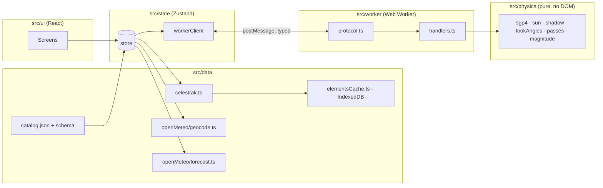

# What Is In Your Sky Right Now — Technical Plan

| Field | Value |
|---|---|
| Status | **Draft v0.22 — for review.** Plans SPEC v2.14 "one sky on a desk": the decisions are §2.50 (D-1094..D-1108 this plan's, D-1109..D-1128 the blocks its tasks spend) and the delivery is §16.33 (P10 first, then R182–R191 in six waves, auto-merged; 2.14.0 tagged by the owner), in `docs/sdd/phases/v2.14/plan.md`. Every earlier status line, word for word, is in the [revision history](#revision-history) at the end of this document. |
| Date | 2026-11-04 (v0.22). Earlier dates are in the [revision history](#revision-history). |
| Input | `SPEC.md` v2.14: V214-1..V214-22 are fixed like the rows before them, and SPEC §5.18's proposal is adopted where §2.50 does not say otherwise. Earlier inputs are in the [revision history](#revision-history). |
| Scope | Architecture, project structure, module boundaries, data model, worker contract, testing strategy, the Task Zero physics spike, and how the tasks of every phase from v1 on are delivered (§16). **No task breakdown** — that is `sdd-breakdown`'s job. |

---

## 1. Fixed Inputs

These come from the spec's Decision Log and are not up for debate in this plan:

- **No backend in MVP.**
  Static site; browser talks to CelesTrak and Open-Meteo directly.
  Elements cached in IndexedDB, refreshed at most every 2 h.
- **Catalog** is a hand-maintained JSON of ~30 objects with intrinsic magnitudes and provenance.
- **Twilight rule:** list passes when the sun is below −6°; label passes with the sun between −6° and −12° as "sky still bright".
- **CelesTrak CORS** is verified; fallback order is the community TLE API, then pulling the v1 proxy forward.
- **Stack:** React + TypeScript + Vite, static deploy.
- **Sky chart (UX-1):** a 3D ASCII sky dome the user can rotate and tilt, plus a 2D polar fallback over the same data; both DOM-only, no WebGL, no canvas.
  Monospace / terminal aesthetic across the whole UI.

From SPEC v1.0's Decision Log (V1-1..V1-11), fixed for the v1 phase:

- **Still no backend.** v1 stays browser-direct against CelesTrak and Open-Meteo; the caching proxy, Nominatim and the full `visual` group move to Phase 3.

From SPEC v1.1's Decision Log (V11-1..V11-13), fixed for the v1.1 phase:

- **v1.1 comes after the v1.0.0 tag** (V11-1); the Moon lore line sits behind a build flag, off by default (V11-2).
- **Compact gets a settings page and a one-row header; every control row fits 36 cells; the chart is full-bleed and at least square and fills 90 % of its box at every width** (V11-3, V11-4).
  A 390 px mockup set gates the home, settings and detail tasks.
- **The sky window is a third view, SVG, touch devices only, fixed by a spike the owner runs on a phone** (V11-5); **the legend replaces every name, time and caption on the drawings** (V11-6); **live-page arcs appear, grow and fade** (V11-7); **the live link moves beside the title** (V11-8).
- **All fifty open review findings are in scope, one findings task per lane in the first wave** (V11-11); **CI has a 10 min budget on pull requests and the capture set runs on `main`** (V11-10); **headings are true north** (V11-12); **desktop mid widths are fixed by rule with a 1024 px profile** (V11-13).
- **Delivery reuses the driver with lanes recut** (V11-9): `ui`, `chart`, `window`, `live` (and `data` for its three findings).
- **Two languages**, English and Spanish, as a preference rather than a route.
- **The dome is the default view again**, in colour, under a CSP relaxed by exactly one directive; its composition is fixed by a spike before the implementation task.
- **72 hours** of passes and forecast, stored automatically, with the app shell served by a service worker.
- **Tasks are delivered in lanes and waves** by a driver script, one model per task, auto-merge with an owner gate on anything visual (§16).

From SPEC v2.4's Decision Log (V24-1..V24-12), fixed for the v2.4 phase:

- **The stars are a section, `#stars`, built on the window, with one tap to the sky screen** (V24-1, V24-2); **the catalogue is stars to 4.5, the 88 figures and five planets, built at build time** (V24-3); **the window gets a hand camera on that page only** (V24-4).
- **Positions on the main thread, geometric, one rotation per shown instant** (V24-5); **the page opens on the pole side at 35° and shows now** (V24-6, V24-7).
- **A star is a character placed exactly, and the spike is the only thing that reopens it** (V24-9); **a spike first, the owner on a phone** (V24-8); **the compact link is the When pane's, `s` is the key** (V24-10).
- **One release, at v2.5** (V24-11); **the fixtures come from IAU SOFA and JPL Horizons** (V24-12).

From SPEC v2.3's Decision Log (V23-1..V23-10), fixed for the v2.3 phase:

- **Three phases in order — the design system, the stars, one sky view** (V23-1); this plan covers the first and nothing of the other two beyond the four chart tokens they will draw with (V23-8).
- **Pixel-identical except named moves; the re-shot capture set is the proof** (V23-2); **the one named move is F-98's degree labels, and board 1B's 1.2 rem stays** (V23-5).
- **Night restates colour and nothing else** (V23-3); **primitives are components, not a CSS framework** (V23-4); **enforcement is a test, not a linter dependency** (V23-7); **the guide is generated markdown plus a dev-only page, and a canvas is a handoff** (V23-6).
- **One breakpoint syntax, the height queries named** (V23-9), which sets **the browser floor at Safari 16.4, Chrome 104, Firefox 63** (V23-10).

Everything in spec §5 ("Technical Architecture", marked *proposal*) was reviewed.
Where this plan agrees, it is simply adopted below.
Where it disagrees, the disagreement and rationale are in §2.

---

## 3. Architecture Overview

**Dependency rules** (enforced with `eslint-plugin-import-x` `no-restricted-paths`, one zone per row, D-28; test files are exempt):

| Module | May import from | Must not import |
|---|---|---|
| `src/physics` | `satellite.js`, `astronomy-engine`, `src/physics/*` | React, DOM APIs, `src/data`, `src/state`, `src/ui` |
| `src/worker` | `src/physics`, `src/worker/*`, shared types | React, DOM (other than the worker global), `src/data`, `src/state` |
| `src/data` | `idb`, `zod`, shared types | React, `src/state`, `src/ui`, `src/worker` |
| `src/state` | `src/data`, `src/worker/protocol` (types only), `src/lib` | `src/ui`, physics internals |
| `src/lib` | shared types, `src/physics` **types only** — plus, in `lib/skyBodies.ts` alone, `src/physics/sun.ts` and `src/physics/moon.ts` at runtime (D-80); `astronomy-engine` in `lib/skyStars.ts` and `lib/riseSet.ts` (D-1101) | React, `src/state`, `src/data` |
| `src/i18n` | shared types | everything else (catalogs import nothing) |
| `src/ui` | `src/state`, `src/lib`, `src/i18n`, shared types | `src/data`, `src/worker`, `src/physics` directly |
| `src/ui/components/guide/skychart/dome/**` | everything `src/ui` may, plus `@glyphcss/react` | — |
| everything else | — | **`@glyphcss/react`** (the only place it may be imported is the `dome/` directory above) |

Shared types live in `src/model/` and import nothing.

v1 additions to the rules: `src/i18n` is imported by `src/ui` only — `lib/` returns message *keys and parameters*, never rendered sentences, so a phrase helper cannot hard-code one language (FR-I18N-2).
The service worker (`/sw.js`, which `vite-plugin-pwa` writes into `dist/`) is generated by the build (D-79) and imports nothing of ours.

---

## Map

The rest of this document is cut by phase (FR-SDD-3, `scripts/sdd/split.ts`).
Every id resolves through [`docs/sdd/ids.md`](docs/sdd/ids.md): `npm run sdd:id <id>` prints it with its file and heading, and an old section number (`SPEC §4.47`, `PLAN §16.4`) has a line there too.

| Phase | Spec | Plan | Tasks |
|---|---|---|---|
| mvp | [spec](docs/sdd/phases/mvp/spec.md) | [plan](docs/sdd/phases/mvp/plan.md) | [tasks](docs/sdd/phases/mvp/tasks.md) |
| v1 | [spec](docs/sdd/phases/v1/spec.md) | [plan](docs/sdd/phases/v1/plan.md) | [tasks](docs/sdd/phases/v1/tasks.md) |
| v1.1 | [spec](docs/sdd/phases/v1.1/spec.md) | [plan](docs/sdd/phases/v1.1/plan.md) | [tasks](docs/sdd/phases/v1.1/tasks.md) |
| v1.2 | [spec](docs/sdd/phases/v1.2/spec.md) | [plan](docs/sdd/phases/v1.2/plan.md) | [tasks](docs/sdd/phases/v1.2/tasks.md) |
| v1.3 | [spec](docs/sdd/phases/v1.3/spec.md) | [plan](docs/sdd/phases/v1.3/plan.md) | [tasks](docs/sdd/phases/v1.3/tasks.md) |
| v1.3.2 | [spec](docs/sdd/phases/v1.3.2/spec.md) | [plan](docs/sdd/phases/v1.3.2/plan.md) | [tasks](docs/sdd/phases/v1.3.2/tasks.md) |
| v1.4 | [spec](docs/sdd/phases/v1.4/spec.md) | [plan](docs/sdd/phases/v1.4/plan.md) | [tasks](docs/sdd/phases/v1.4/tasks.md) |
| v2.0 | [spec](docs/sdd/phases/v2.0/spec.md) | [plan](docs/sdd/phases/v2.0/plan.md) | [tasks](docs/sdd/phases/v2.0/tasks.md) |
| v2.1 | [spec](docs/sdd/phases/v2.1/spec.md) | [plan](docs/sdd/phases/v2.1/plan.md) | [tasks](docs/sdd/phases/v2.1/tasks.md) |
| v2.2 | [spec](docs/sdd/phases/v2.2/spec.md) | [plan](docs/sdd/phases/v2.2/plan.md) | [tasks](docs/sdd/phases/v2.2/tasks.md) |
| v2.2.1 | [spec](docs/sdd/phases/v2.2.1/spec.md) | [plan](docs/sdd/phases/v2.2.1/plan.md) | [tasks](docs/sdd/phases/v2.2.1/tasks.md) |
| v2.3 | [spec](docs/sdd/phases/v2.3/spec.md) | [plan](docs/sdd/phases/v2.3/plan.md) | [tasks](docs/sdd/phases/v2.3/tasks.md) |
| v2.4 | [spec](docs/sdd/phases/v2.4/spec.md) | [plan](docs/sdd/phases/v2.4/plan.md) | [tasks](docs/sdd/phases/v2.4/tasks.md) |
| v2.5 | [spec](docs/sdd/phases/v2.5/spec.md) | [plan](docs/sdd/phases/v2.5/plan.md) | [tasks](docs/sdd/phases/v2.5/tasks.md) |
| v2.6 | [spec](docs/sdd/phases/v2.6/spec.md) | [plan](docs/sdd/phases/v2.6/plan.md) | [tasks](docs/sdd/phases/v2.6/tasks.md) |
| v2.6.1 | [spec](docs/sdd/phases/v2.6.1/spec.md) | [plan](docs/sdd/phases/v2.6.1/plan.md) | [tasks](docs/sdd/phases/v2.6.1/tasks.md) |
| v2.7 | [spec](docs/sdd/phases/v2.7/spec.md) | [plan](docs/sdd/phases/v2.7/plan.md) | [tasks](docs/sdd/phases/v2.7/tasks.md) |
| v2.8 | [spec](docs/sdd/phases/v2.8/spec.md) | [plan](docs/sdd/phases/v2.8/plan.md) | [tasks](docs/sdd/phases/v2.8/tasks.md) |
| v2.9 | [spec](docs/sdd/phases/v2.9/spec.md) | [plan](docs/sdd/phases/v2.9/plan.md) | [tasks](docs/sdd/phases/v2.9/tasks.md) |
| v2.10 | [spec](docs/sdd/phases/v2.10/spec.md) | [plan](docs/sdd/phases/v2.10/plan.md) | [tasks](docs/sdd/phases/v2.10/tasks.md) |
| v2.11 | [spec](docs/sdd/phases/v2.11/spec.md) | [plan](docs/sdd/phases/v2.11/plan.md) | [tasks](docs/sdd/phases/v2.11/tasks.md) |
| v2.12 | [spec](docs/sdd/phases/v2.12/spec.md) | [plan](docs/sdd/phases/v2.12/plan.md) | [tasks](docs/sdd/phases/v2.12/tasks.md) |
| v2.13 | [spec](docs/sdd/phases/v2.13/spec.md) | [plan](docs/sdd/phases/v2.13/plan.md) | [TASKS.md](TASKS.md) |
| v2.14 | [spec](docs/sdd/phases/v2.14/spec.md) | [plan](docs/sdd/phases/v2.14/plan.md) | — |

The Decision Log (SPEC §12): [decisions.md](docs/sdd/decisions.md).
Reference: [glossary](docs/sdd/reference/glossary.md),
[revision-history](docs/sdd/reference/revision-history.md),
[project-structure](docs/sdd/reference/project-structure.md),
[data-model](docs/sdd/reference/data-model.md),
[worker-contract](docs/sdd/reference/worker-contract.md),
[data-layer](docs/sdd/reference/data-layer.md),
[testing](docs/sdd/reference/testing.md),
[build-and-deploy](docs/sdd/reference/build-and-deploy.md),
[traceability](docs/sdd/reference/traceability.md),
[delivery](docs/sdd/reference/delivery.md),
[breakdown-inputs](docs/sdd/reference/breakdown-inputs.md).
