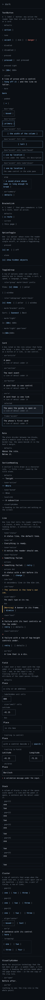
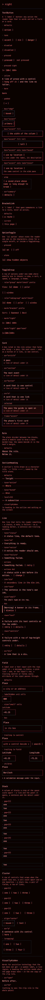
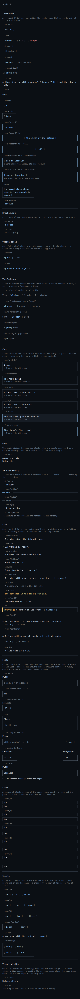
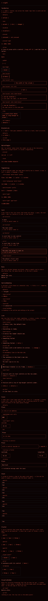

# The design system

<!-- Generated by `scripts/design-guide.ts` from `src/ui/styles/tokens.css` and `src/ui/components/primitives/manifest.ts`. Do not edit: `npm run design:guide` rewrites it, and `tests/docs/design.test.ts` fails when this file differs from what the script writes. -->

The visual identity, written down as one token sheet and the primitives built on it (SPEC §4.45, FR-X-6). A screen is built from these and from nothing else: every length, colour, type size and stacking level a module uses is a token below, every control is a primitive below, and a module that writes a value instead of its name fails `tests/styles/literals.test.ts`. The page that shows every primitive in every state, in both themes, is `dev/primitives.html` — `npm run dev` serves it at http://localhost:5173/dev/primitives.html — and its captures are at the end of this page.

## The sheet

`src/ui/styles/tokens.css`, in the order its sections are written. Lengths are written from the grid — `--row` (1.5 rem, 24 px at the base) and `--cell` (1ch) — and have one value; colours have a dark value and a night value, and the night block restates every colour and nothing else (FR-THEME-1). The contrast beside each colour is what `tests/styles/tokens.test.ts` computes (`scripts/contrast.ts`, WCAG 2.1): text clears 4.5 : 1 on both grounds, a control's edge and a chart mark clear 3 : 1.

### Grid

The source every other length is written from: one character advance (`--cell`), one text row (`--row`), the tap floor and the hairline a rule is drawn with.

| Token | Value | Note |
|---|---|---|
| `--font-mono` | `ui-monospace, 'SF Mono', Menlo, Consolas, 'DejaVu Sans Mono', 'Liberation Mono', monospace` |  |
| `--cell` | `1ch` |  |
| `--row` | `1.5rem` |  |
| `--tap` | `calc(2 * var(--row))` |  |
| `--hairline` | `1px` |  |

### Space

The vertical scale, each step a share of the row, so what sits between two blocks is a whole number of quarter rows. Horizontal space is in cells (`calc(2 * var(--cell))`) and has no scale. `--space-block` is board 1B’s block gap, kept at its value beside the scale (OQ-37).

| Token | Value | Note |
|---|---|---|
| `--space-1` | `calc(var(--row) / 4)` | 6 px |
| `--space-2` | `calc(var(--row) / 2)` | 12 px — the one name for 0.75rem, calc(var(--row) / 2) and 12px |
| `--space-3` | `var(--row)` | 24 px |
| `--space-4` | `calc(1.5 * var(--row))` | 36 px |
| `--space-5` | `calc(2 * var(--row))` | 48 px, = --tap |
| `--space-block` | `1.2rem` |  |
| `--gutter` | `28px` |  |

### Type

Every size-and-line-height pair in use, named for the role of the element that sets it and never for the size, so a later collapse of the ladder (OQ-37) is a value change and not a rename. The chart’s sizes are in px on purpose: the drawings do not scale with the base (OQ-38).

| Token | Value | Note |
|---|---|---|
| `--text-title` | `2rem` | 32 on 38: the next event's time on the home (NextEventBlock) |
| `--text-title-row` | `2.375rem` |  |
| `--text-countdown` | `1.5rem` | 24 on 48: the pass detail's live countdown headline (Countdown) |
| `--text-countdown-row` | `calc(2 * var(--row))` |  |
| `--text-question` | `1.375rem` | 22 on 28: the compact first-run question (FR-FIRST-1; App .coldHeading, Steps .heading) |
| `--text-question-row` | `1.75rem` |  |
| `--text-pane` | `1.25rem` | 20 on 26: the wide board's question and pane headings, the next-event card's time |
| `--text-pane-row` | `1.625rem` |  |
| `--text-heading` | `1.25rem` | 20 on the row: the sheet's and the guide panel's h2, the live readout and headline time |
| `--text-heading-row` | `var(--row)` |  |
| `--text-lead` | `1.125rem` | 18 on 30: the guide's prose (GuideText) |
| `--text-lead-row` | `calc(1.25 * var(--row))` |  |
| `--text-body` | `1rem` | 16 on 24: h1–h3, the card's name, the stripe's hour, the readout's offset |
| `--text-body-row` | `var(--row)` |  |
| `--small` | `0.875rem` |  |
| `--small-row` | `1.25rem` |  |
| `--text-stripe` | `var(--small)` | 14 on 18: the tonight stripe's and the ghost stripe's labels |
| `--text-stripe-row` | `1.125rem` |  |
| `--chart-text-9` | `9px` |  |
| `--chart-text-11` | `11px` |  |
| `--chart-text-12` | `12px` |  |
| `--chart-text-14` | `14px` |  |
| `--chart-text-15` | `15px` |  |
| `--chart-text-18` | `18px` |  |

### Edges

The plain-character borders, the three radii, the one focus ring (`global.css`’s `:focus-visible`, D-704) and the bold weight.

| Token | Value | Note |
|---|---|---|
| `--border` | `var(--hairline) solid var(--rule)` | dividers and card frames |
| `--border-control` | `var(--hairline) solid var(--edge)` | an input's or a button's boundary (WCAG 1.4.11) |
| `--radius-0` | `0` |  |
| `--radius-1` | `var(--hairline)` |  |
| `--radius-2` | `calc(var(--row) / 12)` | 2 px |
| `--focus-ring` | `calc(var(--row) / 12)` | 2 px, the ring's width |
| `--focus-offset` | `calc(var(--row) / 12)` | 2 px, the ring's offset |
| `--focus-offset-tight` | `var(--hairline)` | the two stripes' ring sits closer (TimeStripe, StripeOverview) |
| `--weight-bold` | `700` |  |
| `--window-fill-opacity` | `0.88` |  |
| `--chart-hairline` | `calc(var(--hairline) * 0.75)` |  |
| `--screen-overlay-alpha` | `85%` |  |

### Layers

Every `z-index` in the tree, named for what stands at it. A module names the level and never writes the number.

| Token | Value | Note |
|---|---|---|
| `--z-raised` | `1` | a badge or a card's control lifted over its neighbours; the chart's bottom overlay |
| `--z-raised-2` | `2` | over the raised: the moon glare's and the cloud badge's popover, the sky screen's veil |
| `--z-sheet` | `10` | the pass detail's full-screen sheet |
| `--z-overlay` | `20` | the shortcuts overlay |
| `--z-screen` | `30` |  |
| `--z-banner` | `100` | the skip link, drawn over whatever is at the top-left when focused |

### Colour

Every colour in both themes. The night values are reds (FR-THEME-3: `r ≥ g ≥ b`, within 30° of red), so in night mode the status inks differ by lightness and not by hue, and colour is never the only channel (FR-X-5).

| Token | Dark | Night | Contrast, dark | Contrast, night | Note |
|---|---|---|---|---|---|
| `--bg` | `#0b0f14` | `#0a0202` | the page ground | the page ground |  |
| `--bg-raised` | `#161c24` | `#1a0806` | 1.12 : 1 on `--bg` (a surface) | 1.06 : 1 on `--bg` (a surface) |  |
| `--fg` | `#d5dbe3` | `#ff8f7d` | 13.79 : 1 on `--bg`, 12.30 : 1 on `--bg-raised` (text, ≥ 4.5 : 1) | 9.27 : 1 on `--bg`, 8.76 : 1 on `--bg-raised` (text, ≥ 4.5 : 1) |  |
| `--fg-dim` | `#7d8794` | `#d95a48` | 5.28 : 1 on `--bg`, 4.70 : 1 on `--bg-raised` (text, ≥ 4.5 : 1) | 5.39 : 1 on `--bg`, 5.09 : 1 on `--bg-raised` (text, ≥ 4.5 : 1) |  |
| `--accent` | `#9ad0ff` | `#ff6a55` | 11.75 : 1 on `--bg`, 10.48 : 1 on `--bg-raised`, `--bg` on it 11.75 : 1 (text, ≥ 4.5 : 1) | 7.28 : 1 on `--bg`, 6.89 : 1 on `--bg-raised`, `--bg` on it 7.28 : 1 (text, ≥ 4.5 : 1) |  |
| `--danger` | `#ff8a80` | `#ff7a52` | 8.42 : 1 on `--bg`, 7.51 : 1 on `--bg-raised` (text, ≥ 4.5 : 1) | 7.98 : 1 on `--bg`, 7.54 : 1 on `--bg-raised` (text, ≥ 4.5 : 1) |  |
| `--ok` | `#8fd694` | `#ffb3a0` | 11.18 : 1 on `--bg`, 9.97 : 1 on `--bg-raised` (text, ≥ 4.5 : 1) | 11.94 : 1 on `--bg`, 11.29 : 1 on `--bg-raised` (text, ≥ 4.5 : 1) |  |
| `--warn` | `#f0c674` | `#ff9c86` | 11.93 : 1 on `--bg`, 10.63 : 1 on `--bg-raised` (text, ≥ 4.5 : 1) | 10.12 : 1 on `--bg`, 9.57 : 1 on `--bg-raised` (text, ≥ 4.5 : 1) |  |
| `--rule` | `#2a323d` | `#3a1512` | 1.48 : 1 on `--bg` (decorative only) | 1.27 : 1 on `--bg` (decorative only) |  |
| `--edge` | `#606c7a` | `#a3453a` | 3.59 : 1 on `--bg`, 3.20 : 1 on `--bg-raised` (a control’s edge, ≥ 3 : 1) | 3.39 : 1 on `--bg`, 3.21 : 1 on `--bg-raised` (a control’s edge, ≥ 3 : 1) |  |
| `--chart-pass` | `#9ad0ff` | `#ff6a55` | 11.75 : 1 on `--bg` (a chart mark, ≥ 3 : 1) | 7.28 : 1 on `--bg` (a chart mark, ≥ 3 : 1) | the highlighted pass |
| `--chart-pass-flown` | `#5f9fd0` | `#c04a3a` | 6.73 : 1 on `--bg` (a chart mark, ≥ 3 : 1) | 4.19 : 1 on `--bg` (a chart mark, ≥ 3 : 1) | the part already flown (FR-DOME-5) |
| `--chart-pass-dim` | `#7d8794` | `#a3453a` | 5.28 : 1 on `--bg` (a chart mark, ≥ 3 : 1) | 3.39 : 1 on `--bg` (a chart mark, ≥ 3 : 1) | every other pass |
| `--chart-peak` | `#f0c674` | `#ff9c86` | 11.93 : 1 on `--bg` (a chart mark, ≥ 3 : 1) | 10.12 : 1 on `--bg` (a chart mark, ≥ 3 : 1) | the peak marker |
| `--chart-shadow` | `#ff8a80` | `#d95a48` | 8.42 : 1 on `--bg` (a chart mark, ≥ 3 : 1) | 5.39 : 1 on `--bg` (a chart mark, ≥ 3 : 1) | the shadow-entry marker |
| `--chart-now` | `#ffffff` | `#ffd8cd` | 19.22 : 1 on `--bg` (a chart mark, ≥ 3 : 1) | 15.61 : 1 on `--bg` (a chart mark, ≥ 3 : 1) | the current position |
| `--chart-horizon` | `#a7b1bf` | `#c05545` | 8.86 : 1 on `--bg` (a chart mark, ≥ 3 : 1) | 4.52 : 1 on `--bg` (a chart mark, ≥ 3 : 1) | the horizon ring |
| `--chart-rings` | `#606c7a` | `#a3453a` | 3.59 : 1 on `--bg` (a chart mark, ≥ 3 : 1) | 3.39 : 1 on `--bg` (a chart mark, ≥ 3 : 1) | altitude rings and meridians |
| `--chart-compass` | `#d5dbe3` | `#ff8f7d` | 13.79 : 1 on `--bg` (a chart mark, ≥ 3 : 1) | 9.27 : 1 on `--bg` (a chart mark, ≥ 3 : 1) | the compass labels |
| `--chart-sun` | `#f0a94a` | `#ff7a52` | 9.59 : 1 on `--bg` (a chart mark, ≥ 3 : 1) | 7.98 : 1 on `--bg` (a chart mark, ≥ 3 : 1) | the Sun glow |
| `--chart-moon` | `#e8e2d0` | `#ffb3a0` | 14.84 : 1 on `--bg` (a chart mark, ≥ 3 : 1) | 11.94 : 1 on `--bg` (a chart mark, ≥ 3 : 1) | the Moon |
| `--chart-ground` | `#161c24` | `#160505` | 1.12 : 1 on `--bg` (a chart surface, meant to sit near 1) | 1.03 : 1 on `--bg` (a chart surface, meant to sit near 1) | base layer, the ground disc |
| `--chart-sky` | `#1d2733` | `#1e0908` | 1.27 : 1 on `--bg` (a chart surface, meant to sit near 1) | 1.07 : 1 on `--bg` (a chart surface, meant to sit near 1) | base layer, the sky bowl |
| `--chart-star` | `#e3e8ee` | `#ffc0b0` | 15.60 : 1 on `--bg` (reserved for the stars, FR-DS-8) | 13.12 : 1 on `--bg` (reserved for the stars, FR-DS-8) | a star |
| `--chart-star-dim` | `#8a94a1` | `#cc5848` | 6.25 : 1 on `--bg` (reserved for the stars, FR-DS-8) | 4.95 : 1 on `--bg` (reserved for the stars, FR-DS-8) | a faint star |
| `--chart-figure` | `#5a7088` | `#9b4238` | 3.76 : 1 on `--bg` (reserved for the stars, FR-DS-8) | 3.16 : 1 on `--bg` (reserved for the stars, FR-DS-8) | a constellation line |
| `--chart-planet` | `#f2c27a` | `#ff9a70` | 11.69 : 1 on `--bg` (reserved for the stars, FR-DS-8) | 9.89 : 1 on `--bg` (reserved for the stars, FR-DS-8) | a planet, gold against the stars' white |
| `--chart-star-faint` | `#626d7a` | `#a24a40` | 3.65 : 1 on `--bg` (a chart mark, ≥ 3 : 1) | 3.51 : 1 on `--bg` (a chart mark, ≥ 3 : 1) | the faintest rung, V ≤ 4.5 |
| `--chart-figure-name` | `#7a8591` | `#c4544a` | 5.12 : 1 on `--bg` (chart text, ≥ 4.5 : 1) | 4.61 : 1 on `--bg` (chart text, ≥ 4.5 : 1) | a constellation's name, text |
| `--chart-series-1` | `#8ec5ff` | `#ff5c4a` | 10.60 : 1 on `--bg` (a chart mark, ≥ 3 : 1) | 6.73 : 1 on `--bg` (a chart mark, ≥ 3 : 1) |  |
| `--chart-series-2` | `#ffb86c` | `#ffa07a` | 11.28 : 1 on `--bg` (a chart mark, ≥ 3 : 1) | 10.33 : 1 on `--bg` (a chart mark, ≥ 3 : 1) |  |
| `--chart-series-3` | `#8fd694` | `#e0433a` | 11.18 : 1 on `--bg` (a chart mark, ≥ 3 : 1) | 4.92 : 1 on `--bg` (a chart mark, ≥ 3 : 1) |  |
| `--chart-series-4` | `#f48fb1` | `#ffd0c0` | 8.61 : 1 on `--bg` (a chart mark, ≥ 3 : 1) | 14.71 : 1 on `--bg` (a chart mark, ≥ 3 : 1) |  |
| `--chart-series-5` | `#c8a6ff` | `#ff8c42` | 9.48 : 1 on `--bg` (a chart mark, ≥ 3 : 1) | 8.88 : 1 on `--bg` (a chart mark, ≥ 3 : 1) |  |
| `--chart-series-6` | `#7fe0d6` | `#c8574b` | 12.39 : 1 on `--bg` (a chart mark, ≥ 3 : 1) | 4.81 : 1 on `--bg` (a chart mark, ≥ 3 : 1) |  |

## The primitives

`src/ui/components/primitives/`: one component, one module and one manifest row each (`src/ui/components/primitives/manifest.ts`, D-703). Every control is `--tap` tall. Each one's `className` is placement only — a grid area or a margin from the space scale — and nothing else may be set from outside.

### `TextButton`

`src/ui/components/primitives/TextButton.tsx` — A `[ label ]` button: any action the reader taps that is words and not a field or a card.

| Prop | Type | What it does |
|---|---|---|
| `label` | `ReactNode` | The words between the brackets. |
| `onClick` | `(event) => void` | What the tap does. |
| `disabled` | `boolean` | A disabled control reads in the dim ink and takes no tap. |
| `tone` | `'accent' \| 'dim' \| 'danger'` | The words’ ink: an action, a secondary action, or the danger ink. |
| `pressed` | `boolean` | A pressed text control: bracketed in the accent when pressed, bare and dim when not (the sort row, the compact speeds). |
| `tight` | `boolean` | With `pressed`: brackets without their spaces, `[60×]` (the compact speeds). |
| `inline` | `boolean` | Hung off a line of prose: the tap box is padding and a matching negative margin, so the line does not grow. |
| `bare` | `boolean` | The words without their brackets, for the one row whose budget buys them off (the compact live actions row’s share). |
| `padded` | `boolean` | A cell of padding inside at each side and a `--tap` floor on the width, for a control standing clear of a heading beside it. |
| `box` | `'edge' \| 'accent'` | A bordered control: the sheet’s own box, or the home’s primary action in the accent’s border. |
| `fill` | `boolean` | With `box`: the width of the column it stands in. |
| `tall` | `boolean` | With `box="accent"`: the when step’s 56 px foot action. |
| `note` | `ReactNode` | With `box="accent"`: a line under the label, the control’s description and never its name. |
| `look` | `'boxed' \| 'plain'` | With `note`: the input group’s two looks, boxed on a phone and plain in the wide pane. |
| `wrap` | `boolean` | A label that may break anywhere (a saved place’s name) rather than widening its row. |
| `as` | `'button' \| 'summary'` | A `<button>`, or the `
` of a `
` drawn as the same control. |
| `className` | `string` | Placement only: a grid area or a margin from the space scale (D-704). |

### `BracketLink`

`src/ui/components/primitives/BracketLink.tsx` — A `[ label ]` that goes somewhere: a link to a route, never an action.

| Prop | Type | What it does |
|---|---|---|
| `href` | `string` | Where it goes. |
| `label` | `ReactNode` | The words between the brackets. |
| `current` | `boolean` | The page this control stands on: a dim `aria-current` span with the same box, not a link. |
| `className` | `string` | Placement only: a grid area or a margin from the space scale (D-704). |

### `OptionToggle`

`src/ui/components/primitives/OptionToggle.tsx` — One `[x] option` whose state the reader can see in the characters; alone for a single on/off, or inside a ToggleGroup.

| Prop | Type | What it does |
|---|---|---|
| `label` | `ReactNode` | The option’s words, after the `[x] ` mark. |
| `pressed` | `boolean` | Whether the option is on; the parent owns it. |
| `onPress` | `() => void` | What a tap means; a group passes nothing for the option already pressed. |
| `value` | `string` | The option’s value as `data-option`, so a caller can find it in its group again. |
| `alone` | `boolean` | An option standing alone has no trailing cell; in a group that cell separates it from the next. |
| `className` | `string` | Placement only: a grid area or a margin from the space scale (D-704). |

### `ToggleGroup`

`src/ui/components/primitives/ToggleGroup.tsx` — A row of options under one name where exactly one is chosen: a view, a sort, a speed, a language, a theme.

| Prop | Type | What it does |
|---|---|---|
| `name` | `string` | The group’s accessible name. |
| `prefix` | `string` | An optional visible prefix such as `View:`, hidden from assistive technology. |
| `options` | `{ value, label }[]` | The options in order. |
| `value` | `string` | The chosen option; the parent owns it. |
| `onChange` | `(value) => void` | Called with the new value when another option is chosen, never for the chosen one. |
| `role` | `'group' \| 'radiogroup'` | Pressed buttons (the default), or radios with one tab stop where the arrow keys choose. |
| `mark` | `'check' \| 'bracket' \| 'tight'` | How the chosen option is told from the others: `[x]`, bracketed, or bracketed without spaces. |
| `gap` | `'cell' \| 'none'` | A cell between options, or none where each option’s trailing cell is the whole gap (the wide speeds). |
| `className` | `string` | Placement only: a grid area or a margin from the space scale (D-704). |

### `Card`

`src/ui/components/primitives/Card.tsx` — A box ruled in the rule colour that holds one thing — a pass, the next event — and, as a button or a link, is one control.

| Prop | Type | What it does |
|---|---|---|
| `as` | `'article' \| 'section' \| 'button' \| 'a'` | The element: a pass’s article, the next event’s named section, or the card as one button or link with the sheet’s control chrome taken off. |
| `selected` | `boolean` | The card the guide is open on: ruled in the accent on the raised ground and `aria-current`. |
| `frame` | `'rule' \| 'accent'` | The frame’s ink: the rule (a card among cards), or the accent (the phone’s first card). |
| `children` | `ReactNode` | What the card holds. |
| `className` | `string` | Placement only: a grid area or a margin from the space scale (D-704). |

### `Rule`

`src/ui/components/primitives/Rule.tsx` — The plain divider between two blocks, where a module used to draw a bare border-top; the space beside it is the host’s margin.

| Prop | Type | What it does |
|---|---|---|
| `className` | `string` | Placement only: a grid area, a flex basis or a margin from the space scale (D-704). |

### `SectionHeading`

`src/ui/components/primitives/SectionHeading.tsx` — A section’s title drawn as a character rule, `── Title ─────`, named by the title alone.

| Prop | Type | What it does |
|---|---|---|
| `id` | `string` | The heading’s id, for the section’s `aria-labelledby`. |
| `children` | `ReactNode` | The title. |
| `tone` | `'active' \| 'muted'` | The home’s pane headings: the reading the reader is on in the accent, a pane not there yet in the dim ink. |
| `level` | `2 \| 3` | The heading’s rank in the outline (FR-A11Y-2); the drawing is the same at either. |
| `visuallyHidden` | `boolean` | The heading read and not drawn (a `VisuallyHidden` at the same rank), for a region whose name is on the screen already. |

### `Line`

`src/ui/components/primitives/Line.tsx` — One line that tells the reader something — a status, a note, a failure — as a leading marker, a sentence and trailing actions.

| Prop | Type | What it does |
|---|---|---|
| `tone` | `'status' \| 'ok' \| 'notice' \| 'failure'` | The ink for the marker and the frame’s edge: dim, `--ok`, `--warn` or `--danger`. |
| `marker` | `ReactNode` | The leading marker in the tone’s ink, the banner’s spelled-out `[Warning]`: the second channel beside the colour (FR-X-5). |
| `children` | `ReactNode` | The sentence. |
| `actions` | `ReactNode` | The trailing controls, after the sentence or on the row under it. |
| `ink` | `'fg' \| 'dim' \| 'tone'` | The sentence’s ink: the page’s, the dim ink, or the tone’s (the elements line past five days). |
| `size` | `'body' \| 'small'` | The body, or `--small` on its row. |
| `box` | `boolean` | The banner’s frame: the rule all round and the tone’s edge half a cell wide at the left. |
| `rows` | `'text' \| 'controls'` | The actions on the row under the sentence: a text row of inline controls a cell apart, or a row of `--tap` controls centred, two cells apart, a quarter row under. |
| `dot` | `boolean` | A middle dot between the sentence and the actions. |
| `as` | `'p' \| 'div'` | A paragraph, or a div where the host’s line was one. |
| `className` | `string` | Placement only: a grid area or a margin from the space scale (D-704). |

### `Field`

`src/ui/components/primitives/Field.tsx` — A label over a text input with the rows under it — a message, a status, a pick list — and, on the input’s row, a trailing control or field; every attribute of the input passes through.

| Prop | Type | What it does |
|---|---|---|
| `id` | `string` | The input’s id, which is the label’s `htmlFor`. |
| `label` | `ReactNode` | The label’s words. |
| `labelHidden` | `boolean` | The label read by assistive technology and not drawn (the home’s altitude, whose unit is in its box). |
| `size` | `'body' \| 'small'` | The label’s type and the space under it: the body half a row over the input, or `--small` in the dim ink a third of a row over it (the home group). |
| `cells` | `number` | The input’s width in cells; left out, the width of the column it stands in. |
| `unit` | `string` | A unit drawn inside the input’s box a cell after the value or the placeholder, `0 m`. |
| `box` | `boolean` | A box ruled in `--rule` round the field, half a row by a cell inside and a third of a row on a short screen (the phone’s input group). |
| `trailing` | `ReactNode` | A control or a field on the input’s row: a `Field` here joins this one’s grid, its control in the second column and its rows across both. |
| `children` | `ReactNode` | The rows under the input: a validation message (a `Line`), a status, a pick list. |
| `className` | `string` | Placement only: a grid area or a margin from the space scale (D-704). |

### `Stack`

`src/ui/components/primitives/Stack.tsx` — A column of blocks a step of the space scale apart — a line and the panel it opens, a sentence and the detail under it.

| Prop | Type | What it does |
|---|---|---|
| `gap` | `1 \| 2 \| 3 \| 4 \| 5` | The space between the blocks as a step of the space scale: `1` a quarter row (`--space-1`) up to `5` two rows (`--space-5`). |
| `children` | `ReactNode` | The blocks, in order. |
| `className` | `string` | Placement only: a grid area, a margin from the space scale, a `min-width` (D-704). |

### `Cluster`

`src/ui/components/primitives/Cluster.tsx` — A row of controls that wraps when the width runs out, a cell count apart and on one baseline — a share row, a pair of fields, a row of links.

| Prop | Type | What it does |
|---|---|---|
| `gap` | `1 \| 2 \| 3` | The space between the controls, in cells; two left out. |
| `align` | `'baseline' \| 'center'` | The controls on their baseline (a row of text controls) or centred (a row that mixes boxes and text). |
| `as` | `'div' \| 'p'` | A `div`, or a `p` where the row is a sentence with its control. |
| `children` | `ReactNode` | The controls, in order. |
| `className` | `string` | Placement only: a grid area or a margin from the space scale (D-704). |

### `VisuallyHidden`

`src/ui/components/primitives/VisuallyHidden.tsx` — Words for assistive technology that the eye does not get — a spoken label, a live region, a heading the outline needs where the page draws none — in the one copy of the clip rule.

| Prop | Type | What it does |
|---|---|---|
| `as` | `'span' \| 'p' \| 'h1' \| 'h2' \| 'h3' \| 'dt' \| 'label'` | The element: a span in a line (the default), a paragraph, a heading in the outline, a `dt`, or a `label`; every other attribute passes through. |
| `children` | `ReactNode` | The words. |
| `className` | `string` | Placement only: a grid area the host’s rules name (D-704). |

## The rules

### No literal in a module (FR-DS-2)

`tests/styles/literals.test.ts` reads every stylesheet under `src/` except the sheet and fails on:

- a colour literal — a hex, `rgb()`, `hsl()`, a `color-mix()` with a literal inside, or a named colour other than `transparent`, `currentColor` and `inherit`;
- a `px`, `rem` or `em` length other than `0`, outside an `@media` or `@container` condition;
- a `z-index` written as a number;
- an `outline` rule other than `outline-offset: var(--focus-offset-tight)` — the ring is `global.css`'s alone;
- a `font-family` that is not `var(--font-mono)`;
- a `::before`/`::after` whose `content` is `"[ "` or `" ]"` outside `src/ui/components/primitives/` — the brackets are the control primitives';
- in a `.tsx` file, an inline `style` whose value is a colour or a length literal (a custom property and a number measured at runtime are allowed).

The exceptions are in `tests/styles/literals.allow.json`, one entry per file with its count and its reason. A count may only go down, and an entry whose count reaches zero is removed. A length a module needs is a token above or a cell count; a colour is a token; a stacking level is a layer.

### Breakpoints: one source, one syntax (FR-DS-3)

Every length in an `@media` or `@container` condition is one of `src/lib/layout.ts`'s exported thresholds — the widths, the three heights (`SIDEWAYS_MAX_HEIGHT_PX`, `SHORT_MAX_HEIGHT_PX`, `WIDE_SHORT_MAX_HEIGHT_PX`) and `FRAME_LEGEND_MIN_CELLS` — and `tests/styles/breakpoint.test.ts` holds each condition in the tree to one of them and to `tests/styles/breakpoints.json`'s listing. Every condition is written in range syntax: `(width >= 964px)`, `(height <= 700px)`, never `min-width` or `max-width`. That syntax sets the browser floor: **Safari 16.4, Chrome 104, Firefox 63**. Nothing in the tree targets anything older.

### A prop, never an override (FR-DS-4)

The primitives above are the only place a control is styled. A feature module may place a primitive — a grid area, a margin from the space scale — and may not set its colour, its font, its border, its padding or its brackets. A feature component that wants a different control asks for a prop, and the prop is added to the primitive for every module that needs it, never as a local override. A feature component composes primitives and keeps its own file and name (`FailureLine` renders a `Line`, `PassCard` a `Card`, `SortToggle` a `ToggleGroup`, `CoordsInput` a `Field`), which is what keeps its tests and its captures unchanged. The primitives are leaves: they import React, their own module and each other, and nothing of the app — no store, no copy, no behaviour (D-703).

### How a redesign lands (FR-DS-9)

A design handoff names the sheet's tokens and the primitives by the names this guide prints. A handoff that invents names (`--color-accent-*`) is translated into the sheet before a task is cut, and the translation is part of the spec prompt. The order of work is always:

1. the sheet — a token's value changes here and nowhere else;
2. the primitives — a prop is added, a module changed, in `src/ui/components/primitives/`;
3. the dev page's captures — `npm run design:captures` re-shoots the four files below, so the change is a visible diff in review in both themes;
4. the screens.

A screen's module is never the first file a redesign touches. The `sdd-spec` skill reads this guide before a screen is specified.

## The dev page

`dev/primitives.html` renders every primitive in every state and tone, both themes side by side, and is served by `npm run dev` only — `vite build` never sees it. `npm run design:captures` shoots it under `playwright.design.config.ts` at 390 and 1280 px, one file per theme, into `docs/screenshots/design/`; `.github/workflows/captures.yml` re-shoots them after the release set, so they join the set's diff.

