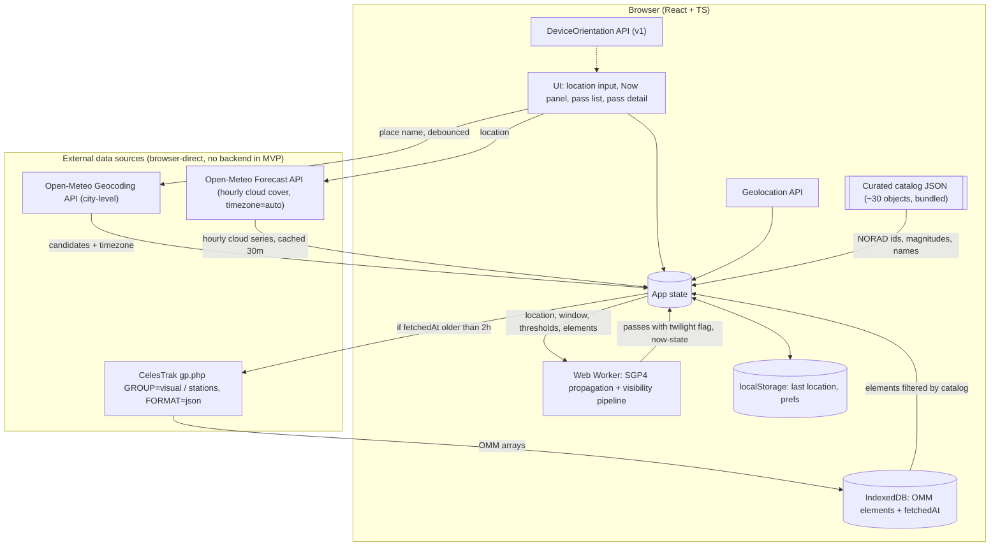

# mvp — SPEC.md sections

Cut from `SPEC.md` by `scripts/sdd/split.ts` (FR-SDD-3); ids resolve through `docs/sdd/ids.md`.

## 3. Personas & User Stories

### 3.1 Personas

- **Casual Stargazer (primary).**
  No astronomy background.
  Heard "you can see the ISS" and wants to try tonight from the back garden.
  Uses a phone.
- **Curious Parent / Teacher.**
  Wants a reliable "show the kids something" moment; needs advance notice and confidence it will actually be visible.
- **Hobbyist Observer (secondary).**
  Knows what azimuth means.
  Wants a fast, honest list and the ability to tune thresholds; will notice if predictions are wrong.

### 3.2 User Stories (MVP unless tagged)

Each story has acceptance criteria (AC). "Visible pass" is defined in §4.3.

**US-1 — Provide my location by place name**
As a user, I can type a city, town, or place name and have it converted to coordinates.
- AC1: A single free-text field accepts a place name; results appear as a short pick list (name, region, country) when ambiguous.
- AC2: The resolved place name and coordinates are shown so I can confirm they are right.
- AC3: If geocoding fails or returns nothing, I get a clear message and the option to enter coordinates instead.
- AC4: The UI makes clear that resolution is city-level ("Using the centre of Cipolletti, Rio Negro"); street addresses are not resolved to house precision in MVP.

**US-2 — Provide my location by coordinates**
As a user, I can paste or type latitude/longitude.
- AC1: Accepts decimal degrees (`-34.6037, -58.3816`) and common variants (space-separated, with N/S/E/W suffixes).
- AC2: Validates range (lat −90..90, lon −180..180) with inline errors.
- AC3: Optional altitude (metres) field, default 0.

**US-3 — Use my device's location**
As a user, I can press one button to use the browser's Geolocation API.
- AC1: Button is only shown when the API is available and the page is served over HTTPS.
- AC2: Permission denial shows a non-blocking message and leaves the manual inputs usable.
- AC3: Reported accuracy is displayed if worse than ~1 km; otherwise hidden.

**US-4 — See what is visible right now**
As a user, I see at a glance whether any satellite is visible **at this moment** from my location.
- AC1: A "Now" panel lists satellites currently above the elevation threshold, sunlit, with observer in darkness — or states plainly that none are visible and why (daylight / nothing up / all in shadow).
  *(amended v2.0)* The panel is the When reading's (FR-FIRST-4, FR-FIRST-5), after the next-event block.
  *(amended v2.0.2, V20-19)* On the home page the panel is the When table's `Up now` row (FR-FIRST-9), shown while at least one satellite is visible and absent otherwise; with none up, the Dark row and the next-event block say when to look instead of why nothing is up.
  The live page keeps the full statement.
- AC2: The panel updates at least every 10 seconds without a page reload.
- AC3: For each currently-visible satellite: current azimuth (compass direction + degrees), current elevation, and time remaining until it sets or enters shadow.
  *(amended v2.0.2, V20-19)* On the home page the `Up now` row carries the first satellite's name and time left and a count of the rest; the live page carries this criterion in full.

**US-5 — See upcoming visible passes**
As a user, I see a list of upcoming visible passes for the next 24 hours (configurable up to 5 nights).
- AC1: Each list item shows: satellite name, start time (local to the *observer location*, not the browser), max elevation, peak compass direction, duration, predicted brightness, and a weather indicator.
- AC2: Passes are sorted chronologically by default; a toggle sorts by "best first" (brightness × elevation).
  *(amended v1.1)* On compact the toggle labels are "Soonest" and "Best" so the row fits one line (FR-COMP-4); wide keeps "Soonest first" / "Best first".
- AC3: Passes that fail the visibility criteria are not listed (no "hidden but listed" clutter).
- AC4: Time until the next pass is shown as a countdown.

**US-6 — Get step-by-step viewing guidance for a pass**
As a user, I open a pass and get instructions on where and when to look.
- AC1: Text summary in plain language, e.g. *"Appears low in the west-southwest at 21:14:32, climbs to 62° (two-thirds of the way up the sky) in the south at 21:17:50, disappears into Earth's shadow in the east-northeast at 21:20:05.
  Brighter than any star."*
- AC2: Numeric details: rise/peak/set azimuth (° and 16-point compass), max elevation, start/peak/end times to the second, duration, magnitude, range at peak.
- AC3: A **3D ASCII-rendered sky dome** centred on the observer, with cardinal points labelled on the horizon, the pass drawn as an arc with its peak marked, and rise/set points and direction of travel indicated.
  I can rotate and tilt the view so I am looking toward the horizon I will actually face.
- AC4: Distinguishes "sets below horizon" from "enters Earth's shadow" as the end condition.
- AC5: A 2D polar (all-sky) chart of the same pass is available as a fallback view, one tap away, built from the same data.

**US-7 — Know whether clouds will ruin the pass**
As a user, each pass tells me whether the forecast suggests clear or cloudy skies.
- AC1: Cloud cover (total, and low/mid/high where available) is fetched for the observer location for the pass time.
- AC2: A three-state indicator: *Clear* (< 30 % total cloud), *Partly cloudy* (30–70 %), *Likely obscured* (> 70 %).
  Thresholds are constants and appear in the UI tooltip.
- AC3: Forecast timestamp and provider are shown so the user knows how fresh the data is.
- AC4: If weather data is unavailable, the pass is still shown with a "weather unknown" state — weather never blocks pass display.

**US-8 — Remember my last location** *(MVP, minimal)*
As a returning user, the app pre-fills my last-used location.
- AC1: Stored in `localStorage` only; nothing sent to a server.
- AC2: A "clear" action removes it.

## 4. Functional Requirements

Requirements use MUST / SHOULD / MAY (RFC 2119 sense).
IDs are stable for traceability into later plan/tasks.

### 4.1 Location

- **FR-LOC-1** The app MUST accept location via (a) free-text city/place name, (b) lat/lon text, (c) browser Geolocation.
  *(amended v2.0, V20-2)* Of the three, (c) is the primary action on a first run and (a) and (b) are its equal alternatives (FR-FIRST-2); the order they are offered in is FR-FIRST-2's, not this list's.
  *(amended 2026-11-02, the owner's call, PLAN D-1025)* A location from (c) is named after the nearest town, looked up on the device: the observer is set with its rounded coordinates as the label at once, and the page never waits on a name; the app then fetches, from its own origin and only the first time a device location needs a name, a town list built from GeoNames' `cities15000` (CC BY 4.0) and shipped with the app as a static file, and relabels the location "Near Cipolletti, Argentina" / "Cerca de Cipolletti, Argentina" — "near" because a fix good to ±12 km may be tens of kilometres from the town's centre, the country in the reader's language.
  No town within 50 km keeps the coordinates.
  No request carries the position: the lookup is local, so "nothing is sent anywhere" still holds.
  Coordinates typed by hand (b) keep their coordinates as the label.
  *(amended 2026-11-02, PLAN D-1029)* The named device label is `<town>, <country>` with no "Near" (`Cipolletti, Argentina`), the country in the reader's language.
- **FR-LOC-2** Place-name geocoding MUST use the Open-Meteo Geocoding API directly from the browser (no key, CORS-enabled), MUST be debounced (≥ 500 ms after typing stops), and MUST cache results per query string for the session, to respect the shared 10 000 calls/day non-commercial limit.
- **FR-LOC-3** The app MUST derive the IANA time zone for the chosen location and display all times in that zone, with the zone abbreviation shown.
  Open-Meteo returns the zone both in geocoding results and in forecast responses (`timezone=auto`), so no separate lookup library is required in MVP.
- **FR-LOC-4** *(v1)* The app SHOULD reverse-geocode coordinates to a human-readable label (city / region) for display.
  Open-Meteo has no reverse geocoding; this arrives with the v1 proxy (Nominatim).
  MVP shows rounded coordinates for coordinate/Geolocation inputs.
  *(amended 2026-11-02, the owner's call, PLAN D-1025)* A Geolocation input is labelled offline with the nearest town (FR-LOC-1 (c)); typed coordinates still show rounded coordinates, and no reverse-geocoding provider is used.
- **FR-LOC-5** The app MUST persist the last location locally and MUST NOT transmit it to any first-party server for storage.
  *(amended v1)* Up to 8 saved places (FR-OFF-7) live in the same local store under the same rule.
- **FR-LOC-6** Geocoding precision in MVP is city/place level.
  The app MUST NOT imply street-level accuracy in the UI.

### 4.2 Satellite Data

- **FR-SAT-1** The MVP catalog is a **hand-maintained list of ~30 well-known bright objects** (ISS, Tiangong, Hubble, large rocket bodies, etc.) stored as a static JSON file in the repo, keyed by NORAD catalog number, with display name, intrinsic magnitude, category, and short description.
  The full CelesTrak `visual` group is v1.
- **FR-SAT-2** The browser MUST fetch current GP elements **directly from CelesTrak** (OMM JSON) for the `visual` and `stations` groups (two requests) and filter client-side to the curated catalog.
  Per-object `CATNR` requests MUST NOT be used (30 requests per client would violate CelesTrak's fair-use policy).
  If a curated object is absent from both groups it MUST be skipped with a console warning, not an error.
- **FR-SAT-6** Fetched elements MUST be cached in IndexedDB with a `fetchedAt` timestamp.
  The client MUST NOT re-request from CelesTrak more often than once every 2 hours (enforced against the stored timestamp, across tabs and reloads).
  On network failure the cached set MUST be used with the epoch-age warning of FR-SAT-4.
- **FR-SAT-3** The app MUST prefer the OMM/JSON representation over classic two-line TLE text.
  Rationale: the public catalog exceeded 5-digit numbers in July 2026; TLE lines now use Alpha-5 encoding for catalog numbers ≥ 100 000, which OMM avoids.
- **FR-SAT-4** The app MUST display the epoch age of the elements in use and MUST warn when elements are older than 5 days (accuracy degrades; ISS reboosts happen frequently).
  *(amended v2.0.2, V20-21)* On the home page both are one line in the Where reading — `Elements 9 d 4 h old · [ details ]`, in `--warn` past the 5 days — whose `[ details ]` opens the full status and the warning in place (FR-FIRST-11).
- **FR-SAT-5** The curated catalog file (FR-SAT-1) MUST be the single source of per-object metadata and MUST record the provenance of each intrinsic magnitude (source + date) so values can be audited and updated.

### 4.3 Visibility Computation

A pass is **visible** when, for a contiguous interval of time, all of the following hold:

1. **Above horizon threshold.**
   Satellite elevation ≥ `MIN_ELEVATION` (default 10°; 0° is unusable in practice because of buildings, haze, and atmospheric extinction).
2. **Observer in darkness.**
   Sun altitude at the observer ≤ `SUN_ALT_MAX` = −6° (after end of civil twilight / before start of civil dawn).
   **Decided:** passes are listed from −6°; passes whose peak occurs with the sun between −6° and −12° carry a **"sky still bright"** label (only the brightest objects will be seen).
   User-configurable threshold is v1.
3. **Satellite sunlit.**
   Satellite is not inside Earth's umbra.
   Penumbra MAY be treated as lit with a "fading" flag.
4. **Bright enough.**
   Predicted visual magnitude at peak ≤ `MAG_LIMIT` (default +4.5; roughly what an average suburban sky allows).
   Every MVP catalog object has a known intrinsic magnitude (FR-SAT-1).
   When the full `visual` group is added in v1, objects with unknown intrinsic magnitude are shown with "brightness unknown" if the other conditions pass.

- **FR-VIS-1** The app MUST compute passes for a window of at least the next 24 h and at most 5 nights.
  *(amended v1)* The v1 window is 72 h from the time of computation (FR-OFF-2); the list shows tonight by default and the three nights grouped on request (US-16 AC5); a user-selectable window stays later.
- **FR-VIS-2** Pass boundaries (start, peak, end) MUST be refined to ≤ 1 s precision.
- **FR-VIS-3** For each pass the app MUST report: start time, start azimuth, peak time, peak azimuth, peak elevation, end time, end azimuth, end reason (`horizon` | `shadow` | `twilight`), duration, predicted peak magnitude, range at peak.
- **FR-VIS-4** The pipeline MUST run without blocking the UI thread (Web Worker) and SHOULD complete the 24 h computation for the ~30-object MVP catalog in under 1 s, and for ≈ 200 objects (v1) in under 3 s, on a mid-range 2022 phone.
- **FR-VIS-5** The app MUST recompute when location, window, or thresholds change; and MUST re-evaluate "now" state at least every 10 s using the cached propagation.
  *(amended v2.1, V21-8)* The app MUST also recompute when the page becomes visible, or the device wakes, with the stored run's window start more than `RECOMPUTE_STALE_H` (2 h) behind the clock, whether or not newer elements have arrived (FR-NIGHT-4).
  *(was: place, window and threshold changes only; the build added "newer elements" and nothing else, so an open tab kept a frozen window)*
- **FR-VIS-6** All thresholds MUST be centralised constants with documented defaults and documented rationale.
- **FR-VIS-7** Each pass MUST carry a `twilight` flag set when the sun altitude at peak is between −6° and −12°; the UI MUST render it as a "sky still bright" label on the pass card and in the guide text.

### 4.4 Observation Guide

- **FR-GUIDE-1** For each pass the app MUST render a plain-language sentence (US-6 AC1) generated from a template, using 16-point compass names and an elevation-to-words mapping (e.g. 10–25° "low", 25–50° "mid-sky", 50–75° "high", > 75° "almost overhead").
- **FR-GUIDE-2** The app MUST render a **3D sky dome as ASCII text**, centred on the observer, showing: the horizon ring with cardinal points (at least N/E/S/W, ideally 8 points) labelled on it; each pass in view as an arc across the dome with its peak marked; rise and set points; direction of travel; and the shadow-entry point where applicable.
  The user MUST be able to rotate (azimuth) and tilt (pitch) the view, by touch drag and by keyboard, so the dome is seen from the direction they will face.
  The default view MUST face the pass's rise azimuth at a tilt that shows both horizon and peak.
- **FR-GUIDE-2b** The app MUST also provide a **2D polar (all-sky) chart** of the same pass — horizon as the outer circle, zenith at the centre, altitude rings at 30°/60°, cardinal labels, rise/peak/set and shadow-entry markers — as a fallback view reachable from the dome view.
  Both views MUST be driven by the same computed pass geometry.
  *(amended v1.1, V11-5)* The view control offers three views where the device allows it: the dome, the polar chart and the sky window (§4.18); all three are driven by the same computed pass geometry.
- **FR-GUIDE-3** Brightness MUST be expressed both as a magnitude number and a comparison phrase: "brighter than Venus" (≤ −4), "brighter than any star" (−4 to −1.4), "like a bright star" (−1.4 to +1), "like an average star" (+1 to +3), "faint, needs dark sky" (> +3).
- **FR-GUIDE-4** The 2D polar chart MUST be orientation-aware: default "looking up" convention (east on the left, as when lying on your back looking up) with an explicit toggle to map convention (east on the right).
  The chosen convention MUST be labelled on the chart.
  The 3D dome needs no such toggle: the user's rotation is the orientation, and the current facing direction MUST be shown as text (e.g. "facing WSW, tilt 35°").
- **FR-GUIDE-5** Both chart views MUST be rendered in the DOM only — text nodes and ordinary elements (with SVG permitted for the 2D chart).
  **No WebGL and no `<canvas>`.**
  Rationale: the ASCII dome is the product's visual signature and must be selectable, zoomable, and styleable like the rest of the page; DOM rendering also keeps the CSP strict and testing simple.
  *(amended v1, V1-4)* The CSP MAY allow inline `style` attributes (`style-src-attr 'unsafe-inline'`) so the rasteriser can colour glyphs (FR-DOME-2); `style-src-elem`, `script-src` and every other directive stay `'self'`.
- **FR-GUIDE-6** The dome MUST re-render smoothly enough for interactive rotation on a mid-range 2022 phone (target ≥ 30 updates/s while dragging) at the default grid size; grid size MAY reduce on small screens.
- **FR-GUIDE-7** Chart views MUST carry a text alternative (the FR-GUIDE-1 sentence and the numeric table) and the character grid MUST be hidden from assistive technology so screen readers are not read a wall of symbols.
  *(amended v1.1, V11-6)* The legend (§4.17) is part of the text alternative and is exposed to assistive technology as a list.

### 4.5 Weather

- **FR-WX-1** The app MUST fetch an hourly cloud-cover forecast for the observer location covering the prediction window.
  *(amended v1)* The window is 72 h, so the request asks for four forecast days (FR-OFF-3).
- **FR-WX-2** For each pass, cloud cover MUST be interpolated to the pass peak time from the two nearest hourly values.
- **FR-WX-3** The three-state indicator (US-7 AC2) MUST be shown per pass; the "Now" panel MUST show current cloud cover.
  *(amended v2.0.2, V20-19)* On the home page the current cloud cover is the When table's `Clouds now` row (FR-FIRST-9).
- **FR-WX-4** Where the provider supplies low/mid/high layer cloud, the indicator SHOULD weight low + mid cloud more heavily than high cloud (thin cirrus often still permits seeing bright satellites).
  *(amended 2026-11-02, the owner's call, PLAN D-1028)* A covering layer counts even when it is high: the effective cover is the thickest layer, high cloud counted at 70 % — `max(low, mid, 0.7·high)` — so high cloud alone tops out at 70 %, partly cloudy, and never reads clear under a full deck.
  Tonight's cloud (the when step's `Clouds tonight`, the what step's foot, the Stars door and the stars page's head line and wide line) is read hour by hour across the dark window, and where it changes once the line says when: `Likely obscured until 02:00 · clear after` on the wide line, two rows `Until 02:00` · `Likely obscured` and `From 02:00` · `Clear` on the when step, two pieces in the foot, and on the door and the head the better part with its stretch of the dark, `Dark, clear 02:00 → 07:05` / `Oscuro y despejado 02:00 → 07:05`.
  A state that lasts one hour is not a change; more than one change is `Variable`.
  Pass verdicts stay per instant (FR-WX-2).
- **FR-WX-5** Weather fetch failure MUST degrade gracefully (US-7 AC4).
  Weather MUST be cached for 30 min per location cell (rounded to 0.1°).

### 4.6 Cross-Cutting

- **FR-X-1** Mobile-first responsive layout; dark theme by default; optional red-tint "night vision" mode (v1, specified in §4.14).
  *(amended v1)* "Responsive" includes the wide layout of §4.8.
- **FR-X-6** **Visual identity: monospace / terminal aesthetic across the whole UI** — a monospace typeface everywhere, character-grid-aligned layout where practical, box-drawing or plain-character borders, restrained colour on a dark ground, no photographic imagery.
  The ASCII sky dome must read as a natural part of the interface, not a widget dropped into a conventional web page.
  *(amended v2.0, V20-3)* The identity gains a mark, "Aperture" (§4.29): braille text on the same grid, the one image-like thing in the interface, from which the icon and the favicon are rendered *(amended v2.0.1, V20-14: from whose scene, as dots)*.
  *(amended v2.3, V23-1)* The identity is written down as one token sheet and eight primitives (§4.45): "monospace everywhere", "the character grid", "plain-character borders" and "bracketed controls" are tokens and components a module names, not conventions a module re-states; a module that writes the value instead of the name fails FR-DS-2's test.
- **FR-X-2** Every external data source MUST be credited in a footer (CelesTrak; Open-Meteo for weather and geocoding, whose geocoding data derives from GeoNames) as their terms require.
  *(amended 2026-11-02, the owner's call, PLAN D-1025)* GeoNames is also used directly, for the town a device location is named after, and the full footer's sentence says so: "Place search by Open-Meteo geocoding, and the town named for your device's location, with data from GeoNames (CC BY 4.0)." / "Búsqueda de lugares por la geocodificación de Open-Meteo, y la ciudad que nombra la ubicación del dispositivo, con datos de GeoNames (CC BY 4.0)." OpenStreetMap/Nominatim attribution is added in v1 when the proxy introduces it.
  The footer MUST also name who made the page, linked to their profile.
  At wide widths it says all of this in one row rather than four (D-120): every source still named, still linked, and still under the licence it is used with.
  *(amended v2.2, V22-10; V22-15)* The footer also credits the library the sky is drawn with, in every form the footer has: **"Sky chart: glyphcss."**, `glyphcss` linked to <https://glyphcss.com>; in Spanish "Carta del cielo: glyphcss." The library only — its author is not named in the app or in the repository's living documents (V22-15; V22-10 had named him, and that text is history).
  The old rule — three sources and the maker, glyphcss's MIT notice carried by `public/third-party-notices.txt` alone (FR-PUB-4) — held from v1.3.2 to v2.1.
  FR-SHOW-8 carries the change.
  *(amended 2026-11-02, the owner's call, PLAN D-1023)* **The footer is the same on every page.**
  On wide every page — home, the pass detail, settings, live (`#live`) and stars (`#stars`) — ends in D-120's one-row form; the live page keeps its one viewport for the box and the rail (FR-LIVE-7, FR-SHP-3) and the row follows it under the fold, the page scrolling by the row's height and no more.
  On compact the home and the settings page end in the full credits; the three pages that are all sky (live, stars and the pass detail, FR-FULL-1, FR-CLEAN-1) carry the one-row form, its privacy word kept, as the last group of the controls sheet's body (FR-FULL-4), after the page's last section.
  Every form stands a group gap (`--space-3`, FR-FLOW-10) under what is above it.
  Until now settings ended in its own privacy line and live and stars had no footer.
- **FR-X-3** No analytics or tracking in MVP beyond anonymous, aggregate error logging.
- **FR-X-4** The app MUST function offline for the already-computed pass list, and MUST be able to recompute from IndexedDB-cached elements for a new location without network (weather then shows "unknown").
  *(amended v1, V1-6)* The app shell itself MUST load offline through a service worker, and the stored forecast stays usable offline past its TTL with its age shown (§4.11).
  PWA install is v1 (FR-OFF-6).
- **FR-X-5** Accessibility: WCAG 2.1 AA colour contrast; chart information duplicated in text; keyboard navigable.
  *(amended v2.1, V21-2)* Document structure — landmarks, the heading outline, the title and the focus of each route, and the skip link — is §4.33 (FR-A11Y-1..6), which extends this requirement and does not replace it.
  The accessibility rules written before it stand where they are: FR-GUIDE-7 (the text alternative, the grid hidden from assistive technology), FR-DESK-4 (the shortcuts), FR-THEME-2 (the night palette's contrast), FR-LEG-4 and FR-LEG-5 (the key without colour), FR-FSC-2 (the 44 px close control), FR-MARK-5 (contrast, state never colour alone, reduced motion).

## 5. Technical Architecture

> **Status: proposal.** The stack, data flow, and algorithm below reflect the v0.2 decisions (no backend in MVP, curated ~30-object catalog, −6° twilight rule) but are to be validated in the plan phase. The assumption that CelesTrak serves usable CORS headers to browsers has been verified (§12, OQ-11).
>
> *As built (2026-09-25, V22-7):* the proposal was validated in the plan and this section keeps its wording as history. The stack that shipped is React 19 + TypeScript + Vite with CSS modules and design tokens, Zustand, `satellite.js`, `astronomy-engine`, `idb`, `zod`, the sky chart in `@glyphcss/react`, the time zone from Open-Meteo's own field, hosted as Cloudflare Workers static assets with no backend in any phase so far. PLAN §11.1 is the list with versions, licences and boundaries; the §5.1 row that decided otherwise carries a note.

### 5.1 Stack Recommendation

| Layer | Choice | Rationale |
|---|---|---|
| Frontend | React 19 + TypeScript, Vite, Tailwind (or CSS modules) — *as built (2026-09-25, V22-7): CSS modules and the tokens in `src/ui/styles/`, no utility framework; PLAN §11.1* | Requested. Vite for fast dev/build, easy Web Worker bundling. |
| State | Small: Zustand or React context + `useReducer` | App state is a handful of slices (location, elements, passes, weather, prefs). No need for heavier tooling. |
| Orbit math | `satellite.js` (v7.x, TypeScript, supports TLE and OMM) | De-facto SGP4/SDP4 in JS; includes ECI→ECF, look angles, GMST. |
| Sun position / twilight | `astronomy-engine` (accurate, TS types) — or `suncalc` for lighter weight | Sun altitude at observer and sun vector for shadow test. |
| Time zone lookup | Open-Meteo's `timezone` field (geocoding results and `timezone=auto` forecasts) | Needed to show times in the observer's zone (FR-LOC-3). `tz-lookup` only if a pure-coordinate input needs a zone before weather loads. |
| Client storage | IndexedDB via `idb` (elements cache, FR-SAT-6); `localStorage` for last location and prefs | IndexedDB handles the ~100 KB element payload and works across tabs; `localStorage` is enough for small prefs. |
| Sky charts | **3D ASCII sky dome rendered as DOM text** (in-house projection: az/el → dome coordinates → character grid) with a **2D polar fallback** (SVG or text). No WebGL, no canvas (FR-GUIDE-5). | The dome is the visual signature; DOM text keeps it styleable, testable, and CSP-friendly. Geometry is simple enough to write without a charting or 3D library. |
| Backend | **None in MVP** (decided). v1: thin caching proxy on an edge runtime — Cloudflare Workers (Hono, TypeScript) or Vercel Edge Functions | See §5.2. Entire pass computation stays in the browser in every phase. |
| Hosting | Static site (Cloudflare Pages / Netlify / Vercel / GitHub Pages) | Free tiers comfortably cover hobby-scale traffic; the v1 worker adds no hosting cost on free tiers. |
| Testing | Vitest + fixtures with known passes; Playwright for smoke | Visibility math needs golden tests against a trusted predictor (see §7 open questions). |

### 5.2 Backend: none in MVP, caching proxy in v1

**Decision (OQ-1, 2026-09-01):** MVP ships with no first-party backend.

- **Orbital data:** the browser fetches CelesTrak OMM JSON for the `visual` + `stations` groups directly, stores it in IndexedDB, and refreshes at most every 2 hours (FR-SAT-2, FR-SAT-6).
  CelesTrak's fair-use limits are per IP, and one user fetching ~100 KB every 2 hours is far below the ~100 MB/day threshold.
  CelesTrak serves `access-control-allow-origin: *` on `gp.php` JSON responses (verified 2026-09-01 by curl with an Origin header and by a browser fetch; see §12).
  It is not a contractual promise, so the fallback order is documented in §12.
- **Geocoding:** Open-Meteo's Geocoding API (city/place level, no key, CORS-enabled, same 10 000 calls/day non-commercial budget as the forecast API).
  Street-address precision is a stated non-goal.
- **Weather:** Open-Meteo forecast API, browser-direct, as before.

**Why the proxy still arrives in v1:**

1. **Scaling the catalog** to the full `visual` group and adding Space-Track as a redundant source is cleaner behind one cached endpoint, and shields users from any CelesTrak CORS or availability change.
2. **Street-address geocoding and reverse geocoding** need Nominatim (or similar), whose policy caps *the whole application* at 1 request/second and requires an identifying User-Agent/Referer — only enforceable server-side.
3. **Later features** (push notifications, share links with server-rendered previews) need a place to live.

The v1 worker is stateless apart from cache and does no orbital computation.

### 5.3 Data Flow



*v1 change to this diagram:* an edge worker is inserted between the browser and CelesTrak / Nominatim (`/api/gp`, `/api/geocode`), and the catalog grows to the full `visual` group.

### 5.4 Visibility Pipeline (the core algorithm)

Inputs: OMM elements for N objects; observer geodetic position (lat, lon, alt); time window `[t0, t1]`; thresholds.

```
for each object:
  satrec = satellite.json2satrec(omm)            # or twoline2satrec for TLE
  coarse scan t = t0 .. t1 step 30 s:
    posEci = satellite.propagate(satrec, t)
    gmst   = satellite.gstime(t)
    posEcf = satellite.eciToEcf(posEci, gmst)
    look   = satellite.ecfToLookAngles(observerGd, posEcf)   # az, el, range
    if el >= 0: mark as "above horizon" segment
  for each above-horizon segment:
    refine rise/set crossings of el = MIN_ELEVATION by bisection to <= 1 s
    refine peak (max el) by golden-section / parabolic fit on el(t)
    sample every 1–5 s within [rise, set]:
      sunAlt      = sun altitude at observer(t)               # astronomy-engine
      lit         = !inUmbra(posEci, sunVectorEci(t))         # cylindrical shadow test, Earth radius 6371 km (+ optional 6378/atmosphere fudge)
      visibleNow  = el >= MIN_ELEVATION && sunAlt <= SUN_ALT_MAX && lit
    visible interval = longest contiguous visibleNow run
    if none: discard pass
    end reason = horizon | shadow | twilight, whichever cut the run
    phase angle at peak, range at peak -> magnitude estimate:
      m = m_std - 15.75 + 5*log10(range_km) - 2.5*log10( sin(b) + (π - b)*cos(b) )
      (diffuse-sphere phase law; m_std = magnitude at 1000 km, half phase)
    if m > MAG_LIMIT and m_std known: discard
emit passes sorted by start time
```

Notes:
- The shadow test: project the satellite's ECI position onto the anti-sun axis.
  If the projection is positive (satellite on the night side) **and** the perpendicular distance to the axis is less than Earth's radius, the satellite is in umbra.
  A conical model adds a few lines and gives a better penumbra edge; MVP uses cylindrical and flags the last ~20 s before shadow entry as "fading".
- The "Now" panel reuses the same functions at `t = now` for every object, no scan needed.
- Twilight label: after the visible interval is found, evaluate sun altitude at peak; if it is in (−12°, −6°] set `twilight = true` (FR-VIS-7).
- Deep-space objects (period > 225 min) trigger SDP4 automatically in `satellite.js`; none are expected in the curated catalog or the `visual` group.
- Performance envelope: MVP ≈ 30 objects × 2 880 coarse steps (24 h @ 30 s) ≈ 86 k propagations — well under a second. v1 ≈ 200 objects ≈ 0.6 M propagations; `satellite.js` handles several hundred thousand per second in a worker, so expect 1–3 s, then sub-second refinement.
  Extending to 5 nights ×5 cost — still fine in a worker, but the UI should stream results per object.

### 5.5 "Where to Look" UX Patterns

Ranked for MVP inclusion.
All patterns must reuse the same computed pass geometry.

| Pattern | Description | Pros | Cons | Phase |
|---|---|---|---|---|
| **Plain-text instructions** | Generated sentence + numeric table (§4.4). | Universally understood; accessible; zero permissions. | Requires user to know roughly where WSW is. | **MVP** |
| **3D ASCII sky dome** (primary) | Observer-centred dome drawn as a character grid in the DOM: horizon ring with cardinal labels, pass arcs with peak markers, rotate/tilt to face the relevant horizon. | Matches how the user will actually stand and look ("turn to face WSW, look about a third of the way up"); no mirror-convention confusion; distinctive, on-brand with the terminal identity (FR-X-6). | Character resolution is coarse (angles read to ~5°); rotation needs a short affordance ("drag to look around"); more engineering than a static chart. | **MVP** |
| **2D polar all-sky chart** (fallback) | Circle = horizon, centre = zenith, track drawn with markers and arrow. Same data as the dome. | Shows the whole pass at once; standard in Heavens-Above and similar apps, so familiar; precise angles. | The "looking up" mirror convention confuses first-timers; needs the orientation toggle (FR-GUIDE-4). | **MVP** (secondary view) |
| **Compass overlay** | Live arrow / ring using `DeviceOrientationEvent` heading; highlights the rise point and, during the pass, the satellite's current position. | Turns "WSW" into "turn a bit more left". Huge usability win outdoors. | iOS requires `requestPermission()` and HTTPS; magnetometer heading errors of 10–20° are common; not available on desktop. Must degrade to static chart. | **v1** |
| **AR camera view** | Camera feed with satellite marker overlaid using full device orientation (alpha/beta/gamma). | Most intuitive: point and see. | Camera permission, sensor fusion drift, battery; night camera feed is mostly black so the value over compass mode is smaller than it looks. | later |
| **Landmark hint** | "Above the tall building to your south-west" using reverse-geocoded POIs. | Charming. | Requires POI data and user context; unreliable. | not planned |
| **Audio countdown** | Spoken "appears in 10 seconds, low in the west". | Hands-free while looking up. | Nice-to-have. | later |

Design principles: monospace / terminal aesthetic throughout (FR-X-6), dark background, high contrast, one pass per screen in detail view, times in large type, and a persistent live countdown to the next event (rise → peak → set).

### 5.6 Error and Edge Handling

- Observer at high latitude in summer (no darkness): show "no darkness tonight at this latitude" instead of an empty list.
- Element set missing an object the metadata table expects: skip silently, log.
- Clock skew: use `Date.now()` but display a warning if the device time differs from the server `Date` header by > 60 s.
- Location changes mid-computation: cancel the worker job (AbortController pattern with a job id).

## 6. External Dependencies

### 6.1 Orbital Data Sources — Comparison

| Source | Data | Coverage | Access / limits | Licence / terms | Browser-direct? | Verdict |
|---|---|---|---|---|---|---|
| **CelesTrak** (`celestrak.org/NORAD/elements/gp.php?GROUP=visual&FORMAT=json`) | GP elements as TLE, 3LE, OMM XML/JSON/CSV; curated groups (`visual`, `stations`, `starlink`, `active`, `last-30-days`…); supplemental operator ephemerides for ISS/Starlink | Full public catalog, refreshed ~every 2 h from Space-Track | No key. Fair-use: keep under ~100 MB/day per IP; repeated hammering gets IPs firewalled. No SLA. | Free for any use with attribution; no formal licence text, governed by usage policy. | Yes — `access-control-allow-origin: *` verified 2026-09-01 (§12). Not a formal commitment. | **Primary source for MVP, fetched browser-direct** with a 2 h IndexedDB cache; v1 adds the caching proxy. Curated groups are exactly the candidate set we need. |
| **Space-Track.org** (18th Space Defense Squadron) | Authoritative GP, GP_History, SATCAT, decay/launch data; JSON/XML/CSV/TLE | Full catalog, origin of CelesTrak's data | Free account required; cookie/session login; ≤ 30 req/min and ≤ 300 req/hour; server-side only. | User agreement permits redistribution with attribution; must not circumvent limits. | No (auth + no CORS). | **v1 fallback / redundancy** behind the v1 proxy. Not usable in MVP (no backend). |
| **N2YO REST API** | Pre-computed *visual passes* (with magnitude), radio passes, positions, TLE | Full catalog; `visualpasses` endpoint does exactly our job | API key; 1 000 transactions/hour; per-endpoint counters in every response. | Free for non-commercial; terms restrict redistribution. | Yes, but exposes key. | **Not for core path**: outsources our differentiator, non-commercial only, and key must be proxied. Useful as a **golden-test oracle** during development. |
| **Heavens-Above** | Best-in-class visible pass predictions | — | No public API; scraping prohibited. | — | — | **Reference only** for manual QA. |
| **Where The ISS At** (`wheretheiss.at`) | ISS position + TLE | ISS only | No key, ~1 req/s | Free | Yes | Not needed; ISS is in CelesTrak `stations`. |
| **Open Notify** | ISS position; pass-prediction endpoint was retired | ISS only | No key | Free | Yes | Not suitable. |
| **TLE API** (`tle.ivanstanojevic.me`) | Community wrapper over CelesTrak with search/pagination | Full catalog | No key, CORS-enabled | Unofficial, no SLA | Yes | **First fallback** if CelesTrak's CORS policy changes (§12); adds a third-party single point of failure. |
| **SatNOGS DB** | Satellite metadata, transmitters, TLEs | Mostly amateur/edu sats | Token required | CC-BY-SA | Via proxy | Not relevant for naked-eye set; maybe metadata later. |

**Intrinsic magnitude data (needed for brightness, FR-SAT-1/5):** GP data carries no brightness.
**Decision (OQ-3):** the MVP catalog is a hand-maintained JSON of ~30 objects with intrinsic magnitudes seeded from public community values (e.g. Mike McCants' standard-magnitude list, checking current hosting and terms) and provenance recorded per entry.
For v1's full `visual` group, the options are (a) ingest the McCants list wholesale, or (b) estimate from SATCAT radar cross-section, with `unknown` allowed — chosen in the v1 plan.

### 6.2 Geocoding

| Provider | Key | Limits | Notes | Verdict |
|---|---|---|---|---|
| **Open-Meteo Geocoding** (`geocoding-api.open-meteo.com/v1/search`) | No | Shares the 10 000 calls/day non-commercial budget; CORS-enabled | City/town/place level (GeoNames-derived); returns lat/lon, admin region, country, elevation, population, and IANA timezone. No street addresses, no reverse geocoding. | **MVP** (decided). Browser-direct, debounced + session-cached. |
| **OSM Nominatim** (public) | No | 1 req/s for the whole app; identifying UA/Referer required; must cache; no autocomplete-style hammering | ODbL attribution ("© OpenStreetMap contributors"); street-level forward and reverse geocoding | **v1**, via proxy with global rate limit + cache |
| Photon (komoot) | No | Undocumented fair use; supports type-ahead | OSM-based | Alternative if autocomplete is desired |
| OpenCage | Yes | 2 500/day free | Wraps OSM + others | v1 alternative if Nominatim limits bite |
| Mapbox / Google | Yes | Paid beyond free tier; Google forbids caching/displaying without Google map | — | Not aligned with "no-key" preference |

MVP geocodes to the centre of the chosen place.
Satellite pass geometry changes negligibly over a few kilometres (a 5 km offset shifts azimuth by well under 1° for a 400 km-altitude pass), so city-level input costs nothing in prediction quality; it only affects the displayed place label.

### 6.3 Weather (Cloud Cover)

| Provider | Key | Cloud fields | Coverage | Limits | Verdict |
|---|---|---|---|---|---|
| **Open-Meteo** | No | `cloud_cover`, `cloud_cover_low`, `cloud_cover_mid`, `cloud_cover_high` hourly (15-minutely for some models); up to 16 days; `timezone=auto` returns the IANA zone | Global, multi-model (ICON, GFS, ECMWF, national models) | 10 000 calls/day non-commercial; requests with > 10 variables or > 2 weeks count as multiple calls; commercial use requires paid plan | **MVP choice.** No key, CORS-enabled, layered cloud, and the timezone echo solves FR-LOC-3. |
| 7Timer! ASTRO | No | Cloud cover bands, seeing, transparency — astronomy-oriented | Global (GFS-based) | Undocumented, hobby infra | Attractive **v1 secondary** for "sky transparency"; not robust enough as primary. |
| MET Norway Locationforecast | No (UA required) | `cloud_area_fraction` + low/medium/high | Global (best in Nordics) | Fair use, identifying UA | Solid fallback. |
| NWS `api.weather.gov` | No | `skyCover` in gridpoints | US only | Fair use | US-only fallback. |
| OpenWeatherMap | Yes | `clouds.all` (total only) | Global | 1 000/day free (One Call 3.0) | Weaker data, needs key. |

**Cloud → verdict rule (initial):** `effective = 0.6·low + 0.3·mid + 0.1·high` if layers present, else `total`.
Clear < 30 %, Partly 30–70 %, Likely obscured > 70 %.
Tune after real-world use (OQ-5).
*(amended 2026-11-02, the owner's call, PLAN D-1028)* `effective = max(low, mid, 0.7·high)` if layers present, else `total`; the thresholds stand.
The weighted sum read Neuquén's 98 % high deck (low 1, mid 27) as 18 %, clear; the new rule reads it as 68.6 %, partly cloudy.

### 6.4 Browser APIs

- Geolocation API (HTTPS only).
- Web Workers (propagation off main thread).
- `DeviceOrientationEvent` incl.
  `webkitCompassHeading` / `absolute` handling (v1).
- Notifications + Service Worker / Push (v1/later; iOS requires installed PWA).
- `navigator.share` for share links (v1).

### 6.5 Libraries

| Library | Purpose | Notes |
|---|---|---|
| `satellite.js` ^7 | SGP4/SDP4, coordinate frames, look angles | MIT. Supports OMM JSON input. |
| `astronomy-engine` | Sun position, twilight, moon (later: moon glare warnings) | MIT. Sub-arcminute accuracy. |
| `geomagnetism` 0.2.0 (v1.1) | Magnetic declination for true-north headings (FR-WIN-3) | Apache-2.0. Pure JS, WMM2015–WMM2025 coefficients bundled, 6.2 KB gzipped whole (PLAN D-185); installed 2026-09-05. |
| `@glyphcss/react` 0.1.6 (v1) | The sky chart: a 3-D scene rasterised into the page's own monospace cell grid (PLAN §8) | MIT, © 2025 Layoutit, by Juan Cruz Fortunatti — <https://glyphcss.com>. Chosen because the whole app is text in one grid, so the chart is text too and needs no canvas; credited in the README and in `public/third-party-notices.txt` (FR-PUB-4, FR-PUB-5). |
| Yale Bright Star Catalogue, 5th ed. (v2.4, data) | The stars to magnitude 4.5 and the figures' endpoints (FR-STAR-1) | Public domain (Hoffleit & Warren, 1991). Vendored raw under `data-src/stars/`, built at build time; never fetched. |
| IAU WGSN star names (v2.4, data) | Proper names in the catalogue (FR-STAR-1, FR-STAR-7) | CC BY 4.0; credited in `public/third-party-notices.txt`. |
| Constellation figures (v2.4, data) | The 88 figures' line segments (FR-STAR-1) | Source per OQ-39 (default: d3-celestial's `constellations.lines.json`, BSD-3-Clause), credited in `public/third-party-notices.txt`. |
| `idb` | Promise wrapper over IndexedDB for the elements cache (FR-SAT-6) | Tiny, TS types. |
| `tz-lookup` | lat/lon → IANA zone offline | Optional; Open-Meteo supplies the zone in MVP. |
| `date-fns` / `date-fns-tz` or Temporal polyfill | Time formatting in observer zone | |
| `hono` | Edge worker routing | **v1 only** (no backend in MVP). |
| `vitest`, `@playwright/test` | Tests | |

---

## 7. Open Questions

| ID | Question | Why it matters | Proposed default if unanswered |
|---|---|---|---|
| OQ-2 | Exact membership of the ~30-object MVP catalog (which rocket bodies and payloads beyond ISS, Tiangong, Hubble), and who maintains it as objects decay or launch. | Drives the metadata file and whether users see enough passes on an average night. | Seed from the brightest entries of CelesTrak's `visual` group plus `stations`; review quarterly. |
| OQ-5 | Cloud thresholds and layer weighting. | Too strict hides good passes; too lax erodes trust. | Values in §6.3; revisit after 2 weeks of field use. |
| OQ-6 | Golden-test oracle: is it acceptable to compare against N2YO/Heavens-Above outputs during development (manually captured fixtures)? | We need ground truth to validate the pipeline to ±few seconds and ±1° azimuth. | Yes, captured manually as fixtures, not fetched at test time. |
| OQ-7 | Should the "Now" view list objects that are up but not visible (e.g. in shadow), greyed out, for educational value? | Clarity vs. clutter. | No in MVP; add as a toggle in v1. |
| OQ-8 | Elevation-mask / obstruction input (e.g. "trees to my north up to 25°")? | Hobbyists want it; casual users won't use it. | Later. |
| OQ-9 | Analytics/telemetry policy. | Privacy stance and what we can learn about accuracy. | None in MVP beyond error logging. |
| OQ-10 | Product name and domain. | Working title is long. | Keep repo name; decide before public launch. **Resolved (v2.2, V22-11):** the domain is `inyoursky.app`, bought at Cloudflare Registrar on 2026-09-25 and bound to the Worker by the deploy (§4.44); the product name and the repository name stay as they are. |
| OQ-12 *(v1)* | Moon glare thresholds (FR-MOON-2): 50 % illumination and 30° separation. | Too eager and every full-moon night is "glare"; too lax and faint passes disappoint. | Ship the defaults; revisit with OQ-5 after field use. |
| OQ-13 *(v1)* | Folk full-moon names are Northern-hemisphere tradition; the owner and first users are in Argentina. | A "Harvest Moon" in March reads wrong south of the equator. | Show the name with its origin noted; consider a Southern list later. |
| OQ-14 *(v1)* | Service worker update policy: activate on next load with a banner (FR-OFF-1) or `skipWaiting` at once. | A silent update mid-session can break the live page; a stale shell can hide a fix. | Next load with a banner. |
| OQ-15 *(v1)* | Cost of the layered dome (FR-DOME-8): coloured output is one `<span>` per colour run, a second solid-mode scene is a second rasterisation, and a per-mesh density layer is a third `<pre>`. | Could halve the drag rate on a phone. | Measured by the dome spike (FR-DOME-8) under the D-62 method for each candidate; `colorTolerance` (24–128), `interactiveDownscale` and dropping the base layer while dragging are the fallbacks, in that order. glyphcss's `atlas` colour encoding (no spans) does not cover the braille glyphs, so it is not an option for the line layer. **Resolved (v2.1, V21-17):** measured by the R16 spike; the composition is PLAN D-90..D-92 (`docs/dome-composition/findings.md`). |
| OQ-16 *(v1.1)* | Sky-window projection and field of view (FR-WIN-1): gnomonic keeps arcs straight-ish but stretches at 60°; stereographic keeps shapes but bends the horizon. | The window has to read as "what is in front of me" at a glance. | Fixed by the FR-WIN-7 spike; start from stereographic at 60°. **Resolved (v2.1, V21-17):** stereographic at a 60° field across the shorter side, from the R38 spike on a phone (PLAN D-204, `docs/window/FINDINGS.md`). |
| OQ-17 *(v1.1)* | The iOS sensor path (FR-WIN-3): whether `deviceorientation` gives `webkitCompassHeading` together with usable `beta`/`gamma` in one event, and whether the heading needs the interface-orientation correction D-175 assumed. | A wrong assumption turns the window ninety degrees on the phone the owner uses. | Measured on a device in the spike; the dome stays the fallback either way. **Resolved (v2.1, V21-17):** measured on an iPhone — `webkitCompassHeading` with usable `beta` and `gamma` in one event, `alpha` relative and drifting (PLAN D-205). |
| OQ-18 *(v1.1)* | Touch stepping on the stripe (FR-TRAJ-5): step buttons, tap-to-jump on a segment, or a slow-scrub gesture. | Dragging is 4 min per pixel on a phone; the live page is unusable for planning without a precise step. | Fixed by the FR-WIN-7 spike; buttons if nothing else wins. **Resolved (v2.1, V21-17):** step buttons; neither tap-to-jump nor a slow drag was a countable tap (PLAN D-204). |
| OQ-19 *(v1.1)* | `ARC_LOOKAHEAD` (5 min) and `ARC_LINGER` (10 min) values (FR-TRAJ-2). | Too short and the chart is empty between passes; too long and it fills at 3600×. | Ship the defaults; revisit after a few nights of field use with OQ-5 and OQ-12. |
| OQ-20 *(v1.1)* | Which World Magnetic Model package, and its bundle cost (FR-WIN-3). | The heading is a few degrees off without it; a heavy package is a phone-page cost paid on every load. | **Resolved 2026-09-05:** `geomagnetism` 0.2.0, Apache-2.0, 6.2 KB gzipped (4.3 KB importing the WMM2025 model alone); PLAN D-185. |
| OQ-21 *(v1.2)* | Whether anything is lost by taking the compass off the dome (V12-1): a reader who liked the turning bowl now gets the window, or a drag. | The dome is still the default view, and the window asks for a permission the dome did not. | Ship the change and revisit after a few nights outdoors, with OQ-5. If the turning dome is missed, its heading path returns as a setting behind the same control, not as a second control. |
| OQ-22 *(v1.3)* | Whether the browser's back button should close the sky screen (FR-FSC-2): on Android, back is how a full-screen thing is left. | A history entry means the screen is route state, and D-13 makes the hash the only route state; a `#live…&follow` hash would reopen the screen on a reload, where the permission needs a tap. | Not in v1.3: the `×` and `Esc` close it and back leaves the live page as it does today. Revisit after nights outdoors; if it is missed, the entry is pushed without a hash change and popped on close, and a reload never restores it. |
| OQ-23 *(v1.3)* | Whether the legend strip over the bottom of the sky screen (FR-FSC-3) hides arcs low in the field. | With the phone held up 20° the bottom of the field is ground; held level it is the horizon, where passes rise and set. | Ship it and look. If the strip gets in the way, it collapses to the keys and swatches alone and a tap on it opens the rows; not a second layout. |
| OQ-24 *(v1.4)* | `STRIPE_CHUNK_H`, the chunk's length: 4 h (FR-SPAN-1). | Two hours is finer but six chunks a night to page through; six hours is one press for most of a night but 60 s per pixel on a phone. | Ship 4 h; revisit after a night's use, with OQ-5. *(v1.4 release, R72)* Still open, and deliberately: 4 h shipped in 1.4.0 (FR-SPAN-1, `STRIPE_CHUNK_H`), and the night's use the answer depends on has not happened — the owner's phone run of `docs/RELEASE.md` §11.1 is the first of it. Nothing measured in the phase argues either way; a headless run can say the chunk is 40 s per pixel on a phone against four minutes and cannot say whether six chunks a night is too many to page through. |
| OQ-25 *(v1.4)* | Whether the whole-span fallback at 600× and 3600× (FR-SPAN-6) is wanted, or whether the stripe should simply jump chunk to chunk at speed. | At 3600× a chunk is four seconds of wall time; the alternative is a stripe that re-labels faster than it reads. | Ship the fallback at `CHUNK_MIN_WALL_S` = 10 s; one Decision Log row takes it out. *(v1.4 release, R72)* Shipped as proposed and recorded as V14-8, which is the decision to *have* the fallback; the question left is whether the owner wants it, and that is the same night's use OQ-24 waits for. Left open rather than answered by a second row: the 1.4.0 build is where 600× and 3600× are watched for the first time. |
| OQ-26 *(v1.4)* | Whether `[ list (n) ]`'s count includes the Sun and Moon lines or only the drawn passes (FR-LEG-7). | "list (2)" with nothing up reads wrong; a count that ignores two rows the panel shows reads wrong too. | Count the passes; the two body lines are in the panel uncounted. **Resolved 2026-09-09 (R72):** as proposed, in the shipped 1.4.0 build — `LegendToggle`'s `count` is the drawn passes and the Sun and Moon rows are in the panel uncounted; V14-12. |
| OQ-27 *(v2.0)* | Where the live page's three-way view control stands in the two states (FR-WATCH-4). The artboards omit it, and it is the way into the sky screen (FR-FSC-6), so it cannot go; but its row is what keeps the compact box under its floor at 390 × 667 even in watching — with the row, the rows under and above the box leave about 367 px against a floor of 374; without it, about 415. | The row costs 48 px on a phone in a state whose point is to give the drawing every row; the control is also where the polar chart and the window are chosen. | Keep the row where FR-LIVE-7 has it and assert the box at 667 as measured. If the owner wants the row back, the candidates are the top row (beside the indicator, the place name giving way) or a `[ view ]` control in the actions row that cycles the three, both one string away; the artboards' readout under the box is the same question. **Resolved 2026-09-20 (R80):** as proposed, in the shipped 2.0.0 build — the view control keeps FR-LIVE-7's row in both states, and the box at 390 × 667 in watching is asserted as measured rather than against the floor (`live-compact.spec.ts`, 329 px against FR-COMP-5's 374, where 1.4.1 measured 198); V20-25. |
| OQ-28 *(v2.0)* | The portrait band's cap on the sky screen (FR-GUT-7): at most as tall as it is wide. | Taller and the band stops being "twice the sky" sideways; shorter and the arcs are a strip. The artboard's band is roughly square. | Square; the owner confirms on a phone with the rest of FR-GUT-7. **Resolved 2026-09-20 (R80):** as proposed, in the shipped 2.0.0 build — R79 caps the upright band at its own width and `ChartFrame.test.tsx` and `SkyWindow.test.tsx` assert it; the owner's half of the sentence is `docs/RELEASE.md` §12.2 and not a question left open, because what ships is decided and only the confirmation is outstanding; V20-26. |
| OQ-29 *(v2.0)* | The header mark's size on wide (FR-MARK-4): the prompt fixes 24 px on the title line, and the lockup artboard shows the 56 px tier beside the two-line title block. | 24 px keeps the header's rows as they are; 56 px is a bigger mark and a tagline that must move under it either way. | 24 px on both headers, the `header32` tier; the `header56` tier stays in the ladder with no placement until the owner asks for the lockup. **Resolved 2026-09-20 (R80):** as proposed, in the shipped 2.0.0 build — both headers draw `header32` at `MARK_HEADER_PX` (24), and `header56` is in `MARK_TIERS` and in `rasters.json` with no placement in `src/`, which is what keeps the lockup one prop away; V20-27. |
| OQ-30 *(v2.0)* | Whether the state indicator should run while playing at a speed (FR-MARK-5): `held` and still, as specified, or running since time is moving. | A bead that runs once a minute cannot show 3600×, and a still bead under a moving stripe may read as stuck. | Still: the indicator answers "is this real time?", and the pressed speed control answers the rest. Revisit after a night's use. **Resolved 2026-09-20 (R80):** as proposed, in the shipped 2.0.0 build — `StateIndicator` passes `running={!held}`, so the bead is still and warm at every speed, and the word beside it reads `held`; the night's use is `docs/RELEASE.md` §12.2 and would reopen this as a new question rather than leave this one hanging; V20-28. |
| OQ-31 *(v2.0)* | Whether the chart view control should leave the pass detail's sheet for the sky screen the way the live page's states leave the stripe — the detail is unchanged by this phase. | The detail's window is one tap on the same control; the gutter serves it too (FR-GUT-4). | Unchanged; the detail is not in this phase. **Resolved 2026-09-20 (R80):** as proposed, in the shipped 2.0.0 build — the pass detail's view control still opens the sky screen from inside the sheet (the set's `window` capture is that route, FR-FSC-6), and no v2.0 task touched the sheet. The gutter reached the detail anyway, because it is the same screen (FR-GUT-4); V20-29. |
| OQ-32 *(v2.0.2)* | What the Where pane's dome shows and does: the sky at the current instant with the drawn passes, static, a link to `#live` (as specified), or tonight's pass tracks at their peaks. | Specified as the sky now, since that is what board 1B draws and what the live page opens on; the owner confirms on the R76 captures. **Resolved 2026-09-20 (R80):** as specified, in the shipped 2.0.0 build — the Where pane draws the live page's dome at real time, loaded after the page and inert inside its link to `#live` (PLAN D-512, D-519), and `v1-home-1024-*` and `v1-home-1280-*` in the re-shot set are the pictures of it; V20-30. *(v2.1, V21-12)* The two captures named here show no dome (F-80); the behaviour was confirmed on the running build on 2026-09-21 at 1280 and 1920 px. *(R94)* The evidence is `v1-home-1280-view-*` and `v1-home-1920-view-*` (FR-CAP-1): the home as it opens, cropped to the viewport, shot after the spec has proved the dome's `<pre>` non-empty (PLAN D-610). `v1-home-1024-view-*` shows the pane without a dome, by D-607's rule and not by F-80's frame: at 1024 × 768 the left column holds Where and When and has no room for one. |
| OQ-33 *(v2.0.2)* | The stripe's span with no dark band (high summer at high latitude): centred on local solar midnight (as specified), or the bright-twilight band's middle. | Solar midnight, since it exists at every latitude; revisit if the stripe looks empty on a summer capture. **Left open 2026-09-20 (R80), with the reason:** the condition the revisit is written against never arose. Every fixture in the repository is Neuquén or Paris in September, so no capture and no test in this phase has a night with no dark band in it, and closing the question on the strength of a picture that does not exist would be the closure the register exists to prevent. It stays as specified in the shipped build and is the one v2.0 question the release does not answer. *(v2.1, R100)* **Left open again, for the same reason:** v2.1 added no fixture (`tests/fixtures/` is unchanged across the phase), so there is still no night without a dark band in any test or capture. It is the owner's to close on a summer night at a high latitude, or to carry into a phase that adds such a fixture. |
| OQ-34 *(v2.1)* | Widths from 431 to 963 px — every tablet, and a phone-sized window on a desk — are the compact layout with nothing tested and no cap on a single column or a full-bleed box. | A 900 px column of 36-cell rows is mostly margin, and the box rule makes a 900 px square drawing. | Not this phase (V21-1). Proposed for the next: a `COMPACT_MAX_CELLS` cap that centres the compact column, before any tablet layout of its own. **Resolved (V21-22):** the cap joins this phase, §4.42; a tablet layout of its own (two columns from about 80 cells) was offered and left for later. *(R100)* **Closed by R99 (#150):** the compact column is capped and centred from 431 px (PLAN D-634, D-635), and the 768 px column is in the capture set (R94, #151). The tablet layout stays out of scope, not open. |
| OQ-35 *(v2.1)* | What the audit did not check: contrast in the default dark theme, a named screen-reader run, a Tab walk on a device, text scaling to 200 %, and the night theme above 390 px. | FR-X-5 claims AA and nothing measures it outside the night palette. | The release's phone run gains a screen-reader pass (FR-A11Y-6); a tokens test for the dark theme like FR-THEME-2's is the cheap half and is proposed for this phase's A11Y task if it fits. Whether `@axe-core/playwright` is worth installing on `main` first stays the owner's. **Narrowed (V21-19):** the owner installs it and FR-A11Y-7 asserts contrast and the AA rules in both themes; a named screen-reader run, a Tab walk on a device and 200 % text scaling stay unchecked by any test and are the release run's. *(R100)* **The measured half is closed by R96 (#148):** axe over every route, width and theme finds no violation, with one `color-contrast` entry scoped to the dome's degree labels, which is F-98 (PLAN D-617). **The rest is left open, waiting on the owner's phone run:** the screen-reader pass, the Tab walk and 200 % text are `docs/RELEASE.md` §13.4, and this row closes when that run is written down. |
| OQ-36 *(v2.1)* | Faint passes under a bright Moon: tonight's list of 40 held a dozen one-minute passes near magnitude +4 at 11–16° with a 78 % Moon up. They are correct and nearly unseeable. | The list's length is what buries the good passes; `Best` sorts them down but does not say so. | Not this phase (no new feature, V21-1). Proposed: a `[ show faint ]` toggle, default off, over a threshold the owner sets (§8). The same for a `next pass` jump on the live page's stripe, which by day is the one thing a reader there wants. **Resolved (V21-20, V21-21):** both join this phase — §4.40 with `FAINT_MAG` +3.5 and `FAINT_MAG_MOON` +2.5, §4.41 as one control on the watching headline over FR-SPAN-4's landing. *(R100)* **Closed:** the faint control by R97 (#149; the thresholds in `lib/faint.ts`, PLAN D-627) and its stored preference by R98 (#139); `[ see this pass ]` by R101 (#143). |
| OQ-37 *(v2.3)* | Whether the type ladder (six rem sizes on five line heights above `--small`), the three radii and board 1B's 1.2 rem block gap should collapse onto the grid in a later pass, once the guide prints them side by side. | Fewer names is a smaller sheet and a cleaner guide; every collapse is a visible move the capture set has to be re-baselined for, and FR-FIRST-1/2 pin the gap. | Not in this phase (V23-2); the guide prints the ladder and the owner decides from it. |
| OQ-38 *(v2.3)* | Whether `--chart-text-<n>`'s pixel sizes (9 to 15 px) should scale with the base font like the rest of the type. | The drawings' labels do not grow with a reader's text size; AA at 9 px is also the thinnest the dome's labels can be. | Pixel tokens now, since the fit rules (FR-DOME-1, FR-COMP-5) are written in px; revisit with OQ-35's text-scaling check. |
| OQ-39 *(v2.4)* | Which figure source: d3-celestial's lines (BSD-3-Clause, positions as coordinates to be snapped to catalogue stars at build time) or Stellarium's `constellationship.fab` (GPL-2.0, HIP ids). | The GPL file cannot be bundled into an MIT app; the BSD one needs a snap step the build must get right for every figure. | d3-celestial, with `starCatalog.test.ts` asserting every snapped endpoint is within 0.1° of a catalogue star; the spike (FR-STAR-12) confirms. |
| OQ-40 *(v2.4)* | Where `[ stars ]` goes on the compact header if the row does not hold a fourth link in Spanish (FR-COMP-4). | The header is 36 cells; `[ estrellas ]` is 13 of them. | **Resolved (V24-10):** the compact header is 34 of 36 cells and the live actions rows 32 and 33, so the link is the header on wide and the When pane's first line on compact (FR-STAR-3). |
| OQ-41 *(v2.4)* | Whether the stars page should scrub time — a stripe like the live page's — or stay at now. | A planner wants "what is up at 23:00"; a stripe is the live page's whole second half. | Now, in this phase (V24-7); v2.5 opens the stars from the live page at its instant, which is the planner's case. |
| OQ-42 *(v2.4)* | Whether a star's label should also carry its distance in light-years and its constellation, the two facts a first-time reader asks. | Three more fields in the catalogue (a few KB); a longer readout line on a phone. | Constellation yes (it is in the catalogue already), distance no; revisit on the field notes. |
| OQ-43 *(v2.5)* | Whether the polar chart should draw the figures as well as the stars. | A 250-unit disc with 88 figures is a web; without them the stars are dots with no shape to read. | Stars only (FR-SKY-1's table); the owner looks at the capture and decides. **Resolved (v2.10, V210-5): figures yes**, and the names with `names` on, off by default on compact (FR-PHONE-8, OQ-51). |
| OQ-44 *(v2.5)* | Whether the Where pane's dome on the home should draw the stars. | It is a small inert dome whose job is to say "a sky, now"; stars make it truer and busier at 200 px. | No; one line in the table. |
| OQ-45 *(v2.5)* | Whether the names layer should be offered on the pass pages, where a tap already names a star. | "It rises under Orion" wants the name on the drawing; twenty labels under arcs and keys collide. | Not offered; the tap and the readout name it (FR-STAR-7). **Resolved v2.5 (V25-9):** not offered; the highlighted pass's landmark is the one star named (FR-SKY-11). |
| OQ-46 *(v2.5)* | Whether to ship the IAU constellation boundaries, so the `Among` column and the landmark line can say *in* Orion rather than *among*. | The figures' lines are already shipped and name the nearest pattern, which is what the eye looks for; boundaries are a second data set (d3-celestial's `constellations.bounds.json`, the lines' source and licence) of a few KB gzipped in the `stars` chunk, and they are exact. | Not shipped: the nearest figure within 10° (FR-SKY-12); revisit if a reader reports a point named for the wrong pattern. **Resolved 2026-10-25 (V25-13): not shipped.** |
| OQ-47 *(v2.6)* | Whether the wide home should also open with the three doors. | Wide already shows Where, When and What side by side and the live link in the header; the doors answer a phone's one-screen problem. | **Resolved v2.6 (V26-9):** yes — the owner asked for both layouts to be revisited; one row of three doors over the panes. |
| OQ-48 *(v2.6)* | Whether the Satellites door should open the live sky rather than the detail while a pass is up now. | Up now, the live page follows the pass in real time; the detail has the same countdown and a chart facing the peak, and one target per door is easier to learn. | The detail, always (V26-3). |
| OQ-49 *(v2.7)* | Whether the wide live page should get the time track, the jump and the automatic speed too. | v2.7 is the phone (V27-1). The wide page has room for the overview, the stripe and the step row, and a desk reader plans with them; revisit after the phone has been used for a night or two. |
| OQ-50 *(v2.10)* | Whether Auto should be the theme a fresh profile gets, so the phone turns red after dark with no visit to settings. | Phone-first says yes; the capture set and every reader who has not chosen would change theme by the clock, and a desk at night may not want red. | Dark stays the default (FR-PHONE-15); revisit after the phone run. |
| OQ-51 *(v2.10)* | Whether `names` on the compact whole sky should be on by default once the field outline shows where to look. | Off keeps the 390 px disc readable; on matches the window. | Off on compact, on on wide (FR-PHONE-8); the owner reads the capture. |
| OQ-52 *(v2.10)* | The three strengths (`BLOOM_STRENGTH`, `MILKY_WAY_STRENGTH`, `HORIZON_STRENGTH`): the mockup's second-cut values, or the owner's from the sliders. | They are the difference between "a sky" and "full white", and only an eye on an OLED phone in the dark settles them. | The second cut's 0.7 / 0.6 / 0.6 until the phone run (FR-LOOK-10, FR-LOOK-12). |
| OQ-53 *(v2.11)* | Whether the pass detail's prose and table belong in the sheet at all on a phone, or behind one more tap (`[ more ]`) so the sheet stays short. | The sheet's body scrolls, so the prose costs nothing above the fold; a second tap hides what a planner reads. | In the sheet, last (FR-CLEAN-5); the owner reads the capture. |
| OQ-54 *(v2.11)* | Whether the stars page's layer rows should fold into one row of five toggles now that they sit in a sheet. | Two rows are 36 cells each today; one row would not fit Spanish. | Two rows (FR-CLEAN-4). |
| OQ-55 *(v2.12)* | Whether pressing a saved place on the globe should only move the globe, or also make it the app's place. | The globe is a planning view ("what does my friend in London see"); changing the observer from it would reload the passes and the forecast and move every other page behind the reader's back. Settings already changes the place. | The globe only; the app's observer and the saved places' order are unchanged (FR-GLOBE-9). **Resolved 2026-11-03:** the owner accepted this default. |
| OQ-56 *(v2.12)* | Whether the globe's time should be its own, or move with the page and the app (or carry a `t` in the link). | FR-STAR-8 keeps the stars page at now and has no scrub; the live page's instant is in its hash. A globe whose ±1 d moved the window too would turn the stars page into a second live page. `usePlayback` already models a held instant, a span and the speeds, so a second instance costs no new model. | Its own: a second `usePlayback` owned by the globe, not in the hash, not saved, moving nothing else (FR-GLOBE-7). **Resolved 2026-11-03:** the owner accepted this default. |
| OQ-57 *(v2.12)* | Whether the wide stars page should open on the globe rather than the window. | The owner asked for the globe because the flat view made little sense on a desk; the window is still the page's first view at every width and the captures of `stars` would all move. | The window, as today; the globe one press away. The owner reads the captures and may flip it by one row. **Resolved 2026-11-03:** the owner accepted this default. **Reversed 2026-11-03 (V212-11):** after testing a local 2.12.0 build the owner chose the globe as the desk's opening view; the window stays one press away; the phone is unchanged. |
| OQ-58 *(v2.12)* | Whether the globe should thin its stars by the twilight limit (FR-STAR-13) as the window does. | The globe is an atlas of the whole sphere and a time-lapse across dusk would make stars on the far side of the world blink out for a local sunset. The tint already says it is light. | No thinning; the sky side takes the twilight tint (FR-GLOBE-13). **Resolved 2026-11-03:** the owner accepted this default. |
| OQ-59 *(v2.12)* | The spike's other shapes: the 360° horizon panorama as a second desk view, several horizons on one globe, the full-sky map. | Each is cheap once the globe exists, and none was asked for. | Phase 3 (later); not in v2.12. **Resolved 2026-11-03:** the owner accepted this default. |
| OQ-60 *(v2.12)* | Whether the globe should draw the window's field as an outline, as the whole sky does on a phone (FR-PHONE-9). | On a desk the window and the globe are never shown together and the globe's instant and place may differ from the window's. | Not drawn. **Resolved 2026-11-03:** the owner accepted this default. |

Resolved questions (OQ-1, OQ-3, OQ-4, OQ-11) are recorded in §12.

---

## 8. Additional Feature Ideas — Ranked by Value vs. Effort

Effort: S (≤ 1 day), M (2–4 days), L (1–2 weeks).
Value: from casual-user perspective.

| Rank | Feature | Value | Effort | Phase | Notes |
|---|---|---|---|---|---|
| 1 | **ISS-first mode / "Next ISS pass" hero card** *(amended v2.0.2, V20-20: on the home page the hero card is folded into the list — the next ISS pass carries a `Next ISS` tag on its card, and the next-event block counts down to whatever is next)* | Very high | S | MVP | The ISS is what 90 % of visitors actually want. Pin it at the top when a visible pass exists in the window. |
| 2 | **Compass-guided pointing** (US-10) | Very high | M | v1 (live page, FR-LIVE-8) | Biggest outdoor usability jump. |
| 3 | **Pre-pass notification** (US-11) | High | M–L | v1 (in-page alarm S) → later (push) | In-page audio/visual alarm while tab is open is cheap; true push needs service worker + backend + iOS PWA install. |
| 4 | **Share a pass link** (US-12) | High | S | v1 (§4.13) | URL encodes lat/lon/NORAD id/time; recipient recomputes locally. |
| 5 | **Save favourite locations** | Medium | S | v1 (FR-OFF-7) | `localStorage` list; no accounts. |
| 6 | **Multi-night window (up to 5 nights)** | Medium | S | v1 (3 nights, FR-OFF-2) | Pipeline already supports it; UI grouping by night. |
| 7 | **Moon phase & glare warning** | Medium | S | v1 (§4.12, with lore) | `astronomy-engine` gives it nearly free; a full moon near the track hurts faint passes. |
| 8 | **Starlink trains** (recent launch chains) | High interest, medium value | L | later | Needs `starlink` group (thousands of objects → server-side precompute or very aggressive culling), plus supplemental TLEs; recently launched trains are the only visually interesting case. |
| 9 | **"What did I just see?"** — pick time + rough direction, get candidates | Medium | M | later | Reverse query over cached passes; fun and drives trust. |
| 10 | **Add to calendar (.ics)** | Medium | S | later (was v1, V1-1) | Trivial and useful for the parent/teacher persona. |
| 11 | **Sky transparency / seeing (7Timer)** | Low–medium | S | later | Mostly for hobbyists. |
| 12 | **PWA install + offline** | Medium | M | v1 (§4.11, V1-6) | Prerequisite for iOS push. |
| 13 | **AR camera overlay** | Medium | L | later | See §5.5. |
| 14 | **Elevation mask / horizon obstructions** | Low (casual) / High (hobbyist) | M | later | See OQ-8. |
| 15 | **Historical accuracy feedback ("I saw it / didn't")** | Medium (for us) | M | later | Requires a backend store and a privacy story. |
| 16 | **Live sky page with timeline** (US-15) | Very high | L | v1 (§4.10) | The dome as a living thing; the reason to come back on a clear night. |
| 17 | **English / Spanish** (US-13) | High | M | v1 (§4.7) | Half the first users read Spanish. |
| 18 | **Desktop layout** (US-14) | Medium | M | v1 (§4.8) | Planning at a desk before going out. |
| 19 | **Night theme** (US-19) | Medium | S | v1 (§4.14) | Outdoors, in the dark, is where the app is used. |
| 20 | **Settings page on a phone** (US-20) | High | S | v1.1 (§4.16) | The home screen was a form with the answer at the bottom. |
| 21 | **Sky window / point mode** (US-21) | Very high | M | v1.1 (§4.18) | The outdoor use the dome cannot serve on a phone; supersedes rank 2 as the home of US-10 on phones. |
| 22 | **Trajectories that grow, and a readable stripe** (US-22) | High | M | v1.1 (§4.19) | Turns the live page from a chart of everything into a sky that moves. |
| 23 | **Chart legend** (US-23) | High | S | v1.1 (§4.17) | Labels on the drawing collided and hid the arcs on a phone. |
| 24 | **Moon lore behind a flag** | Low | S | v1.1 (§4.15) | Off by default until the owner decides its place. |
| 25 | **The stars through the phone** (US-38, US-39) | Very high | L | v2.4 (§4.46) | The window plus a catalogue; the first hand-driven window; what v2.5 moves the satellites onto. |
| 26 | **The pass among the stars, the window on a desk** (US-40, US-41) | Very high | M | v2.5 (§4.47) | One scene for every view; the stars under the arcs; the window everywhere. |
| 27 | **The phone first, every star, a sky with depth** (US-45..US-48) | Very high | L | v2.10 (§4.52, §4.53) | Following on by default; the whole sky with figures on every page; the sky as a surface with haze, bloom, colour and detail by field. |
| 28 | **One clean sky** (US-49) | High | M | v2.11 (§4.54) | The stars page and the pass detail take the live page's full-sky form and sheet on the phone. |
| 29 | **The globe** (US-50) | High | M | v2.12 (§4.55) | The whole celestial sphere from outside on a desk, with the reader's horizon, time and saved places. |

---

## 9. Phased Roadmap

### Phase 0 — Spike (validate the physics)
Not a product release.
Goals: prove the pipeline against a trusted oracle.
- Node script: fetch `visual` + `stations` OMM, filter to the curated catalog, run pipeline for 2–3 known locations, compare against manually captured Heavens-Above/N2YO passes for the same nights.
  Target: start/end within ±10 s, azimuths within ±2°, max elevation within ±1°.
- Draft the ~30-object catalog JSON with magnitudes and provenance (OQ-2).

### Phase 1 — MVP
Everything tagged MVP above.
Definition of done:
- US-1..US-8 accepted; FR-LOC-1..3, FR-LOC-5..6, FR-SAT-1..6, FR-VIS-1..7, FR-GUIDE-1..7 (incl. 2b), FR-WX-1..5, FR-X-1..6 met.
- Curated ~30-object catalog; ISS hero card; "sky still bright" label on twilight passes.
- Text guide + 3D ASCII sky dome with rotate/tilt, 2D polar fallback view, both DOM-rendered; monospace/terminal visual identity; three-state weather indicator.
- No backend: browser-direct CelesTrak with 2 h IndexedDB cache; Open-Meteo geocoding (city-level) and forecast; static hosting only.
  Attributions in place.
- Golden tests from Phase 0 running in CI.
- Deployed at a public URL over HTTPS.

## 11. Sources consulted while drafting

- CelesTrak GP data formats and usage policy — https://celestrak.org/NORAD/documentation/gp-data-formats.php , https://www.celestrak.org/usage-policy.php
- Space-Track API documentation and rate limits — https://www.space-track.org/documentation
- N2YO API (limits, `visualpasses`) — https://apis.io/apis/n2yo/n2yo-api/
- Open-Meteo docs, geocoding API, and pricing — https://open-meteo.com/en/docs , https://open-meteo.com/en/docs/geocoding-api , https://open-meteo.com/en/pricing
- satellite.js — https://github.com/shashwatak/satellite-js , https://www.npmjs.com/package/satellite.js
- Nominatim usage policy — https://operations.osmfoundation.org/policies/nominatim/

---
