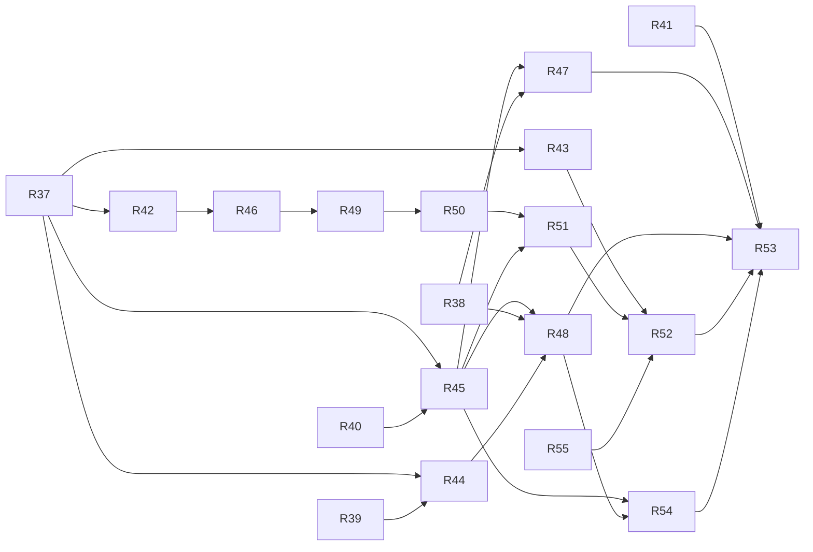

# v1.1 — TASKS.md sections

Cut from `TASKS.md` by `scripts/sdd/split.ts` (FR-SDD-3); ids resolve through `docs/sdd/ids.md`.

## v1.1 tasks

Draft, cut 2026-09-05 from `SPEC.md` v1.1 and `PLAN.md` v0.4, for review. Spec Phase 2b, "phone pass": the fifty open v1 findings, CI time, the compact layout and settings page, the chart legend, the sky window, the live trajectories and stripe, true north. Delivery is PLAN §16 as amended for the phase: five lanes, four models, the findings and the CI budget in the first wave, the sky-window spike driven by the owner. *(v1.1.1, 2026-09-06)* R54 appended from `SPEC.md` v1.1.1 and `PLAN.md` v0.4.1: the owner's wide live-page findings F-51..F-53 (V11-14, D-268), on the idle `live` lane beside the `ui` chain. *(v1.1.2, 2026-09-06)* R55 appended from `SPEC.md` v1.1.2 and `PLAN.md` v0.4.2: the install offer is snoozed by "Not now" rather than ended by it (V11-15, D-272). It depends on nothing in the phase and runs in any wave; V11-16 also puts the offer on the settings page, which is R52's, so R52 now waits for it.

**Before the first wave** (repo tooling, not tasks — PLAN D-86, D-197, D-198): `scripts/sdd/tasks.ts` accepts the lanes `window` and `docs`, the models `sonnet`, `haiku` and `interactive`, and the fields `Precondition:` and `Findings:`; `scripts/sdd/brief.ts` writes the brief; `session.ts` gains `--fallback`; `sdd-implement` reads the brief under `SDD_HEADLESS` and runs narrow tests while iterating. `--status` prints the open F-numbers.

### Conventions for this phase

- Everything in the v1 conventions holds. Lanes are PLAN §16.1 as amended (D-196), plus `docs` for the one task that touches no source:
  - `ui` — `src/ui/**` except `guide/skychart/**`, `screens/Live*` and `components/live/**`; `src/i18n/**`, `src/lib/{layout,shortcuts,shareLinks,moonPhrases,readiness,flags}.ts` and, from v1.1.2, `src/lib/installSnooze.ts`; `src/ui/styles/**`, `.github/workflows/**`, `tests/e2e/v1-captures.spec.ts`
  - `chart` — `src/ui/components/guide/skychart/**` except `window/`, `src/lib/{skyGeometry,skyBodies,legend,arcReveal}.ts`, `spike/dome-composition/**`
  - `window` — `src/ui/components/guide/skychart/window/**`, `spike/window/**`, `docs/window/**`
  - `live` — `src/ui/screens/Live*`, `src/ui/components/live/**`, `src/lib/{timeStripe,playback,declination}.ts`
  - `data` — `src/data/**`, `src/state/**`, `vite.config.ts`, `public/**`
  - `docs` — `docs/mockups/**`, `scripts/mockup-capture.ts`
- **Model** is per task from PLAN §16.6 (D-197): `fable` where the session verifies its own drawing, `opus` for semantics and copy, `sonnet` for mechanical work with a complete spec, `interactive` for the spike the owner drives. Reviews: `opus` on `Gate: auto`, `sonnet` on `Gate: owner`. A limit-stopped session is retried once on the next model (`fable → opus → sonnet`).
- **Findings:** lists the `F-<n>` ids (SPEC §4.20) a task closes. Each fix is one commit `F-<n>: …` with a test that fails on the old code; a finding the session verifies as already fixed on `main` is recorded in the summary with the commit (D-194). A task holds about ten findings at most (D-199).
- **Precondition:** a file that must exist on `origin/main`; the driver skips the task until it does (PLAN §16.3).
- The message catalogs are split per lane by R42 (`src/i18n/{en,es}/{ui,chart,live,window}.ts`); from R42 on a task edits only its lane's file, and `Touches outside the lane` need not name it.
- Captures: 390 px always, both languages and both themes; 1280 px and, from R50, 1024 px where the wide layout changed. Only `Gate: owner` tasks shoot captures, and only for the screens they changed (PLAN §16.8). The D-179 capture set is re-shot by `captures.yml` on `main`, never in a task.
- Decision numbers are reserved in one PLAN entry after D-199: R37 D-200..203, R38 204..207, R39 208..211, R40 212..215, R41 216..219, R42 220..223, R43 224..227, R44 228..231, R45 232..235, R46 236..239, R47 240..243, R48 244..247, R49 248..251, R50 252..255, R51 256..259, R52 260..263, R53 264..267. *(v1.1.1)* R54 takes D-269..D-271 (D-268 is its decision, already written). *(v1.1.2)* R55 takes D-273..D-275 (D-272 is its decision, already written).

### Tasks

- [x] **R37 — CI time: the 10 min budget, the capture set off the PR path, and the R36 findings** — the stored-run switch is on four specs (`shortcuts`, `desktop`, `pass-detail`, `language`), not on every page spec; the rest are listed as follow-ups in the PR body.
  - **Lane:** ui
  - **Model:** opus
  - **Gate:** auto
  - **Depends on:** —
  - **Findings:** F-46, F-47, F-48, F-49, F-50
  - **Goal:** A pull request's CI finishes inside ten minutes, and the release captures are a main-branch job.
  - **Satisfies:** FR-CI-1, FR-CI-2, FR-CI-3; FR-FIX-2 for the five R36 findings.
  - **Scope (PLAN D-195):** `ci.yml`: `timeout-minutes: 10` with FR-CI-1 named in a comment, a `time` step wrapping each stage with `date +%s` and a table in `$GITHUB_STEP_SUMMARY`. `v1-captures.spec.ts`: `test.skip(process.env['CAPTURES'] !== '1', …)` like `dome-perf`; the helpers taken from `liveHelpers.ts` (F-47); a fixed shot instant (F-48); seeded observers as the app produces them (F-49); `THEMES.length * LOCALES.length` (F-50). `captures.yml`: on `push` to `main` and `workflow_dispatch`, `CAPTURES=1 npx playwright test v1-captures`, upload `docs/screenshots/v1-*.png` as an artefact, fail on a missing file, commit nothing. `playwright.config.ts`: `workers: '100%'` on CI. `liveHelpers.ts`: `seedStoredRun()` so a page spec loads a stored run; every spec that only needs a rendered page uses it (FR-CI-3).
  - **Touches outside the lane:** `.github/workflows/captures.yml` (new), `playwright.config.ts`, `tests/e2e/liveHelpers.ts`, `tests/e2e/*.spec.ts` (the `seedStoredRun` switch), `tests/docs/captures.test.ts`.
  - **Done when:**
    - The PR's own CI run finishes under 10 min and its step summary shows the stage table.
    - `npx playwright test` locally skips the 60 capture tests without `CAPTURES=1`; with it they run and write the set.
    - `captures.yml` runs on the merge to `main` and uploads the artefact.
    - `--reporter=list` shows no spec over 60 s on CI.
    - A test per closed finding, named by its F-number.

- [x] **R38 — Sky-window spike: projection, field of view, the sensor path and the stripe's touch stepping** — done on an iPhone with Safari and Chrome; Android Chrome is the one line of `FINDINGS.md` left for a later run. The heading pick is `fused` (alpha calibrated by the compass while upright), a fifth pick the entry did not foresee.
  - **Lane:** window
  - **Model:** interactive
  - **Gate:** owner
  - **Depends on:** —
  - **Goal:** The owner picks, on a phone, how the sky window projects and how the stripe steps.
  - **Satisfies:** FR-WIN-7; resolves OQ-16, OQ-17, OQ-18.
  - **Scope (PLAN §8.10):** `spike/window/` — one page with every knob as a URL parameter: `projection=gnomonic|stereographic`, `fov`, `smoothing`, the three orientation angles live, screen-angle correction on and off; the two fixture passes (the golden grazing pass and R14's synthetic high pass) drawn in the window; a second page with the stripe at 390 px and the three stepping candidates (`step` buttons, tap-to-jump on a segment, slow drag) each behind a parameter. Measured: the update rate by the D-62 method; the iOS facts of OQ-17 (`webkitCompassHeading` with `beta`/`gamma` in one event; interface-orientation correction). Captures at 390 px. `docs/window/FINDINGS.md`: the owner's picks as constants (`WINDOW_FOV`, `WINDOW_SMOOTHING`, the projection, the stepping control) and the sensor facts.
  - **Touches outside the lane:** none.
  - **Done when:**
    - `docs/window/FINDINGS.md` exists on `main` with the four picks and the OQ-17 answers, each with a capture or a number behind it.
    - The stepping pick lands `t` within 1 min of a rise in ≤ 3 taps on the owner's phone (US-22 AC6).
  - **How it runs:** the owner opens a session in this checkout and drives the spike with the phone on the local network (`vite --host`); the driver lists the task and never runs it.

- [x] **R39 — Live findings: playback, the stripe's focus and memoisation, the follow control, the shared-link observer**
  - **Lane:** live
  - **Model:** opus
  - **Gate:** auto
  - **Depends on:** —
  - **Findings:** F-34, F-36, F-37, F-38, F-39, F-40, F-42
  - **Goal:** The live page's seven open review findings closed, each by a test.
  - **Satisfies:** FR-FIX-1 for the live lane; FR-LIVE-8 as amended (the control hidden on polar, F-40).
  - **Scope:** `usePlayback` clamps the held instant on resume (F-36); `live.spec.ts` uses `exact: true` for `60×` (F-37); `hourTicks`, `nightBands`, `passSegments` memoised on `(span, passes, zone)` (F-38); pointer-down no longer prevents default, the stripe is focusable and focuses itself (F-39); `FollowPhone` hidden when the view is polar (F-40); the permission-less path stays `off` until a reading arrives (F-42); a same-document navigation to `#live?lat=…` applies the link's observer through `startApp`'s parser, not only at mount (F-34).
  - **Touches outside the lane:** `src/ui/App.tsx` (F-34's hash listener, one hunk), `tests/e2e/live.spec.ts`.
  - **Done when:** a test per finding, named by it; `npm test` and `live.spec.ts` green; no capture (nothing visible changes).
  - *Done as written, with three notes: F-37's locator is in `live-playback.spec.ts`, not `live.spec.ts`, and needed an anchored pattern rather than `exact` (the accessible name carries the `[x] ` the CSS writes); F-38 took the shown instant out of `passSegments` (`isCurrent(segment, t)` at draw time) so the memo can hold on `(passes, span, width)`; F-42 makes `aria-pressed` follow the first reading, which moved three follow assertions in `Live.test.tsx` and `live-landscape.spec.ts`.*

- [x] **R40 — Chart findings: the astronomy import retry, the flown strip, the polar Sun label and glow, the zoom guard**
  - **Lane:** chart
  - **Model:** sonnet
  - **Gate:** auto
  - **Depends on:** —
  - **Findings:** F-1, F-2, F-3, F-4, F-5, F-35
  - **Goal:** The chart's six open findings closed.
  - **Satisfies:** FR-FIX-1 for the chart lane.
  - **Scope:** `useSkyBodies` clears `pending` on rejection so the chunk is retried (F-1); `flownStrip` keeps `passStrip`'s `omit` gap (F-2); the polar Sun label moves above the grid group (F-3); the polar glow's step derives from its half-width like the dome's (F-4); the flown strip takes `highlighted` into its colour (F-5); the dome's keep guard compares `zoom` (F-35). The raster snapshot is re-baked only if F-2 or F-5 change it.
  - **Touches outside the lane:** none.
  - **Done when:** a test per finding; `SkyChart.contract.test.tsx` and the snapshot green.

- [x] **R41 — Data findings: the favourites' sort, the stale zone, the doc block**
  - **Lane:** data
  - **Model:** sonnet
  - **Gate:** auto
  - **Depends on:** —
  - **Findings:** F-11, F-12, F-13
  - **Goal:** The favourites store's three open findings closed.
  - **Satisfies:** FR-FIX-1 for the data lane.
  - **Scope:** `addFavourite` keeps the just-saved entry whatever the stored stamps say (F-11); `fillTimeZone` refreshes the matching favourite when the zone resolves (F-12); the `Favourite` doc block names `cellKey` (F-13).
  - **Touches outside the lane:** none.
  - **Done when:** a test per finding; `npm test` green.

- [x] **R42 — The catalogs split per lane, and the Moon lore behind its flag**
  - **Lane:** ui
  - **Model:** sonnet
  - **Gate:** auto
  - **Depends on:** R37
  - **Goal:** Each lane owns its own message file, and the lore line is off by default.
  - **Satisfies:** FR-FLAG-1, FR-FLAG-2; FR-MOON-4 as amended; PLAN D-183, D-199 (2).
  - **Scope:** `src/i18n/en/{ui,chart,live,window}.ts` and the same for `es`, merged by `en.ts` / `es.ts` into the unchanged `Messages` type so no consumer changes (the split is by the key's owning lane, using the sections the catalogs already have; `window.ts` starts empty). `lib/flags.ts` exporting `MOON_LORE` from `import.meta.env.VITE_MOON_LORE === 'on'`; `vite.config.ts` `envPrefix` and a build-time log line; `App.tsx` renders `MoonLore` through `React.lazy` inside `if (MOON_LORE)`; `tests/build/flags.test.ts` builds with the flag off and asserts no chunk holds a lore key; `vitest.config.ts` sets `VITE_MOON_LORE=on` for the unit run; an ESLint `no-restricted-syntax` rule forbids `import.meta.env` outside `lib/flags.ts`.
  - **Touches outside the lane:** `vite.config.ts`, `vitest.config.ts`, `eslint.config.js`, `tests/build/flags.test.ts` (new).
  - **Done when:**
    - `npm run typecheck` green with the split; no key moved, added or renamed (a test diffs the flattened key sets before and after).
    - `npm run build` prints `VITE_MOON_LORE=off` and `flags.test.ts` passes; with `on`, `MoonLore.test.tsx` passes and the home renders the line.
    - The default capture set (on `main`) shows no lore line.

- [x] **R43 — The compact mockups: home, settings and the pass detail with its legend**
  - **Lane:** docs
  - **Model:** opus
  - **Gate:** owner
  - **Depends on:** R37
  - **Goal:** The owner approves what the phone screens will look like before they are built.
  - **Satisfies:** FR-COMP-6; PLAN D-191.
  - **Scope:** `docs/mockups/compact-390.html` on the app's own `tokens.css` and `global.css`, one `<style>` block for the compact rules, three screens (home with the one-row header and the location summary, `#settings`, the pass detail with the full-bleed square chart and the table as its legend) in both themes; `npm run mockup:compact` through `scripts/mockup-capture.ts` writing `compact-390-{home,settings,detail}-{dark,night}.png`; `docs/mockups/README.md` says what is illustrative (the chart is R22's capture with its labels blanked).
  - **Touches outside the lane:** `package.json` (the script).
  - **Done when:** the six PNGs exist and the owner has approved them on the PR; every control row in the mockup is ≤ 36 cells (FR-COMP-4, counted by hand in the README).

- [x] **R44 — True north: the declination in the heading and on the strip**
  - **Lane:** live
  - **Model:** opus
  - **Gate:** auto
  - **Depends on:** R37, R39
  - **Findings:** F-41
  - **Goal:** The dome that follows the phone faces true north.
  - **Satisfies:** FR-WIN-3 (the heading correction), FR-LIVE-8 as amended; US-21 AC6; PLAN D-185.
  - **Scope:** `lib/declination.ts` — `declinationDeg(observer, date)` over `geomagnetism` 0.2.0 (the only importer; the boundary rule in `eslint.config.js`); the live slice computes and caches it when the observer changes; `compassHeading.ts` adds it to the magnetic heading; `StatusStrip` prints "true north, declination +1.1°" in both languages while following. Tests: three observers against NOAA calculator values (±0.2°); the heading sum; the strip line.
  - **Touches outside the lane:** `eslint.config.js` (the boundary rule), `scripts/bundle-budget.ts` (the live chunk's budget, re-set by D-178's rule).
  - **Done when:** the tests above; `npm run bundle:budget` shows the live chunk within its re-set budget; `live.spec.ts`'s follow case asserts the strip line.
  - *Done as written, with three notes.* There is no live slice in `src/state` (the lane's "live slice" is the page), so the cache is `useDeclination`, a per-observer `useMemo` in `src/ui/components/live/`. `declinationDeg` passes `allowOutOfBoundsModel: true`: `geomagnetism` throws outside the WMM epochs, and a static site still being loaded after November 2029 must extrapolate rather than fail to render. The follow case `live.spec.ts` was to assert on did not exist there — the R34 one is in `live-landscape.spec.ts` — so both now assert the line, and `live.spec.ts` gains a portrait follow case in both languages.

- [x] **R45 — The legend, the fit rule and the arc states in the dome and polar views**
  - **Lane:** chart
  - **Model:** fable
  - **Gate:** owner
  - **Depends on:** R37, R40
  - **Goal:** The drawings carry keys instead of text, fill their box, and can draw a pass in any of the five arc states.
  - **Satisfies:** FR-LEG-1, FR-LEG-2, FR-LEG-4, FR-LEG-5 (the legend component and its placement); FR-COMP-5, FR-DOME-1 as amended (the box and the fit rule); FR-TRAJ-1 and FR-TRAJ-3 for the dome and polar (the drawing per state); FR-DOME-4, FR-DOME-6 as amended; US-23 AC1, AC2, AC4, AC5. **Advances** FR-LEG-3 (the detail's table, R51) and FR-TRAJ-1 on the live page (R48).
  - **Scope (PLAN D-186, D-187, D-189, §8.9):** `lib/legend.ts` (`legendRows`), `lib/arcReveal.ts` (`arcState`, `cutTrack`; the constants in `physics/constants.ts` — one additive hunk, named below), `SkyChart.types.ts` gains `legendKeys` and `passes[i].arc` (default `'full'`), `skychart/Legend.tsx`, `ChartFrame.tsx` owning the box (full-bleed and square on compact; the live height floor through a `ResizeObserver`) and the legend's slot (under on compact, a 24-cell column on wide); `camera.ts` `zoom = min(width / 2.4, height / 1.6)`; the dome's name and time hotspots and the polar's name and time `<text>` removed, the key drawn at each peak; `domeGeometry` and `SkyPolar` draw `live` as the cut track solid, `ahead` dotted faint, `linger` faint, `hidden` not at all. The raster snapshot re-baked once; the D-172 rate re-measured at 390 px and recorded.
  - **Touches outside the lane:** `src/physics/constants.ts` (`ARC_LOOKAHEAD_MS`, `ARC_LINGER_MS`, additive), `src/i18n/{en,es}/chart.ts`.
  - **Done when:**
    - The contract test's new assertions: each view draws each pass's key once at the peak and no other text than compass and ring labels; the legend lists the same passes in the same order in both views.
    - `camera.test.ts`: extent ≥ 90 % of the shorter side at 390 × 390 and 1240 × 450.
    - `arcReveal.test.ts` at the five boundaries; each view's geometry test per state.
    - Captures: the pass detail at 390 px (full-bleed square, legend under) and 1280 px (legend beside), both themes, both languages; the D-172 figure in the summary ≥ 30/s.
  - *Done as written, with four notes.* The legend goes beside the drawing only where the frame has 62 cells (D-232): at 1280 px the guide column is 40 cells and the detail's legend stays under; the live page at 1280 px is the beside capture. The portrait floor is behind a page switch the live page holds off until R48 re-cuts its rows (D-233). The catalog split (D-199) is not on `main`, so the legend's keys went into the chart section of `en.ts` / `es.ts`. The D-172 rate is 45.3/s at 390 px and 34.0/s at 1280 px (D-234).

- [x] **R46 — ui findings A: the readiness line, the nights and the place picker offline**
  - **Lane:** ui
  - **Model:** opus
  - **Gate:** owner
  - **Depends on:** R42
  - **Findings:** F-21, F-22, F-23, F-24, F-25, F-26, F-27, F-28
  - **Goal:** R27's eight open findings closed.
  - **Satisfies:** FR-FIX-1 for the ui lane, part one.
  - **Scope:** no readiness verdict before the first requests settle on a warm start (F-21); the offline notice keyed to the picker's own query, not the restored label (F-22); `offlineUntil` compared with now (F-23); night overrides reset per run (F-24); the heading count excludes the hero pass (F-25); "tomorrow night" from the observer's calendar day (F-26); the readiness stamp carries the zone (F-27); the Spanish offline sentence reworded so it cannot read as the opposite state (F-28, owner reads it).
  - **Touches outside the lane:** none.
  - **Done when:** a test per finding; captures of the readiness line and the night headings at 390 px in Spanish.
  - *Done 2026-09-06, with three notes.* F-27 was closed as written and no further: D-145 leaves the zone off this stamp to keep it inside the 36 characters a 390 px phone has, and that reasoning holds for the observer's own zone, so only the unlabelled UTC fallback — the case the finding names — gained a label. F-24 is keyed to the coordinates rather than to the run, because a re-compute for the same place is the same three nights and closing the reader's disclosures for it would be its own bug. F-28's Spanish reads "Listo sin red hasta …" / "No está listo sin red: …": "sin conexión" makes the sentence 40 characters and D-145 allows 36, and the place picker — where the sentence really is about an absent connection — keeps it. Captures: `docs/screenshots/r46-{readiness,nights,nights-later}-390-dark-es.png`.

- [x] **R47 — The sky window view** *(done 2026-09-06; the placeholder aims 20° up or as high as the peak needs, D-241; the window and declination chunks get budgets, D-242)*
  - **Lane:** window
  - **Model:** fable
  - **Gate:** owner
  - **Depends on:** R38, R45
  - **Precondition:** `docs/window/FINDINGS.md`
  - **Goal:** Hold the phone up and see the passes in the part of the sky it points at.
  - **Satisfies:** FR-WIN-1, FR-WIN-2, FR-WIN-4, FR-WIN-5, FR-WIN-3 (the three-angle rotation and smoothing; the declination comes from R44 through `compassHeading.ts`); FR-GUIDE-2b as amended; US-21 AC1..AC4, AC7. **Advances** FR-WIN-6 (R48).
  - **Scope (PLAN D-188, §8.10):** `skychart/window/projection.ts` (pure; the spike's projection and `WINDOW_FOV`), `useDeviceOrientation.ts` (heading, pitch, roll; D-175's permission path; `WINDOW_SMOOTHING`; one update per frame), `SkyWindow.tsx` (SVG: horizon with compass names, altitude lines and zenith mark, azimuth ticks, arcs clipped to the field with markers and keys, live marker and flown part, Sun and Moon; the legend through `ChartFrame`); registered in `SKY_CHART_VIEWS` with `available()`; `chartView` accepts `'window'`; `[ point at the sky ]` in the window's place when saved and a gesture is needed.
  - **Touches outside the lane:** `SkyChart.tsx` (the registration, one hunk), `state/slices/prefs.ts` (`chartView`'s union), `src/i18n/{en,es}/window.ts`, `scripts/bundle-budget.ts`.
  - **Done when:**
    - `projection.test.ts` hand-computed points; the hook's permission, smoothing and rate tests; the contract test over three views.
    - Playwright with `hasTouch` and stubbed orientation: the option present, the window drawn, the horizon moving with a synthetic event; without touch the option absent.
    - Captures at 390 px, both themes, both languages, from the stubbed orientation; the rate figure in the summary.

- [x] **R48 — Live trajectories, the three-row stripe, the stepping control and window mode**
  - **Lane:** live
  - **Model:** fable
  - **Gate:** owner
  - **Depends on:** R38, R44, R45
  - **Precondition:** `docs/window/FINDINGS.md`
  - **Goal:** On the live page the tracks appear, grow and fade as time moves, and the stripe can be read and stepped on a phone.
  - **Satisfies:** FR-TRAJ-1, FR-TRAJ-2, FR-TRAJ-3 (the live page's use of the states), FR-TRAJ-4, FR-TRAJ-5, FR-WIN-6, FR-LIVE-2, FR-LIVE-4, FR-LIVE-7 as amended; US-22 AC1..AC7; US-21 AC5. **Advances** FR-COMP-4 (the live rows, tested in R52).
  - **Scope (PLAN D-189, D-190, §8.11):** `Live.tsx` sets `passes[i].arc` from `arcState(pass, t)` and passes `legendKeys`; the legend on the page; `TimeStripe` as three rows in body cells (labels every 2 h wide / 3 h compact with the date at midnight, band with hourly ticks, segments), `TimeReadout.tsx` above it; the stepping control the findings file names, on `usePlayback.stepTo`; `windowMode`: choosing the window dispatches `now()` and hides the stripe block and playback; the compact portrait layout per FR-LIVE-7 as amended (one-row header slot, the chart box taking the remaining height, two-line strip, at most two control rows, no drag hint).
  - **Touches outside the lane:** `src/i18n/{en,es}/live.ts`, `tests/e2e/live.spec.ts`.
  - **Done when:**
    - e2e: scrubbing across one pass moves it through `ahead`, `live`, `linger`, gone, with the legend's state and the drawn segments following; playing at 3600× keeps the D-172 rate (measured, in the summary).
    - The stripe's three rows and the readout in RTL tests in a fixed zone; the stepping lands within 1 min of a rise in ≤ 3 taps in Playwright with `hasTouch`.
    - Window mode hides the stripe and playback and returns `t` to now; leaving restores them.
    - Captures at 390 px portrait and 844 × 390 landscape, both themes, both languages.
  - *Done as written, with three notes.* The stepping is the spike's six buttons (`|◀ rise −10m −1m +1m +10m rise ▶|`), and `rise ▶|` lands on a rise in one tap. The compact strip is two lines of numbers (D-246) and the compact top row drops the language and theme switches (D-244); the portrait floor is D-233's frame width, 351 px at 390 px, not the full-bleed 390. Window mode's e2e goes with R47, since the preference schema rejects a view it does not know; the RTL test covers FR-WIN-6. The D-172 rate is 59.1/s at both widths (D-247).

- [x] **R49 — ui findings B: favourites and coordinates, the install and update offers, the Moon on the cards, the leftovers**
  - **Lane:** ui
  - **Model:** opus
  - **Gate:** owner
  - **Depends on:** R46
  - **Findings:** F-29, F-30, F-31, F-32, F-33, F-14, F-15, F-16, F-20
  - **Goal:** R28's and R30's open findings closed, and the two stray files gone.
  - **Satisfies:** FR-FIX-1 for the ui lane, part two; US-18 AC1 completed (F-14).
  - **Scope:** picking a favourite reseeds `CoordsInput` (F-29); the update offer is inert under an open pass on wide too (F-30); the `beforeinstallprompt` listener lives outside the shell's mount (F-31); `prompt()` rejections caught (F-32); the first-visit e2e assertion waits for hydration (F-33); the phase name and illumination on the card and in the guide whenever the Moon is up, glare or not (F-14, owner reads the Spanish); the altitude condition parameterised like the other two (F-15); the debug script and the scratch Playwright config deleted and git-ignored (F-16, F-20).
  - **Touches outside the lane:** `.gitignore`, `tests/e2e/*.spec.ts` (F-33).
  - **Done when:** a test per finding; captures of a card with the Moon line at 390 px in Spanish.

- [x] **R50 — ui findings C: mid widths, the Escape guard, focus and `inert`, the breakpoint's font**
  - **Lane:** ui
  - **Model:** opus
  - **Gate:** owner
  - **Depends on:** R49
  - **Findings:** F-6, F-7, F-8, F-9, F-10, F-43, F-44, F-45
  - **Goal:** R23's and R35's open findings closed, with the desktop usable at every wide width.
  - **Satisfies:** FR-FIX-1 for the ui lane, part three; FR-DESK-3, FR-DESK-5 as amended; PLAN D-192.
  - **Scope:** `lib/layout.ts` `WIDE_SPLIT_MIN_CELLS = 124` pinned by the breakpoint test; below it an open guide takes the right column and `GuidePanel` shows `[ list ]` (F-6); the `Escape` listener guarded by the picker's open state (F-7); `PassDetail` keyed by the pass so focus moves to the new heading (F-8); the list's height from the shell, not a fixed 34 rows (F-9); the breakpoint derivation measured from the actual font rather than assumed (F-10); the opener captured before `inert` blurs it (F-43); `moveCursor` confirms focus moved (F-44); `inert` covers the compact sheet's portal (F-45). `playwright.config.ts` gains `desktop-1024`; `wide.spec.ts` runs at both widths.
  - **Touches outside the lane:** `playwright.config.ts`, `tests/e2e/wide.spec.ts`, `tests/styles/breakpoint.test.ts`.
  - **Done when:** a test per finding; captures of the home and the guide at 1024 px and 1280 px, both themes, English.
  - *Done. `WIDE_SPLIT_MIN_PX` counts the two gutters and one of the shell's two side paddings as well as the 124 cells, so the split is at 1272 px rather than 1253 and 1280 keeps both columns (D-253).*

- [x] **R51 — The pass detail's legend block and the share findings** — the shadow boundary renames its table row rather than adding a fourth, since `Pass` has three points and the drawing swaps the marker there (D-257, the owner's call in session); the table reaches the legend as `SkyChartProps.legendLead`, called with the row it replaces (D-256). The detail's chart is still given only the explained pass, so FR-TRAJ-3's dim arcs of the others never appear on it — the rows are there the moment it is, and the contract test covers them; listed as a follow-up. The owner's review of the wide guide added D-259: the legend goes beside the drawing only while it is a list, since the guide column grows with the screen and a five-column table folded into 24 cells on a large desktop.
  - **Lane:** ui
  - **Model:** opus
  - **Gate:** owner
  - **Depends on:** R45, R50
  - **Findings:** F-17, F-18, F-19
  - **Goal:** On the pass detail the table is the legend, and a share link no longer holds the page hostage.
  - **Satisfies:** FR-LEG-3 (the detail), FR-GUIDE-7 as amended; US-23 AC3; FR-FIX-1 for the ui lane, part four.
  - **Scope:** `PassNumbers.tsx` moves directly under the chart, takes the key and the swatch in its heading, adds the shadow-entry row where one applies, and is followed by one row per dim pass and one line each for the Sun and the Moon (all from `legendRows`); `GuideText` stays above the chart. A share link is consumed once and cleared from the hash when the user changes the observer (F-17); the substitute pass waits for `passes.status === 'done'` before opening (F-18); the altitude bounds shared from one module (F-19).
  - **Touches outside the lane:** none (the legend rows come from `lib/legend.ts`, chart-owned and merged by R45).
  - **Done when:** the detail's contract test (the table is the first legend block, one row per dim pass, the Sun and Moon lines); a test per finding; captures of the detail at 390 px and 1280 px, both themes, both languages.

- [x] **R52 — The settings page, the two headers, the location summary and the rows that fit** — the compact header needed a short title, which the entry did not name: "What is in your sky right now" is 29 of FR-COMP-4's 36 cells before the two controls have said anything (D-261). The clear action is lifted out of `LocationInput` by a `showClear` prop so FR-COMP-2's order can hold, and the language switch's right alignment moved from the component to the two callers that want it (D-262). `controlRows.test.ts` reads each row's brackets out of its own stylesheet and applies a state's decoration only to the element in that state, without which the live page's playback row measures 39 cells instead of its real 33 (D-263). It found one row over budget: the Spanish "no place set" prompt, at 37. `InstallAction` and `installEnv.ts` are D-260's split, and `InstallHint` now wraps the same action with its "Not now" passed in, so the copy exists once. Moving the form off the compact home rippled through a dozen e2e specs, which reach it through `liveHelpers`' new `withSettings` / `openSettings` / `leaveSettings`.
  - **Lane:** ui
  - **Model:** opus
  - **Gate:** owner
  - **Depends on:** R43, R51, R55 (the hint's two answers, which the settings action is pulled out beside)
  - **Precondition:** `docs/mockups/compact-390-home-dark.png`
  - **Goal:** On a phone the home screen is the answer, the form is one tap away, and nothing wraps.
  - **Satisfies:** FR-COMP-1, FR-COMP-2 as amended (v1.1.2, the Install row), FR-COMP-3, FR-COMP-4, FR-DESK-2 as amended, US-5 AC2 as amended, FR-OFF-6 as amended (v1.1.2, V11-16), US-16 AC4 as amended; US-20 AC1..AC6; PLAN D-184, D-193, D-260.
  - **Scope:** `common/Header.tsx` with the wide row (title, `[ Live sky ]` beside it, language and theme at the right on one grid row) and the compact row (title, `[ live ]`, `[ settings ]`); `screens/Settings.tsx` at `#settings` composing the existing location, favourites, language and theme components; `passSelection.ts` parses the third route; `Esc` through the D-73 listener; `common/LocationSummary.tsx` on the compact home; `SortToggle` short labels on compact; `tests/styles/controlRows.test.ts` over every FR-COMP-4 row in both locales (the live page's rows included, rendered from R48's components). **Install (V11-16, D-260):** `common/InstallAction.tsx` pulled out of `InstallHint.tsx` — whichever of the two shapes the environment calls for, over the event `installOffer.ts` holds, with no decline beside it — placed on the settings page between Saved places and Clear saved location. It reads the browser, never `installOfferVisibility`, so it survives the third "Not now"; taking it calls `dismissInstallHint`, and it does not render when the browser has nothing to offer, which is also what "already installed" looks like. `InstallHint` keeps the snooze and wraps the same action, so the copy exists once.
  - **Touches outside the lane:** none.
  - **Done when:**
    - RTL: `#settings` renders; each control writes the store field it wrote on the home screen; `Esc`, back and the hash round-trip; the wide layout shows no `#settings` link and its header row is one grid line.
    - `controlRows.test.ts` ≤ 36 cells for every row in both locales.
    - e2e at 390 px: header, summary, settings, and the sort row on one line; at 1280 px the live link beside the title.
    - The settings Install row: shown after the third decline and while a snooze is running, both shapes by the environment prop, absent when the browser offers nothing, and taking it installs and ends the hint. Its row fits FR-COMP-4's 36 cells in both locales.
    - Captures of home, settings and the wide header, both themes, both languages, against the R43 mockups; the settings capture shows the Install row.

- [x] **R53 — v1.1 release preparation** — the set is 92 files, not a top-up: `settings`, `window` and `legend` are three new screens and the whole set was cleared and re-shot, which is what caught `v1-favourites-390-*` still showing the saved places on a home screen R52 moved to `#settings` (D-273). The window's captures need a touch context, so they are a `test.describe` of their own; the legend's are shot two minutes past the search instant, where the rows read `up` and `gone` rather than four `soon`s. The budget re-set moves one row — the live chunk from 15 KB back to the 10 KB floor (D-274) — and every other chunk re-measures to the number it already had. The findings register is the PR's table, F-1..F-53 and not F-1..F-50: the last three were written after this entry was (D-275). The tag, the deploy, the two phones of `docs/RELEASE.md` §7 and the `captures.yml` run on the merge stay with the owner.
  - **Lane:** ui
  - **Model:** opus
  - **Gate:** owner
  - **Depends on:** R41, R47, R48, R52, R54
  - **Goal:** v1.1 is releasable: every finding accounted for, the capture set extended, the budgets re-set, the version bumped.
  - **Satisfies:** SPEC §9 Phase 2b definition of done; FR-FIX-1's "none silently open".
  - **Scope:** `captureSet.ts` gains the settings page, the window (stubbed orientation), the legend states and the 1024 px profile; `captures.yml` re-shoots on `main`; `tests/docs/captures.test.ts` matches; `bundle-budget.ts` re-set by D-178's rule; `docs/RELEASE.md` gains the phone checks (the window on a real iPhone and Android, the FR-GUIDE-6 and FR-LIVE-5 rates); a table in the summary listing F-1..F-50 with the commit or the Decision Log row that closed each; `package.json` 1.1.0.
  - **Touches outside the lane:** `tests/e2e/captureSet.ts`, `tests/docs/captures.test.ts`, `scripts/bundle-budget.ts`, `docs/RELEASE.md`, `package.json`.
  - **Done when:** `npm test`, `npm run build`, `npm run bundle:budget` all `ok`; the `captures.yml` run on the merge is green; the findings table has no empty row; the owner tags `v1.1.0`.

- [x] **R54 — The wide live page: the raster inside its box, the rows folded, the legend scrolling**
  - **Lane:** live
  - **Model:** opus
  - **Gate:** owner
  - **Depends on:** R45, R48
  - **Findings:** F-51, F-52, F-53
  - **Goal:** On a large screen the dome sits inside its box with its north and south rows whole, gets the height the folded rows give back, and every legend row can be reached.
  - **Satisfies:** FR-DOME-1 as amended (v1.1.1, the ceiling), FR-LIVE-7 as amended (v1.1.1, wide), FR-LEG-2 (the column reachable); FR-FIX-1 for F-51..F-53.
  - **Scope (PLAN D-268):** `dome/camera.ts`'s fit rule bounded above — the extent, labels included, at most the shorter side of the box, the 90 % test pinning 100 % too (F-51). `Live.module.css` gains a wide branch at FR-DESK-1's 100 cells beside D-173's landscape one, areas `top` / `dome` / `bottom` / `strip`: the view control, the facing readout and the hint on the top row; the playback controls at the left, the stripe block with its readout filling the rest and the share action at the right on the bottom row; the strip one line; the dome row `minmax(0, 1fr)` takes the rest (F-52). `Legend.module.css` scrolls the column within the box's height (`overflow-y: auto`, `min-height: 0` up the grid) and `Legend.tsx` scrolls the activated row into view (F-53). Portrait, landscape on a phone and window mode are unchanged. Opus rather than Fable: D-268 fixes every number and file, so the session verifies against a written rule, not against what it draws.
  - **Touches outside the lane:** `src/ui/components/guide/skychart/dome/camera.ts` and its test, `src/ui/components/guide/skychart/Legend.tsx` and `Legend.module.css` (the `chart` lane, named here per FR-FIX-1), `tests/e2e/live.spec.ts`.
  - **Done when:**
    - The fit test asserts 90 % ≤ extent ≤ 100 % of the shorter side at 1280 × 800 and 1920 × 1080, and fails on the old rule at 1920 (F-51).
    - `live.spec.ts` at 1920 × 1080: one row above the dome and two under it, the dome box at least 75 % of the viewport height, no page scroll; at 390 × 844 the portrait rows are as R48 left them (F-52).
    - A legend test reaches the last drawn pass by keyboard and its row is within the column's visible box (F-53).
    - Captures: the live page at 1920 × 1080 dark en, and at 1280 × 800 both themes en; `npm test` and `live.spec.ts` green.
  - *Done as written, with three notes.* The row above the dome is the chart's, not the page's, so the fold moved the view toggle into the frame's controls slot and touched `SkyChart`, `ChartFrame` and the three views (D-269). The stripe joins the bottom row only from 164 cells (`STRIPE_ROW_MIN_CELLS`, D-270): 1920 px folds to two rows, 1280 and 1440 keep the stripe on its own row, three where R48 had five. F-53's pointer half was already fixed by R45's scroll rule — the finding had measured the list, not the slot — and is recorded as such; its keyboard half was real, since focus promoted the row to the top and Tab looped over the first two rows, so focus now highlights without promoting (D-271).

### Expected waves (v1.1)

Computed from the graph with the driver's caps (one task per lane, three at once, concurrently). R38 is `interactive` and sits outside the driver's waves; R47 and R48 wait on its findings file.

| Wave | Tasks | Lanes | Models |
|---|---|---|---|
| 1 | R37, R39, R40 | ui, live, chart | opus, opus, sonnet |
| 1b | R41 (the fourth ready task; picked up by the next `--wave`) | data | sonnet |
| 2 | R42, R44, R45 | ui, live, chart | sonnet, opus, fable |
| 3 | R46, R43 | ui, docs | opus, opus |
| 4 | R49, R47, R48 | ui, window, live | opus, fable, fable |
| 5 | R50, R54 | ui, live | opus, opus |
| 6 | R51 | ui | opus |
| 7 | R52 | ui | opus |
| 8 | R53 | ui | opus |

The `ui` lane is again the long pole: eight of its tasks in a row, because the findings live where the bugs were and the settings page is the phase's last feature. Everything else is done by wave 4, and R54 (v1.1.1) rides beside R50 in wave 5 on the idle `live` lane. If the owner wants the phone screens sooner, R52's dependency on R51 can be dropped at the cost of two rebases on `App.tsx`; the findings tasks would then follow it. Model spend: five of seventeen sessions on Sonnet, three on Fable, one interactive, the rest on Opus; reviews are Sonnet on the eleven `Gate: owner` tasks.

No two tasks in one wave name the same shared file: R37 and R39 both touch `tests/e2e/live.spec.ts` only through R37's `seedStoredRun` switch, which is one additive import per spec; the driver's rebase settles it. `src/physics/constants.ts` is touched by R45 alone. From R42 on the catalogs are per lane.

- [x] **R55 — The install offer comes back: "Not now" snoozes it, 7 days then 30, then never** — done as written; the three stored fields travel as one `InstallAnswer` through the store so the pure rule and the slice cannot read the device differently, and the e2e is `install-snooze.spec.ts` on the pull-request path (two tests, 0.8 s) with the captures behind `CAPTURES=1`. The iOS note snoozes too, since "Not now" is the only answer it has.
  - **Lane:** ui
  - **Model:** opus
  - **Gate:** owner
  - **Depends on:** none (R28 built the hint and is merged)
  - **Goal:** A reader who is not ready to install the app today is asked again in a week, and twice more at most; one who installs it is never asked again.
  - **Satisfies:** FR-OFF-6 as amended (v1.1.2), US-16 AC4 as amended; PLAN D-272.
  - **Scope (PLAN D-272):** `src/lib/installSnooze.ts` — new — holds `INSTALL_SNOOZE_DAYS = [7, 30]` with its rationale (FR-VIS-6) and one pure function from `{ dismissed, declines, snoozedUntil }` plus an instant to `'shown' | 'snoozed' | 'answered'`; `data/localPrefs.ts` gains `installHintDeclines` and `installHintSnoozedUntil`, both optional in the zod schema and both absent on a device that has never declined; `state/slices/prefs.ts` gains `declineInstallHint` beside the existing `dismissInstallHint`, which keeps writing the latch for Install and `appinstalled`; `InstallHint.tsx` asks the pure function at mount (`Date.now()`, read once) instead of reading the latch, and its "Not now" calls the new action. The copy does not change.
  - **Touches outside the lane:** `src/data/localPrefs.ts`, `src/state/slices/prefs.ts` (the `data` lane), and the new `src/lib/installSnooze.ts`, which no lane owns yet — the conventions list gains it under `ui`.
  - **Done when:**
    - `installSnooze.test.ts` at the boundaries: nothing stored shows the offer; one decline at `t` hides it at `t + 7 d − 1 ms` and shows it at `t + 7 d`; a second hides it 30 days; a third answers it for good; a stored `installHintDismissed` answers it whatever the count says.
    - `localPrefs.test.ts`: the two keys round-trip, and a blob written before v1.1.2 (the latch alone, or neither key) reads as a device with no declines.
    - `InstallHint.test.tsx`: "Not now" writes a decline and not the latch; the install action and `appinstalled` still write the latch; a snoozed hint renders nothing; a hint whose snooze has expired renders again when the browser is still offering.
    - An e2e case at 390 px: "Not now", reload, no hint; the clock moved past the snooze with `page.clock`, reload, the hint is back.
    - Captures: the home screen at 390 px with the hint up, both themes and both languages, against R28's.

### Requirement coverage (v1.1)

| Requirement | Tasks |
|---|---|
| FR-FLAG-1, 2 | R42 |
| FR-COMP-1, 2, 3, 4 | R52 |
| FR-COMP-5 | R45 |
| FR-COMP-6 | R43 |
| FR-LEG-1, 2, 4, 5 | R45 |
| FR-LEG-3 | R51 (the detail), R48 (the live page's rows) |
| FR-OFF-6 as amended (v1.1.2) | R55 (the snooze), R52 (the settings action, V11-16) |
| FR-WIN-1, 2, 4, 5 | R47 |
| FR-WIN-3 | R44 (declination), R47 (the rotation) |
| FR-WIN-6 | R48 |
| FR-WIN-7 | R38 |
| FR-TRAJ-1, 3 | R45 (the views), R48 (the live page) |
| FR-TRAJ-2, 4, 5 | R48 |
| FR-FIX-1 | R39, R40, R41, R46, R49, R50, R51, R44 (F-41), R54 (F-51..F-53), R53 (the table) |
| FR-FIX-2 | R37 |
| FR-CI-1, 2, 3 | R37 |
| FR-DESK-2 amended | R52 |
| FR-DESK-3, 5 amended | R50 |
| FR-DOME-1, 4, 6 amended | R45 |
| FR-DOME-1 amended (ceiling, v1.1.1) | R54 |
| FR-LIVE-7 amended (wide, v1.1.1) | R54 |
| FR-GUIDE-2b amended | R47 |
| FR-GUIDE-7 amended | R51 |
| FR-LIVE-2, 4, 7 amended | R48 |
| FR-LIVE-6 amended | R45 (the reason as a legend state), R48 |
| FR-LIVE-8 amended | R39 (hidden on polar), R44 (true north) |
| FR-MOON-4 amended | R42 |
| US-5 AC2 amended | R52 |
| Spec §9 Phase 2b done | R53 |

| Story | Tasks |
|---|---|
| US-20 — Set things up on a phone | R43 (the mockup), R52 |
| US-21 — Point my phone at the sky | R38 (the spike), R44 (true north), R47 (the view), R48 (window mode) |
| US-22 — Watch the trajectories appear | R38 (the stepping), R45 (the states in the views), R48 |
| US-23 — Read the chart by its legend | R45 (the legend and the keys), R51 (the detail's table), R48 (the live page) |

### Dependency graph (v1.1)

