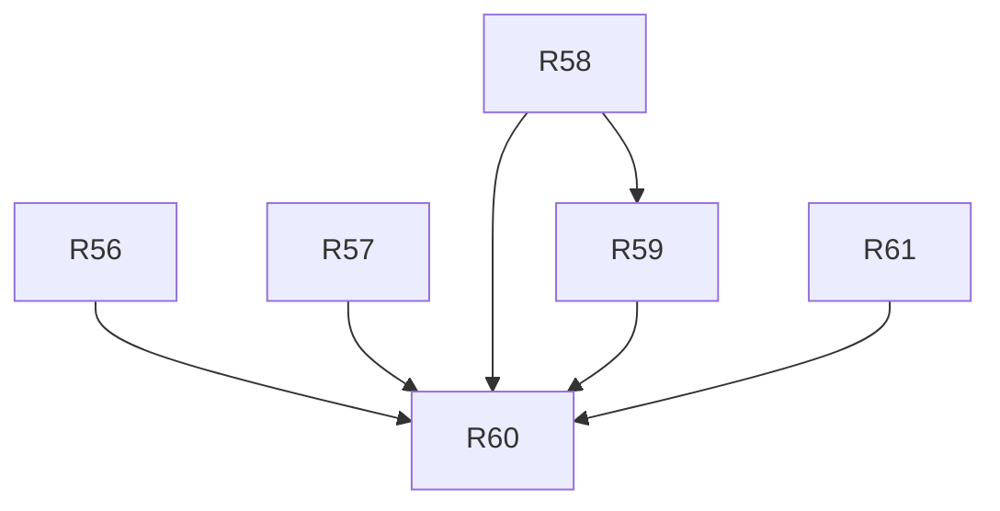

# v1.2 — TASKS.md sections

Cut from `TASKS.md` by `scripts/sdd/split.ts` (FR-SDD-3); ids resolve through `docs/sdd/ids.md`.

## v1.2 tasks

Draft, cut 2026-09-07 from `SPEC.md` v1.2 and `PLAN.md` v0.5, for review. Spec Phase 2c, "follow and the fixes": the follow control opens the sky window instead of turning the dome and a phone pointed at the ground says so (§4.22), and the three defects the owner found on the released build — the dome clipped above 1920 px (F-54), the compact rows overlapping under the stripe (F-55) and the pass set lost by a click or a reload (F-56). Four items and nothing else (V12-6): no v1.1 leftover is pulled in, and anything found on the way is written down as a finding for a later phase.

Delivery is PLAN §16 unchanged, cut by §16.9: five tasks, three waves, one task per lane, three at once. Lanes and their directories are the v1.1 conventions above, with D-283's clarification that `src/i18n/{en,es}/window.ts` belongs to `window`, `live.ts` to `live` and `chart.ts` to `chart`, so a lane ships its own copy. Decision blocks are reserved in PLAN §16.9: **R56 D-285..D-289, R57 D-290..D-294, R58 D-295..D-299, R59 D-300..D-306, R60 D-307..D-311.**

- [x] **R56 — The sky window says when the phone is pointed at the ground** *(the vertical half-field is read from the measured box, so `FOV / 2` in a landscape box and wider in a tall one — D-278's parenthetical had the two orientations swapped; D-285 records it.)*
  - **Lane:** window
  - **Model:** opus
  - **Gate:** owner
  - **Depends on:** none
  - **Goal:** Sweeping the phone down out of the sky is answered by the picture: the ground hatches over with a note while sky is still in frame, and the whole box says "you are pointing at the ground — raise the phone" once none is left.
  - **Satisfies:** FR-FOL-4, FR-FOL-5. **Advances:** US-21 AC9, AC10 (AC8 is R59's).
  - **Scope (PLAN D-278, D-283):** `window/projection.ts` gains `groundState(view, box): 'sky' | 'ground' | 'buried'`, derived from the centre altitude and the vertical half-field (`WINDOW_FOV` spans the shorter side, so the half-field is `FOV / 2` in portrait and `FOV / 2 × height / width` in landscape) — no new constant. `SkyWindow.tsx` draws a hatched `<rect>` from an SVG `<pattern>` clipped to the horizon it already computes, plus one `role="status"` note; at `buried` it draws the veil and the note over the box and skips the arcs, markers, Sun and Moon. Copy in `i18n/{en,es}/window.ts`. Neither state is modal and neither needs a tap to leave. The view keeps following the phone throughout: nothing about the sweep is clipped or reset (FR-FOL-4, already FR-WIN-3's rule — the task adds its test, not new code).
  - **Touches outside the lane:** none.
  - **Done when:**
    - `projection.test.ts` pins `groundState` at both boundaries in portrait and in landscape, and that the landscape half-field is the narrower one.
    - `SkyWindow.test.tsx`: at `ground` the veil and the note are in the tree **and** an arc above the horizon is still drawn; at `buried` the note is there and no arc, marker or body is; both notes are `role="status"` and read from the catalog in both locales.
    - A sweep test drives synthetic orientation events from +80° pitch to −80° and back and asserts the state sequence `sky → ground → buried → ground → sky` with no reset of the smoothing.
    - Captures (touch context, as R53's window shots): the two states at 390 px, both themes, English and Spanish.
    - `npm test` green; no change to the FR-GUIDE-6 rate path.

- [x] **R57 — The dome fits its box at every size, not at the two the test pins**
  - **Lane:** chart
  - **Model:** sonnet
  - **Gate:** owner
  - **Depends on:** none
  - **Findings:** F-54
  - **Goal:** On a 2560 × 1440 screen the whole dome is inside its box — no column of the raster cut, the drawing still filling at least 90 % of the shorter side.
  - **Satisfies:** FR-DOME-1 as amended (v1.2); FR-FIX-1 for F-54.
  - **Scope (PLAN D-279):** the measured cause is written down: `colsFor` caps the grid at `MAX_GRID_COLS = 120` and `layoutFor` caps the cell at `MAX_CELL_WIDTH_PX = 12`, so the raster is at most 1440 CSS px wide while `zoomFor` sizes the drawing from the box, and a box wider than 1440 px and taller than 960 px asks for a drawing the grid cannot hold. Both halves are fixed: `layoutFor` lets the cell keep growing once the column cap binds, so `cols × cellWidth` covers the box at every width — the *grid* is unchanged, so the rasterisation cost and D-234's drag rate are unchanged, and the drawing above 1440 px becomes larger and coarser rather than finer — and `zoomFor` is given `min(box, cols × cellWidth)` by `min(box, rows × cellHeight)`, so the ceiling holds by construction. `MIN_CELL_WIDTH_PX` and `GRID_COLS` are untouched.
  - **Touches outside the lane:** `playwright.config.ts` (a `desktop-2560` project) and `tests/e2e/dome-fit.spec.ts`.
  - **Done when:**
    - `camera.test.ts` is a table over 1280 × 800, 1920 × 1080, 2560 × 1440 and 3840 × 2160 asserting `0.9 ≤ extent / shorter side ≤ 1.0` in both dimensions, and it **fails on the old rule at 2560 × 1440 and above** while still passing at the two sizes R54 pinned.
    - `dome-fit.spec.ts` at 2560 × 1440, and at 1280 × 800 with `deviceScaleFactor: 2`, measures the painted raster against the chart box on the live page and on the pass detail: inside it, and at least 90 % of the shorter side.
    - The drag rate is re-measured by the D-62 method (`DOME_PERF=1`) at 390 px and 1280 px and recorded in the PR body; both stay above FR-LIVE-5's 30/s.
    - Captures: the live page at 2560 × 1440 dark English, and the pass detail at 1280 × 800 both themes.
    - `npm test` green.

- [x] **R58 — A live link for the place already in the store keeps its passes, and following will not rewrite the saved view**
  - **Lane:** data
  - **Model:** sonnet
  - **Gate:** auto
  - **Depends on:** none
  - **Findings:** F-56
  - **Goal:** Clicking the stripe and reloading leaves the sky exactly as it was, and the store grows the transient view the follow control will need.
  - **Satisfies:** FR-LIVE-11, FR-WIN-5 as amended. **Advances:** FR-FOL-1 (R59 presses the control). **Closes:** FR-FIX-1 for F-56.
  - **Scope (PLAN D-277, D-280):** two changes in `src/state/**` and nothing else. (a) The observer guard: `startApp` compares a `#live` link's coordinates with the saved observer at the precision the hash carries — the five decimals and whole metres `shareLinks.ts` writes, which is what FR-LIVE-11 means and what D-295 makes one helper — and restores the saved observer — its label, its zone, its stored run — instead of building a `source: 'coords'` one, which is what drops the stored run and starts a 72 h search today; a hash for a different place is unchanged. (b) The view override: `slices/prefs.ts` gains `viewOverride: ChartView | null` and `setViewOverride`; the `chartView` selector every consumer already reads becomes `viewOverride ?? saved`, the saved value is exposed as `savedChartView`, and `setChartView` clears the override and writes prefs. The override is never persisted (§7.9 unchanged). No `chart`-lane file changes, because `SkyChart` keeps reading `chartView`.
  - **Touches outside the lane:** `tests/e2e/live-reload.spec.ts`.
  - **Done when:**
    - A state test seeds a saved geocoded observer and a stored run, boots with `#live?lat=…&lon=…` at the same rounded place, and asserts the observer, its zone and the stored passes survive — **failing on the old code** — and that a hash for another place still starts a search.
    - `prefs.test.ts`: the override never reaches storage, `chartView` resolves override over saved, `setChartView` clears the override and writes, `savedChartView` is what was written.
    - `live-reload.spec.ts`: seed a stored run, open `#live`, click the stripe, reload, and assert the arc count, the stripe's segment count and the strip's satellite count are what they were before the click — failing on the old code. The click-only report is reproduced first in the same spec; if it is a second defect it is closed here and named in the PR body.
    - `npm test` green.

- [x] **R59 — Follow opens the window, and the compact rows stop overlapping**
  - *Done differently in two places (PLAN D-300, D-301): the press waits for one reading before it opens the window, so a phone with no north in its readings never changes the view; and `--chart-floor` yields by the page turning `--chart-floor-on` off (D-233's switch), which is a one-line change to the `chart` lane's contract test — the third file outside the lane, with `live-landscape.spec.ts` and `r48-trajectories.spec.ts`, whose floor assertions moved with it. The rows still do not fit beneath a floored box at 390 × 667; the arithmetic is in D-300 and the gap is a finding for the register.*
  - **Lane:** live
  - **Model:** opus
  - **Gate:** owner
  - **Depends on:** R58
  - **Findings:** F-55
  - **Goal:** `[ follow phone ]` shows the sky the phone is pointed at and gives the view back when it is pressed again, and on a phone no row of the live page sits on top of another.
  - **Satisfies:** FR-FOL-1, FR-FOL-2, FR-FOL-3, FR-LIVE-7 as amended (v1.2), FR-LIVE-8 as amended (v1.2), FR-WIN-4 as amended; US-10, US-21 AC8; FR-FIX-1 for F-55.
  - **Scope (PLAN D-276, D-281):** the control switches the chart to the window through R58's `setViewOverride`, remembers the view it came from and restores it on the second press and on unmount; permission is requested in that tap, and a denial or a relative-only device leaves the view alone, shows the existing note and leaves the control unpressed. `useFollowPhone` keeps the presence test, the permission and the notes and loses the heading path; `Live.tsx` stops passing `facingAzDeg` (`SkyChartProps` is untouched, so no `chart`-lane file moves); the control is offered on the dome **and** the polar chart wherever the window is offered, and never on the window; `StatusStrip`'s declination line follows the window being shown rather than `follow.state`. `compassHeading.ts` keeps the helpers the window imports. Separately, `Live.module.css`'s compact branch gives the rows under the box one `--live-row-gap` in place of the per-block margins, and `--chart-floor` becomes a floor that yields rather than a minimum that overflows: the gaps give first, the box only after them, and the page never scrolls.
  - **Touches outside the lane:** `tests/e2e/live-compact.spec.ts`, `tests/e2e/live.spec.ts` (the follow path).
  - **Done when:**
    - The follow states of PLAN §8.12 are unit tests with synthetic orientation events: switch from dome and from polar; the second press restores the view it came from; a denial and a relative-only device change nothing but the note; picking a view by hand while following clears the override and stops following; the saved preference is never what following opened.
    - Entering follow returns the instant to real time and hides the stripe block and the playback row (FR-FOL-3, FR-WIN-6), and leaving restores them.
    - `live-compact.spec.ts` at 390 × 667 and 390 × 844 reads the boxes of the facing readout, the status strip, the clock readout, the stripe and the stepping row and asserts no two intersect and the page does not scroll — **failing on the old CSS**.
    - `controlRows.test.ts` still passes for every live row (FR-COMP-4).
    - Captures at 390 px, both themes, English and Spanish: the live page not following, and following (the window in the box).
    - The owner has run it on a phone — the switch, the sweep, the ground state, the second press — and the run is recorded in the PR body (V11-9's rule; the sensor path cannot be verified headlessly).
    - `npm test` green.

- [x] **R61 — The wide live page's rail: the rows go beside the dome, and the dome fills the width** *(added 2026-09-07 as a hotfix on the owner's ask, out of wave order; PLAN §16.9 gives it D-312..D-316. Rewritten the same day on the owner's review of the previews, V12-8..V12-10: the box is cut to the drawing's shape from what the window leaves, the stripe is under the box on every wide page with the playback controls on its clock's row, the page is one centred column under 1660 px, and the resize defect F-60 is fixed with it.)*
  - **Lane:** live
  - **Model:** opus
  - **Gate:** owner
  - **Depends on:** none
  - **Findings:** F-59, F-60, F-61
  - **Goal:** On a desktop the dome box is the largest box of the drawing's own shape the window leaves, filled across and down, the rows that were under it stand beside it, the stripe is under it on a big screen, the whole bowl is drawn and centred in the box, and a resized window draws the dome right.
  - **Satisfies:** FR-LIVE-7, FR-LEG-2, FR-TRAJ-4 and FR-DOME-1 as amended (v1.2.1); FR-FIX-1 for F-59 and F-60. **Holds:** FR-DOME-1 as amended (v1.2).
  - **Scope (PLAN D-312):** the cause is written down first — the drawing is about 1.41 : 1 at the default tilt and D-187 sizes it from the box's shorter side, so a box at the page's full width (1.96 : 1 at 1920 × 1080) can never be filled across, and a steeper tilt cannot do it either (the extent's aspect is 1.73 even at the 80° clamp). `Live.tsx` builds its side column once and places it twice: the page's own row on compact, the chart's `aside` on wide. `SkyChartProps` gains `aside`, threaded through the three views to `ChartFrame` as `legend` is; `ChartFrame` puts it under the legend in that column and `ChartFrame.module.css` widens the column to `clamp(44 * var(--cell), 26%, 60 * var(--cell))` — the cap is D-313, so the rail's share of the page falls as the page grows — with the legend scrolling inside what the rail leaves it. `Live.module.css` drops D-268's fold, its `@container` rule and the page's third row. `lib/timeStripe.ts`: `labelEveryHours` reads the stripe's measured width instead of the shell, and `keepLabels` drops a label that would be drawn over its neighbour (the date wins), because the rail's stripe is 44 to 68 cells.
  - **Touches outside the lane:** `chart` — `skychart/SkyChart.types.ts`, `SkyChart.tsx`, `ChartFrame.tsx` + module, `dome/SkyDome.tsx`, `polar/SkyPolar.tsx`, `window/SkyWindow.tsx` (the `aside` slot, additive); `tests/e2e/{live,dome-fit}.spec.ts`, `tests/e2e/domeInk.ts` (the ink helper, extracted from `dome-fit.spec.ts` so both specs measure one thing).
  - **Scope, rewritten (PLAN D-314..D-316):** `SkyChartProps` gains `boxAspect` and `stripe`; `ChartFrame` measures what it leaves the drawing (its box, its controls row, its stripe row, the rail's 44-cell minimum off a probe) on a `ResizeObserver`, cuts the box with `lib/layout.ts` `fitBox` at `camera.ts` `DOME_BOX_ASPECT` (2.4 : 1.7) and writes it inline as `--chart-box-w` / `--chart-box-h`; the stripe has a row of its own under the drawing; `Live.tsx` hands the stripe block to `stripe` on every wide page (V12-12) with the playback controls on the clock's row inside it (D-318), the side column to `aside` from `LIVE_TWO_COLUMN_MIN_PX` (1660) and `stacked` to the frame under it, where the drawing stands centred, the stripe and the legend are the frame's whole width and the strip with the actions is the page's own row reading from the left (D-319, D-320); compact keeps R48's rows; `SkyDome`'s layer keys carry the font size, so a resize remounts the scene (F-60); `camera.ts`'s `drawingExtent` counts the bowl's silhouette and the ground disc, `ZOOM_HEIGHT_DIVISOR` is 2.0 from it, and each layer's camera gets a `center` from `layerCenter` so the drawing and not the observer sits in the middle of the box (D-317, F-61).
  - **Done when:**
    - `live-rail.spec.ts` at 1280 × 800, 1280 × 720, 1920 × 1080, 1920 × 940, 2560 × 1440, 2560 × 1235 and 3840 × 2160: the box is 2.4 : 1.7 and bound by the height or by the width beside the rail, from 1660 px the strip and the actions stand beside it in the rail and under 1660 px the page is one centred column with the legend under the stripe, the stripe block is under the box at every wide width with the playback row on the clock's row, the page does not scroll, and the painted drawing covers at least 90 % of the box's **width** — **failing on the old layout** everywhere (65 %, 66 %, 68 %, 69 %).
    - `dome-resize.spec.ts`: one page resized through 1920 × 1080, 3840 × 2160, 1280 × 800 and 2560 × 1440 keeps the drawing inside its box at each and, at 1280 × 800, paints what a fresh load there gives within a cell — **failing on the old key** at the second size (F-60).
    - `camera.test.ts`: the extent is 1.78 units tall at the default tilt, the old divisor would have cut the bowl on every height-bound box, the shift centres both layers alike; `live-rail.spec.ts` at every size: the blank above and below the drawing within a cell of each other and the drawing ≥ 90 % of the box down — **failing on the old rule** everywhere on wide (F-61).
    - `dome-fit.spec.ts` still passes: FR-DOME-1's floor and ceiling are untouched.
    - `live.spec.ts`'s wide block asserts the rail's order, the stripe under the box and that no stripe label is drawn over another; `Live.test.tsx`, `useMediaQuery.test.ts`, `fitBox.test.ts` and `SkyChart.contract.test.tsx` assert the placement, the threshold, the fit rule and the frame's measurement against the stylesheet's rules.
    - `timeStripe.test.ts` covers the width-driven cadence and `keepLabels`.
    - Captures: the live page at 1280, 1920, 2560 and 3840 px, dark, English, plus 1280 night.
    - `npm test`, lint, typecheck and the e2e suite green.
  - **Done 2026-09-07:** first as the rail alone (D-312, D-313), then rewritten the same day on the owner's three reviews of the previews (V12-8..V12-11; D-314..D-317) — a ladder of four fixed boxes was tried and withdrawn within the day, because a browser window is never its screen (a 2560 × 1440 monitor's 1235 px viewport took the 1920 step); and the third review found F-61, the top of the bowl cut off on every desktop since R45, because the fit rule never counted the bowl's silhouette. Measured on the cut box at D-317's 2.4 : 2.0, box then drawing across and down: 1280 × 800 → 548 × 457 in the one-column page (D-319), 92 % / 92 %; 1920 × 1080 → 1022 × 852 through the stripe under it, 92 % / 92 %; 2560 × 1235 → 1208 × 1007, 92 % / 92 %; 2560 × 1440 → 1454 × 1212; 3840 × 2160 → 2318 × 1932, 92 % / 92 %; the blank above and below the drawing within a cell of each other (from 65–69 % across and a cut top on the old layout). The four screenshots the owner sent first were one tab resized, and the resize was F-60: the scene's remount key carried the column count alone, which every desktop box caps; with the font size in the key the resize chain gives the fresh-load numbers exactly. One recorded lane crossing (the `aside`, `stripe` and `boxAspect` slots in `chart`, and D-317 in `dome/camera.ts`). The fifth review took the one-column page further: the stripe and the legend full width and the status strip left aligned, so everything under the drawing shares one margin (V12-15, D-320). Captures: `docs/screenshots/r61-live-{1280,1920,2560,3840}-dark-en.png` and `r61-live-1280-night-en.png`; the v1 set's live and legend captures at 1280 px re-shot; every other dome capture moves with D-317's centring and is R60's to re-shoot, and R54's fold captures are left as the record of the layout this replaces.

- [x] **R60 — v1.2 release preparation**
  - **Lane:** ui
  - **Model:** sonnet
  - **Gate:** owner
  - **Depends on:** R56, R57, R58, R59, R61
  - **Goal:** The phase closes: the capture set covers the new screens, the budgets are re-set, every finding the phase carries is closed, and the build is 1.2.0. (F-57, F-58 and F-62 stay open by V12-6 — written down for a later phase, carried by no v1.2 task.)
  - **Satisfies:** the Phase 2c definition of done (SPEC §9).
  - **Scope:** `package.json` at 1.2.0; the D-179 capture set topped up rather than re-shot — the window's two ground states, the live page following, the sizes R57 added, and R61's wide live page at 1280, 1920, 2560 and 3840 — with `captures.test.ts` matching the new set; the desktop dome captures V12-11 moved re-shot, since the centring and the 2.0 divisor changed every one of them (R61 re-shot its own and the v1 set's live and legend at 1280; the rest are this task's); the bundle budgets re-measured by the D-178 rule (the measured build plus a tenth) with the `chart`, `live` and `window` chunks re-stated; `docs/RELEASE.md` updated for the phase, including the phone run the owner owns; F-54..F-56 and F-59..F-61 marked closed in the register with the PR that closed each, and F-57, F-58 and F-62 left open with the note that no v1.2 task carries them.
  - **Touches outside the lane:** `SPEC.md` §4.20 (the findings' closing note), `TASKS.md`.
  - **Done when:**
    - `captures.test.ts` and the committed set agree, and the set includes the R56 and R59 screens in both themes and locales, and R61's wide sizes.
    - No dome capture in the set predates V12-11's centring: every one shows the whole bowl, its outline included.
    - The register has a closing PR against each of F-54..F-56 and F-59..F-61, and no other row has been closed or opened silently.
    - The budget table equals the measured build plus a tenth; `npm run build` is inside it.
    - `npm test`, lint, typecheck and the PR e2e path green inside FR-CI-1's 10 min.
    - The tag, the deploy and the on-device run stay with the owner, as `docs/RELEASE.md` says.
  - **Done 2026-09-08 (D-345..D-347):** as written, with one thing the entry did not foresee: the *declination* chunk no longer exists. R66 took the live page's last call to `useDeclination` away with the strip's true-north line (D-341), so Vite folds the World Magnetic Model back into the window chunk — `SkyWindow-*.js` is 12.0 KB where it was 5.9, neither half grown — and the budget follows to 15 while the declination row is deleted rather than left matching nothing (D-345). The `chart` and `live` rows the entry expected to re-state both hold at the numbers they already carried (94.2 → 105, 7.4 → 10), and `main` measures 137.9 inside its 155. The set is 116 files, all re-shot: 35 changed, and only the screens that carry a view control or the live page's actions row (D-346). `docs/RELEASE.md` gains §9, whose §9.1 replaces §8.1's follow checks — that section asks the owner to press a control the app no longer has (D-347). Nothing new was found to write into SPEC §4.20; F-64 stands as R66 left it.

### Expected waves (v1.2)

Computed from the graph with the driver's caps (one task per lane, three at once, concurrently).

| Wave | Tasks | Lanes | Models |
|---|---|---|---|
| 1 | R56, R57, R58 | window, chart, data | opus, sonnet, sonnet |
| 2 | R59 | live | opus |
| — | R61 | live | opus |
| 3 | R60 | ui | sonnet |

Wave 1 fills all three slots with the phase's three independent pieces; they share no file, since R56 stays inside `window/` and its own catalog, R57 inside `dome/camera.ts` plus a Playwright project, and R58 inside `src/state/**`. R59 is one task rather than two because the `live` lane runs one at a time either way, and the follow switch and the row spacing are the same screen, the same captures and the same phone run. R60 is the only task that touches `package.json`, the budgets or the capture set. Three of the five sessions are Sonnet, since D-279, D-280 and the release rules leave those tasks a written answer to implement; the two that carry judgement — the ground state's composition and copy, the follow states — are Opus. Reviews are Sonnet on the four `Gate: owner` tasks.

Token rules for the phase (PLAN D-284): every session takes the D-198 brief with only the sections §16.9 names for it, none reads the three documents in full, test runs stay narrow until the last commit, and captures come only from the owner-gated tasks and only for the screens they change.

