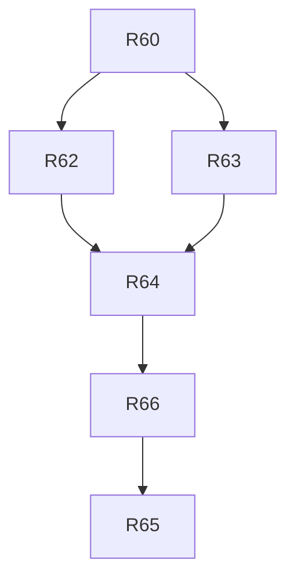

# v1.3 — TASKS.md sections

Cut from `TASKS.md` by `scripts/sdd/split.ts` (FR-SDD-3); ids resolve through `docs/sdd/ids.md`.

## v1.3 tasks

Draft, cut 2026-09-08 from `SPEC.md` v1.3 and `PLAN.md` v0.6, for review. Spec Phase 2d, "the follow screen": on the live page the follow control opens a screen of its own — the window drawing over the whole viewport, a `×` to close, the facing readout and the legend as overlays, nothing else of the page — drawn only with the phone held sideways, with a note in portrait; hidden objects are never on it; the window leaves the live page's view control, so follow is the only way in there and the pass detail is unchanged (§4.23, V13-1..V13-4). One item and nothing else (V13-5): anything found on the way is a finding for a later phase.

Delivery is PLAN §16 unchanged, cut by §16.10: four tasks, three waves, one task per lane, and every task on `opus` — the owner's instruction for the phase. Lanes and their directories are the v1.1 conventions above with D-283's catalog rule (`window.ts` to `window`, `live.ts` to `live`, `chart.ts` to `chart`). Decision blocks are reserved in PLAN §16.10: **R62 D-328..D-332, R63 D-333..D-337, R64 D-338..D-344, R65 D-345..D-349.** All four wait for R60, so v1.2 ships as it is.

- [x] **R62 — The chart can be a screen, and a page says which views it offers**
  - **Lane:** chart
  - **Model:** opus
  - **Gate:** owner
  - **Depends on:** R60
  - **[P]** with R63.
  - **Goal:** `SkyChart` renders the window with no chrome and the readout and legend as overlays when a page asks for a screen, and the live page's view control offers the dome and the polar chart only.
  - **Satisfies:** FR-FSC-3, FR-FSC-6; FR-LEG-2, FR-WIN-4, FR-WIN-5 as amended v1.3. **Advances:** FR-FSC-1 (the frame half), US-21 AC13 (the view-control half), US-21 AC1 as amended.
  - **Scope (PLAN D-322, D-324):** `SkyChart.types.ts` gains `screen?: boolean` and `views?: readonly ChartView[]`, and `ChartFrame` an `overlay` slot. `SkyChart.tsx`: with `screen` the view is `WINDOW_VIEW` (no `viewFor`), no `OptionToggle`, no `figcaption`, no controls, `fill` implied, `aside` and `stripe` dropped; `offeredViews(lost, views)` filters the registered views by the page's list in registered order, and a page that passes nothing offers all three. `ChartFrame.tsx` + module with `screen`: the box is the host's whole size — no aspect, no floor, no full-bleed margins, no column measurement — `status` absolutely at the top-left, `legend` along the bottom edge at most two rows high scrolling inside, `overlay` over everything, both overlays on `--follow-overlay` (`color-mix(in srgb, var(--surface) 85%, transparent)`; `FOLLOW_OVERLAY_ALPHA` as one token in `styles/tokens.css`). `Legend.tsx` with `screen` draws the compact rows. The dome and the polar chart ignore `screen`. `viewFor`'s fallback to the dome is what draws a saved `window` as the dome where the window is not offered, and nothing writes the preference on the way.
  - **Touches outside the lane:** `src/ui/styles/tokens.css` (one token; named here as the task's shared file).
  - **Done when:**
    - `SkyChart.test.tsx`: `views={['dome', 'polar']}` renders a two-option toggle with no "Window", a saved `window` draws the dome and `localPrefs` still reads `window`; no `views` renders three where the presence test passes (the pass detail's case, unchanged); `screen` renders the window view with no toggle, caption or controls whatever `chartView` says.
    - `ChartFrame` test: with `screen` the box is the host's size at 844 × 390 and at 390 × 844 (jsdom sizes mocked), the `status`, `legend` and `overlay` slots are in the tree in that order, `aside` and `stripe` are not; without `screen` nothing in the existing frame tests changes.
    - `SkyChart.contract.test.tsx` unchanged and green: the three views draw the same geometry.
    - The overlay token passes FR-THEME-2's contrast for body text over the darkest sky token in both themes (a unit check against the token values, as R19's theme tests do).
    - Captures: the compact live page at 390 px in both locales and themes, showing the two-option view control on one row (these replace the R59 live captures).
    - `npm test` green; no dome or polar capture moves.
  - **Done 2026-09-08 (D-328, D-329):** three departures from the scope text, all recorded. There is no `--surface` token, so the overlay is `--bg-raised` — the app's panel surface — and what `tokens.css` gains is the alpha alone (`--follow-overlay-alpha: 85%`), with `--follow-overlay` derived in `ChartFrame.module.css`; an alpha is invisible to the tokens test's `#rrggbb` pair table, so no theme rule needed an exception. The screen frame carries a class of its own rather than `.frame` / `.fill`, so none of the eleven framed-chart rules can reach it. And `overlay` is on `SkyChartProps` as well as `ChartFrame`, since D-321's page reaches the frame only through the chart; the last link, `SkyWindow`'s `<ChartFrame>` call, is the `window` lane's and goes with R63's rewrite of it, so until R63 `screen` reaches `SkyChart` and stops there. The live page's `views` was taken here rather than left to R64, because the capture bullet and D-327's gate both ask for it, with one exception: while `follow.state === 'on'` the page offers the window again, or R59's follow control would draw the dome under itself — R64 deletes the exception with the override. Captures `r62-live-390-{dark,night}-{en,es}.png`; the four `r59-live-390-*` they supersede stay in `docs/screenshots/` as the record of the three-option control, as R54's fold captures did.

- [x] **R63 — The window on a screen: no chrome, and a portrait state that says to turn the phone**
  - **Lane:** window
  - **Model:** opus
  - **Gate:** owner
  - **Depends on:** R60
  - **[P]** with R62.
  - **Goal:** Asked for a screen, the window renders no view control and no hint, keeps its readout as the status overlay, and — held upright — shows only "Turn the phone sideways to follow the sky." until the phone is turned, with the sensor running throughout.
  - **Satisfies:** FR-FSC-4. **Advances:** US-21 AC12, FR-FSC-1 (the window half).
  - **Scope (PLAN D-323, D-283):** `SkyWindow.tsx` reads `props.screen` (through the same cast R48 used for `chartView`, so it compiles before and after R62): with it, no `controls` for the frame; `useMediaQuery('(orientation: landscape)')` (`hooks/useMediaQuery.ts`) drives a `portrait` state drawn like `buried` — no SVG content, the `role="status"` note `t.window.portrait` as the whole box, `data-orientation="portrait"` on the root, `status={null}` and `legend={null}` handed to the frame. `useDeviceOrientation` stays mounted across the state. The ground states are computed only in landscape. Without `screen` nothing changes. Copy in `i18n/{en,es}/window.ts` (`portrait`, both languages).
  - **Touches outside the lane:** none (`useMediaQuery` is read, not changed).
  - **Done when:**
    - `SkyWindow.test.tsx`: with `screen` and portrait the note is the only text in the box, the readout and the legend are absent, the orientation hook's listener is still attached (a spy on `removeEventListener` sees no call); flipping the mocked query to landscape draws the arcs with no new permission request (`requestOrientationAccess` spy called once); the ground sweep of R56 still passes in landscape; without `screen` a portrait box draws as before.
    - With `screen` the tree holds no `OptionToggle` and no hint; without it both are there.
    - The Spanish and English notes are in the catalog snapshot.
    - Captures (touch context): the portrait note at 390 × 844 in both locales and themes, shot through the window rendered with `screen`.
    - `npm test` green; the FR-GUIDE-6 rate path untouched.
  - **Done 2026-09-08:** as written, with three additions the scope did not foresee, all recorded. `SkyWindow` also passes `screen` on to `ChartFrame`, because the window is what renders the frame and neither end of that seam is R62's (D-333). `tests/support/matchMedia.ts` threw on `(orientation: …)`, so the shared stub learned to read it off the size it already tracks — the task's one crossing out of its lane (D-334). And the captures are shot from `spike/window/screen.tsx`, a lane-owned harness that mounts the production window with `screen`, because in wave 1 no page passes the prop; `docs/screenshots/r63-window-390-portrait-{dark,night}-{en,es}.png` and `r63-window-844-landscape-dark-en.png`, superseded by R64's `follow-screen-390-portrait-*` (D-335). The permission check counts the browser's own `requestPermission`, which is what "asked once" means, rather than the memoising `requestOrientationAccess` around it; the "no `OptionToggle`" check is made at the window's `controls` prop, since `SkyChart` cannot pass `screen` until R62.

- [x] **R64 — The follow screen: the layer, the `×`, `Esc`, hidden objects off it, the e2e and the captures**
  - **Lane:** live
  - **Model:** opus
  - **Gate:** owner
  - **Depends on:** R62, R63
  - **Goal:** Pressing `[ follow phone ]` on a phone replaces the live page with the sky the phone points at, a `×`, where it is looking and the legend, and nothing else; the `×` puts the page back exactly as it was.
  - **Satisfies:** FR-FSC-1, FR-FSC-2, FR-FSC-5, FR-FSC-7; FR-FOL-1, FR-FOL-3, FR-LIVE-6, FR-LIVE-7, FR-LIVE-8, FR-WIN-6 as amended v1.3. **Advances:** US-21 AC11, AC12, AC13, and AC5/AC8 as amended; US-10 as amended.
  - **Scope (PLAN D-321, D-325, D-326):** `components/live/FollowScreen.tsx` + module: a `position: fixed; inset: 0; height: 100dvh` layer on the page background, `--z-follow` above the header, `role="dialog"` `aria-modal="true"`, rendering `SkyChart` with `screen`, the page's `passes`, `observer`, `now`, `sun`, `moon`, `colorBy="pass"` and **no** `hidden`, and the `×` (`<button>`, text `×`, 44 × 44 px, `aria-label` `t.live.followClose`) in the `overlay` slot; focus to the `×` on open, back to the follow control on close, `Tab` wrapping inside. `Live.tsx`: while `follow.state === 'on'` the layer replaces the `.page` grid with every hook still mounted (passes, playback and R48's `now` effect, the wake lock); `Esc` closes the screen before it can leave the page; unmount closes it; `useHiddenObjects(observer, shown, liveHidden && !following)`; `SkyChart` on the page gets `views={['dome', 'polar']}`. Copy in `i18n/{en,es}/live.ts` (`followClose`). `tests/e2e/follow-screen.spec.ts` at 844 × 390 with `hasTouch` and `sky-window.spec.ts`'s orientation helpers. Captures in `v1-captures.spec.ts` with the `captures.test.ts` list updated: `follow-screen-844-{sky,ground,buried}-{dark,night}-{en,es}` and `follow-screen-390-portrait-{dark,night}-{en,es}`; the v1.2 `following` captures leave the set and `docs/screenshots/`.
  - **Touches outside the lane:** `tests/e2e/v1-captures.spec.ts` and `captures.test.ts` (the `ui` lane's capture list; the one shared file, additive) — and the removal of the `r59-live-390-following-*` files.
  - **Done when:**
    - `FollowScreen.test.tsx` (jsdom, `matchMedia` mocked, synthetic orientation events): open shows the drawing, the `×`, the readout and the legend and none of `live-side`, `stripe-block`, `playback-row`, `live-actions` or the app header; `×`, `Esc` and unmount each restore the previous view (dome and polar) with the stripe block and the playback row back at real time; focus lands on the `×` and returns to the follow control; portrait shows the note and the `×` only; no `hidden` prop reaches the chart; with the hidden toggle on, no `computeAt` message leaves the page while following.
    - `App.live.test.tsx`'s follow states rewritten: the control mounts the layer instead of switching the page's `data-view`; a denial and a relative-only device still leave the page alone with the note (FR-FOL-2).
    - `follow-screen.spec.ts`: the layer's box equals `innerWidth × innerHeight`, the header is not hit-testable under it, the `×` restores the page, `setViewportSize(390, 844)` shows the note and back to 844 × 390 the drawing, with one permission request in total.
    - The capture set holds the sixteen `follow-screen-*` files in both themes and locales and no `following` file; `captures.test.ts` agrees.
    - The owner has run it on a phone, sideways and upright, and accepted it (V11-9).
    - `npm test`, lint, typecheck green.
  - **Done 2026-09-08 (D-338..D-342):** as written, with five departures, all recorded. The layer replaces `LiveSky`'s grid rather than `LivePage`'s, because every hook the scope says stays mounted lives there, and the header it covers is made `inert` *and* `aria-hidden` where it stands (D-338). `SkyWindow` had to pass `overlay` on to the frame — R62's last link, which R63 did not take — and `WindowView`'s Suspense fallback had to become a screen too, or the `×` would have been missing for the frames the lazy chunk takes to land (D-339). Focus is a callback ref rather than a mount effect for the same reason, and the dialog's name is the readout where there is one and the control's name in the portrait state, where there is no element to point `aria-labelledby` at (D-340). The strip's true-north line is gone with the window's being a view of this page, so `Live.tsx` stops calling `useDeclination` (D-341). And the captures are four *screens* in D-179's naming, `v1-follow-screen-{sky,ground,buried}-844-*` and `v1-follow-screen-portrait-390-*` — the sixteen files the scope asks for, with the state before the width as `window-ground` already has it, and the first screen in the set with no 1280 px picture (D-342). The follow states rewritten are `Live.test.tsx`'s; `App.live.test.tsx` has none and never had.

- [x] **R66 — The window is a view again, the sky screen is shared, the instant is the page's, and F-63**
  - **Lane:** live
  - **Also touches (PLAN D-357, R66 is alone in flight):** `chart`, `window` and the new `components/screen/`
  - **Model:** opus
  - **Gate:** owner
  - **Depends on:** R64
  - **Goal:** Choosing "window" from the view control — on the live page or on a pass detail — opens the sky screen at the moment the page is showing; the `[ follow phone ]` control is gone, the window is never a saved view, nothing scrolls, and the drawing no longer lies over the status strip on a landscape phone.
  - **Satisfies:** FR-FSC-8, FR-FSC-9; FR-FSC-1, FR-FSC-2, FR-FSC-3, FR-FSC-4, FR-FSC-6, FR-FSC-7, FR-COMP-5, FR-WIN-4, FR-WIN-5, FR-WIN-6 as amended v1.3.1; F-63 (FR-FIX-1). **Advances:** US-21 AC1, AC5, AC7, AC8, AC11, AC13, AC14.
  - **Also amended, and deliberately not cited by id here** (§16.8: naming them pulls five long requirements into the brief and puts it over budget, and each says the same thing from the other end): the live page's layout requirement, whose landscape overlap invariant F-63 breaks; the compass-follow requirement and the whole of §4.22, which the deleted control leaves behind; and the phone-pointing story of §3.2. What a session needs of all four is in FR-FSC-6, FR-FSC-8, D-355 and the F-63 row. The requirement-coverage table at the end of this block is the traceability record.
  - **Scope (PLAN D-350..D-356):** five changes on one branch.
    1. **The way in** (D-350, D-352): `components/screen/useSkyScreen.ts` — `useFollowPhone` moved and renamed, keeping the presence test, the permission inside the tap, F-42's one-reading rule and the `relative` / `denied` notes, and setting a `skyScreen` boolean in the prefs slice instead of `viewOverride`. `SkyChart`'s view control offers the window on both pages (no `views` prop anywhere, no live-page exception) and its `window` option calls `open()` rather than `setChartView`; the note renders beside the control from `chart` copy. `savedChartView` narrows to `'dome' | 'polar'` with a stored `'window'` migrated to `'dome'` on load; the `[ point at the sky ]` gate goes; `dropChartView` closes the screen. Delete `FollowPhone.tsx` + module + `useFollowPhone.ts` and the `live.follow*` keys.
    2. **The shared screen** (D-351): `components/live/FollowScreen.tsx` + module move to `components/screen/SkyScreen.tsx` + module, unchanged in what they draw. `Live.tsx` renders it in place of the grid as R64 does; `PassDetail.tsx` renders it over the sheet, portaled to the body with the sheet `inert`. Focus returns to the view control's `window` option.
    3. **The instant** (D-353): delete `Live.tsx`'s `if (following) toNow()` effect; the screen gets `now={shown}` and the page's `chartPasses`.
    4. **No scroll** (D-354): `100dvh` and `overscroll-behavior: contain` on the layer; the pass detail's sheet gets `overflow: hidden` while the screen is up and its `scrollTop` back on close.
    5. **F-63** (D-355): `--page-pad-x: 0` on `.dome` inside `Live.module.css`'s `(orientation: landscape) and (max-height: 500px)` block. Nothing else changes.
    Copy in `i18n/{en,es}/chart.ts` (`screenClose`, `windowDenied`, `windowRelative`); the rename table is D-356 — test ids, tokens, the e2e file and the capture names all move with it.
  - **Touches outside the lane:** `tests/e2e/v1-captures.spec.ts`, `tests/e2e/captureSet.ts` and `tests/docs/captures.test.ts` (the `ui` lane's capture list — R66 is alone in flight, so there is no conflict), and `state/slices/prefs.ts`.
  - **Done when:**
    - `SkyScreen.test.tsx` and `SkyChart`'s view-control tests (jsdom, `matchMedia` mocked, synthetic orientation events): the `window` option opens the layer and never writes the preference; a denial and a relative-only device leave the view alone with the note beside the control; the `×`, `Esc` and unmount each restore the page with the view it had; focus lands on the `×` and comes back to the option; no `hidden` prop reaches the chart; portrait is the note and the `×` alone.
    - `PassDetail.test.tsx`: the option opens the same screen over the sheet, none of the sheet's own content is on it, the sheet is `inert` and not scrollable while it is up, and its scroll position is back after the `×`.
    - `Live.test.tsx`: entering at a scrubbed instant at 60× keeps that instant on the screen and it advances; closing gives the page back at the instant reached, with the stripe block and the playback row; no `toNow` on entry.
    - `prefs` tests: a stored `'window'` reads as `'dome'` and is rewritten; nothing writes `'window'`.
    - `tests/e2e/sky-screen.spec.ts` (renamed from `follow-screen.spec.ts`) at 844 × 390 with `hasTouch`: the layer's box is the viewport, the page under it is not hit-testable, the `×` restores the page, turning the phone swaps the drawing for the note with one permission request in total, and the same spec opens the screen from a pass detail.
    - `tests/e2e/live-landscape.spec.ts` gains F-63's measurement — `chart-box` inside `live-dome` and clear of `live-side` at 740 × 360, 844 × 390 and 932 × 430 — and it fails on the old CSS (FR-FIX-1).
    - The capture set holds the `sky-screen-*` files (the live sky, ground, buried and portrait states in both themes and locales, and the pass detail's pair) and no `follow-screen` or `following` file; `captures.test.ts` agrees.
    - The owner has run it on a phone: the screen from both pages, sideways and upright, and a pass in the future watched through it (V11-9).
    - `npm test`, lint, typecheck green.
  - **Done 2026-09-08 (D-358..D-363):** as written, with six decisions the scope did not foresee, all recorded. The compact view control drops its visible `View:` prefix, because three options plus the prefix are 38 cells at 390 px and the row wrapped to two — the thing V13-4 had taken away (D-358). The note, the lost option and a one-shot focus flag are the store's rather than `SkyChart`'s, since the window that fails is the one on the screen and the control that answers for it is on the page underneath, which is also unmounted while the layer is up (D-359). The screen takes its initial facing from the page that opens it, so the guide's screen still aims at the pass it is about (D-360). `[ point at the sky ]` is deleted rather than left unreachable (D-361). The pass detail's `Esc` is a capture listener that stops the press before the app's own shortcut listener reads it (D-362). And the capture set's `window` becomes the screen opened from a pass at 844 while its two ground states leave, `r59-captures.spec.ts` and `r62-captures.spec.ts` going with the states they asserted (D-363). Two things found on the way and not fixed here: F-64 in SPEC §4.20, a `moon.spec.ts` failure that reproduces on `origin/main`, and the phone run itself, which is the owner's gate.

- [x] **R65 — v1.3 release preparation**
  - **Lane:** ui
  - **Model:** opus
  - **Gate:** owner
  - **Depends on:** R64, R66
  - **Goal:** The phase closes: the capture set is re-shot on `main` with the follow screen in it, the budgets are re-set, and the build is 1.3.0.
  - **Satisfies:** the Phase 2d definition of done (SPEC §9).
  - **Scope:** `package.json` at 1.3.0; the D-179 capture set re-shot on `main` (the sky screen's set under its v1.3.1 names, the compact live page's three-option control, the pass detail's own screen) with `captures.test.ts` matching; the bundle budgets re-measured by the D-178 rule with the `chart`, `live` and `window` chunks re-stated; `docs/RELEASE.md` updated for the phase, the phone run the owner owns named in it; anything found on the way written into SPEC §4.20 as a finding for a later phase, none fixed here.
  - **Touches outside the lane:** `SPEC.md` §4.20 (findings only), `TASKS.md`.
  - **Done when:**
    - `captures.test.ts` and the committed set agree, and the set includes the R62, R63, R64 and R66 screens in both themes and locales.
    - The budget table equals the measured build plus a tenth; `npm run build` is inside it.
    - `npm test`, lint, typecheck and the PR e2e path green inside FR-CI-1's 10 min.
    - The tag, the deploy and the on-device run stay with the owner, as `docs/RELEASE.md` says.

### Expected waves (v1.3)

Computed from the graph with the driver's caps (one task per lane, three at once, concurrently), after R60 is checked on `main`. *(v1.3.1)* R66 is wave 4 and R65 moves behind it: R66 holds every lane it touches (PLAN D-357), so nothing runs beside it.

| Wave | Tasks | Lanes | Models |
|---|---|---|---|
| 1 | R62, R63 | chart, window | opus, opus |
| 2 | R64 | live | opus |
| 3 | R66 | live (+ chart, window, screen) | opus |
| 4 | R65 | ui | opus |

Wave 1 runs the two lanes that share no file: R62 stays inside `skychart/**` less `window/` plus one token, R63 inside `window/` and its own catalog; each reads `screen` off `props` so neither needs the other to compile. R64 is one task because the switch, the layer, the e2e and the captures are one screen and one phone run. R65 is the only task that touches `package.json` or the budgets.

Token rules for the phase (PLAN D-284): every session takes the D-198 brief with only the sections §16.10 names for it, none reads the three documents in full, test runs stay narrow until the last commit, and captures come only from the screens a task changes.

### Requirement coverage (v1.3)

| Requirement | Task |
|---|---|
| FR-FSC-1 | R62 (the frame), R63 (the window), R64 (the layer) |
| FR-FSC-2 | R64 |
| FR-FSC-3, FR-LEG-2 as amended | R62 |
| FR-FSC-4 | R63 |
| FR-FSC-5, FR-LIVE-6 as amended | R64 |
| FR-FSC-6, FR-WIN-4 / FR-WIN-5 as amended | R62 (the prop), R64 (the live page passes it) |
| FR-FSC-7 | R64, R65 |
| FR-FOL-1 / FR-FOL-3 / FR-LIVE-7 / FR-LIVE-8 / FR-WIN-6 as amended | R64 |
| US-21 AC11..AC13 | R64 (AC12 with R63, AC13 with R62) |
| FR-FSC-8, FR-FSC-9 | R66 |
| FR-LIVE-7, FR-LIVE-8, FR-FOL-1..3, US-10 as amended v1.3.1 | R66 |
| FR-FSC-1, FR-FSC-2, FR-FSC-6, FR-COMP-5, FR-LIVE-7, FR-LIVE-8, FR-WIN-4, FR-WIN-5, FR-WIN-6 as amended v1.3.1 | R66 |
| F-63 | R66 |
| US-21 AC14, and AC1/AC5/AC7/AC8/AC11/AC13 as amended v1.3.1 | R66 |
| Phase 2d definition of done | R65 |

