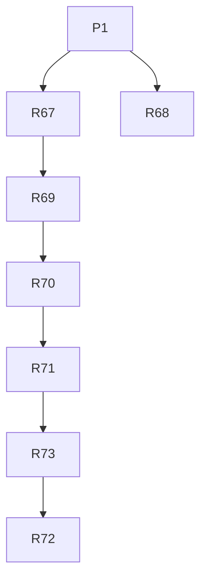

# v1.4 — TASKS.md sections

Cut from `TASKS.md` by `scripts/sdd/split.ts` (FR-SDD-3); ids resolve through `docs/sdd/ids.md`.

## v1.4 tasks

Draft, cut 2026-09-08 from `SPEC.md` v1.4 and `PLAN.md` v0.6.4, for review. Spec Phase 2f, "the shape, the chunk and the list": three items from the owner's use of the 1.3.0 build — the live page drawing a layout neither of its rules describes on a short wide window (F-65), a time stripe whose smallest step is bigger than the pass it selects, and a legend that is in the wrong place on a small desktop and a moving hole on a phone — and the four findings no earlier phase carried (F-57, F-58, F-62, F-64).

*(v1.4.1, 2026-09-09, V14-9..V14-11)* R73 is appended from `SPEC.md` v1.4.1 and `PLAN.md` v0.6.5 (§16.15): the sky screen stops waiting for the phone to be turned. It lands after R71 and before R72, which is re-run on the build that carries it — nothing else in the block changes.

Delivery is PLAN §16 unchanged, cut by §16.14: six tasks, five waves, one task per lane in each. Wave 1 is the two findings tasks in different lanes, F-64 first because it is red on `origin/main` and every later task would inherit it. The three layout tasks are one per wave because all three are the `live` lane and each changes what `ChartFrame` measures; the order — the shape rules, then the rows under the box, then the box's own width — is so that no task is measured against CSS a later one deletes (D-390). Models follow §16.6 rather than a phase override (`sonnet` for the two mechanical findings, `fable` for the two visual tasks the session can measure itself, `opus` where three lanes and a stored preference meet). Decision blocks: **R67 D-391..D-393, R68 D-394..D-396, R69 D-397..D-403, R70 D-404..D-410, R71 D-411..D-418, R72 D-419..D-423.**

- [x] **R67 — F-64: the Moon lore line the Now panel does not show** [P] — the catalogue and the fixture were already right; the cause was the local `e2e` npm script building with `VITE_MOON_LORE` off while CI already built it on, so `npm run e2e`'s build was fixed to match.
  - **Lane:** ui
  - **Model:** sonnet
  - **Gate:** auto
  - **Depends on:** none (P1 is merged)
  - **[P]** with R68.
  - **Goal:** `moon.spec.ts`'s Now-panel test passes for the reason it was written — the "Moon tonight" region carries its lore line — and not by having its assertion loosened.
  - **Satisfies:** FR-FIX-1 for F-64. **Holds:** FR-MOON-4, FR-MOON-5, FR-FLAG-1.
  - **Scope (spec §4.20 F-64):** find the cause before changing anything, and reproduce it on a worktree of `origin/main` first — the row already records that it fails there. Two candidates the row names or implies: the lore line is chosen from the Moon's constellation at the instant the fixture pins (FR-MOON-4), so a date-dependent gap in the catalogue is one; and the line ships behind a build flag that is off by default (FR-FLAG-1), so a spec that asserts it without setting the flag is the other. Fix what is actually wrong — the catalogue's coverage, the fixture's expectation, or the flag the spec runs under — and say which in the PR. The assertion itself may only change if the assertion is what was wrong, and then the PR says so in a sentence.
  - **Touches outside the lane:** `tests/e2e/moon.spec.ts` (the failing spec), `SPEC.md` §4.20 (the register row).
  - **Out of scope:** every other finding, and any change to the Moon's observing facts (phase, illumination, glare) — this is the lore line alone.
  - **Done when:**
    - `npx playwright test moon.spec.ts` is green on the branch, and the same command's failure on a worktree of `origin/main` is pasted in the PR with its assertion diff (FR-FIX-1's "fails on the old code", here satisfied by the existing spec).
    - The cause is named in the PR in one sentence, and the change is in the code, the catalogue or the fixture — not in the assertion, unless the PR argues that case explicitly.
    - `npm test`, lint and typecheck green; no other spec file changed.
    - F-64's row in spec §4.20 is marked closed with this PR's number, and no other row is touched.

- [x] **R68 — F-57 and F-58: the window stops doing the same work twice per render** [P] — closed; SPEC.md §4.20's PR number is filled in once known (R60 precedent).
  - **Lane:** window
  - **Model:** sonnet
  - **Gate:** auto
  - **Depends on:** none (P1 is merged)
  - **[P]** with R67.
  - **Goal:** while the ground state is shown, the window projects the horizon once per render instead of twice, and `lookDirection` is computed once instead of twice.
  - **Satisfies:** FR-FIX-1 for F-57 and F-58. **Holds:** FR-WIN-1, FR-WIN-2, FR-WIN-3, FR-FOL-5, FR-FSC-3.
  - **Scope (spec §4.20 F-57, F-58):** in `window/SkyWindow.tsx`, `groundClipPath` takes the already-projected horizon array the horizon grid path computes (`HORIZON.map(at)`) rather than re-projecting all 181 points, and `lookDirection` is computed once and passed to the ground-state test instead of being recomputed inside it. Pure plumbing: no projection, no geometry and no drawn output changes.
  - **Touches outside the lane:** `SPEC.md` §4.20 (two register rows).
  - **Out of scope:** the projection itself, `WINDOW_FOV`, the smoothing, and any other render-cost work in the window.
  - **Done when:**
    - A unit test spies on the projection call and asserts one horizon projection per render with the ground state shown — 181 calls where the old code makes 362 — and one `lookDirection` per render; **failing on the old code** (FR-FIX-1).
    - The window's drawn output is unchanged: the existing `SkyWindow` geometry and ground-state tests pass untouched, and the `window` captures in the set are byte-identical.
    - `npm test`, lint and typecheck green; F-57 and F-58 marked closed in spec §4.20 with this PR's number.

- [x] **R69 — Window shapes: the mode in every rule, F-65, and the matrix** — *done as written, with two rows of the matrix held to a documented allowance (964 × 420 until R71's rail; 844 × 501, the compact stack) and the fold letting the rows' air out as well as joining the actions to the strip's line, since 48 px rows cannot reach the floor by the fold order alone; see `sdd-run/R69.summary.md`.*
  - **Lane:** live
  - **Model:** fable
  - **Gate:** owner
  - **Depends on:** R67
  - **Goal:** no viewport shape draws a layout neither of the page's rules describes: a short wide window keeps the desktop layout with a smaller box, the landscape-phone layout is the phone's alone, and a test walks every size the app claims to support.
  - **Satisfies:** FR-SHP-1, FR-SHP-2, FR-SHP-3, FR-SHP-4, FR-SHP-5; FR-FIX-1 for F-65; FR-LIVE-1 and FR-LIVE-7 as amended v1.4 (the shape and the height halves). **Advances:** US-25 AC1..AC4.
  - **Scope (PLAN D-379, D-380, D-381, D-389):**
    - `Live.module.css`: every declaration inside the `(orientation: landscape) and (max-height: 500px)` block is scoped to `.page[data-compact='true']` — the grid, the column gap, `.dome { --page-pad-x: 0 }` and `.side { overflow-y: auto }` — so the block is the phone's and says so in the selector (D-379).
    - `src/lib/layout.ts` (the task's named shared file, `ui`'s lane): `LIVE_BOX_MIN_PX = 192` and `foldRows(heightPx)`, pure, from the height the page has to which rows under the box it drops; `LIVE_TWO_COLUMN_MIN_PX` is **not** touched here — it goes with R71 (D-381, D-386).
    - `Live.tsx`: under the floor the actions row joins the status strip's line, in that order and no other (D-389: the overview row joins the head of the order in R70, which is the task that creates it).
    - `tests/styles/liveShape.test.ts`: reads `Live.module.css` as text and asserts every `@media` block's selectors carry `[data-compact=`, and that no block setting `grid-template-areas` or `grid-template-columns` on `.page` sets only one of the two (D-379).
    - `tests/e2e/shapes.spec.ts`: one page load, walked through FR-SHP-4's matrix with `setViewportSize`, measuring at each size — no pane over another, `scrollWidth <= clientWidth`, `scrollHeight <= innerHeight`, `chart-box` at least `LIVE_BOX_MIN_PX` tall with a drawing in it, and FR-DOME-1's 90–100 % fit; the home page and the pass detail take the compact-portrait and desktop rows from one load each (D-380).
  - **Touches outside the lane:** `src/lib/layout.ts` (the named shared file), `SPEC.md` §4.20 (F-65's row), `docs/screenshots/`.
  - **Out of scope:** the rail's width rule and `LIVE_TWO_COLUMN_MIN_PX` (R71), the stripe's rows (R70), and any change to the landscape-phone layout itself — it is correct today and the matrix must prove it still is.
  - **Done when:**
    - `tests/styles/liveShape.test.ts` **fails on the old stylesheet** (the landscape block has no mode selector) and passes on the branch.
    - `tests/e2e/shapes.spec.ts` passes at every row of FR-SHP-4, and **fails on the old code** at 1200 × 450 and 1400 × 480: on `origin/main` the measurements there are the page's rows 456 px wide inside a 1200 px window, `chart-box` 243 × 0 and `scrollHeight` 624 against 450 (spec §4.20 F-65).
    - `tests/e2e/live-landscape.spec.ts` and `live-rail.spec.ts` pass unchanged: the phone's landscape layout and the wide page are what they were.
    - Captures: `docs/screenshots/r69-live-1200x450-{dark,night}-en.png` and the desktop live page at 1024 × 768, both themes, English.
    - The e2e stage stays inside FR-CI-1's ten minutes, with the shape spec's own duration reported in the PR.
    - The owner's gate: a browser window dragged short by hand, beside the matrix's numbers.

- [x] **R70 — The stripe's span: the chunk, the overview and the re-cut row**
  - **Lane:** live
  - **Model:** fable
  - **Gate:** owner
  - **Depends on:** R69
  - **Goal:** the stripe draws the four hours that hold the shown instant, with the whole night in one row above it, and the row under it lands on a pass in one tap — on a desktop as well as a phone.
  - **Satisfies:** FR-SPAN-1..FR-SPAN-7; FR-LIVE-4, FR-TRAJ-4 and FR-TRAJ-5 as amended v1.4. **Advances:** US-24 AC1..AC6, US-22 AC6 as amended.
  - **Scope (PLAN D-382, D-383, D-384, D-385, D-389):**
    - `lib/timeStripe.ts`: `STRIPE_CHUNK_H = 4`, `CHUNK_MIN_WALL_S = 10`, `chunkFor(t, span, timeZone)` (boundaries at multiples of the chunk from the observer's local midnight, through the zone path `hourTicks` already uses and memoised as that is, clipped to the span) and `drawnSpan(t, span, timeZone, speed)`. Pure, no state anywhere (D-382).
    - `TimeStripe.tsx`: draws `drawnSpan(...)` instead of the span; the ticks, bands, segments and lane packing memoise on the drawn window; the cursor and `current` keep following `t`; the label cadence is computed from the drawn window's width — every 30 min where twelve labels fit, every hour under that, the date at a midnight crossing (FR-SPAN-7).
    - `components/live/StripeOverview.tsx` + `.module.css`: the whole span in one row — night bands, one mark per pass in its arc's colour, the cursor, a bracket around the drawn chunk — its own `role="slider"` named "Night overview" / "Vista de la noche", click and drag to set `t`, 15 min on the arrow keys, one chunk on Page Up / Page Down (D-383).
    - `StepControls.tsx`: the six buttons become `|◀ pass`, `◀ 4h`, `−1m`, `+1m`, `4h ▶`, `pass ▶|`; the ±10 min pair is deleted; the two chunk buttons step `t` by `STRIPE_CHUNK_H` hours through the same `onStep`; disabled rather than absent at the ends (D-384).
    - `Live.tsx`: the overview goes into the stripe block above the stripe and under the clock readout; the `touch &&` guard on the stepping row is dropped (V14-6); `foldRows`'s order gains the overview at its head (D-389), and `shapes.spec.ts` is extended for it.
    - `i18n/{en,es}/live.ts`: the six labels, their accessible names, and the overview's name and value text.
  - **Touches outside the lane:** `tests/styles/controlRows.test.ts` (the row's cell count), `docs/screenshots/`.
  - **Out of scope:** the 24 h span itself (FR-LIVE-4 keeps it), the hash (FR-LIVE-9 carries `t` and nothing about the chunk), the playback speeds, and the legend.
  - **Done when:**
    - `timeStripe.test.ts`: `chunkFor` cuts on the observer's clock at a zone with a half-hour offset as well as UTC, clips at both ends of the span, and returns the chunk holding `t` for instants either side of a boundary; `drawnSpan` gives the chunk at 1× and 60× and the whole span at 600× and 3600× (FR-SPAN-6).
    - `TimeStripe.test.tsx`: the drawn window follows `t` and nothing else; at 360 px the cadence is every 30 min and the resolution is 40 s per pixel; the geometry memos recompute once across a boundary and not per frame.
    - `StripeOverview.test.tsx`: the bracket is where `chunkFor` says, a click sets `t` to the instant under the pointer, the keys step 15 min and one chunk, and the slider's value text is the clock time.
    - `StepControls.test.tsx`: six buttons in FR-SPAN-3's order, the chunk buttons step four hours and clamp, the pass jumps are exact, and each end disables rather than removes; `controlRows.test.ts` puts the row at 35 cells or fewer in both languages (FR-COMP-4).
    - `tests/e2e/live-playback.spec.ts`: from real time, one tap on `pass ▶|` puts the shown instant within a second of the golden pass's rise and the stripe redraws around it — **failing on the old code**, where the same tap needs the row to be present on a touch device and leaves the stripe at 24 h; playback at 3600× draws the whole span and at 60× the chunk, and FR-LIVE-5's rate holds at both.
    - Captures: the compact live page at 390 × 844 and the wide page at 1280 × 800, both themes and both languages, with the overview, the chunk and the new row; and FR-SPAN-6's whole-span state at 1280 × 800.
    - The owner's gate: on a phone, a drag that aims and one tap to a pass.
  - **Done as written, with two notes:** the overview's bracket is `drawnSpan`'s and not `chunkFor`'s, so it covers
    the whole row at 600× and 3600× as FR-SPAN-6 requires (D-383's "a bracket from `chunkFor`" reads as the drawn
    window); and the two rows this task puts under the box pull FR-SHP-3's fold in at short wide windows, which
    moved `LIVE_VIEWPORTS.short` and three rows of the shape matrix's floor allowance (see `R70.summary.md`).

- [x] **R71 — The legend's place: the rail at every width and the list control** *(done but for one line of FR-LEG-8: the box's floor holds at 390 × 844 and cannot be reached at 390 × 667, measured — spec §4.20 F-62 and PLAN D-415. The actions row needed the share action's brackets to stay inside FR-COMP-4 in Spanish, PLAN D-411.)*
  - **Lane:** live
  - **Model:** opus
  - **Gate:** owner
  - **Depends on:** R70
  - **Goal:** on a desktop the list is beside the drawing at every width; on a phone it is one tap away and takes the same room whatever it holds, so nothing the sky does moves the picture.
  - **Satisfies:** FR-LEG-6, FR-LEG-7, FR-LEG-8, FR-LEG-9; FR-LIVE-7, FR-LEG-2 and FR-COMP-5 as amended v1.4; FR-FIX-1 for F-62. **Advances:** US-23 AC2 as amended.
  - **Scope (PLAN D-386, D-387, D-388):**
    - **The rail (D-386):** `Live.tsx` loses its `columns` state, its `oneColumn` flag and the `stacked` prop, and hands `aside` to `SkyChart` at every wide width with `boxAspect` and `stripe` as now; `Live.module.css` loses `.page[data-compact='false'][data-columns='one']` and the `.side` row rules under it; `src/lib/layout.ts` loses `LIVE_TWO_COLUMN_MIN_PX` and `LIVE_TWO_COLUMN_QUERY`.
    - **The control (D-387, D-388):** `Live.tsx` renders `[ list (n) ]` in the actions row — a toggle with `aria-expanded`, `n` the number of drawn passes from `lib/legend.ts` — and passes `legendOpen` to `SkyChart`; `ChartFrame` renders its legend slot only while open, at exactly `calc(2 * var(--tap))` with `overflow-y: auto`, the rule the sky screen's strip already uses (FR-FSC-3); `Legend.tsx` gains the empty line in both catalogs.
    - **The preference (D-387):** `prefs.liveLegendOpen`, a boolean beside `savedChartView` in `src/model/prefs.ts` and `src/state/slices/prefs.ts`, default `false`.
  - **Touches outside the lane:** `src/ui/components/guide/skychart/{ChartFrame.tsx,ChartFrame.module.css,Legend.tsx}` and `src/lib/legend.ts` (`chart`'s), `src/model/prefs.ts` and `src/state/slices/prefs.ts` (`data`'s), `src/lib/layout.ts` and `src/i18n/**` (`ui`'s) — the crossings PLAN D-387 records, all in one task because a page that renders a control against a panel that does not exist yet is not a mergeable state.
  - **Out of scope:** the pass detail's legend and the sky screen's strip (both unchanged), the legend's rows and colours (FR-LEG-3, FR-LEG-5), and the box's own fit rule.
  - **Done when:**
    - `tests/e2e/live-rail.spec.ts` at 964 × 700, 1024 × 768, 1280 × 800 and 1660 × 900: the legend and the rail are beside the box, the drawing covers at least 90 % of the box across and down, and no page has a one-column layout — **failing on the old rule** at 964, 1024 and 1280, where the page is one centred column.
    - `Live.test.tsx`: `[ list (n) ]` counts the drawn passes and not the body lines; closed, no legend is in the tree; open, the panel's height is exactly two `--tap` rows with one row, with five, and with none; an empty sky renders the line as a `role="status"`; and adding or removing a pass while open changes the height of neither the panel nor the box — the invariant V14-5 asks for.
    - A compact e2e at 390 × 844 and 390 × 667 measures FR-COMP-5's floor with the list closed — the box at least its own width — **failing on the old layout**, where it is 259 px and 82 px (spec §4.20 F-62).
    - The preference round-trips: a reload comes back open, and a corrupt value falls back to closed.
    - `controlRows.test.ts` covers the actions row with the control on it, in both languages (FR-COMP-4).
    - Captures per FR-LEG-9: compact closed and open at 390 × 844 and 390 × 667, both themes and both languages; the empty line at 390 × 844; the wide page at 964 × 700, 1024 × 768 and 1280 × 800.
    - F-62 marked closed in spec §4.20 with this PR's number.
    - The owner's gate: the list opened and closed on a phone, and the rail at 1024 and 1280.

- [x] **R73 — The screen does not wait: both orientations, the turn and the advice**
  - *Done as written, with two refinements recorded as PLAN D-431 (the quarter is folded in `useDeviceOrientation`, beside the rotation, because `react-hooks` forbids both the effect and the ref D-429's placement needed) and D-432 (a half turn covers the viewport as it is; only a quarter turn swaps the layer's two sides).*
  - **Lane:** window
  - **Model:** opus
  - **Gate:** owner
  - **Depends on:** R71
  - **Goal:** the sky screen gives a picture the moment it opens, whatever the phone's rotation setting: held sideways under a rotation lock it shows the same wide screen an unlocked phone shows, held upright it draws in the portrait box with one line of advice over it, and nothing on it waits for a turn that may never come.
  - **Satisfies:** FR-FSC-4 as rewritten v1.4.1, FR-FSC-10, FR-FSC-11; FR-FSC-7 as amended (the two capture changes). **Advances:** US-21 AC12 as amended, AC15. **Holds:** FR-FSC-1, FR-FSC-3, FR-FSC-9, FR-WIN-1, FR-FOL-2, FR-FOL-5.
  - **Scope (PLAN D-424..D-430):**
    - `skychart/window/screenTurn.ts`: `quarterTurnFor(m, held)` — the room's vertical taken into the phone's frame through `projection.ts`'s existing frame helpers, the nearest quarter in `screen.orientation.angle`'s own convention, `SCREEN_TURN_HYSTERESIS_DEG` (20) past the diagonal before it moves, `held` returned while inside `SCREEN_TURN_FLAT_DEG` (25) of flat, `0` for a null rotation. Pure; no React in the file.
    - `skychart/window/SkyWindow.tsx` + module: the `portrait` state, its `useMediaQuery('(orientation: landscape)')` and the `status={null}` / `legend={null}` it handed the frame are deleted; `ground` is `groundState(m, view)` in every orientation again; `View.screenAngleDeg` on a screen is the quarter, not the browser's angle; `data-orientation` is read from the measured box; the advice line renders when the box is taller than it is wide and `ground === 'sky'`, in the ground notes' place and losing to them.
    - `components/screen/screenTurn.tsx` (new) and `components/screen/SkyScreen.tsx` + module: the context the window reports its quarter through — no provider means a no-op and quarter `0` — and the layer's turn by `quarter - screen.orientation.angle`, `width: 100dvh; height: 100dvw` centred with `transform: translate(-50%, -50%) rotate(var(--screen-turn))`, `data-turn` on the layer, and the `aria-labelledby` / `aria-label` branch collapsed to the readout.
    - `i18n/{en,es}/window.ts`: `portrait` deleted, `turnAdvice` added — "Turn the phone sideways to see more sky." / "Gira el teléfono de lado para ver más cielo." — and `chart.screenLabel` deleted if nothing else names the dialog.
    - Captures (FR-FSC-7): `sky-screen-390-portrait-*` re-shot with the picture in them, one `sky-screen-390-turned` added at one theme and one language, `tests/e2e/captureSet.ts`, `tests/docs/captures.test.ts` and `docs/screenshots/` following; `spike/window/screen-capture.ts`'s portrait guard becomes a check that the drawing is there.
  - **Touches outside the lane:** `components/screen/` (the layer and the context, named by PLAN §16.15), `i18n/{en,es}/window.ts`, `i18n/{en,es}/chart.ts` (the dead label), `tests/e2e/liveHelpers.ts` (`pose`), `tests/e2e/sky-screen.spec.ts`, `tests/e2e/captureSet.ts`, `tests/docs/captures.test.ts`, `docs/screenshots/`, `spike/window/screen-capture.ts`.
  - **Out of scope:** the orientation permission path and the way into the screen (FR-FSC-6 is untouched), the Fullscreen and Screen Orientation lock APIs — the app locks nothing (FR-FSC-4) — the dome and the polar chart, the pass detail's sheet, and any change to `WINDOW_FOV`, the smoothing or the projection's own maths beyond the angle it is handed.
  - **Done when:**
    - `screenTurn.test.ts` walks the pose table — the four quarters, each diagonal inside and outside the hysteresis, flat face-up and face-down returning `held`, and `null` — and `projection.test.ts` pins that a locked-portrait phone held sideways projects the horizon where an unlocked one does.
    - A component test asserts the drawing, the readout, the legend and the advice line together in a portrait box on a screen, and the ground note alone when the phone points below the horizon; **it fails on `origin/main`**, where the portrait box is a note with no drawing in it, and the failure is pasted in the PR (FR-FIX-1's shape, applied to a rewritten requirement).
    - `sky-screen.spec.ts` at 390 × 844: with a sideways pose the layer carries a non-zero `data-turn`, its drawing box is wider than it is tall and `document.documentElement.scrollHeight` equals the inner height (FR-FSC-9); upright, the drawing and the advice line are both there.
    - No second `deviceorientation` listener exists: the test that counts the window's listeners after R68 still passes, and the layer adds none.
    - Both languages carry `turnAdvice` and no key named `portrait` survives in `window.ts`; the i18n snapshot is updated in the same commit.
    - The capture set matches `tests/docs/captures.test.ts`, and the PR shows the two portrait shots before and after beside the new turned one.
    - `npm test`, lint, typecheck and the e2e path green inside FR-CI-1's ten minutes.
    - The owner's gate: the screen run on a phone with rotation locked and unlocked — sideways, upright and flat at the zenith — which is what FR-FSC-10 cannot be accepted without (V11-9).

- [x] **R72 — v1.4 release preparation** — the capture set is topped up with the live page's two uncovered widths (1024 × 768 and F-65's 1200 × 450, D-420) and re-shot whole: 124 files, 41 of them changed. Every budget holds on the 1.4.0 build (D-419), so §11's table is re-stated and no number moves. OQ-26 is closed by V14-9; OQ-24 and OQ-25 are left open with the reason (D-422). F-66, one capture that answers differently on two runs, is written into the register rather than fixed here (D-421). What is left open by design: F-62 at 390 × 667 and FR-LEG-8's sentence, which are the owner's on the release run (`docs/RELEASE.md` §11.3).
  - **Lane:** ui
  - **Model:** opus
  - **Gate:** owner
  - **Depends on:** R73
  - **Goal:** the phase closes: the capture set covers the new screens, the budgets are re-set, every finding the phase carries is closed in the register, and the build is 1.4.0. *(v1.4.1, V14-11: the dependency is R73, not R71 — the version bump, the budgets and the captures are the release's and are taken on the build that ships.)*
  - **Satisfies:** the Phase 2f definition of done (spec §9); FR-COMP-6 for the phase.
  - **Scope:** `package.json` at 1.4.0; the D-179 capture set topped up and re-shot where these screens changed — every live-page capture moves with the rail, the stripe's rows and the actions row — with `tests/docs/captures.test.ts` matching the new set; the bundle budgets re-measured by the D-178 rule (the measured build plus a tenth) with the `chart`, `live` and `window` chunks re-stated; `docs/RELEASE.md` gains the phase's section, whose owner run is the phone checks of R70 and R71 plus a window dragged short; F-57, F-58, F-62, F-64 and F-65 each carrying the PR that closed them in spec §4.20, and OQ-24, OQ-25 and OQ-26 either answered by a Decision Log row or left with the note that a night's use has not happened yet.
  - **Touches outside the lane:** `package.json`, `docs/**`, `SPEC.md` §4.20 and §7, `tests/docs/captures.test.ts`.
  - **Out of scope:** any product change, and any test changed to pass.
  - **Done when:**
    - `npm run bundle:budget` passes with the re-stated numbers, and the PR carries the measured sizes beside the budgets.
    - `tests/docs/captures.test.ts` passes with the new set, and the PR lists which captures changed and why.
    - `docs/RELEASE.md`'s new section names the owner's steps, including the tag pinned to the release commit's SHA rather than `main`'s head.
    - Every row of spec §4.20 that this phase carried names a closing PR, and no row is closed silently.
    - `npm test`, lint, typecheck and the PR's e2e path green inside FR-CI-1's ten minutes.
    - The owner's gate: the tag, the deploy and the release checklist are the owner's, as in every phase.

### Requirement coverage (v1.4)

| Requirement | Task |
|---|---|
| FR-SHP-1, FR-SHP-2 | R69 |
| FR-SHP-3 | R69 (the floor and the fold), R70 (the overview at the head of the fold) |
| FR-SHP-4, FR-SHP-5 | R69, extended by R70 |
| FR-SPAN-1, FR-SPAN-2, FR-SPAN-5, FR-SPAN-6, FR-SPAN-7 | R70 |
| FR-SPAN-3, FR-SPAN-4 | R70 |
| FR-LEG-6, FR-LEG-7, FR-LEG-8, FR-LEG-9 | R71 |
| FR-LIVE-1, FR-LIVE-7 as amended v1.4 | R69 (the shape and the height), R71 (the one wide layout) |
| FR-LIVE-4, FR-TRAJ-4, FR-TRAJ-5 as amended v1.4 | R70 |
| FR-LEG-2, FR-COMP-5 as amended v1.4 | R71 |
| FR-COMP-4 as amended v1.4 | R70 (the stepping row), R71 (the actions row) |
| FR-COMP-6 as amended v1.4 | R69, R70, R71 (their captures), R72 (the set) |
| US-24 | R70 |
| US-25 | R69 |
| US-22 AC6, US-23 AC2 as amended | R70, R71 |
| F-64 | R67 |
| F-57, F-58 | R68 |
| F-65 | R69 |
| F-62 | R71 |
| FR-FSC-4 as rewritten v1.4.1, FR-FSC-10, FR-FSC-11 | R73 |
| FR-FSC-7 as amended v1.4.1 | R73 (the two capture changes), R72 (the set) |
| US-21 AC12 as amended, AC15 | R73 |
| Phase 2f definition of done | R72 |

**Waves** (the driver recomputes them from `main`; this is the sanity check): **wave 1** R67, R68 — **wave 2** R69 — **wave 3** R70 — **wave 4** R71 — **wave 5** R73 — **wave 6** R72. No two tasks in one wave name the same shared file: R67 touches `moon.spec.ts` and R68 the window's own directory, and both touch spec §4.20 in different rows, which is the additive kind of conflict §16.1 allows.
