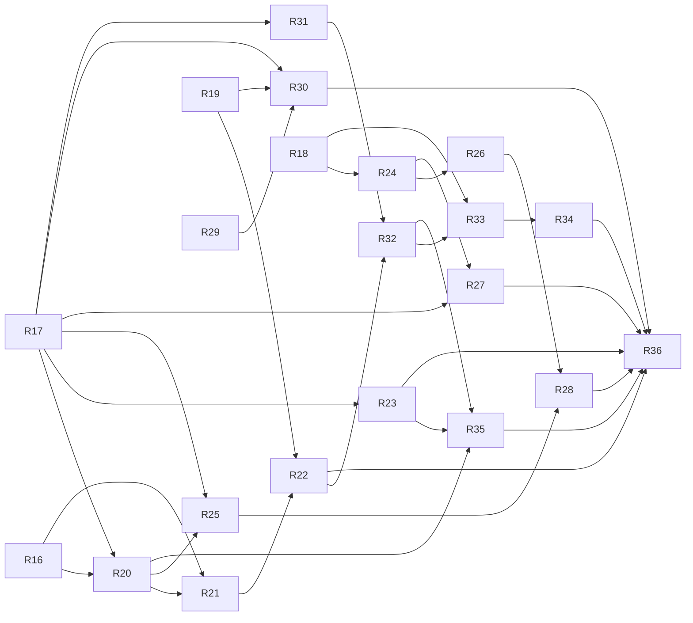

# v1 — TASKS.md sections

Cut from `TASKS.md` by `scripts/sdd/split.ts` (FR-SDD-3); ids resolve through `docs/sdd/ids.md`.

## v1 tasks

Draft, cut 2026-09-03 from `SPEC.md` v1.0 and `PLAN.md` v0.3, for review. Spec Phase 2, "outdoor-ready": language, desktop, the layered dome, the live page, offline for three nights, the Moon, share links, night theme. Delivery is PLAN §16 — one lane per task, waves computed from `main`, run by `scripts/sdd-run.ts`.

### Conventions for this phase

- Every task carries **Lane**, **Model**, **Gate** and **Depends on** as sub-bullets, in the shape PLAN §16.3 fixes and `scripts/sdd/tasks.ts` parses. A task with no `Lane:` or no `Gate:` is a breakdown bug and the driver refuses to run it.
- **[P]** is gone: lanes and waves say what runs beside what. The driver runs at most one task per lane and at most three at once, concurrently, from the graph, never from the printed wave list (PLAN §16.2, D-132).
- **Lane** is the set of directories one task at a time may touch (PLAN §16.1):
  - `ui` — `src/ui/**` except `guide/skychart/**`, `screens/Live*` and `components/live/**`; `src/i18n/**`, `src/lib/{layout,shortcuts,shareLinks,moonPhrases,readiness}.ts`, `src/ui/styles/**`
  - `live` — `src/ui/screens/Live*`, `src/ui/components/live/**`, `src/lib/{timeStripe,playback}.ts` (D-132: cut from `ui` so the live page runs beside the rest of it; its message keys are one `live` section in each catalog, placed after `chart`)
  - `chart` — `src/ui/components/guide/skychart/**`, `src/lib/skyGeometry.ts`, `src/lib/skyBodies.ts`, `spike/**`
  - `data` — `src/data/**`, `src/state/**`, `vite.config.ts`, `public/**`
  - `physics` — `src/physics/**`, `src/worker/**`, `src/model/**`
- **Touches outside the lane** names every file a task edits that its lane does not own, so two tasks in one wave can be checked for a collision. `package.json`, `README.md`, `TASKS.md`, `PLAN.md`, `docs/**` and `tests/e2e/**` are shared by everything, additively, and are resolved by the rebase the driver does before it opens the PR.
- **Gate:** `owner` wherever acceptance includes captures to compare, Spanish copy to read or a composition to choose; `auto` where tests carry the whole acceptance.
- Every UI task ships captures through the `visual-review` skill: 390 px always, 1280 px from R23 on, both languages from R17 on, both themes from R20 on.
- Decision numbers for every open task are reserved in one PLAN entry after D-132 (R31 D-133..137, R26 138..142, R27 143..147, R22 148..152, R28 153..157, R32 158..162, R35 163..167, R33 168..172, R34 173..177, R36 178..182); a session numbers only inside its block.
- **Model** is `opus` by default and `fable` on the four open dome and live-page tasks — R22, R32, R33, R34 (PLAN §16.6, D-131, 2026-09-04). D-88 had put every task on Opus after the account's Fable limit stopped R16 mid-run; with Fable now the account's default the §16.6 criterion applies again, and a run stopped by a model limit is rerun with `--task <id> --model opus` (that run only, never a wave).

- [x] **R16 — Dome composition spike: every knob as a URL parameter, captures and drag rates**
  - **Done 2026-09-03:** as specified. `spike/dome-composition/` (page, geometry, palettes, candidates, capture script) with `npm run spike:dome-composition` regenerating every capture and figure in `docs/dome-composition/`; five candidates compared in `findings.md`. Differences from the task text: the highlighted pass is **not** recommended at a finer per-mesh density — the knob exists in glyphcss 0.1.6 but misplaces its `<pre>`, so FR-DOME-8c is dropped (D-90); and the fallback that saves the desktop grid is a column cap, not one of the three PLAN §8.7 fallbacks (D-91). P-OQ-4 answered in §2 of the findings; the recommendation is D-92.
  - **Lane:** chart
  - **Model:** opus
  - **Gate:** owner
  - **Depends on:** —
  - **Why not a slice:** FR-DOME-8 and PLAN §8.7 require the findings file before the dome task can be cut; it ships in `spike/`, never in the app.
  - **Goal:** Fix the layered dome's composition from measured candidates, so R20 has its colours and R21 has its parameters.
  - **Satisfies:** FR-DOME-8. **Advances:** FR-DOME-1..7. Answers P-OQ-4 / OQ-15.
  - **Scope:** `spike/dome-composition/` reusing the R14 harness (`spike/capture.ts`, `spike/perf.ts`): tilt (35–55°), which meridians are drawn, base-layer density and shading, line weights, per-mesh density on the highlighted pass, the FR-DOME-2 colour set, the pulse, `colorTolerance` and `interactiveDownscale`, each a URL parameter. The two fixture passes are the R1 golden grazing pass and R14's synthetic high pass. Outputs go to `docs/dome-composition/`.
  - **Done when:**
    - One script regenerates every capture and figure from scratch; nothing in `spike/` is imported by `src/` and the bundle budgets are unchanged.
    - `docs/dome-composition/findings.md` compares at least four candidates, each with its parameter string, captures at 390 px and 1280 px of both fixture passes, and its drag rate under the D-62 method (Playwright, 6× CPU throttle).
    - It answers P-OQ-4 in writing: whether per-mesh density exists in glyphcss 0.1.6, what the second scene costs, and which fallback (`colorTolerance` 24→128, `interactiveDownscale`, dropping the base layer while dragging) is needed, if any.
    - The recommendation names the tilt default, the meridian set, the weights, one colour per FR-DOME-2 meaning in both themes, and whether the pulse survives ≥ 30 updates/s.
    - `npx tsc -b` and `npm run lint` clean.

- [x] **R17 — Language: two typed catalogs and the header switch**
  - **Done 2026-09-04:** as specified. Differences: the switch is on the guide sheet as well as the header (D-94) — the sheet is a fixed overlay and makes the header inert, so without it the language cannot be changed on the one screen a share link opens onto; `camera.readout` became `readoutParams` so `Messages['chart']['readout']` words the dome's facing line, and the R16 spike page words it with `en`; the main budget moves to its PLAN §11 v1 figure of 170 KB and measures **114.9 KB** (chart 93.6, worker 34.2). Captures: `docs/screenshots/r17-{home,passes,detail,numbers}-390-{en,es}.png`.
  - **Lane:** ui
  - **Model:** opus
  - **Gate:** owner
  - **Depends on:** —
  - **Goal:** The whole app in English and Spanish, chosen from the browser and switchable in the header without a reload.
  - **Satisfies:** FR-I18N-1..6, US-13. **Advances:** FR-X-5.
  - **Scope:** `src/i18n/{messages,en,es,locale,useT}.ts` (D-69: `en` is the source of truth, `const es: Messages`, parameterised messages are functions). `LanguageToggle.tsx` in the header. `main.tsx` resolves the locale from the prefs then `navigator.languages` and applies it before `createRoot().render()` (D-70), setting `documentElement.lang` and the title (FR-I18N-5). Every string the app renders today moves into both catalogs: header and tagline, location inputs and the pick list, banners, the Now panel, the pass list, cards and the hero, the guide sentence and the numeric table, chart labels and captions, the footer, and every empty and error state. `lib/phrases.ts` returns message keys and parameters, never sentences; `lib/timeFormat.ts` takes the locale (FR-I18N-4).
  - **Touches outside the lane:** `src/main.tsx`, `index.html`, `src/lib/phrases.ts`, `src/model/prefs.ts` (adds `Locale`), `scripts/bundle-budget.ts` (the v1 main budget of PLAN §11).
  - **Done when:**
    - Removing a key from `es.ts` fails `npx tsc -b`, demonstrated by a `@ts-expect-error` fixture in the test file (FR-I18N-2); there is no runtime fallback path.
    - `src/i18n/messages.test.ts`: every parameterised message renders in both languages from a fixture parameter set, no message is empty, and no Spanish string contains `tú`, `vos`, `usted`, `tu ` or a banned imperative (FR-I18N-3).
    - `tests/e2e/language.spec.ts`: with `navigator.languages = ['es-AR']` the first load is Spanish; the toggle switches with no reload and keeps the observer and the open pass; the choice survives a reload; `<html lang>` and the title follow.
    - Times, dates and numbers render through `Intl` in the active language and the observer's zone in both languages (unit test over the golden pass).
    - `npm test`, `npm run lint`, `npx tsc -b`, `npm run e2e` green; main chunk within the v1 budget; 390 px captures of every screen in both languages.

- [x] **R18 — 72 h night-outer search and hidden objects in the worker**
  - **Done 2026-09-04:** as specified. Differences: the nights are derived from the request `window` in `worker/nights.ts` (the request still carries one window, §6.2) and each night searches 30 min past its own edges, keeping only the passes whose start it claims, so a pass on a boundary is found whole and emitted once — pinned by a test that the three nights together emit exactly what one search over the whole 72 h window finds (D-95). `includeHidden` adds `NowState.hidden` rather than widening `items`, which has always held every loaded object; its rule is "above the horizon and not worth looking for", magnitude limit included, because the live page's visible objects come from the magnitude-filtered `Pass.track` (D-96). An object whose search throws is reported once, not once per night. The §9.1 budgets moved into their own `perf` project so they stop measuring each other (D-96): 31 objects × 72 h in **1922 ms** (budget 4500), night 1 in **623 ms** (the MVP's 1500), and the MVP 24 h figure improved from ~1.0 s to **580 ms**. Worker chunk 34.5 KB gzipped against 120.
  - **Lane:** physics
  - **Model:** opus
  - **Gate:** auto
  - **Depends on:** —
  - **Why not a slice:** PLAN §16.1 — the window and the protocol change start in `src/worker` and `src/model`; R24 turns the window on and R33 uses the hidden objects.
  - **Goal:** The worker can answer for three nights and for everything above the horizon, without changing what MVP callers see.
  - **Satisfies:** FR-VIS-1 (amended, worker half), FR-LIVE-6 (worker half). **Advances:** FR-OFF-2.
  - **Scope:** `worker/handlers.ts` loops nights outer, objects inner (D-77); `passes` messages carry `nightIndex` (0, 1, 2) and `progress` counts object × night pairs; featured objects stay first within each night. `computeNow` gains `includeHidden?: boolean`, returning every object above the horizon at `t` with its `visible` flag and reason fields (D-76); no `computeAt` request is added. `worker/protocol.ts` types follow.
  - **Done when:**
    - Handler tests in Node: three nights emitted in order, night 1 complete (featured first) before night 2 begins, `progress` counting pairs.
    - `computeNow` without the flag returns exactly what MVP returned (a fixture comparison); with it, hidden objects arrive with their reasons.
    - A 72 h × 31-object run in Node stays within the §9.1 budget and night 1 within the MVP budget; the number is in the PR.
    - `passes.golden.test.ts` unchanged and green for all three fixtures; worker chunk within the v1 budget.

- [x] **R19 — The Moon in the worker: phase, illumination and glare**
  - **Done 2026-09-04:** as specified. Differences: `MoonPhaseName` takes the camelCase spelling of R29's `MoonPhaseKey` rather than §5's hyphenated one, so `phaseLore(moon.phase)` needs no translation table, and a test pins the two lists equal (D-103); the phase bands are the four cardinal names ±7.5° with crescent and gibbous filling the rest, so "gibbous" always means more than half lit; `separationDeg` is always a real angle: a Moon below the horizon still gets its separation measured, because the angle is a fact either way, and it is the altitude condition alone that keeps the warning off. *(Corrected in the review follow-up, D-109: as merged, `findPasses` passed `null` for a below-horizon Moon and the separation was in fact never measured in exactly that case. `Pass.moonAtPeak` is now always a `MoonState`, as US-18 AC1 needs it to be.)* The published reference is Meeus's worked examples 47.a / 48.a / 49.a with the frame conversion reimplemented in the test, `sun.test.ts`'s arrangement with the NOAA calculator (D-104); agreement is 0.002° against the 0.1° the acceptance asks for. Cost: 24 h search 597 ms against 580 before (budget 1500), 72 h 1988 ms against 1922 (budget 4500), night 1 640 ms; worker chunk 36.1 KB gzipped against 120, no new dependency. `MoonGlareThresholds` was added to `model/moon.ts` — the scope names the parameter but §5 did not type it.
  - **Lane:** physics
  - **Model:** opus
  - **Gate:** auto
  - **Depends on:** —
  - **Why not a slice:** the Moon is a model field before it is a line of text; R30 renders it, R22 draws it.
  - **Goal:** Every pass and every Now state carries the Moon, computed once, in the worker.
  - **Satisfies:** FR-MOON-1, FR-MOON-2 (computation). **Advances:** FR-MOON-3, FR-DOME-6, US-18.
  - **Scope:** `physics/moon.ts` wrapping `astronomy-engine` as `sun.ts` does (D-80): `moonAt(t, observer): MoonState` and `moonGlare(moon, peak, thresholds): MoonGlare`, both pure. Phase-band boundaries and the glare thresholds (altitude > 0°, illumination ≥ 50 %, separation < 30°) are constants in `physics/constants.ts` with rationale comments. `model/moon.ts`; `Pass.moonAtPeak` (null when the Moon is below the horizon) and `NowState.moon`; one Moon evaluation per pass, at peak (§6.3 step 8).
  - **Done when:**
    - `moon.test.ts` (§9.2): illuminated fraction and phase angle at a known new and a known full moon; altitude and azimuth at a fixed instant and place within 0.1° of a published value; ecliptic longitude → zodiac sign at two band edges.
    - Glare unit tests over all three conditions, including each one failing alone.
    - `passes.golden.test.ts` still passes for all three fixtures; the worker gains no dependency and stays within its budget; the recompute time is unchanged within noise.

- [x] **R29 — The Moon lore data file**  *(the CI half only: `check-catalog.ts`'s live membership check has no counterpart for a tradition, so validation is `lore.test.ts` — D-97)*
  - **Lane:** data
  - **Model:** opus
  - **Gate:** owner
  - **Depends on:** —
  - **Why not a slice:** FR-MOON-4 puts the tradition text in a hand-reviewed static file, like the catalog; R30 renders it.
  - **Goal:** One reviewed file with the zodiac lines, the folk full-moon names and the per-phase one-liners, in both languages.
  - **Satisfies:** FR-MOON-4 (data), FR-MOON-5.
  - **Scope:** `src/data/moon/lore.json` — the 12 tropical signs, the 12 folk full-moon names by calendar month (labelled as Northern-hemisphere tradition), and a one-liner per phase and per sign, each in English and Spanish, each with a provenance note in the style of the catalog (FR-SAT-5). `src/data/moon/schema.ts` (zod) validated in CI the way `check-catalog.ts` validates the catalog.
  - **Done when:**
    - The schema test passes and CI validates the file; every entry exists in both languages.
    - A wording test rejects prediction and advice phrasing (FR-MOON-5) and the Spanish `tú` / `vos` / `usted` forms (FR-I18N-3).
    - The file is the only source of tradition text: nothing in it is generated, and each entry names where the tradition comes from.

- [x] **R20 — Night theme and the chart colour tokens**
  - **Done 2026-09-04:** as specified, with three additions. The theme switch is on the guide sheet as well as the header, for D-94's reason (D-99). The page ground moved from `body` to `html[data-theme]`, because the stylesheet is a blocking `<link>` and the module script deferred, so without it a night reader gets one frame of the dark ground before `main.tsx` runs — `identity.spec.ts` follows the ground to `html` (D-99). The night UI tokens are taken from the colours R16 already measured against the night ground, and the header table pins three ratio columns rather than four (D-100). The session's own sandbox refused every `node`, `npx` and `npm` invocation, so it ran no check and took no capture; both were done from an interactive session afterwards. The eight captures are in `docs/screenshots/r20-{home,passes,detail}-390-{dark,night}-{en,es}.png`, and the first-frame assertion moved to what this task's acceptance actually asks — no frame in the *other* palette — because `main.tsx` is a module script and therefore deferred, so the attribute cannot be promised on the first composited frame (D-99).
  - **Lane:** ui
  - **Model:** opus
  - **Gate:** owner
  - **Depends on:** R16, R17
  - **Goal:** A red-on-black theme that holds AA contrast, and one token per chart meaning with a value in every theme.
  - **Satisfies:** FR-THEME-1..3, US-19. **Advances:** FR-DOME-2, FR-X-5.
  - **Scope:** `tokens.css` gains a `[data-theme="night"]` block for every existing token and, in both themes, the FR-DOME-2 meanings — highlighted pass, other passes, peak marker, shadow-entry marker, current position, flown arc, horizon ring, altitude rings, compass labels, Sun glow, Moon — using the colours R16 recommends (D-84). `ThemeToggle.tsx` in the header; `main.tsx` applies `data-theme` from the prefs before the first render (D-70); `model/prefs.ts` gains `Theme`. `scripts/contrast.ts` and `tests/styles/tokens.test.ts` iterate both themes over the same pair table.
  - **Touches outside the lane:** `src/main.tsx`, `src/model/prefs.ts`, `scripts/contrast.ts`.
  - **Done when:**
    - The contrast test is green for both themes (text ≥ 4.5 : 1, non-text ≥ 3 : 1) and the ratio table is in the PR.
    - A token test asserts every token has a value in both themes and that no night value carries a non-red hue.
    - e2e: the toggle switches the theme, `data-theme` is on the root, the choice survives a reload, and no dark-palette frame is painted first.
    - Captures at 390 px in both themes, both languages.

- [x] **R23 — Desktop: two columns and the guide beside the list**
  - **Done 2026-09-04:** as specified, against the mockup approved in PR #33, with three placements decided along the way. `useLayoutMode` is `ui/hooks/useLayoutMode.ts` and not `lib/layout.ts`: PLAN §3 forbids React in `src/lib` and the lint config enforces it, so the file as drawn in §5 could not have been written; `lib/layout.ts` keeps the breakpoint numbers, which the Node-side style test imports (D-116). `PassDetail` renders once, in the right column, and portals its compact sheet to the body, which is what lets one component pick both shells while the page around the sheet stays inert (D-117). The wide panel is a labelled region rather than a dialog, because the list beside it is still live (D-118). The scope line's `Home.tsx` is `App.tsx` in this codebase — there has never been a separate Home screen — and the Moon line's slot is R30's, so the left column holds location, banners and the Now panel today. Captures: `docs/screenshots/r23-{home,guide}-1280-{en,es}.png` and `r23-guide-390-en.png`.
  - **Lane:** ui
  - **Model:** opus
  - **Gate:** owner
  - **Depends on:** R17
  - **Goal:** At 100 cells and above the page is two columns and a pass opens beside the list instead of covering it.
  - **Satisfies:** FR-DESK-1, FR-DESK-2, FR-DESK-3, FR-DESK-5; US-14 AC1, AC2, AC5. **Advances:** FR-X-1.
  - **Precondition:** the owner-approved desktop mockup in `docs/mockups/` (FR-DESK-5). If it is absent the session writes `sdd-run/R23.blocked.md` and stops rather than inventing a layout.
  - **Scope:** `lib/layout.ts` exposes `useLayoutMode(): 'compact' | 'wide'` over `matchMedia` (D-72). `global.css` uses `@media (min-width: 960px)` with a `tests/styles/` test recomputing `100 × --cell` from `tokens.css` and asserting the literal (D-71). Left column fixed at 40 cells (location, banners, Now panel, the Moon line's slot); right column takes the rest (hero, sort, list); the header spans both and carries title, tagline and the right-hand controls (FR-DESK-2). `GuidePanel.tsx` is the wide shell around the same `PassDetail` content (D-72); the list stays scrollable, the selected card is highlighted, `Esc` and the close control close it, and the selection stays in the hash. Compact keeps the MVP sheet.
  - **Done when:**
    - The D-71 breakpoint test passes; every column and panel width in the wide layout is written in cells.
    - e2e at 1280 px: two columns, the guide beside the list, the list still scrollable with the selection highlighted, `Esc` closes, the hash follows. e2e at 390 px: the sheet behaves exactly as before.
    - Crossing the breakpoint with a pass open keeps the same pass open in the other shell.
    - Captures at 1280 px in both languages beside the mockup, and the 390 px set unchanged.

- [x] **R24 — Offline storage: the 72 h window, stored runs and a four-day forecast**
  - **Lane:** data
  - **Model:** opus
  - **Gate:** auto
  - **Depends on:** R18
  - **Goal:** Every successful compute is stored, and a cold start with no network shows the last three nights.
  - **Satisfies:** FR-OFF-2, FR-OFF-3, FR-OFF-5; FR-VIS-1 (amended, client half), FR-WX-1 (amended). **Advances:** FR-OFF-4, FR-X-4.
  - **Scope:** `state/passWindow.ts` becomes 72 h in three nights (D-20 amended, D-77). `data/passesCache.ts` owns the `passRuns` IndexedDB store keyed by the observer rounded to 0.01°, written on every `jobDone { cancelled: false }` with the observer, the window, `computedAt` and the oldest elements epoch, pruned to the two most recent runs (D-78). `forecast.ts` asks for `forecast_days=4`; offline, the stored snapshot stays in use past its 30 min TTL with `fetchedAt` kept, and hours past its end read `unknown` (FR-OFF-3, §7.6). Start-up order becomes prefs → stored run → render → network.
  - **Touches outside the lane:** `src/model/offline.ts` (new: `PassRun`, `Readiness`).
  - **Done when:**
    - `passesCache` tests over fake-indexeddb: write on job done, prune to two, cell rounding, an expired run read back as stored rather than dropped.
    - A store test proves the start-up order renders the stored passes before any fetch is made.
    - Forecast tests cover fresh, stale-but-offline and past-the-end; online behaviour and the 30 min TTL are unchanged.
    - e2e: a warm load, then a reload with the network blocked, shows the stored list and no request to either provider.
    - The night-1 recompute time is unchanged within noise; the number is in the PR.
  - **Note:** `loadForObserver` returns an expired run instead of `null` — PLAN §7.5's pseudocode contradicted its own comment, and the "Done when" line above; D-105 records the resolution. The tripled window also forced two test-wide changes: the e2e wait for a finished list (D-105) and the six specs that located the golden pass as the only ISS article.

- [x] **R30 — The Moon on the cards, the guide, the Now panel and the lore line**
  - **Done 2026-09-04:** as specified, with five decisions. `lib/moonPhrases.ts` cannot import the lore file — PLAN §3 bans `src/lib` → `src/data` for types as well — so the entries arrive as parameters and `MoonLore.tsx` looks them up through `src/state`, the way D-97 already routed them (D-121). The Moon's facts are the Now panel's last line and the tradition is a section of its own below it, which is what makes FR-MOON-5's "separate lines" checkable (D-122). The file has a one-liner per phase *and* per sign and the line carries one: the phase's at the four cardinal phases, the sign's in between, so both halves are read within a month (D-123). "Within a day of full" is measured in phase angle, ±12.19°, and the folk name's month is the observer's, not UTC (D-124). The label and the guide sentence are one component sharing one tooltip, with the thresholds read from `src/state` so an OQ-12 answer moves them (D-125). The e2e uses the Paris fixture at 2026-09-02T03:00Z: Neuquén has no glare pass anywhere in the fixture window, and Paris has an ISS pass whose peak the Moon stands 8° from, 60° up and 74 % lit. Main chunk 125.1 KB gzipped against a 170 KB budget with `lore.json` in it. Captures: `docs/screenshots/r30-{home-390,home-1280,glare-390,guide-390}-{dark,night}-{en,es}.png`.
  - **Lane:** ui
  - **Model:** opus
  - **Gate:** owner
  - **Depends on:** R17, R19, R29
  - **Goal:** The Moon's facts where they change a decision, and the lore clearly labelled as tradition.
  - **Satisfies:** FR-MOON-2 (UI), FR-MOON-3, FR-MOON-4 (UI), FR-MOON-5 (UI); US-18.
  - **Scope:** `lib/moonPhrases.ts` maps the Moon state and the lore file to message keys and parameters, never to sentences (FR-I18N-2). The `[moon glare]` label on the pass card and the one-sentence warning in the guide, with the thresholds in the tooltip. The Moon line in the Now panel: phase name, illumination, and direction and elevation when it is up (`MoonLine.tsx`). `MoonLore.tsx` renders the "Moon tonight" line — sign, the full-moon folk name within a day of full, and the one-liner — under a tradition label, as its own line that no observing fact depends on.
  - **Done when:**
    - Phrase unit tests in both languages, including the full-moon-name window and a sign at a band edge.
    - e2e: a fixture pass whose Moon is up, bright and within 30° shows the label and the guide sentence; a pass that fails one condition shows neither.
    - The lore line never appears inside the facts, and the tradition label is present in both languages.
    - Captures in both languages and both themes.

- [x] **R31 — Share a pass**
  - **Done 2026-09-04:** as specified, with five decisions. `lib/shareLinks.ts` owns all three hashes — `#pass=<id>`, `#pass?…` and `#live?…` — and converts the ISO-8601 instant by arithmetic, because `src/lib` may not touch `Date` (D-15) and a runtime exception to §3 would have cost a cross-lane edit to `physics/time.ts` (D-133). `coordsLabel` and `observerFromCoords` moved to `lib/place.ts` so `src/state` can build the link's observer without importing `src/ui` (D-134), and `startApp` sets it before the effects are wired, so the recipient's chain runs once for the place the link names; it is saved like any other observer (D-135). `ShareButton.tsx` takes `url`, `title` and `text` and nothing about passes, so R32's live share reuses it; a dismissed share sheet says nothing, a refused clipboard shows the link to copy by hand (D-136). FR-SHARE-3 is a banner above the list in both branches, naming the object from the catalog when no pass carries the name, and held back until the recompute is done (D-137). The e2e shares the golden Neuquén pass and opens the link in a fresh browser context: same pass, same sentence, observer from the hash, and every same-origin request is a static file of the build. Captures: `docs/screenshots/r31-share-{390,1280}-{en,es}.png` and `r31-received-390-en.png`.
  - **Lane:** ui
  - **Model:** opus
  - **Gate:** owner
  - **Depends on:** R17
  - **Goal:** A link that reproduces this pass on someone else's device, with no server in the path.
  - **Satisfies:** FR-SHARE-1 (pass form), FR-SHARE-2, FR-SHARE-3; US-12. **Advances:** FR-LIVE-9.
  - **Scope:** `lib/shareLinks.ts` builds and parses `#pass?lat=&lon=&alt=&norad=&start=` in both directions (D-83) and `screens/passSelection.ts` delegates to it (D-13/D-33). `ShareButton.tsx` on the pass detail: `navigator.share` with title, the guide sentence and the URL where it exists, otherwise the clipboard with an inline confirmation. FR-SHARE-3's fallback selects the nearest pass of that satellite in the window, or shows a message naming the satellite and the original time.
  - **Done when:**
    - Round-trip unit tests both ways, including malformed and partial hashes, which must not throw and must leave the app on the home screen.
    - Fallback tests for both branches of FR-SHARE-3.
    - e2e: the button copies the link with the clipboard permission granted, and loading that URL in a fresh context lands on the same pass with the observer set from it.
    - The recipient path makes no request to a first-party server (asserted by the route list in the e2e).
    - Captures in both languages.

- [x] **R21 — The layered dome: two scenes, colour, orientation cues and detail**
  - **Lane:** chart
  - **Model:** opus
  - **Gate:** owner
  - **Depends on:** R16, R20
  - **Goal:** The dome stops reading as a wire cage and becomes the default view again.
  - **Satisfies:** FR-DOME-1, FR-DOME-2, FR-DOME-3, FR-DOME-4, FR-DOME-8 (implementation); FR-DOME-7 (the default view). **Advances:** FR-GUIDE-6, FR-THEME-3.
  - **Scope:** `SkyDome.tsx` renders a base `GlyphScene mode="solid"` and the braille line scene in one grid cell, same grid and cell metrics, base behind and `pointer-events: none`, both driven by the camera state the component already holds (D-74). `domeLayers.ts` decides which meshes belong to which scene; `palette.ts` reads the FR-DOME-2 tokens through a hidden probe and re-reads on a `data-theme` change (D-75); the directional light follows the Sun's real direction. `camera.layoutFor(width, height)` drops the frame, fills the box and grows the column count with the width (FR-DOME-1). Ground disc, observer mark and label-collision resolution in the fixed order compass, peak, rise, end, in `domeGeometry.ts` (FR-DOME-3). Horizon ticks every 10° with degrees every 30°, the 30° and 60° rings labelled, clock times at rise, peak and end, an arrowhead for the direction of travel (FR-DOME-4). The composition is R16's recommendation, not a fresh choice. `DEFAULT_CHART_VIEW` returns to `dome`.
  - **Touches outside the lane:** `public/_headers` and PLAN §11 gain `style-src-attr 'unsafe-inline'` together, and nothing else (D-75).
  - **Done when:**
    - Raster snapshots of both layers for the golden pass, aligned cell for cell.
    - The deploy test pins the new `_headers` block verbatim and asserts `style-src-elem`, `script-src` and every other directive stay `'self'`.
    - The drag rate is ≥ 30 updates/s at 6× CPU throttle at both 390 px and 1280 px (the D-62 method); the number is in the PR, and any fallback used is the one R16 named.
    - Label-collision unit tests; the chart chunk stays within the v1 budget; the polar view is untouched.
    - Captures at 390 px and 1280 px in both themes, and the `dome` default asserted in e2e.
  - **Done 2026-09-04:** as specified, with three differences. The key light points at a fixed twilight direction rather than the real Sun: the prop carrying it is FR-DOME-6's and belongs to R22, so the glow mesh and `sunDirection` are built and tested here and R22 supplies the number (D-111). The drag rate clears the bar at the phone width and **misses it at the desktop width**: **43–44.5/s** at 390 px (longest frame 32–42 ms) against **27.2–27.5/s** at 1280 px (52–58 ms), three runs each at 6x CPU throttle. Both widths draw the *same* 60-column grid — `ChartFrame`'s shared `--chart-size` caps every view at 44 cells and R23's guide column is narrower still, so FR-DOME-1's finer desktop drawing never happens and the 120-column cap of D-91 never binds — which means the dome's own cost is identical at both widths and the missing 9 % is the wide page rendering the list beside the guide. No fallback of R16's addresses that, so none was applied; D-91 already rules this width a warning and not a gate, and the decision is the owner's (D-112). The rise label keeps the polar view's nested `data-anchor`, so one selector still reads both views (D-113). The measurement lives in `tests/e2e/dome-perf.spec.ts`, skipped unless `DOME_PERF=1`, since D-91 already found that a 1280 px panel need not clear 30/s under a phone's throttle. Chart chunk **96.3 KB** gzipped against 100; the base layer's ascii mode adds a 28.7 KB lazy font-atlas chunk fetched when the dome first draws. Captures: `docs/screenshots/r21-dome-{highest-390,highest-1280}-{dark,night}.png` and `r21-dome-golden-390-dark.png`.

- [x] **R25 — Service worker, manifest and the offline shell**
  - **Lane:** data
  - **Model:** opus
  - **Gate:** auto
  - **Depends on:** R17, R20
  - **Goal:** The app itself loads with no network, and a new version waits instead of swapping underneath.
  - **Satisfies:** FR-OFF-1, FR-OFF-6 (manifest half); FR-X-4 (amended, shell half).
  - **Scope:** `vite-plugin-pwa` in `generateSW` mode with `runtimeCaching: []`, `navigateFallback: 'index.html'` and `registerType: 'prompt'` (D-79); the precache list is the build output plus the braille font, the manifest and the icons. `public/manifest.webmanifest` (one name, not localised, `display: standalone`, the dark theme colour) and icons at 192 and 512 px in the terminal identity. Registration in `main.tsx` after the first render, production builds only; a waiting worker sets a store flag for R28's banner.
  - **Touches outside the lane:** `src/main.tsx`.
  - **Done when:**
    - A test asserts the generated `sw.js` registers no route for CelesTrak or Open-Meteo, so data requests are never intercepted.
    - e2e: one warm load, then a reload with the network blocked, serves the shell from the cache and renders.
    - The service worker stays within its own budget and the main chunk is unchanged; a dev build registers nothing.
    - The manifest and both icons are precached and pass an install audit at 390 px.
  - **Done 2026-09-04:** as specified, in two sittings. The task stopped on its first step — `vite-plugin-pwa` has to be in `package-lock.json` before the worker can be generated, and an implementation session cannot put it there: writing the lock file needs the registry, the session sandbox has no network, and both `sdd-run` and CI install with `npm ci`, so a `package.json` edit without a matching lock entry breaks the install before anything runs. **Adding a dependency is therefore an owner step**; it landed on `main` on its own (PR #43, dev dependency only, 259 packages of workbox-build, no package already in the tree changing version) and the branch rebased onto it. `generateSW` with `runtimeCaching: []`, `navigateFallback: 'index.html'` and `registerType: 'prompt'` (D-79), `injectRegister: null` and `manifest: false` because the registration is ours (D-126) and the manifest is hand-written (D-127). `globPatterns` is the default list plus `otf` and `webmanifest`: the dome's braille font (D-65) is an `.otf` in `assets/` that the default glob misses, and an offline chart without it draws in whatever the page font has. **Precache 16 entries, 1462 KiB**; the generated worker holds exactly one `registerRoute`, the navigation fallback, and names neither provider — `tests/e2e/pwa.spec.ts` reads the served `sw.js` back and asserts both, since D-79's promise is a negative and nothing else in the suite would catch a cache appearing in front of CelesTrak or Open-Meteo. Service worker **5.0 KB** gzipped for the Workbox runtime and **0.9 KB** for `sw.js`, against the 15 KB budget. **The main chunk is not quite unchanged: 125.4 KB against 125.2 without the registration wired**, measured both ways on this branch — 0.2 KB for the two `main.tsx` lines, against a 170 KB budget. The offline e2e uses `setOffline`, which takes the app's own origin down too, so the document, the scripts, the stylesheet and the font all come from the precache; it polls for `activated` rather than reading the state once, because `navigator.serviceWorker.ready` resolves a tick earlier, while the worker is still `activating`. A dev build generates no worker (`devOptions.enabled: false`) and registers nothing (`enabled` defaults to `import.meta.env.PROD`, unit-tested). Landed earlier on the branch: the manifest and the two icons from the design tokens (`scripts/build-icons.ts`, D-127) with the install audit as a unit test and against the served build at 390 px; `manifest-src 'self'` in the CSP and PLAN §11 together (D-75); `state/serviceWorker.ts` and the `appUpdate` slice — the waiting-version flag and `applyUpdate` for R28's banner, nine unit tests over a scripted `ServiceWorkerContainer`.

- [x] **R26 — Favourites in the prefs store**
  - **Lane:** data
  - **Model:** opus
  - **Gate:** auto
  - **Depends on:** R24
  - **Goal:** Up to eight saved observers, stored locally, with the offline data kept for the active one.
  - **Satisfies:** FR-OFF-7 (store half), FR-LOC-5 (amended). **Advances:** US-17.
  - **Scope:** `localPrefs` gains `favourites: Favourite[]` with `lastUsedAt`, read independently of the other preferences, evicting the least recently used at nine (D-85). A favourite carries the full `Observer`, including `timeZone`, so selecting one works offline with no geocode. The prefs slice gains add, select and remove; selecting triggers the FR-VIS-5 recompute and the `passRuns` prune keeps the active observer's run.
  - **Touches outside the lane:** `src/model/offline.ts` (adds `Favourite`).
  - **Done when:**
    - Prefs tests: LRU eviction at nine, a malformed favourite dropping only itself, the full observer round-tripping.
    - A store test proves select → recompute, and that the stored run for the active observer survives the prune.
    - Nothing renders yet; the UI arrives in R28.
  - **Done 2026-09-04:** as specified, with one shape change. `Favourite.id` is `cellKey`, the observer's 0.01° cell — the key `PassRun` is already stored under (D-138) — because §5 declared an `id` without saying what makes two saved places the same place, and without an answer saving a place twice spends a second of the eight slots and evicts a real one. Saving a place already on the list refreshes it, keeping `addedAt` and taking the new label. The list lives newest use first, so the eviction is the tail of the sort: `data/favourites.ts` holds the four pure operations, `localPrefs` applies the cap on read as well (a hand-edited store is eight at most), and the prefs slice holds the list as state with `addFavourite`, `selectFavourite` and `removeFavourite`. Selecting is a `setObserver` and nothing else (D-139): no effect, worker message or cache gained a branch, and the recompute, the stored run and the forecast run exactly as for a typed location. **`PrefsDeps` gains `now`** — the same clock `LocationDeps` injects, so `lastUsedAt` is never read from the wall clock inside the slice. The prune keeping the active place's run needed no code: it keeps the two most recent, and the run just written is the active one's, which `effects.test.ts` proves over three places and the real cache (`memoryPassRunStore` behind `createPassesCache`) rather than by reading the prune. Nothing renders and no message key was added, so there are no captures.

- [x] **R27 — Readiness line and the three nights in the list**
  - **Lane:** ui
  - **Model:** opus
  - **Gate:** owner
  - **Depends on:** R17, R24
  - **Goal:** The app says, in one line, how long it will keep working without a signal, and the list shows the three nights.
  - **Satisfies:** FR-OFF-4, FR-OFF-8; US-16 AC2, AC3, AC5. **Advances:** FR-X-4.
  - **Scope:** `lib/readiness.ts` turns the stored run and the stored forecast into `Readiness`: `offlineUntil = min(last pass end, forecast end)`, and `missing` naming whichever of elements, forecast or passes is absent. `ReadinessLine.tsx` under the location. `PassList.tsx` groups the passes under night headings with tonight expanded by default. The offline soft-fail copy in both languages: place search says it is offline, device location still works, the elements banner says the age of what is in use.
  - **Done when:**
    - Readiness unit tests over ready, no forecast, no passes and no elements.
    - e2e offline: the readiness line states a date and time, the three night groups are present with tonight open, and the place search shows its offline message while device location still works.
    - The line fits one line at 390 px in both languages.
    - Captures in both languages and both themes.
  - **Done 2026-09-04:** as specified, with three decisions the task text left open. The line's stamp is a date and a clock **to the minute** — no seconds, no zone — because 390 px inside the page frame is 36.6 characters and the page's usual stamp spends 26 of them; both catalogs are held to 36 by `messages.test.ts` and the e2e measures the rendered box (D-145). `offlineUntil` is `min(last pass end, forecast end)` when both exist and `null` when either does not, the forecast's end being its last hourly sample — the last instant a badge reads anything but "unknown" (D-143) — and the storage time is a second row shown only for a run that came out of the store (D-144). The nights are `
`/`
` disclosures whose rule is restated from the worker's (D-95) and pinned equal to it pass by pass; empty nights keep their heading, a window of one night renders the plain list as before, and the labels are relative only while they are true of the reader's clock (D-146). Place search does not fire at all with no connection and does not retry when it returns (D-147). **Outside the `ui` lane:** `state/passWindow.ts` and `state/index.ts` export `NIGHT_MS`, `lib/timeFormat.ts` gains `formatShortClock`, and two e2e locators in `identity.spec.ts` and `streaming.spec.ts` moved from role queries to the DOM — a closed night's cards leave the accessibility tree, which is what the collapse is.

- [x] **R22 — Live marker, Sun and Moon in both chart views**
  - **Lane:** chart
  - **Model:** fable
  - **Gate:** owner
  - **Depends on:** R19, R21
  - **Goal:** Both views show where the satellite is now, and where the Sun and Moon are, from the same geometry.
  - **Satisfies:** FR-DOME-5, FR-DOME-6, FR-DOME-7 (polar parity). **Advances:** FR-LIVE-2, FR-LIVE-10.
  - **Scope:** `lib/skyBodies.ts` evaluates the Sun and the Moon at an instant — the one `lib` file that imports physics at runtime (D-80). The live marker is interpolated from `Pass.track` with no worker call, and the flown part of the arc is drawn in the flown colour (FR-DOME-5). The Sun is a glow on the horizon ring at its azimuth while its altitude is between −18° and 0°, wider and brighter closer to 0°; the Moon is a marker with a phase glyph while it is up; both labelled (FR-DOME-6). `SkyPolar.tsx` gains the same markers and the FR-DOME-2 palette.
  - **Done when:**
    - Interpolation unit tests at sample boundaries and between them; a component test asserts no worker request is made while the marker moves.
    - Snapshots for both views; the 10 s tick moves the marker in e2e on the detail sheet.
    - The drag rate still holds ≥ 30 updates/s at 6× throttle; the chart chunk stays within budget.
    - Captures of both views at 390 px and 1280 px in both themes.

- [x] **R28 — Install hint, update banner and the favourites list**
  - **Lane:** ui
  - **Model:** opus
  - **Gate:** owner
  - **Depends on:** R17, R25, R26
  - **Goal:** The app can be installed, updates are offered rather than imposed, and places can be saved and switched.
  - **Satisfies:** FR-OFF-6 (UI half), FR-OFF-1 (update banner); US-17 AC1, AC2, AC3.
  - **Scope:** `InstallHint.tsx` shows once when `beforeinstallprompt` fires and, on iOS where it never fires, shows the "Add to Home Screen" note keyed off `navigator.standalone` being defined and false; dismissal is remembered in the prefs. `UpdateBanner.tsx` offers "new version ready — reload", posts `SKIP_WAITING` and reloads, and is the only caller of it (OQ-14). The favourites control in the location panel: save under a label, pick one, remove with no confirmation dialog, and the limit of eight stated.
  - **Done when:**
    - Component tests for both banners, including the iOS branch and the remembered dismissal.
    - e2e: save two places, switch (the list recomputes for the new observer), remove one, reload and see the remaining favourite; the update banner appears from a faked waiting worker and reloads on click.
    - Nothing swaps under an open pass or the live page.
    - Captures in both languages.
  - **Touches outside the lane:** `src/data/localPrefs.ts` and `src/state/slices/prefs.ts` (the install-hint dismissal the scope asks be "remembered in the prefs" — the `data` lane's files, and PLAN §5 already listed the field), `src/state/index.ts` (`favouriteCellKey` re-exported so `src/ui` never imports `src/data`).
  - **Done 2026-09-05:** as specified, with three decisions (D-153..D-155) and one recorded lane crossing. "Shown once" is read as a latch written by every answer to the hint, `appinstalled` included, because `beforeinstallprompt` cannot be replayed and a hint that survived a half-answered dialog would come back offering a dead button (D-153); the iOS branch is keyed off `navigator.standalone` through an `InstallEnv` prop, so both shapes are unit-tested with no browser. "Nothing swaps under an open pass or the live page" is met by *placement*, not by a guard: both offers sit inside `main`, which the compact sheet makes inert and the live route replaces, so `UpdateBanner` still knows nothing but two store fields (D-154); the wide layout deliberately keeps the offer reachable, since FR-DESK-3 keeps that page live. The favourites panel owns no rules (D-155) — the store's from R26 — only readings: drawn whenever there is a place to save or one saved, the save button enabled even for a place already listed (re-saving refreshes it, D-138) with the feedback on the entry marked `aria-current` and "(in use)", removal with nothing in front of it, and the limit stated with its consequence. Two things the tests caught rather than review: stacked `inline-control` rows overlap, so the list rows carry the 48 px height themselves and the hint's two answers moved to a row of their own; and `favouriteCellKey` is re-exported from `src/state`, since the panel needs the one answer to "which saved place is this" and PLAN §3 forbids `src/ui` reaching `src/data`. Measured: main 132.7 KB gzipped against the 170 KB budget, every other chunk unchanged. Captures: `docs/screenshots/r28-{favourites-390,favourites-1280,install-390,install-ios-390,update-390}-dark-{en,es}.png` (the wide favourites capture is English only — the same list in a wider column).

- [x] **R32 — The live page: full-screen dome, status strip and URL state**
  - **Lane:** live
  - **Model:** fable
  - **Gate:** owner
  - **Depends on:** R17, R22, R31
  - **Goal:** A page that shows the whole sky now, with everything that is up drawn on it.
  - **Satisfies:** FR-LIVE-1, FR-LIVE-2, FR-LIVE-3, FR-LIVE-9, FR-LIVE-10; US-15 AC1, AC2, AC9.
  - **Scope:** `screens/Live.tsx` at `#live`, reachable from the header and the Now panel, `Esc` returns; inert with one line and the return control when there is no observer or no elements (FR-LIVE-1). The chart is the existing `SkyChartProps` with `now = t` and the passes whose interval overlaps `now … now + 24 h`, coloured per satellite from a palette of at least six distinguishable hues per theme, assigned in pass order; nothing on the page draws satellites by any other path (FR-LIVE-10). `StatusStrip.tsx` shows `t` in the observer's zone with its abbreviation, the sky state in words, cloud cover at `t` or "unknown", the count visible at `t`, and the Moon's phase and illumination. `lib/shareLinks.ts` gains `#live?lat=&lon=&alt=&t=` in both directions (FR-LIVE-9). The route is its own lazy chunk with its own budget.
  - **Touches outside the lane:** `src/ui/App.tsx` (the `#live` route), the header and the Now panel (the link to the page), `src/lib/shareLinks.ts` (the `#live` form, beside R31's `#pass`), `src/i18n/{en,es}.ts` (a new `live` section, placed after `chart`), `scripts/bundle-budget.ts` (the live chunk's budget).
  - **Done when:**
    - e2e: `#live` fills the viewport with the dome, the strip shows its five fields, and the count matches the Now panel at the same instant.
    - A `#live?…` URL sets the observer (label from the rounded coordinates, source `coords`) and the instant; a bad `t` falls back to real time.
    - Both inert states render one line and the return control.
    - The live chunk is within its budget and does not grow the main chunk beyond it.
    - Captures at 390 px and 1280 px in both themes.
  - **Done 2026-09-04:** as specified, with five decisions (D-158..D-162) and one recorded lane crossing. The chart gained `colorBy="pass"`, `fill` and six `--chart-series-*` tokens per theme, because FR-LIVE-10 leaves the colouring to the chart and no chart task existed to add them (D-158; `skychart/**` is the `chart` lane's). The sky state comes from `lib/skyBodies.ts` beside the Sun and the Moon, restated over the physics thresholds and held to `physics/now.ts` by a sweep (D-159). The strip's count is the passes containing `t` — the markers on the dome — held to the Now panel at the golden instant (D-160). The dome's zoom follows the shorter side of its box, since a desktop's wide box cut off north (D-161). The route replaces the shell rather than covering it, and a link whose `t` cannot be read keeps its observer and opens at real time (D-162). Measured: main 129.9 KB, chart 96.9 KB, live 1.4 KB, astronomy 22.1 KB gzipped, all inside §11. Captures: `docs/screenshots/r32-live-{390,1280}-{dark,night}-en.png` and `r32-live-390-dark-es.png`. Left loose: the portrait page at 390 px gives the dome about 330 px (the top row wraps to three lines and the chart keeps its hint and readout rows), which R33's stripe and R34's landscape are the place to settle.

- [x] **R33 — The time stripe, playback and hidden objects**
  - **Lane:** live
  - **Model:** fable
  - **Gate:** owner
  - **Depends on:** R18, R32
  - **Goal:** Run the coming 24 h forward and see what is up at any instant in it.
  - **Satisfies:** FR-LIVE-4, FR-LIVE-5, FR-LIVE-6; US-15 AC3, AC4, AC6.
  - **Scope:** `TimeStripe.tsx` in SVG (D-82): `now` at the left edge and `now + 24 h` at the right, hour ticks, night shading from the three sky states, a segment per pass in its arc's colour, a cursor with its clock time; drag, click and arrow keys (1 min, 10 min with Shift) set `t`, clamped to the span. `PlaybackControls.tsx`: play and pause at 1×, 60×, 600× and 3600×, a `now` action returning to real time and the 10 s tick, stopping at the end of the span; the loop is `requestAnimationFrame` advancing `t` by wall delta × speed (D-81). Hidden objects are off by default and remembered; on, they come from `computeNow { includeHidden: true }` throttled to one request per 250 ms of wall time, with a stale response dropped if `t` moved past it, drawn dimmed with the reason.
  - **Touches outside the lane:** `src/i18n/{en,es}.ts` (keys inside the `live` section only).
  - **Done when:**
    - Stripe geometry unit tests (tick positions, the night bands, a pass segment, the cursor) and scrubbing tests for the pointer and both key steps.
    - A playback test proves a dropped frame loses no simulated time.
    - ≥ 30 updates/s at 3600× under 6× CPU throttle, measured by the D-62 method; the number is in the PR, and the FR-DOME-8 fallback order is what is used if it is short.
    - The hash is written at most twice a second while scrubbing and never while playing (asserted).
    - e2e scrubs, plays, pauses and returns to now; the hidden-objects toggle shows dimmed objects with reasons and its state survives a reload.
    - Captures in both themes.
  - **Done 2026-09-05:** as specified, with five decisions (D-168..D-172) and two recorded lane crossings. The hidden objects go through `SkyChartProps.hidden` as markers the page has already worded (D-168), which meant the chart lane: both views draw them dimmed, the dome with a `hidden` label kind last in FR-DOME-3's order; `lib/skyBodies.ts` gained `skyStateAt` for the stripe's night bands (D-170). The page reaches the worker through `computeNowAt`, a handle `startApp` sets, and `computeNow` gained `{ includeHidden }`; the toggle is `liveHidden` in `wiys:prefs:v1` — the data lane, additive (D-169). The hash follows a held instant with `replaceState` at most twice a second and never while playing; real time is the bare `#live`, so a reload keeps the saved observer's label (D-171). Measured by the D-62 method at 3600× under 6× CPU: **57.6 rasterisations/s at 390 px** (60 cols, longest frame 42 ms) and **46.9/s at 1280 px** (120 cols, longest 38 ms), both above FR-LIVE-5's 30/s, so no FR-DOME-8 fallback was engaged (`tests/e2e/live-perf.spec.ts`, `DOME_PERF=1`). Portrait at 390 px: the stripe is 48 px and the controls three lines (D-172), the dome keeps about 300 px and the R32 e2e floor moved from 400 to 300; R34's landscape is the phone's answer. Budgets: main 131.9 KB, chart 97.0 KB, live 5.2 KB, astronomy 22.1 KB gzipped. Captures: `docs/screenshots/r33-live-{390,1280}-{dark,night}-en.png` and `r33-live-390-dark-es.png`.

- [x] **R34 — Landscape, wake lock and compass follow**
  - **Lane:** live
  - **Model:** fable
  - **Gate:** owner
  - **Depends on:** R33
  - **Goal:** The live page is usable held up outdoors: it stays awake, works sideways, and turns with the phone.
  - **Satisfies:** FR-LIVE-7, FR-LIVE-8; US-10, US-15 AC7, AC8.
  - **Scope:** the landscape layout by media query — dome on the left, strip and stripe on the right — with portrait stacking unchanged; the Screen Wake Lock requested while the page is visible and released on hidden through `visibilitychange`, rendering nothing where the API is absent. `FollowPhone.tsx` requests `DeviceOrientationEvent` permission inside the click handler (iOS, HTTPS), maps `absolute` events or `webkitCompassHeading` to the dome's facing, shows a note on relative-only devices, turns itself off on the first drag, and is hidden entirely where the API does not exist.
  - **Touches outside the lane:** `src/i18n/{en,es}.ts` (keys inside the `live` section only), `src/ui/styles/**` only if the landscape layout needs a token that does not exist.
  - **Done when:**
    - e2e in a landscape phone viewport shows the two-pane layout, and portrait is unchanged.
    - Tests with the wake lock and orientation APIs stubbed: requested on visible, released on hidden, heading turns the dome, a drag turns following off, the control turns it back on.
    - With the APIs absent nothing is rendered (desktop e2e asserts no control).
    - Captures in landscape at a phone size, both themes.
  - **Done 2026-09-05:** as specified, with five decisions (D-173..D-177) and one recorded lane crossing. The landscape is a media query on the page's grid, `(orientation: landscape) and (max-height: 500px)`, with the top row across both columns and the side column (stripe, controls, strip) at three fifths of the width, because every button is a 48 px row and the first cut pushed the strip below the fold (D-173); no hook, since nothing in React changes. The wake lock is silent, `data-wake-lock` for the tests only, asked only with a sky to draw (D-174). "The API is absent" is read as the constructor on a touch screen, since desktop Chromium defines `DeviceOrientationEvent` and never fires it (D-175); the e2e puts the control in with `hasTouch` and the untouched profiles assert it absent at 390 and 1280 px. The dome gained `facingAzDeg` and `onDrag`, additive — the chart lane, recorded (D-176). Left as they are and recorded (D-177): on a touch phone in portrait the control costs a fourth controls line (the dome 291 px, not 300), and in landscape the dome's drawing is about 120 px across because D-161's zoom follows the stage's height; a fit rule for the chart lane is proposed there. Budgets: main 133.4 KB, chart 97.1 KB, live 6.3 KB, astronomy 22.1 KB gzipped. Captures: `docs/screenshots/r34-live-844-landscape-{dark,night}-en.png`, `r34-live-844-landscape-dark-es.png`, `r34-live-390-follow-dark-en.png`.

- [x] **R35 — Keyboard shortcuts and the overlay** — the guard is D-73's four typing targets, not FR-DESK-4's "or button": a declined press keeps its default instead, so `Enter` on a focused button is still the browser's click (D-164). `Esc` left `PassDetail` for the table (D-166) and the keys are not installed on the live page (D-167).
  - **Lane:** ui
  - **Model:** opus
  - **Gate:** owner
  - **Depends on:** R20, R23, R32
  - **Goal:** The whole app is drivable from the keyboard, and the list of keys is generated from what is registered.
  - **Satisfies:** FR-DESK-4; US-14 AC4. **Advances:** FR-X-5.
  - **Scope:** `lib/shortcuts.ts` installs one `keydown` listener on `document` at the `App` level and holds the single guard: no modifier, not `isComposing`, and the target is not an `input`, `textarea`, `select` or `[contenteditable]` (D-73). One table registers the handlers and generates `ShortcutsOverlay.tsx`, so an undocumented shortcut cannot exist: `j` / `k` move the selection, `Enter` opens, `Esc` closes the guide or the overlay, `l` opens the live page, `v` toggles the chart view, `n` toggles the night theme, `?` opens the overlay.
  - **Done when:**
    - Guard unit tests, one per ignored case.
    - A test asserts every registered shortcut appears in the overlay and every overlay row is registered.
    - e2e at 1280 px drives the list with `j` / `k` / `Enter` / `Esc`, opens the live page with `l`, toggles view and theme, and opens and closes the overlay; e2e also proves typing in the location field triggers nothing.
    - Captures of the overlay in both languages.

- [x] **R36 — v1 release preparation** — the capture set is a new `v1-*` matrix with a test over it rather than a top-up of the per-task captures (D-179), and the budgets are the measured build plus a tenth rather than the PLAN §11 ceilings (D-178). The tag, the deploy and the on-device runs stay with the owner, as `docs/RELEASE.md` §6 now says.
  - **Lane:** ui
  - **Model:** opus
  - **Gate:** owner
  - **Depends on:** R22, R23, R27, R28, R30, R34, R35
  - **Why not a slice:** it is the phase's definition of done (spec §9 Phase 2), collected once everything is merged; the tag, the deploy and the on-device run stay with the owner.
  - **Goal:** The repository states v1 truthfully: budgets from the real build, the full capture set, the checklist, the version.
  - **Satisfies:** spec §9 Phase 2 definition of done.
  - **Scope:** `scripts/bundle-budget.ts` re-set to what the build produces, within the PLAN §11 v1 ceilings (main, chart, live route, worker, service worker). The complete capture set in `docs/screenshots/`: every screen at 390 px and 1280 px, in both languages and both themes. `docs/RELEASE.md` extended with the v1 checks (the FR-GUIDE-6 phone run, the FR-LIVE-5 3600× run, the install check, the deploy-day Heavens-Above comparison). `package.json` to 1.0.0. The requirement coverage table below filled in from what actually shipped.
  - **Done when:**
    - `npm test`, `npm run e2e`, `npx tsc -b`, `npm run lint`, `npm run build` and the budget script are all green, with the measured sizes in the PR.
    - Every requirement in the spec's Phase 2 definition of done has a row in the coverage table naming the task that met it.
    - The capture set is complete: no screen is missing a language or a theme.
    - `package.json` is 1.0.0 and `docs/RELEASE.md` is current. Tagging and deploying are owner steps and are listed as such.

### Expected waves

Computed from the graph with the driver's caps (at most one task per lane, at most three at once, run concurrently — PLAN §16.2, D-132). The driver recomputes this from `origin/main`; the list is a reading aid. Waves 1–3 of the original cut are merged (R16–R21, R23–R25, R29, R30); what follows is the rest of the phase as of 2026-09-04.

| Wave | Tasks | Lanes | Models |
|---|---|---|---|
| 4 | R31, R26, R22 | ui, data, chart | opus, opus, fable |
| 5 | R27, R32 | ui, live | opus, fable |
| 6 | R28, R33 | ui, live | opus, fable |
| 7 | R35, R34 | ui, live | opus, fable |
| 8 | R36 | ui | opus |

No two tasks in one wave name the same file outside their lanes: `src/lib/shareLinks.ts` is R31 (wave 4) and R32 (wave 5); `src/ui/App.tsx` is R32 (wave 5) and R35 (wave 7); the message catalogs get their `live` section from R32 and are extended inside it by R33 and R34, each a wave apart from the `ui` task beside it. Before D-132 the `ui` lane held eight of these ten tasks and was the long pole — eight waves run one task at a time; the `live` lane and the concurrent wave make it five waves of overlapping runs.

### Requirement coverage (v1)

| Requirement | Tasks |
|---|---|
| FR-I18N-1..6 | R17 (every later UI task adds its strings to both catalogs) |
| FR-DESK-1, 2, 3, 5 | R23 |
| FR-DESK-4 | R35 |
| FR-DOME-1, 2, 3, 4, 8 | R16 (composition), R20 (tokens), R21 |
| FR-DOME-5, 6 | R22 |
| FR-DOME-7 | R21 (dome default), R22 (polar parity) |
| FR-LIVE-1, 2, 3, 9, 10 | R32 |
| FR-LIVE-4, 5, 6 | R33 (R18 for the worker half) |
| FR-LIVE-7, 8 | R34 |
| FR-OFF-1 | R25 (worker), R28 (banner) |
| FR-OFF-2, 3, 5 | R24 (R18 for the 72 h search) |
| FR-OFF-4, 8 | R27 |
| FR-OFF-6 | R25 (manifest), R28 (hint) |
| FR-OFF-7 | R26 (store), R28 (UI) |
| FR-MOON-1, 2 | R19 (computation), R30 (UI) |
| FR-MOON-3 | R30 |
| FR-MOON-4, 5 | R29 (data), R30 (UI) |
| FR-SHARE-1, 2, 3 | R31 (pass), R32 (live form) |
| FR-THEME-1, 2 | R20 |
| FR-THEME-3 | R20 (tokens), R21, R22 (chart), R33 (stripe) |
| FR-VIS-1 (amended) | R18 (worker), R24 (client) |
| FR-WX-1 (amended) | R24 |
| FR-GUIDE-5 (amended CSP) | R21 |
| FR-LOC-5 (amended) | R26 |
| FR-X-1 (amended) | R23 |
| FR-X-4 (amended) | R24, R25, R27 |
| Spec §9 Phase 2 done | R36 |

The user stories the same definition of done names, and the tasks whose acceptance
criteria carry them:

| Story | Tasks |
|---|---|
| US-10 — Point my phone at the sky | R32 (the page), R34 (landscape, wake lock, compass follow) |
| US-12 — Share a pass | R31 (a pass), R32 (a live moment) |
| US-13 — Read the app in my language | R17 (both catalogs and the switch; every later UI task extends them) |
| US-14 — Use the app on a desktop | R23 (two columns, the side guide), R35 (the keys and the overlay) |
| US-15 — Watch the sky live and ahead | R32 (the dome and the strip), R33 (the stripe, playback, hidden objects), R34 (landscape) |
| US-16 — Take the app off-grid for three nights | R24 (72 h and the stored run), R25 (the service worker), R27 (the readiness line and the nights), R28 (the update banner) |
| US-17 — Keep a few places | R26 (the store), R28 (the panel) |
| US-18 — Know about the Moon | R19 (phase and position), R29 (the lore), R30 (the panel, the glare badge, the chart marker) |
| US-19 — Use the app in the dark | R20 (the palette and the switch), R21, R22 (the charts), R33 (the stripe) |

This table is the record of what shipped, not a plan: every row names a task that is
merged to `main`. Where two tasks share a row, the first is the one that built the
thing and the second is the one that put it on screen.

### Dependency graph (v1)

