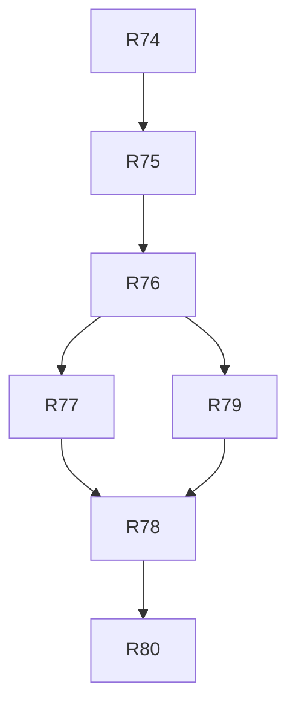

# v2.0 — TASKS.md sections

Cut from `TASKS.md` by `scripts/sdd/split.ts` (FR-SDD-3); ids resolve through `docs/sdd/ids.md`.

## v2.0 tasks

Draft, cut 2026-09-09 from `SPEC.md` v2.0 and `PLAN.md` v0.7, for review. Spec Phase 2g, "the redesign": the design phase's approved artboards (`redesign/`, untracked, V20-11) become five requirement families — the mark (§4.29), the settings page (§4.32), the first run (§4.28), the live page's two states (§4.30) and the compass gutter (§4.31) — and nothing else. Every artboard number a task needs is in the spec's text, so no session needs the artboards.

Delivery is PLAN §16 unchanged, cut by §16.16: seven tasks over six waves, on `main` after the `v1.4.0` tag. The order is the phase's risk (V20-3, V20-4, D-452): the mark first, because it is the only new build step and every later task places it; the settings inversion second, because the compact first run may not withdraw the home screen's `#settings` link until the page it links to is right; then the home screen; then the live states and the gutter together, the phase's one full wave; then the two short shapes; then the release. Four of the seven are the `ui` lane and run one per wave — two sessions in `Header.tsx`, `Settings.tsx` and `src/i18n/en/ui.ts` at once is what §16.1 exists to prevent. R78 depends on R79 for nothing it needs: both cross into `chart`'s `ChartFrame.tsx` (D-449, D-450) and the dependency is the cheapest way to keep them out of one wave. Models follow §16.6: `fable` for R74 and R78, whose acceptance the session can measure itself (a committed raster table; a matrix of heights that must come out equal), `opus` for the four tasks that are copy in two languages and semantics a test cannot fully reach, and `opus` for the release. Every task is `Gate: owner`: each ships captures, Spanish copy, or both.

Decision blocks (§16.2), reserved before wave 1: **R74 D-454..D-460, R75 D-461..D-464, R76 D-465..D-472, R77 D-473..D-480, R78 D-481..D-486, R79 D-487..D-494, R80 D-495..D-499** — D-453 is the phase's one delivery decision, the brief budget PLAN §16.8 now sets at 48 000 characters. Numbers a task does not spend stay unspent. Every session reads SPEC §12 V20-1..V20-23 and PLAN §2.25, §2.29, §8.16 and §16.16 first; each task's **Reads** line is the rest of D-284's list, and no session reads the three documents whole.

*Added 2026-09-18, cut from `SPEC.md` v2.0.2 and `PLAN.md` v0.7.2:* at R76's gate the owner asked for board 1B as drawn (V20-15..V20-23). R76 shipped the cold open and the inputs to the board (D-502..D-504); the populated home is **R81** (the panes' contents, both layouts) and **R82** (the phone's first visit as steps), D-505. R77 now waits for R81, whose next-event block its headline is. Blocks: **R81 D-515..D-522, R82 D-523..D-528.**

- [x] **R74 — Aperture: the generator, the ladder, both headers, the icons and the favicon** *(the rasters are re-baked from this generator, not reproduced cell for cell: FR-MARK-2's blocks were drawn by a generator whose constants were never written down, so the construction and the ladder are reproduced and 701 of the 1 950 cells differ — the counts per tier are in the PR, for the owner's acceptance under FR-MARK-2's own rule, D-455. The compact row is 34 cells, not 33: the mark takes the `>` prompt's place and the gap after it is a cell, D-457. Revisited 2026-09-14 at the owner's gate: the icons and the favicons are drawn from the scene as dots at an integer pitch, the ring cleared around the bead, an SVG favicon first, and the pin back to bytes — SPEC v2.0.1, V20-14, D-460.)*
  - **Lane:** ui
  - **Crossings (§16.16):** `spike/mark/**` and `scripts/build-mark.ts` belong to no lane and are this task's alone; `public/**` is `data`'s and is crossed for the two icons and the favicon (D-438, D-440).
  - **Model:** fable
  - **Gate:** owner
  - **Depends on:** none (`main` after the `v1.4.0` tag)
  - **Reads:** SPEC §4.29 (FR-MARK-1..8), §4.6 (FR-X-6 as amended), §4.11 (FR-OFF-6 as amended), §4.16 (FR-COMP-1, FR-COMP-4 as amended), §4.8 (FR-DESK-2 as amended); PLAN §8.1, §2's decision table row for the glyphcss boundary, D-28, D-127 (what it supersedes), D-370.
  - **Goal:** the app has a mark — one drawing, rasterised to braille by a build step, in both headers, in the manifest icons and in the favicon, with its bead running while the home page loads.
  - **Satisfies:** FR-MARK-1..FR-MARK-8; FR-X-6, FR-OFF-6, FR-COMP-1, FR-COMP-4 and FR-DESK-2 as amended v2.0. **Advances:** US-27 AC4 (the animation; its live-page placement is R77's).
  - **Why the placements are not split off:** a committed raster with nothing rendering it is not a mergeable state (D-452).
  - **Scope (PLAN D-438..D-441; D-440 supersedes D-127's drawing):**
    - `spike/mark/**` (new): a throwaway page that builds the scene with `GlyphScene` at each tier's grid — the bezel with its four cardinal ticks, the orbit ring, the globe's limb and one meridian, and the bead — under an orthographic camera at `MARK_TILT_DEG` (30°), reading the braille font from `skychart/dome/wiys-braille.otf`. The mesh radii and the tick length are the generator's constants, chosen to reproduce FR-MARK-2's rasters and recorded in PLAN from this task's block. `@glyphcss/react` is imported here and nowhere else the app can reach — `eslint.config.js`'s boundary allows it under `skychart/dome/` and `spike/**` alone (D-28).
    - `scripts/build-mark.ts` (new): drives that page with Playwright, reads the two `<pre>` elements per tier, and writes `src/ui/components/mark/rasters.json` — `{ [tier]: { cols, rows, body, frames } }`, the body as text and each of the `MARK_ORBIT_FRAMES` (60) bead frames as a sparse `[row, col, glyph]` list (D-439). The same run renders `public/icon-192.png`, `public/icon-512.png` and `public/favicon.png` by drawing the tier's text at the pixel size on `--bg` and screenshotting it, and regenerates FR-PUB-11's 80 px lockup through `scripts/readme-hero.ts` from the `lockup80` tier. `scripts/build-icons.ts` is deleted and `npm run build:icons` points here.
    - `src/ui/components/mark/Mark.tsx` + module (new, `ui`'s): two absolutely positioned `<pre>`s in one grid — the body written once and never again, the bead frame at the index a `setInterval` holds, one step a second for `MARK_ORBIT_PERIOD_S` (60). Props are the tier and the pixel size; tones are `--fg-dim` for the body and `--accent` or `--warn` for the bead (FR-MARK-3, no token added). The stylesheet imports the dome's `@font-face` rule rather than restating it. Under `prefers-reduced-motion: reduce` the bead does not advance.
    - `Header.tsx` + `Header.module.css`: the `header32` tier at `MARK_HEADER_PX` (24 px, one `--row`, three cells by D-441) before the title at both widths, and the wide tagline's `padding-left` from `calc(2 * var(--cell))` to the mark's width plus one cell.
    - `index.html`: the favicon link and `apple-touch-icon`; the manifest's icons are the new files.
    - The loading use of FR-MARK-5(a): on the home page the bead runs in `--accent` while the elements load and the run computes, and stops when the passes slice reaches `done`.
  - **Touches outside the lane:** `spike/mark/**`, `scripts/build-mark.ts`, `scripts/build-icons.ts` (deleted), `scripts/readme-hero.ts`, `public/**`, `index.html`, `package.json` (the script), `tests/deploy/manifest.test.ts`, `docs/readme/hero.png`, `docs/screenshots/`.
  - **Out of scope:** the cold open's hero placement (R76), the live page's state indicator (R77), the `header56` tier's placement (none in this phase, OQ-29), and any change to the dome — the mark borrows its cell, its font and its camera and touches none of its files.
  - **Done when:**
    - The golden raster test (FR-MARK-8 a), in the shape of `SkyDome.raster.test.tsx`: the six tiers' `body` and frame-0 `mark` layers as committed snapshots seeded from FR-MARK-2's blocks. Where a tier cannot be reproduced cell for cell, the PR shows the two side by side with the count of differing cells and the owner accepts the re-baked snapshot or not — never silently (FR-MARK-2).
    - The structural checks (FR-MARK-8 b): `favicon16` has a non-space cell on each row and exactly one bead cell; each tier's body has fewer non-space cells than the tier above; the bead is inside the grid in every frame; frame 0 and frame 30 differ at every tier but `favicon16`.
    - A test re-runs the generator in CI and asserts `rasters.json` is byte-identical to the committed file (FR-MARK-6).
    - A component test (FR-MARK-8 c): the bead advances on the timer, stops at `done`, and does not advance with `matchMedia` stubbed to `prefers-reduced-motion: reduce`; the body's text node is written once.
    - `tests/styles/controlRows.test.ts` counts the compact header with the mark at ≤ 36 cells in both languages (33 by D-441).
    - `tests/deploy/manifest.test.ts` passes with the new icons and gains the favicon's presence and its 16 × 16 size.
    - `npm run bundle:budget` green with **no budget raised**: the component, the six bodies and the sparse frames fit inside main's 155 KB, and the PR carries the measured main chunk before and after.
    - Captures (FR-MARK-8 e): the compact header at 390 px and the wide header at 1280 px, both themes, English; `tests/docs/captures.test.ts` updated if the set changes.
    - `npm test`, lint, typecheck and the e2e path green inside FR-CI-1's ten minutes.
    - The owner's gate: the new mark in every header, the two icons and the favicon opened at 1 : 1 in the PR.

- [x] **R75 — The settings page: the order inverted, one viewport in Spanish** *(at the owner's gate: the focus ring was drawn round the 48 px tap box and crossed the lines above and below it — on this page the way back, in the wide header the `[ Live sky ]` link over the tagline. Fixed for every inline control in `global.css`, with a quarter row above the wide header's tagline, D-500. Then the same gate: both headers aligned their controls on the mark's baseline rather than the title's, seven pixels low, D-501.)* — done; the components gained placement props rather than staying untouched, and the page drops the compact footer for its privacy line (D-461..D-464).
  - **Lane:** ui
  - **Model:** opus
  - **Gate:** owner
  - **Depends on:** R74
  - **Reads:** SPEC §4.32 (FR-SET-1..4), §4.16 (FR-COMP-2 as amended), §3.2 US-20, US-29; PLAN D-184, D-260, D-262.
  - **Goal:** `#settings` opens on the row a reader comes back for — Location, then Saved places, then one group for the device — and the whole page fits a 390 × 844 phone in Spanish.
  - **Satisfies:** FR-SET-1, FR-SET-2, FR-SET-4; FR-COMP-2 as amended v2.0. **Advances:** US-29 AC1, AC2 (AC3 is R76's). **Holds:** FR-I18N-1, FR-THEME-1, FR-OFF-6's install offer, FR-OFF-7's saved places.
  - **Why the order and the fit are one task:** the fit is what the order is for; splitting them would merge an inverted page that still does not fit (D-452).
  - **Scope (PLAN D-445):**
    - `Settings.tsx`: the three blocks re-ordered — **Location** (the place field, one row `[ Use my location ] [ coordinates ]`, the precision note), **Saved places** (FR-OFF-7's list, one row per place, and the row `[ Save this place ] [ Clear saved ]`), **This browser** (one heading over three label-and-control rows: Language, Theme, Install) — and the privacy line at the foot.
    - `[ coordinates ]` is a disclosure with `aria-expanded`, wrapping the existing `CoordsInput`, open by default when `observer.source === 'coords'`.
    - `LocationInput`'s `showClear` and `savedPlacesFooter` slots (D-262) are what move the clear action; the components themselves are untouched and no store field changes.
    - `i18n/{en,es}/ui.ts`: the group heading and the disclosure's name in both languages; existing strings keep their keys.
  - **Touches outside the lane:** `tests/e2e/settings.spec.ts`, `docs/screenshots/`, `tests/docs/captures.test.ts` if the set changes.
  - **Out of scope:** FR-SET-3's withdrawal of the home screen's `#settings` links — that is R76's, because withdrawing the link before the home carries the form would leave a compact reader with no way to set a place at all (D-452). Nothing about the install offer's own behaviour (V11-15) changes.
  - **Done when:**
    - `tests/e2e/settings.spec.ts` at 390 × 844 in `en` and `es`, in both FR-SET-2 states — no observer with the coordinate fields closed and the offer shown, and an observer with `SETTINGS_FIT_PLACES` (2) saved places — asserts `document.documentElement.scrollHeight <= window.innerHeight` and the privacy line's box inside the viewport; **it fails on `origin/main`**, where the page is about 1020 px at that width, and the failure is pasted in the PR.
    - A component test asserts the document order of the three blocks and the disclosure's default state for both observer sources.
    - Every existing settings test passes with its locators re-pointed and **no assertion loosened** — language, theme, install, saved places, clear, `Esc` and `[ ← Back ]` all still do what they did (FR-COMP-2).
    - `tests/styles/controlRows.test.ts` covers the new rows at ≤ 36 cells in both languages.
    - Captures (FR-SET-4): the page at 390 × 844 with no observer and with two saved places, both themes and both languages.
    - `npm test`, lint, typecheck and the e2e path green inside FR-CI-1's ten minutes.
    - The owner's gate: the Spanish page on a phone with no scrolling, beside the captures.

- [x] **R76 — The first run: the cold open, the countdown, three readings, three panes** — done; the three-pane literal is 1118 px by F-10's rule (D-465), the input group is one instance across the cold open and the line so typing a place keeps its field (D-467), and the 1280 px assertions of `desktop.spec.ts` and `wide.spec.ts` follow the panes, with FR-DESK-2's two columns measured at 1024 px (D-469) (D-465..D-471). *(At the owner's gate: the countdown read "in 225:07" for a pass under four hours out while the hero card on the same page read a clock, so the block takes `formatClockDuration` and D-442 is amended, D-502. The review's three findings are closed with it: the dark window line has its own tests, its lookback is a day with a polar winter's open darkness worded as an end rather than a false dusk, and the row test gives `LocationSummary` its props. Then, against the redesign's board 1B, the screens aligned: one primary button, boxed alternatives in one row on a desk, the wide cold open fitting its window with its foot notes, one rule per pane, and the wide header on one baseline, D-503.)*
  - **Lane:** ui
  - **Crossings (§16.16):** none — `src/lib/nextEvent.ts` is `ui`'s own by §16.16, and `src/lib/layout.ts` is `ui`'s.
  - **Model:** opus
  - **Gate:** owner
  - **Depends on:** R74, R75
  - **Reads:** SPEC §4.28 (FR-FIRST-1..7), §4.1 (FR-LOC-1 as amended), §4.8 (FR-DESK-1, FR-DESK-2, FR-DESK-3 as amended), §4.16 (FR-COMP-3 as amended), §4.32 (FR-SET-3), §3.2 US-1..US-5, US-14, US-26; PLAN §8.16, D-72, D-192, D-253, D-442, D-443, D-444.
  - **Goal:** a first visit asks where, in one primary action, on a phone and at a desk alike; once a place is set the next pass is a countdown before anything else; and the three readings are three stacked regions on compact and three panes on a wide desk.
  - **Satisfies:** FR-FIRST-1..FR-FIRST-7, FR-SET-3; FR-LOC-1, FR-COMP-3, FR-DESK-2 and FR-DESK-3 as amended v2.0. **Advances:** US-26 AC1..AC5, US-29 AC3; US-4, US-14, US-16 and US-20 as amended. **Holds:** US-1, US-2, US-3, US-5.
  - **Scope (PLAN D-442, D-443, D-444):**
    - `src/lib/nextEvent.ts` (new): `nextEvent(passes, t)` → `{ pass, kind: 'rise' | 'peak' | 'end', at, azimuth }` or a reason (`no-passes`, `no-darkness`, `no-elements`). Pure, `t` a parameter and never the wall clock (PLAN §9.3's determinism rule), no worker request and no store field.
    - `ui/components/passes/NextEventBlock.tsx` (new): the label, the headline, the peak line with the brightness phrase and the cloud verdict, and a countdown ticking at `NEXT_EVENT_TICK_MS` (1000) through `useNow`, formatted by `lib/timeFormat.formatCountdown`. One component, two hosts — the home page here, the live page's watching headline in R77 (D-442).
    - `Home.tsx`: three regions — `where`, `when`, `what` — each with a `SectionHeading` (D-49) numbered like the step line, composed from the components that already exist; the cold open (FR-FIRST-1) is what `where` renders with no observer, with the `hero` tier at `MARK_HERO_COMPACT_PX` (120) / `MARK_HERO_WIDE_PX` (140), the step line, the heading and its sentence, and the input group of FR-FIRST-2 with its two foot notes.
    - `LocationSummary`: `[ change ]` opens the FR-FIRST-2 group in place under the line with `aria-expanded`; `[ set a place ]` and every home-screen link to `#settings` are withdrawn (FR-SET-3). The route, the header's `[ settings ]` and a reload on `#settings` are untouched.
    - `src/lib/layout.ts`: `HOME_THREE_PANE_MIN_CELLS = 108` and its pixel twin by D-253's counting (116 cells, about 1114 px); `App.module.css` gains one media query at it for three equal columns, and `data-guide="pane"` places the existing wide guide panel across the `where` and `when` columns with the list kept in `what` (D-444).
    - `i18n/{en,es}/ui.ts`: the step line, the heading and its sentence, the primary action's note, the pane headings, and the next-event label and verbs shared with the live page's catalog.
  - **Touches outside the lane:** `src/lib/layout.ts` and `tests/styles/breakpoint.test.ts` (the third literal), `tests/e2e/home.spec.ts`, `wide.spec.ts`, `location.spec.ts`, `docs/screenshots/`.
  - **Out of scope:** the live page's headline and states (R77), the sky screen (R79), any change to how a component writes the store — this is a re-composition, not a rewrite (D-443) — and any new preference.
  - **Done when:**
    - `nextEvent.test.ts` over a fixture run pins the event, the verb, the direction and the countdown at instants before a pass, between start and peak, between peak and end, and after the last pass, and each of the three reasons.
    - A component test asserts FR-FIRST-1's inventory with no observer (nothing else rendered — no Now panel, no list, no elements banner), the document order of FR-FIRST-2's three controls in both modes with the primary control's accessible name and note, the group's two foot notes last, and the next-event block before the list once an observer is set.
    - `tests/styles/breakpoint.test.ts` pins 1114 px to `App.module.css`'s literal and asserts the three literals — 960, 1114, 1272 — are ascending and each is a real rule (D-443).
    - A layout test at 964, 1024 and 1280 px asserts two columns, two columns and three panes.
    - `tests/e2e/`: with a stubbed `geolocation`, the primary action moves the cold open to the countdown state with **no navigation**; at 1280 × 800 an open pass takes the first two panes' width with the list still in the document; `wide.spec.ts` at 1024 px passes untouched (D-444).
    - FR-FIRST-6's table holds: the existing component and e2e tests for the location inputs, the favourites, the clear action, the readiness line, the banners, the Now panel, the Moon line, the hero card, the sort control, the list and the footer pass with their locators re-pointed and **no assertion loosened**.
    - `controlRows.test.ts` covers every new compact row in both languages.
    - Captures (FR-FIRST-7): the cold open at 390 × 844 and 1280 × 800, both themes and both languages; the populated home at 390 × 844 collapsed and expanded, 1024 × 768 and 1280 × 800, both themes and both languages; the three-pane page with a pass open at 1280 × 800, one theme, both languages.
    - `npm test`, lint, typecheck and the e2e path green inside FR-CI-1's ten minutes.
    - The owner's gate: the first run from a clean browser on a phone to a countdown, and the three panes with a pass open at a desk.

- [x] **R81 — The home's panes as drawn: the stripe, the table, the next event, the cards and the Where reading**
  - **Lane:** ui
  - **Crossings (§16.16):** none — `src/lib/tonightStripe.ts` and `src/lib/passPath.ts` are `ui`'s own (D-505); `useSkyBands` (`live`'s) is imported, not changed, as D-470 already does; the dome's chart chunk is loaded, not changed.
  - **Model:** opus
  - **Gate:** owner
  - **Depends on:** R76
  - **[P]** with R79 — wave 4, two screens that share no file.
  - **Reads:** SPEC §4.28 (FR-FIRST-3, FR-FIRST-5, FR-FIRST-6, FR-FIRST-8..11 as amended v2.0.2), §3.2 (US-4 AC1 and AC3, US-5 AC1 as amended), §4.2 (FR-SAT-4), §4.5 (FR-WX-3), §4.11 (FR-OFF-4), §4.12 (FR-MOON-3), §4.30 (FR-WATCH-2 as amended), §8 rank 1, §12 V20-15..V20-23, OQ-32, OQ-33; PLAN §2.29 (D-505..D-512, D-514), D-442 as amended, D-467, D-470, D-504. Board 1B is untracked (V20-11) and not in a session's worktree; its sizes, spacing, colours and strings are in FR-FIRST-3..11 (V20-23; the cold open and the inputs before them are R76's and unchanged), and the owner holds the board at the gate.
  - **Goal:** with a place set, the wide home's three panes and the phone's stacked page hold what board 1B draws — tonight's stripe, a table of Dark, Clouds now, Moon and Up now, the next event as `Next up · in 3:45:07` over the clock time and the path, one-line cards with the next ISS pass tagged, and a Where reading of the place, one sentence, a dome on wide and one line each of readiness and elements.
  - **Satisfies:** FR-FIRST-3, FR-FIRST-5, FR-FIRST-6, FR-FIRST-8, FR-FIRST-9, FR-FIRST-10, FR-FIRST-11 as amended v2.0.2; FR-SAT-4, FR-OFF-4, FR-WX-3 and FR-MOON-3 as amended v2.0.2; FR-WATCH-2's shared block (the live page's host is R77's). **Advances:** US-26 AC2, AC4, AC6; US-4 and US-5 as amended.
  - **Scope (PLAN D-505..D-512):**
    - `src/lib/tonightStripe.ts` (new): the span, the label line, the 30 cells and the ticks (D-506); `ui/components/now/TonightStripe.tsx` draws them, `aria-hidden`.
    - `src/lib/passPath.ts` (new): start, peak and end by the boundary reasons (D-507).
    - `NextEventBlock`: the label line, the clock time at 32 px, the path line and `[ Open the live sky ]`; a `form: 'card'` for R82; `nextEvent.headline` and `nextEvent.peakLine` deleted with their keys (D-508).
    - `ui/components/now/ConditionsTable.tsx` (new): the `dl` of FR-FIRST-9; `NowPanel` and `DarkWindow` deleted with their tests' facts moved to it (D-509).
    - `PassCard` re-cut to FR-FIRST-10 with `detail: 'magnitude' | 'phrase'`; `IssHeroCard` deleted and the `Next ISS` tag drawn from `nextFeaturedPass` (F-68 holds); the count and sort on one line; the night groups' toggles under the cards (D-510).
    - `ui/components/location/WherePlace.tsx` (new) in place of `LocationSummary`; `ElementsLine.tsx` (new) with `[ details ]` over what `ElementsBanners` renders; `ReadinessLine` and `Favourites` gain their `form: 'line'` (D-511).
    - `ui/components/location/WhereDome.tsx` (new): the dome at real time, lazily, wide only, one link to `#live` (D-512, OQ-32).
    - `Home.tsx` and `App.module.css`: the populated panes' plain headings (`── Where ──`), 0.75 rem between blocks, and the stacked phone page in the same order.
    - `i18n/{en,es}/ui.ts`: every string FR-FIRST-3 and FR-FIRST-8..11 give, in both languages.
  - **Touches outside the lane:** `tests/e2e/home.spec.ts`, `wide.spec.ts`, `desktop.spec.ts`, `now-panel.spec.ts`, `moon.spec.ts`, `location.spec.ts`, `pass-detail.spec.ts` (its high-pass lookup reads the new card), `tests/e2e/r76-captures.spec.ts`, `docs/screenshots/`.
  - **Out of scope:** the phone's first-visit steps (R82 — until then a first visit on a phone goes from the cold open straight to the stacked page, as today), the live page's host of the block (R77), and any change to the guide, the worker or the store's shape.
  - **Done when:**
    - `tonightStripe.test.ts` pins the span, the labels, the cells and the ticks over the stored Neuquén run, and the span with no dark band; `passPath.test.ts` pins `low` and altitudes by boundary reason; `nextEvent.test.ts` pins the label line and the path before, during and after a pass.
    - Component tests: `ConditionsTable` (the rows in order, `Up now` present with a visible item and absent without, no darkness); `PassCard` (its lines, the tag on the next ISS pass alone); `WherePlace` (the sentence per source, `[ change ]` with `aria-expanded`); `ElementsLine` (the disclosure holds every banner's text).
    - The home e2e at 1280 × 800: the three panes in board 1B's order, the dome in Where and none on a 390 px page; an open pass still takes the first two panes (D-444).
    - FR-FIRST-6: every assertion the deleted components' tests made is made again where its fact now is — **none dropped**.
    - `controlRows.test.ts`: the card's first line, the count and sort line and the Where lines at ≤ 36 cells in both languages.
    - Captures (FR-FIRST-7): the populated panes at 1280 × 800 and 1024 × 768, the stacked phone page at 390 × 844, both themes and both languages, and the panes with a pass open, one theme; each element's size, spacing, type and colour measured in the browser against the numbers FR-FIRST-3..11 give (D-504's method).
    - `npm test`, lint, typecheck and the e2e path green inside FR-CI-1's ten minutes (D-514: at most three new page loads).
    - The owner's gate: the panes beside board 1B at a desk, and the stacked page on a phone.
  - **Done (R81):** as written, plus D-515..D-520 — the card opens from its first two lines, the small controls keep their 44 px tap box, the count and sort wrap at the separator at 1280 px too (for the gate), and the facts the amended spec took off the home are asserted where they now are. The captures are `docs/screenshots/r81-*`.

- [x] **R77 — Watching and scrubbing: the split, the inventory, the headline and the conditions line** [P]
  - **Done (2026-09-19):** as written, except the 390 × 667 watching box, which is held at the measured 330 px and not over 374 (D-480, OQ-27). Crossings: `NextEventBlock` gains `liveLink` (D-479), and the legend Moon line carries the phase (D-477).
  - **Lane:** live
  - **Model:** opus
  - **Gate:** owner
  - **Depends on:** R76, R81
  - **[P]** with R82 — wave 5, two screens that share no file; R81 comes first because the watching headline is the block it re-cuts (v0.7.2, D-505) (`Live.tsx`, `liveRows.ts` and `i18n/*/live.ts` against `Home.tsx`, `screens/home/**` and `i18n/*/ui.ts`).
  - **Reads:** SPEC §4.30 (FR-WATCH-1..9), §4.10 (FR-LIVE-1..7 as amended), §4.26 (FR-SPAN-2, FR-SPAN-3 as amended), §4.27 (FR-LEG-6, FR-LEG-7 as amended), §4.12 (FR-MOON-3 as amended), §3.2 US-27; PLAN §8.8, §8.14, D-190, D-386, D-387, D-446, D-447.
  - **Goal:** the live page is watching or scrubbing, told apart by whether the shown instant is real time; watching is the drawing, the next event and one line of conditions, and the stripe, the steps and the speeds come out on a tap and go away on a tap.
  - **Satisfies:** FR-WATCH-1, FR-WATCH-2, FR-WATCH-3, FR-WATCH-4, FR-WATCH-7 (the compact and tall-wide half) and FR-WATCH-8; FR-WATCH-5's compact-portrait and tall-wide rows; FR-LIVE-3, FR-LIVE-5 and FR-LIVE-7 as amended v2.0; FR-MOON-3 and FR-SPAN-3 as amended v2.0; FR-MARK-5's live and held uses. **Advances:** US-27 AC1, AC2, AC3, AC4, AC6; FR-WATCH-9 (a, d, e, f, and b at two of its four shapes).
  - **Scope (PLAN D-446, D-447):**
    - `src/ui/screens/liveRows.ts` (new, `live`'s): pure `rowsFor(state, mode, shape)` → the ordered row ids the page renders, which is FR-WATCH-4's inventory in one place. `Live.tsx` renders from it and the component test asserts against it.
    - `Live.tsx`: `scrubbing` is the predicate over the live slice's instant and nothing else — no new store field, nothing new in the hash (D-446). `[ scrub ]` / `[ scrub the night ]` is the pause path at now; `[ back to live ]` is the existing `now` action renamed in the catalogs; `[ Now ]` is not rendered separately.
    - The headline: `NextEventBlock` (R76's component, re-cut by R81 to board 1B's three lines — `Next up · in 4:12`, the clock time, the path; FR-WATCH-2 as amended) while watching; the held instant with its offset from now (`21:47 · +33 min`, FR-TRAJ-4's readout rule) while scrubbing. Beside it the state indicator — `Mark` at the `header32` tier, 24 px, plus the word `live` or `held` (never colour alone) — on the compact top row beside the place name, at the head of the rail on wide.
    - The conditions line (FR-WATCH-3): one line per mode, replacing the five-field strip; the Moon's phase and illumination leave the compact line for the list panel (FR-LEG-7, FR-MOON-3 as amended).
    - The rows themselves: watching renders the 24 h overview as its only timeline and no stripe, step row or playback row; scrubbing adds the time row, the stripe, the step row and the playback row where FR-WATCH-4 puts them on compact and on the tall wide page. Absent, not hidden.
    - The actions rows of FR-WATCH-4, including the hidden-objects toggle joining the compact scrubbing row (V20-8), and the wide share action's two names.
    - `i18n/{en,es}/live.ts`: `live`, `held`, `scrub`, `scrub the night`, `back to live`, the overview's end labels and the two share names.
  - **Touches outside the lane:** `src/ui/components/mark/Mark.tsx` (used, not changed), `tests/e2e/live*.spec.ts`, `tests/styles/controlRows.test.ts`, `docs/screenshots/`.
  - **Out of scope:** the landscape phone's rail and the short wide window's overlay (R78 — this task leaves both shapes rendering the inventory they render today under the new state split, and R78 places the block), `lib/layout.ts` (R78's crossing, D-448), `ChartFrame.tsx` (R78's crossing, D-449), the gutter and the sky screen (R79), and any change to what the drawing draws.
  - **Done when:**
    - A component test per state asserts `rowsFor`'s inventory by test id — presence **and** absence — the headline's text in both states, the indicator's word, and that `[ scrub ]` holds `t` at the tap's instant while `[ back to live ]` returns it to real time and lets it advance.
    - `tests/e2e/live-states.spec.ts` (new) enters scrubbing, steps a pass with `pass ▶|`, plays at 60× and returns to live, at 390 × 844 and 1280 × 800; R78 extends the same spec to 844 × 390 and 1200 × 450.
    - `live-compact.spec.ts` measures `chart-box` at 390 × 667 in watching with the list closed and asserts it over FR-COMP-5's floor of 374 px, with the view control's row where V20-13 leaves it.
    - The existing playback, stripe, overview, step-row, list, hidden-objects and share tests pass once they enter scrubbing first, with **no assertion loosened**.
    - A URL carrying `t` opens scrubbing and a URL without it opens watching, with no code that knows about states (FR-LIVE-9 unchanged).
    - `controlRows.test.ts` covers the new compact rows — the top row with the indicator, the conditions line and both actions rows — at ≤ 36 cells in both languages.
    - Captures (FR-WATCH-9 f): both states at 390 × 844 and 1280 × 800, both themes and both languages.
    - `npm test`, lint, typecheck and the e2e path green inside FR-CI-1's ten minutes.
    - The owner's gate: the page in both states one-handed at night.

- [x] **R79 — The compass gutter, and portrait's band** [P]
  - *Done:* upright at 390 × 844 the band is capped at 390 × 390 (FR-GUT-7), so the 68 px is asserted at 844 × 390 and on the turned layer at 390 × 844 (D-492); the pass detail's `window` captures are re-shot with the gutter as well.
  - **Lane:** window
  - **Crossings (§16.16):** `skychart/ChartFrame.tsx` is `chart`'s (D-450); R78 makes the phase's other crossing into it, in a later wave.
  - **Model:** opus
  - **Gate:** owner
  - **Depends on:** R76
  - **[P]** with R81 — wave 4 *(v0.7.2; was with R77, which now waits for R81)*.
  - **Reads:** SPEC §4.31 (FR-GUT-1..8), §4.23 (FR-FSC-1..11 as amended), §4.18 (FR-WIN-1..3), §4.17 (FR-LEG-1..5), §3.2 US-21, US-28; PLAN §8.10, §8.13, §8.15, D-188, D-278, D-322, D-427, D-450, D-451.
  - **Goal:** the sky screen's bottom edge is a compass — where I face, what I can see of it, where each pass is and which way to turn when the field is empty — and the drawing gets 68 px back; held upright the screen draws a band of sky instead of instructing.
  - **Satisfies:** FR-GUT-1..FR-GUT-8; FR-FSC-3, FR-FSC-7 and FR-FSC-11 as amended v2.0; FR-LEG-2 as amended v2.0. **Advances:** US-28 AC1..AC6; US-21 as amended. **Holds:** FR-FSC-1, FR-FSC-2, FR-FSC-5, FR-FSC-9, FR-FSC-10, FR-FOL-5, FR-WIN-1..3.
  - **Scope (PLAN D-450, D-451):**
    - `skychart/window/gutter.ts` (new, pure, `window`'s): `gutterX(bearing, facing, widthPx)` by FR-GUT-2's formula with `GUTTER_HALF_SPAN_DEG` (90) and a wrap into (−180, 180]; `bracketFor(view)` from `projection.ts`'s own field functions and `WINDOW_FOV` — **no new constant** (FR-GUT-3); `gutterMarks(passes, facing, view)` → one entry per pass with its branch (`in-bracket` | `on-band` | `off-left` | `off-right`), its `x` or its angle to turn, its legend key and its series colour token, the bearing being the satellite's azimuth while the pass is up and its rise azimuth otherwise.
    - `CompassGutter.tsx` (new, `window`'s): `GUTTER_PX` (28) tall, the screen's full width, on `--screen-overlay`; the eight compass names with a tick above each where they fall in the band; the bracket; a tick per drawn pass, at least 2 × 8 px, with its key under it only outside the bracket; the edge markers stacking in legend order with the nearer angle first; and the empty-field chip as a `role="status"` line above the gutter, which loses to FR-FOL-5's ground notes and names no direction when nothing is in the span.
    - `ChartFrame.tsx`: on the screen the bottom overlay slot is filled by the gutter instead of the legend strip — which component fills it changes, how the overlay works does not (D-450).
    - The portrait layout (FR-GUT-7): chosen from the measured box as `data-orientation` already is since R73, never from `(orientation: portrait)` (D-451). Top to bottom: the readout and the `×`; the next-event block with the turn advice as secondary copy on the peak line in `--fg-dim`; the band, capped at as tall as it is wide; two `--tap` legend rows; the gutter. FR-FSC-11's `role="status"` wrapper goes and its `turnAdvice` string moves — the copy and its Spanish survive.
    - `i18n/{en,es}/window.ts`: the chip's two forms and the edge markers' reading; the compass names come from `compass`'s translated 8-point set.
  - **Touches outside the lane:** `skychart/ChartFrame.tsx` (the slot), `src/ui/components/guide/legend/` (the strip is not rendered on the screen), `tests/e2e/sky-screen.spec.ts`, `tests/styles/`, `docs/screenshots/`.
  - **Out of scope:** the live page's two states (R77), the projection, `WINDOW_FOV`, the smoothing and FR-FSC-10's turn (R73's, untouched), the pass detail's sheet (OQ-31 is not this phase's), and the legend on the dome and the polar chart, which keep FR-LEG-2's placements.
  - **Done when:**
    - `gutter.test.ts` walks a table of facings and bearings — inside the bracket, on the band, off the band left, off the band right and exactly 180° behind — asserting the branch and `x`, in the style of `lib/timeStripe.ts`'s tests. Nothing about the gutter is tested through the DOM (FR-GUT-5).
    - A component test: a name per compass point in the band, a tick per drawn pass with the key only outside the bracket, an edge marker per off-band pass, and the chip only with an empty field and never over a ground note.
    - `sky-screen.spec.ts` with `stubCompass` asserts the drawing box is **68 px taller than on `origin/main`** at 844 × 390 and 390 × 844, measured on the SVG's box, with the old number pasted in the PR; the chip appears with the heading turned away from every pass; upright, the five rows are in order.
    - A `tests/styles/` test pins `GUTTER_PX` to the stylesheet's token.
    - No key named `portrait` and no `role="status"` advice line survive; `turnAdvice` is on the peak line in both languages and the i18n snapshot moves in the same commit.
    - `sky-screen.spec.ts`'s existing assertions — `role="dialog"`, `Esc`, `100dvh` with no scrolling (FR-FSC-9), hidden objects never drawn, the readout and the `×` — pass unchanged.
    - Captures (FR-GUT-8): the screen sideways at 844 × 390 with a pass in the field and with the chip, and upright at 390 × 844, both themes and both languages.
    - `npm test`, lint, typecheck and the e2e path green inside FR-CI-1's ten minutes.
    - The owner's gate: a phone held up, sideways and upright, with a pass in the field and with none — a bearing's sign looks right in a unit test and is backwards in the hand (R73's argument).

- [x] **R82 — The phone's first visit: three steps, then stacked**
  - **Lane:** ui
  - **Crossings (§16.16):** none — `src/lib/moonNote.ts` is `ui`'s own (D-513).
  - **Model:** opus
  - **Gate:** owner
  - **Depends on:** R81
  - **[P]** with R77 — wave 5, two screens that share no file.
  - **Reads:** SPEC §4.28 (FR-FIRST-1, FR-FIRST-4, FR-FIRST-7 as amended v2.0.2), §3.2 US-26 AC3, §12 V20-16, V20-23; PLAN D-467, D-504, D-513, D-514. Board 1B's phone states are untracked (V20-11); their numbers and strings are in FR-FIRST-4 (V20-23), and the owner holds the board at the gate.
  - **Goal:** a first visit on a phone walks where → when → what, one screen each, with a ✓ on a finished step, and every later visit opens on the stacked page R81 built.
  - **Satisfies:** FR-FIRST-4 as amended v2.0.2 (the steps); FR-FIRST-7's step captures. **Advances:** US-26 AC3.
  - **Scope (PLAN D-513):**
    - `Home.tsx`: `step: 'where' | 'when' | 'what' | null`, set once at mount (`'where'` with no observer, `null` with one), never stored and never in the hash; the device button, a picked place and a saved place move `where` to `when`; typed coordinates move it on blur or `Enter`, never on a keystroke (D-467); the step line's finished items are controls back.
    - `ui/screens/home/WhenStep.tsx` (new): the heading and sentence, the ruled box with the stripe and the night's three rows, the ruled box with `Clouds tonight`, `Moon` and the Moon sentence, and `[ See what crosses ]` at the foot of the screen.
    - `ui/screens/home/WhatStep.tsx` (new): the count in words, the sentence, R81's block in its card form, tonight's cards with the brightness phrase, `[<n> more tonight]` and `[<n> more nights]`, and the ruled foot line with `[ edit ]`.
    - `src/lib/moonNote.ts` (new): `MOON_BRIGHT_PCT` (50) and the sentence rule.
    - `i18n/{en,es}/ui.ts`: the steps' headings, sentences, rows, the Moon sentences, `home.count(n)` to twelve and the foot line.
  - **Touches outside the lane:** `tests/e2e/home.spec.ts`, `location.spec.ts`, `tests/e2e/r76-captures.spec.ts`, `tests/styles/controlRows.test.ts`, `docs/screenshots/`.
  - **Out of scope:** the wide page (a desk has no steps: the cold open's three panes become the populated panes, as R76 and R81 left them), any stored first-run flag, and the panes' components (R81's).
  - **Done when:**
    - A component test walks a first visit — the device button moves to `when`, `[ See what crosses ]` to `what`, `[ edit ]` back to `where` with the group open — and asserts each step's inventory in order; a second test types a coordinate pair and asserts the step does not move until the field is left, with the field still focused while typing (D-467).
    - A render with an observer at mount is the stacked page and never a step.
    - `moonNote.test.ts` pins both sentences at the threshold's two sides and with the Moon down.
    - `home.count` in both languages from one to twelve and past it.
    - One e2e at 390 × 844 with a stubbed `geolocation` walks the three steps with no navigation and reloads onto the stacked page (D-514: one page load and one reload).
    - `controlRows.test.ts` covers the step line with ✓, the rows and the foot line at ≤ 36 cells (the `--small` rows counted in their own characters) in both languages.
    - Captures (FR-FIRST-7): the when and what steps at 390 × 844, both themes and both languages, measured in the browser against the numbers FR-FIRST-4 gives (D-504's method).
    - `npm test`, lint, typecheck and the e2e path green inside FR-CI-1's ten minutes.
    - The owner's gate: a first visit on a phone from a clean browser, through the three steps, and a reload.
  - **Note (R82):** done as written, with D-521..D-525 for what the entry left open; one line outside the lane — `SkyWindow.tsx` passes the observer's zone to `NextEventBlock`, which `main`'s typecheck needed after R79 and R81 merged.

- [x] **R78 — The two short shapes: the landscape phone's rail and the short wide window's overlay** — done as written, with three differences recorded in PLAN D-481..D-486: the table counts the time row at the block's 44-cell floor in Spanish, so the overlay starts at a 602 px viewport (D-482); the bar and the measurement reach `ChartFrame` by a context exported from that file rather than through the five view files (D-484); and at 1200 × 450 the parent's failure is the box moving (376 px watching, 218 scrubbing), not the box under its floor, which on the parent happens at 964 × 420.
  - **Lane:** live
  - **Crossings (§16.16):** `skychart/ChartFrame.tsx` is `chart`'s (D-449) and `src/lib/layout.ts` is `ui`'s (D-448); both are named as this task's shared files.
  - **Model:** fable
  - **Gate:** owner
  - **Depends on:** R77, R79
  - **Why R79:** for nothing this task needs — both cross into `ChartFrame.tsx`, and the dependency is the cheapest way to keep them out of one wave (§16.16).
  - **Reads:** SPEC §4.30 (FR-WATCH-5, FR-WATCH-6, FR-WATCH-7), §4.25 (FR-SHP-1..5 as amended); PLAN D-173, D-246, D-314, D-381, D-414, D-448, D-449.
  - **Goal:** on a landscape phone the scrub block goes in the rail and the drawing does not move between the states; on a short wide window it comes up as a bar over the bottom of the drawing, and the box is the same height watching and scrubbing.
  - **Satisfies:** FR-WATCH-5's landscape-phone and short-wide rows, FR-WATCH-6, FR-WATCH-7 (the shapes' half); FR-SHP-3 and FR-SHP-4 as amended v2.0; FR-WATCH-9 b and c at the two short shapes. **Advances:** US-27 AC5; US-25 as amended.
  - **Scope (PLAN D-448, D-449):**
    - `src/lib/layout.ts` (the task's named shared file): `scrubPlacement({ mode, shape, boxHeightPx })` → `'under' | 'rail' | 'overlay'` — the rail on the landscape phone, the overlay on a wide page where placing the block under the box would take it below `LIVE_BOX_MIN_PX` (192), under the box otherwise. The decision is made from the height the frame has measured, never from a viewport literal — a browser window is never its screen, which is what the withdrawn ladder of fixed boxes taught (D-314). `LIVE_KEPT_ROWS_PX`'s over-count (D-414) is re-derived here, since the rows under the box are now a state's, and `foldRows` reads `liveRows`'s table so the fold cannot name a row the state does not render (D-447).
    - `ChartFrame.tsx`: a `bottomOverlay` slot rendered inside the box's own box on `--screen-overlay`, the third use of the surface the sky screen's overlays and the list panel already use (D-449) — so the drawing does not resize when the bar appears.
    - `Live.tsx`: passes the scrub block to the slot or to the rail by `scrubPlacement`; each overlay control row is one text row tall with its 48 px hit box kept by D-246's padding-and-negative-margin; `[ back to live ]` stays at the head of the rail and dismisses the bar with the state; the overview stays in the rail at short wide widths and does not fold.
    - The landscape phone: watching puts the indicator and clock, the headline, the conditions line and the overview in the `3fr` rail; scrubbing adds the time row, the stripe, the step row and the playback row to the rail, which scrolls inside itself where a language or a height overflows it (D-173, D-119). The dome column's width and height are the same in both states.
  - **Touches outside the lane:** `src/lib/layout.ts`, `skychart/ChartFrame.tsx` (the slot), `tests/e2e/shapes.spec.ts`, `live-states.spec.ts`, `live-landscape.spec.ts`, `live-rail.spec.ts`, `docs/screenshots/`.
  - **Out of scope:** the state split itself and the inventory (R77's, consumed here), the gutter (R79), the tall wide page's under-the-box behaviour (unchanged, FR-WATCH-5), and any change to `fitBox`'s own maths beyond the height it is handed.
  - **Done when:**
    - A unit test walks `scrubPlacement` over FR-SHP-4's matrix and both states, including the height either side of `LIVE_BOX_MIN_PX` on a wide page, and the re-derived `LIVE_KEPT_ROWS_PX` per state.
    - `tests/e2e/live-states.spec.ts` extended to 844 × 390 and 1200 × 450: at 1200 × 450 `chart-box`'s measured height is **identical** in watching and scrubbing and the bar is inside the box, covering at most half its height; at 844 × 390 the dome column is identical in both. **Fails on the branch's parent** at 1200 × 450, where revealing the block takes the box under its floor, and the failure is pasted in the PR.
    - `tests/e2e/shapes.spec.ts` walks every row of FR-SHP-4 **in both states**, keeping its invariants: no pane over another, `scrollWidth <= clientWidth`, `scrollHeight <= innerHeight`, the box at least `LIVE_BOX_MIN_PX` tall with a drawing in it, and FR-DOME-1's 90–100 % fit.
    - FR-WATCH-7 holds where it is absolute: on the landscape phone and the short wide window the box's height does not change on the state either, and no tick, chunk boundary, speed change or pass rising changes any row's height at any shape.
    - `live-landscape.spec.ts` and `live-rail.spec.ts` pass with their locators re-pointed and no assertion loosened.
    - The e2e stage stays inside FR-CI-1's ten minutes, with the shape spec's own duration reported in the PR.
    - Captures: both states at 844 × 390 and 1200 × 450, both themes and both languages.
    - `npm test`, lint and typecheck green.
    - The owner's gate: a browser window dragged short in both states, beside the matrix's numbers.

- [x] **R80 — v2.0 release preparation** — done as written, with four things the entry did not predict, recorded in PLAN D-495..D-499. `main` measures **158.0 KB against its 155 budget**, so PLAN §11's standing instruction applies and the budget is *not* raised: F-69 in §4.20 carries it, with the mark's share measured by ablation at 5.2 KB (152.8 with `Mark.tsx` stubbed) and the other 12.7 KB of the phase's growth named beside it. "The cold open and the settings page added" is read as a re-shoot and not as new screen names (D-496): `location` *is* the cold open and `settings` has been in the set since R53, and FR-FIRST-7, FR-SET-4 and FR-GUT-8 each ask only for a re-shoot — so the only screen the set gains is the live page's second state. **F-66 did not reproduce** on the 2.0.0 build and stays open (D-497), and the probe that looked for it found a second nondeterministic capture, `sky-screen-chip` at 844, filed as F-70. OQ-33 is the one question left open, with its reason: no fixture in the repository has a night with no dark band, so the revisit it asks for has nothing to look at.
  - **Lane:** ui
  - **Model:** opus
  - **Gate:** owner
  - **Depends on:** R78, R82
  - **Reads:** SPEC §9 Phase 2g, §4.16 (FR-COMP-6 as amended), §7 (OQ-27..OQ-31), §4.20; `docs/RELEASE.md` and PLAN §11.
  - **Goal:** the phase closes: the capture set covers the new and renamed screens, the budgets are re-set with the mark inside main's, every open question the phase raised is answered or left with its reason, and the build is 2.0.0.
  - **Satisfies:** the Phase 2g definition of done (spec §9); FR-COMP-6 for the phase; FR-MARK-6's budget measurement on the shipped build.
  - **Scope:**
    - `package.json` at 2.0.0.
    - The D-179 set re-shot on `main`: `live` becomes `live-watching` and `live-scrubbing` at the widths it has today plus 1200 × 450; the `sky-screen-*` screens re-shot with the gutter; the cold open and the settings page added; `home` and `location` re-shot for the three readings; `tests/e2e/captureSet.ts` and `tests/docs/captures.test.ts` following.
    - The bundle budgets re-measured by the D-178 rule (the measured build plus a tenth), with main's re-stated and the mark's cost inside it named.
    - `docs/RELEASE.md` gains the phase's section, whose owner run is the first run from a clean browser on a phone, the live page one-handed in both states, the sky screen sideways and upright, the settings page in Spanish, the three panes at a desk and a window dragged short.
    - F-66 is expected in the diff and is not a product change: `v1-polar-390-night-es.png` alternates between two states 142 px apart off one build (SPEC §4.20, D-421), so the re-shoot names it as the known flake rather than leaving the reviewer of the set to tell it apart from a screen that moved. It is **not** closed here — the cause is `chart`-lane code this task may not touch — and its row stays open with its measurement.
    - OQ-27..OQ-31 each answered by a Decision Log row or left open with the reason; every finding the phase carried closed in spec §4.20 with its PR number; FR-SET-4's note that the `docs/mockups/` settings board is superseded by the artboard and not re-drawn.
  - **Touches outside the lane:** `package.json`, `docs/**`, `SPEC.md` §4.20 and §7, `tests/docs/captures.test.ts`, `tests/e2e/captureSet.ts`.
  - **Out of scope:** any product change, and any test changed to pass.
  - **Done when:**
    - `npm run bundle:budget` passes with the re-stated numbers, and the PR carries the measured sizes beside the budgets.
    - `tests/docs/captures.test.ts` passes with the new set, and the PR lists which captures changed, which were renamed and why — with F-66's file named as the known flake if it appears, and F-66 still open in §4.20.
    - `docs/RELEASE.md`'s new section names the owner's steps, including the tag pinned to the release commit's SHA rather than `main`'s head.
    - Every row of spec §4.20 and §7 that this phase carried names a closing PR or a reason for staying open; no row is closed silently.
    - `passes.golden.test.ts` passes unchanged — the phase touched no physics.
    - `npm test`, lint, typecheck and the PR's e2e path green inside FR-CI-1's ten minutes.
    - The owner's gate: the tag, the deploy and the release checklist are the owner's, as in every phase.

### Requirement coverage (v2.0)

| Requirement | Task |
|---|---|
| FR-MARK-1..FR-MARK-8 | R74 (R77 places the live indicator) |
| FR-X-6, FR-OFF-6, FR-COMP-1 as amended | R74 |
| FR-SET-1, FR-SET-2, FR-SET-4 | R75 |
| FR-COMP-2 as amended | R75 |
| FR-SET-3 | R76 |
| FR-FIRST-1..FR-FIRST-7 | R76 |
| FR-LOC-1, FR-COMP-3, FR-DESK-2, FR-DESK-3 as amended | R76 |
| FR-WATCH-1, FR-WATCH-2, FR-WATCH-3, FR-WATCH-4, FR-WATCH-8 | R77 |
| FR-WATCH-5 | R77 (compact portrait, tall wide), R78 (landscape phone, short wide) |
| FR-WATCH-6 | R78 |
| FR-WATCH-7 | R77 (the reader's tap), R78 (the two short shapes) |
| FR-WATCH-9 | R77 (a, d, e), R78 (b, c), R77 and R78 (f) |
| FR-LIVE-3, FR-LIVE-5, FR-LIVE-7, FR-MOON-3, FR-SPAN-3 as amended | R77 |
| FR-SHP-3, FR-SHP-4 as amended | R78 |
| FR-GUT-1..FR-GUT-8 | R79 |
| FR-FSC-3, FR-FSC-11, FR-LEG-2 as amended | R79 |
| FR-FSC-7 as amended | R79 (the screen's captures), R80 (the set) |
| FR-COMP-4 as amended | R74 (the header), R75 (the settings rows), R76 (the home rows), R77 (the live rows) |
| FR-COMP-6 as amended | R74..R79 (their captures), R80 (the set) |
| US-26 | R76 (AC5 with R75's page in place) |
| US-27 | R77 (AC1..AC4, AC6), R78 (AC5) |
| US-28 | R79 |
| US-29 | R75 (AC1, AC2), R76 (AC3) |
| Phase 2g definition of done | R80 |

**Waves** (the driver recomputes them from `main`; this is the sanity check): **wave 1** R74 — **wave 2** R75 — **wave 3** R76 — **wave 4** R81, R79 — **wave 5** R77, R82 — **wave 6** R78 — **wave 7** R80. Waves 4 and 5 are full, and neither pair shares a file: R81 is `Home.tsx`, the home's components and `i18n/*/ui.ts`, R79 the window's own directory, `ChartFrame.tsx` and `i18n/*/window.ts`; R77 is `Live.tsx`, `liveRows.ts` and `i18n/*/live.ts`, R82 `Home.tsx`, `screens/home/**` and `i18n/*/ui.ts`. `ChartFrame.tsx` is crossed twice in the phase (R79 and R78) and never in the same wave. *(v0.7.2: R81 and R82 added by SPEC v2.0.2, D-505; the earlier line was waves 4 R77, R79 — 5 R78 — 6 R80.)*
