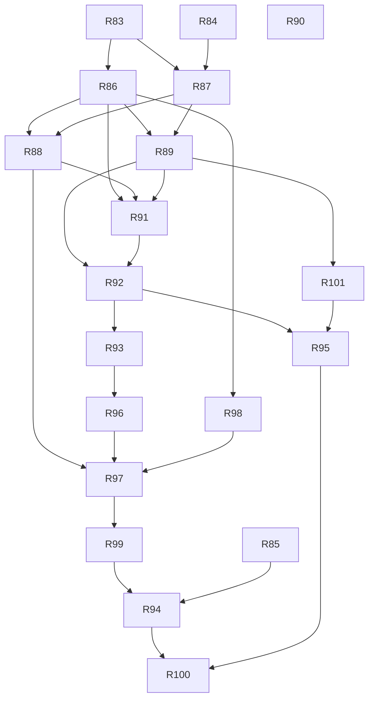

# v2.1 — TASKS.md sections

Cut from `TASKS.md` by `scripts/sdd/split.ts` (FR-SDD-3); ids resolve through `docs/sdd/ids.md`.

## v2.1 tasks

Draft, cut 2026-09-21 from `SPEC.md` v2.1 and `PLAN.md` v0.8, for review. Spec Phase 2h, "the audit and the flow": what the audit of the 2.0.0 build measured, what a walk of the running app found and what a reading of its state flow found, each as a requirement with a test (§4.33–§4.42), plus the three small features the owner added on review (V21-20..V21-22: faint passes, `[ see this pass ]`, the capped compact column). No dependency is added by any task, and physics is untouched: `passes.golden.test.ts` passes unchanged at every merge.

Delivery is PLAN §16 unchanged, cut by §16.17: nineteen tasks over eleven waves, on `main` after the `v2.0.0` tag. The entries below are in **wave order**, because the driver fills a wave from the top of the file (at most three, one per lane); the ids are the plan's and are not renumbered. The order is the phase's (§9 Phase 2h): the link that destroys a reader's place first, then the list that tells the time, then failures, then the shell, then the desk widths, then the three features, then the capture rule, then the release. The phase is mostly `ui`, so it is long and thin, with `data`, `live` and `window` filling the early waves beside it.

The breakdown re-cuts §16.17's proposal in three places, each to keep two sessions out of one file:

- **R89 creates the failure line** (`ui/components/common/FailureLine.tsx` and the new `i18n/*/failure.ts` catalog, as crossings into `ui`), because the live page's failed state (FR-FAIL-6) needs it a wave before R91 spreads it everywhere else. R91 therefore depends on R89. It lands in wave 4 either way.
- **R95 depends on R92.** R92 crosses into `screens/Live.tsx` and `LiveRoute.ts`, and R95 is the `live` lane, so this keeps them out of one wave. R95 moves from wave 5 to wave 6, beside R93, with which it shares no file.
- **R90 is printed in wave 2, not 3.** It has no dependency, so the driver picks it as soon as a wave has room. Its one crossing, `useSkyScreen.ts`, is named by no other task of the phase.

Two shared files are split within a wave by rule rather than by dependency. `tests/styles/controlRows.test.ts` is R85's in wave 1, so R84 does not edit it. `components/passes/NextEventBlock.tsx` is R101's in wave 4, so R91 does not edit it (§16.17 named that risk).

Decision blocks (§16.2), reserved in PLAN §16.17 and unchanged: **R83 D-551..D-555, R84 D-556..D-561, R85 D-562..D-565, R86 D-566..D-572, R87 D-573..D-577, R88 D-578..D-582, R89 D-583..D-587, R90 D-588..D-590, R91 D-591..D-595, R92 D-596..D-603, R93 D-604..D-609, R94 D-610..D-614, R95 D-615..D-616, R96 D-617..D-621, R97 D-627..D-631, R98 D-632..D-633, R99 D-634..D-637, R100 D-638..D-642, R101 D-643..D-646.** Numbers a task does not spend stay unspent. Every session reads SPEC §12 V21-1..V21-22, PLAN §2.35 and §16.17 first; each task's **Reads** line is the rest of D-284's list, and no session reads the three documents whole.

**Lane ownership for this phase** (§16.17): `src/lib/nights.ts`, `src/lib/faint.ts`, `src/lib/routeTitle.ts`, `src/ui/navigation.ts`, `src/ui/Shell.tsx`, `src/ui/RootBoundary.tsx`, `tests/e2e/structure.ts` and `tests/e2e/captureSet.ts` are `ui`'s; `src/state/openLink.ts` and `src/state/failure.ts` are `data`'s; `src/model/prefs.ts` stays `physics`'s and R98 crosses into it. Every crossing is named in its task's entry.

**Preconditions:** `@axe-core/playwright` is already in `package.json` and the lockfile on `origin/main` (#130, D-622), so R96 carries no `Precondition:` line. R90's and R92's gates need a phone and a screen reader. Their dependants cannot start before the owner has run them, because an owner-gated task merges only at the owner's hand.

### Wave 1

- [x] **R83 — A link is a visit, in the store: `visiting`, `openLink()`, nothing written through**
  - *Done:* as written; the running tab's `hashchange` path is a listener in `App.tsx` calling `state`'s `followHash` (D-552), and unreadable/unknown hashes are recorded but not yet cleared (D-554).
  - **Lane:** data
  - **Model:** opus
  - **Gate:** auto
  - **Depends on:** none (`main` after the `v2.0.0` tag)
  - **Findings:** F-89
  - **Reads:** SPEC §4.35 (FR-VISIT-1..4), §4.13 (FR-SHARE-3 as amended), FR-LIVE-9 as amended, US-32; PLAN D-135 (what it supersedes), D-280, D-538, D-539.
  - **Goal:** opening a friend's pass or live link over a saved place never touches `wiys:prefs:v1`; the store knows it is visiting and says what a link did.
  - **Satisfies:** FR-VISIT-1; FR-LIVE-9 and FR-SHARE-3 as amended v2.1 (the store side). **Advances:** FR-VISIT-2..4 and US-32 (the notice and notes are R87's and R89's).
  - **Why this is a slice without its notice:** the visible change is the one that matters: after a link, the reader's saved place, its name and its time zone are still there on reload. The e2e shows that.
  - **Scope:**
    - The observer slice gains `visiting: Observer | null`, `keepVisit()` and `endVisit()` (endVisit clears the hash and recomputes). One selector, `useActiveObserver()` = `visiting ?? observer`, is what every reader of the observer uses. Moving the readers over is a mechanical rename in `src/ui/**` and is the only crossing.
    - The write-through in `store.ts` persists `observer` only. `passesCache` and the weather cache are not written while `visiting` is set. FR-OFF-4's readiness reads `observer`.
    - `state/openLink.ts` (new): `(hash, saved) → { kind: 'own' | 'visit' | 'adopt' | 'unreadable' | 'unknown', note?: 'past' | 'far' }`, with D-280's rounding equality now covering pass links as well. Boot (`state/index.ts`) and the running tab's `hashchange` path both call it. The result is kept in the ui slice as session state and is never persisted.
  - **Touches outside the lane:** the `useActiveObserver()` rename across `src/ui/**` readers (no behaviour change there).
  - **Out of scope:** `VisitNotice`, the one-line notes and every other visible string (R87, R89); the live page's own reading of the result (R89).
  - **Done when:**
    - `openLink.test.ts` covers each `kind` and both `note`s: own place by rounding for a pass link and for a live link, visit over a saved place, adopt with none saved, `#live?lat=999` unreadable, an unknown hash, a past `t`, and a `t` beyond 24 h.
    - A store test: with a saved named place and a time zone, applying a visit leaves `localStorage['wiys:prefs:v1']` byte-identical, and no passes or weather cache is written. `keepVisit()` stores the visited place, and `endVisit()` restores the saved one's label and zone.
    - An e2e loads a `#pass?…` link over a saved, named place, reloads without the hash, and finds the saved place's label and zone. **Fails on the branch's parent**, and the failure is pasted in the PR.
    - A pass link pasted into a running tab selects the pass and is not dropped (F-93's first clause; the rest of F-93 is R87's).
    - `npm test`, lint, typecheck and the e2e path green inside FR-CI-1's ten minutes.

- [x] **R84 — The first run's controls: placeholders, `[ continue ]`, the first card, the whole card, the Moon sentence off the card, the count line**
  - *Done differently:* the control's own box is stretched rather than a zero-size button's `::after` (D-556); the first card's pass stays out of the list under it, as FR-FIRST-3 as amended says; `[ continue ]` is a phone-only control, so the 1280 × 800 e2e types a pair and taps a card without it.
  - **Lane:** ui
  - **Model:** opus
  - **Gate:** owner
  - **Depends on:** none
  - **Findings:** F-73, F-77, F-78, F-84, F-85, F-86
  - **Reads:** SPEC §4.28 (FR-FIRST-1..4, FR-FIRST-10 as amended), US-18 (AC1 as amended), US-26 (AC1, AC6, AC7); PLAN D-467, D-513, D-548.
  - **Goal:** a first-time reader can see that the coordinate fields are empty, move on from them with a button, and open any pass by tapping anywhere on its card, including the first card of the phone's third step.
  - **Satisfies:** FR-FIRST-2, FR-FIRST-3 and FR-FIRST-10 as amended v2.1; FR-FIRST-4's `[ continue ]` (V21-5); US-18 AC1 as amended; US-26 AC1, AC6 and AC7.
  - **Scope (D-548):**
    - `CoordsInput` keeps altitude as `''` (parsed as 0) and the placeholders read as placeholders, not values.
    - The where step shows `[ continue ]` while `step.held` is true and calls `step.onSettle` (D-513's state), so typed coordinates no longer need a blur or `Enter` to move on.
    - `NextEventBlock`'s card form takes `onOpen` and uses the same stretched button as `PassCard`. On the third step the first card's pass is openable, and it appears in the list under it.
    - The whole card is one target: `::after { position: absolute; inset: 0 }` on a `position: relative` article. The tags stay text, and the cursor is a pointer over the whole box.
    - `MoonAtPeak` leaves the card (US-18 AC1 as amended). The Moon sentence lives where the amended AC puts it.
    - The count line's separator becomes a rendered node attached to `Sort:`'s side, so a wrap never leaves a dangling ` ·`.
  - **Touches outside the lane:** none. **Not touched here:** `tests/styles/controlRows.test.ts`, which is R85's in this wave; the card's first line is already pinned there and does not change.
  - **Out of scope:** the step's footer and one-screen height (R87), nights and pruning (R88), heading levels (R92).
  - **Done when:**
    - Component tests: an empty altitude renders `''` and submits 0; `[ continue ]` is present exactly while the step is held and moves the step on; a click on the card's cloud line opens the pass; the third step's first card opens its pass; the card has no Moon line.
    - An e2e at 390 × 844 and 1280 × 800 types coordinates, presses `[ continue ]`, and taps the bottom row of a card, which opens the pass. At 375 px and 1280 px, with `Sort:` forced to wrap, no line of the count row ends in `·`.
    - Captures: the cold open, the third step and the populated list at 390 and 1280 px, both themes, both languages.
    - `npm test`, lint, typecheck and the e2e path green inside FR-CI-1's ten minutes.
    - The owner's gate: the Spanish copy and the captures.

- [x] **R85 — The compact live rows in Spanish, and the short wide inventory's clip**
  - *Done differently:* the English scrubbing row needed a short `[ live ]` too (D-562); the inventory's header row and labelled times are in `Legend.tsx` and the chart catalogs (D-564, D-565).
  - **Lane:** live
  - **Model:** opus
  - **Gate:** owner
  - **Depends on:** none
  - **Findings:** F-81, F-82
  - **Reads:** SPEC FR-COMP-7, FR-COMP-4, §4.20 F-81 and F-82; PLAN D-244, D-246, D-411, D-549.
  - **Goal:** the compact live page's two rows fit in Spanish with room to spare and Share has its brackets back, and at 1200 × 450 the watching inventory ends on a whole row with a `+n` line.
  - **Satisfies:** FR-COMP-7; FR-CAP-5's last sentence (the short wide watching capture shows the fix). **Advances:** FR-CAP-5 (R94 re-shoots the set).
  - **Scope (D-549):**
    - On compact, Back renders `[ ← ]` with the accessible name "Back" / "Volver" and an unchanged 48 px hit box. The Spanish place shows a whole coordinate pair at 360 px before it ellipsises.
    - `[ Compartir ]` gets its brackets back. The Spanish labels on the action row are shortened in `i18n/es/live.ts` until the row fits. `s/d` has the accessible name "sin datos".
    - The short wide inventory is clipped with a `max-height` that is a whole number of rows, plus a `+n` row that `liveRows.ts` computes. The three times on it are labelled.
  - **Touches outside the lane:** `tests/styles/controlRows.test.ts` (this wave's only editor), `src/i18n/*/live.ts`.
  - **Out of scope:** the live page's states (R89), `[ see this pass ]` (R101).
  - **Done when:**
    - `controlRows.test.ts` pins the compact live top row and action row at ≤ 34 of 36 cells in both languages.
    - A component test: Back's accessible name in both languages; the `+n` row's count against a fixture with more objects than rows.
    - `live-states.spec.ts` at 1200 × 450: the inventory's last visible row is whole (its bottom lies on a row boundary) and `+n` is shown. At 360 × 640 in Spanish the place's text holds a whole coordinate pair.
    - Captures: the compact live page at 360 and 390 in Spanish, and 1200 × 450 watching, both themes.
    - `npm test`, lint, typecheck and the e2e path green inside FR-CI-1's ten minutes.
    - The owner's gate: the Spanish row labels and the captures.

### Wave 2

- [x] **R86 — Failures in the store: kinds, retry actions, the forecast's refresh, the worker's listeners and stall, the stale recompute, the stored run's age**
  - **Lane:** data
  - **Model:** opus
  - **Gate:** auto
  - **Depends on:** R83
  - **Findings:** F-87
  - **Reads:** SPEC §4.36 (FR-FAIL-2..4), §4.34 (FR-NIGHT-3, FR-NIGHT-4), FR-VIS-5 as amended, US-31 AC3 and AC4, US-33 AC2 and AC3; PLAN §6, §7, D-536, D-537, D-540..D-543.
  - **Goal:** every failure is stored as a kind and can be retried from the store; the forecast stays fresh; a dead or stalled worker ends its job; a stale run recomputes on wake; a stored run is shown only for what is left of it.
  - **Satisfies:** FR-FAIL-2 (the store side), FR-FAIL-3, FR-FAIL-4 (the store side), FR-NIGHT-3, FR-NIGHT-4; FR-VIS-5 as amended v2.1. **Advances:** FR-FAIL-1 (the line is R89's and R91's), US-31 AC3 and AC4, US-33 AC2 and AC3.
  - **Why this is a slice:** a wake after 3 h recomputes, and a 14-day-old stored run reads "computing" rather than an old list. Both are visible on the existing screens with no new component.
  - **Scope:**
    - `state/failure.ts` (new): the `Failure` type and `toFailure(error)` by D-540's table, including Open-Meteo's `200` with a `text/` error body as `bad-data`. The elements, weather, passes and location slices store a `Failure`, never a sentence.
    - `retryElements`, `retryWeather` and `retryPasses` re-enter the effect the first attempt used; the place search keeps its last query for a retry (D-541). No backoff is added.
    - `requestWeather` also runs from the visibility handler when the snapshot is older than `WEATHER_MAX_AGE_MIN`, and from the recheck after a failed forecast (D-542). A place with a null zone gets its zone from the retry.
    - `workerClient.ts` gets `error` and `messageerror` listeners and a `JOB_STALL_S` timer that is reset on each progress message. At the limit it terminates the worker and rejects with `{ kind: 'timeout' }`, and `retryPasses` spawns a new one (D-543). The worker's message contract is unchanged.
    - `recomputeIfStale()` is called from the visibility handler and the 15-minute recheck (D-537). `showStoredPasses` compares the stored `windowEnd` with the clock, and the count line's span is `windowEnd − max(now, windowStart)` rounded down to the hour (D-536).
  - **Touches outside the lane:** the components that show an error string today (the elements banners, the readiness line, the place picker) read `failure.detail` in its place, so nothing on screen changes. The failure line that replaces those sentences is R89's and R91's. No catalog is touched.
  - **Out of scope:** `FailureLine` and every visible failure sentence (R89, R91); the root boundary (R91); the install event (R91).
  - **Done when:**
    - `failure.test.ts` maps a network `TypeError` offline, 429, 503, a zod error, an Open-Meteo `200` text body and an `AbortError` to their kinds.
    - `workerClient.test.ts`: an `error` event and a 60 s silence each reject the job with its kind under fake timers; a retry spawns a new worker.
    - `effects.test.ts`: the visibility handler requests the forecast at 61 min and not at 59; the recheck after a failed forecast re-requests it; a run whose window start is 2 h 1 min behind recomputes with the old list still selectable, and one 1 h 59 min behind does not.
    - A store test with stored runs aged 1 h, 50 h and 14 days (FR-NIGHT-3): 1 h shows with the span that is left, and 50 h and 14 days show `computing`.
    - `passes.golden.test.ts` unchanged and green.
    - `npm test`, lint, typecheck and the e2e path green inside FR-CI-1's ten minutes.
  - **Note:** the place search's `Failure` lives in `PlacePicker`, which owns that state; the location slice holds none (D-567). The 50 h run reads `computing` through FR-NIGHT-4's recompute over its 22 h that are left (D-571).

- [x] **R87 — The visit notice and the link notes; one screen with its footer; `[ set a place ]`'s landing**
  - **Lane:** ui
  - **Model:** opus
  - **Gate:** owner
  - **Depends on:** R83, R84
  - **Findings:** F-74, F-93
  - **Reads:** SPEC FR-VISIT-2..4, FR-FIRST-1 and FR-FIRST-4 as amended, US-32; PLAN D-539, D-548.
  - **Goal:** on the home page a reader who opened a link sees whose sky this is and can go back or keep it; links that could not be honoured say so; the phone's first step is one screen with its one-line footer.
  - **Satisfies:** FR-VISIT-2, FR-VISIT-3 and FR-VISIT-4 on home; FR-FIRST-1 and FR-FIRST-4 as amended v2.1 (the footer's `line` form and one screen tall); US-32 AC1..AC3 on home. **Advances:** FR-VISIT-2 on the live page (R89).
  - **Scope:**
    - `VisitNotice.tsx` (new, `ui/components/common/`): the `role="status"` line under the header at `--small` with `[ back to my place ]` and `[ keep this place ]`, calling R83's `endVisit()` and `keepVisit()`. At most two rows of 36 cells on compact, in both languages. The live page mounts the same component in R89.
    - The one-line notes from `openLink()`'s result: "This link was for <time>, which has passed. Showing now.", the far-`t` note, and "That link could not be read.". Each is dismissible and none is stored.
    - `Footer` takes `form: 'full' | 'line'`, and the steps pass `line` (D-548). The first step is one viewport tall at 390 × 844 and 360 × 640.
    - The home's receiving side of `[ set a place ]`: a navigation to home with the intent to set a place opens the where step with the focus in the input group. R89 draws the button on the live page.
  - **Touches outside the lane:** none.
  - **Out of scope:** the live page's notice and its no-place state (R89), history handling (R92).
  - **Done when:**
    - A component test: the notice's two controls call their actions; it is `role="status"`; `controlRows.test.ts` counts it at ≤ 2 × 36 cells in both languages.
    - An e2e over a saved, named place: a pass link shows the notice; `[ back to my place ]` restores the label and zone and clears the hash; `[ keep this place ]` stores the visited place and removes the notice. `#live?lat=999` lands on home with "That link could not be read." and the hash cleared; `#nonsense` is cleared silently.
    - An e2e at 390 × 844 and 360 × 640: the first step's `scrollHeight <= innerHeight` and its footer is the line form.
    - Captures: the notice at 390 and 1280 px, the first step at 360 and 390, both themes, both languages.
    - `npm test`, lint, typecheck and the e2e path green inside FR-CI-1's ten minutes.
    - The owner's gate: the Spanish notice and notes, and the captures.
  - **Done differently:** at 360 × 640 the e2e asserts the spec's "at most the footer is below the fold" (D-574), not `scrollHeight <= innerHeight`; `LinkNote` draws all three notes, but home mounts only the unreadable one and the live page mounts the moment's two in R89 (D-575); the phone's notice uses a short sentence (D-573).

- [x] **R90 — The sky screen's wait and the denial note**
  - **Lane:** window
  - **Model:** opus
  - **Gate:** owner
  - **Depends on:** none
  - **Findings:** F-94
  - **Reads:** SPEC FR-FAIL-7, FR-FOL-5; PLAN D-550.
  - **Goal:** on a device that never reports its orientation, the sky screen says so after three seconds instead of waiting forever; after an iOS denial it says how to be asked again.
  - **Satisfies:** FR-FAIL-7.
  - **Scope (D-550):** `useSkyScreen` starts a `SENSOR_WAIT_S` (3 s) timer on arming and falls to FR-FOL-5's relative note, "This device is not reporting which way it faces.", when the timer fires with no event. The iOS denial note gains the reload instruction (Safari asks once per load). The strings go in `i18n/*/window.ts`.
  - **Touches outside the lane:** `src/ui/components/screen/useSkyScreen.ts` (`ui`'s; no other task of the phase names it).
  - **Out of scope:** any change to the sky screen's drawing or the gutter.
  - **Done when:**
    - A hook test under fake timers: no event for 3 s shows the relative note, an event at 2.9 s does not, and a denial shows the reload note in both languages.
    - An e2e with the orientation API stubbed to stay silent: the note is visible 3 s after the tap.
    - `npm test`, lint, typecheck and the e2e path green inside FR-CI-1's ten minutes.
    - The owner's gate: on a phone, the sky screen armed, and on iOS a denial then a reload.

### Wave 3

- [x] **R88 — Nights on local noon, and the list pruned by the clock** *(done 2026-09-23; `ENDED_LINGER_S` lives in `lib/nights.ts`, not `physics/constants.ts`, which is outside the lane; a night with no pass at all is not drawn either, so `offline.spec` expects two to four nights; the list's clock is the store's, which closes F-68's open clause — D-578, D-579)*
  - **Lane:** ui
  - **Model:** fable
  - **Gate:** auto
  - **Depends on:** R86, R87
  - **Findings:** F-90, F-67, F-68
  - **Reads:** SPEC §4.34 (FR-NIGHT-1, FR-NIGHT-2, FR-NIGHT-5), US-16 AC5 as amended, US-31; PLAN D-534, D-535.
  - **Goal:** the list is about the nights ahead: a pass before dawn sits under the evening before it, an ended pass leaves within a minute, and the headings turn over at local noon.
  - **Satisfies:** FR-NIGHT-1, FR-NIGHT-2, FR-NIGHT-5; US-16 AC5 as amended v2.1; US-31 AC1 and AC2. F-68's open clause lapses with the hero card, and this task records it.
  - **Scope:**
    - `lib/nights.ts` (new, pure): `nightOf(instant, zone)` through one cached `Intl.DateTimeFormat(…, { timeZone, hourCycle: 'h23' })`. The zone is the observer's, or the device's when it is null, never `'UTC'` by default. `nightGroups.ts` groups by its key.
    - `useShownPasses` (`screens/home/shownPasses.ts`) filters out passes whose end is more than `ENDED_LINGER_S` (60 s) behind the `now` slice's instant, and does it on the existing 10 s tick. The count line, the night counts and `tonightStripe`'s ticks read that same selector. Inside the 60 s, a card reads `ended`. The open pass is exempt.
    - The headings recompute when the clock crosses local noon, with no recompute of passes. A night with no pass left is not drawn.
    - `PassList.test.tsx`'s wall-clock night names (F-67) move onto a fixed clock.
  - **Touches outside the lane:** none.
  - **Out of scope:** faint passes (R97, which composes after this filter), the stored run's age (R86).
  - **Done when:**
    - `nights.test.ts` over a fixture run computed at 01:00 local: the 05:00 pass is under last evening's night and the 21:00 pass under the coming one, in a zone east of UTC and a zone west of it; a null zone falls back to the device's.
    - A component test under a fake clock: a pass 59 s past its end reads `ended`, and at 61 s it is gone from the cards, the count line, the night's count and the stripe's ticks; the open pass stays; an emptied night is not drawn; crossing noon renames "Tomorrow night" to "Tonight".
    - No test in `src/ui/components/passes/` reads the wall clock.
    - `passes.golden.test.ts` unchanged and green.
    - `npm test`, lint, typecheck and the e2e path green inside FR-CI-1's ten minutes.

- [x] **R89 — The live page's three states, the visit notice on it, offline from a stored run**
  - **Lane:** live
  - **Model:** opus
  - **Gate:** owner
  - **Depends on:** R86, R87
  - **Findings:** F-92, F-75
  - **Reads:** SPEC FR-LIVE-1 as amended, FR-OFF-8 as amended, FR-FAIL-1, FR-FAIL-2, FR-FAIL-6, FR-VISIT-2, FR-VISIT-3, US-33 AC4; PLAN D-540, D-541.
  - **Goal:** the live page tells "no place", "loading" and "failed" apart, offers `[ retry ]` or `[ set a place ]` as each needs, shows the visit notice, and opens from the stored run with no network.
  - **Satisfies:** FR-LIVE-1 and FR-OFF-8 as amended v2.1, FR-FAIL-6, FR-VISIT-2 and FR-VISIT-3 on the live page, US-33 AC4. **Advances:** FR-FAIL-1 and FR-FAIL-2 (this task builds the line and uses it once; R91 places it everywhere else).
  - **Scope:**
    - **No place:** "The live sky needs a place." and `[ set a place ]`, which lands on R87's where step with the focus in the input group. The same appears when `#live` is opened cold from a bookmark.
    - **Loading:** the mark's bead moving and "Loading orbital elements…". **Failed:** the failure line with `[ retry ]` = `retryElements`.
    - `ui/components/common/FailureLine.tsx` (new, crossing into `ui`): `t.failure[kind](what)`, `[ retry ]` (48 px on compact), and a `Disclosure` holding `detail` in monospace. `src/i18n/{en,es}/failure.ts` (new, crossing into `ui`) holds the six kinds' sentences in both languages, registered in `en.ts` and `es.ts`.
    - With a stored run and no usable elements, the page opens on the stored passes' tracks (FR-OFF-8).
    - The live page mounts R87's `VisitNotice` and honours `openLink()`'s `past` and `far` notes (a past `t` opens watching; a far `t` holds at the span's end). A held instant that real time overtakes releases to watching.
  - **Touches outside the lane:** `ui/components/common/FailureLine.tsx` (new), `src/i18n/{en,es}/failure.ts` (new), `src/i18n/en.ts`, `src/i18n/es.ts`.
  - **Out of scope:** the failure line on home, the guide and the place search (R91); the shell and its landmarks (R92).
  - **Done when:**
    - A component test per failure kind in both languages: the sentence matches no `/HTTP|\d{3}|Error:/`, and the detail is inside `[ details ]` (FR-FAIL-2).
    - `Live.test.tsx`: each of the three states renders its own text and control; a cold `#live` load does not flash the failed text.
    - An e2e with the network offline and a stored run: `#live` opens and draws tracks. With elements failing, `[ retry ]` shows loading and then the page. With no observer, `[ set a place ]` lands on the where step with the focus in the input group.
    - An e2e: a live link with a past `t` opens watching with the note; a `t` 30 h ahead opens held at the span's end with its note.
    - Captures: the three states at 390 and 1280 px, both themes, both languages.
    - `npm test`, lint, typecheck and the e2e path green inside FR-CI-1's ten minutes.
    - The owner's gate: aeroplane mode on a phone with the live page open, then `[ retry ]`.
  - *Done:* the `Disclosure` is `FailureLine`'s own `[ details ]` toggle over a `<pre>`, as `ElementsLine` does it, since no shared component exists (D-583); a stored run counts for the page by place, not by object, and opens it while the elements are still loading too (D-584); "a held instant real time overtakes" is one that was ahead of real time when set, so `[ scrub ]` at now is not released (D-585); the notice strip shares the top row's grid area (D-586).

- [x] **R98 — `showFaint` in the prefs schema and store** *(done as written; only `true` is read back from storage, D-632; `localPrefs.test.ts` covers the schema beside `prefs.test.ts`)*
  - **Lane:** data
  - **Model:** fable
  - **Gate:** auto
  - **Depends on:** R86
  - **Reads:** SPEC FR-FAINT-3; PLAN D-623.
  - **Goal:** the reader's choice to show faint passes has somewhere to live, with an older stored prefs record still loading as `false`.
  - **Satisfies:** FR-FAINT-3 (the stored preference). **Advances:** FR-FAINT-2, US-34 AC3 (R97 draws the control).
  - **Why not a slice:** it is one field. It is split off so that R97, a `ui` task, does not write `src/state/**` (§16.17's one hard rule). The field has no reader until R97.
  - **Scope:** `showFaint: boolean` joins `wiys:prefs:v1` with a zod `.catch(false)`, plus a `setShowFaint` action in the prefs slice. The prefs schema version does not change.
  - **Touches outside the lane:** `src/model/prefs.ts` (`physics`'s; no other task of the phase names it).
  - **Out of scope:** the classification and the control (R97).
  - **Done when:**
    - `prefs.test.ts`: a record without the field loads as `false`; `setShowFaint(true)` persists and survives a reload of the store; a malformed value loads as `false`.
    - `npm test`, lint and typecheck green.

### Wave 4

- [x] **R91 — The failure line everywhere, the root boundary, the install button and its row** *(done 2026-09-23; the elements failure is the pass list status line's line and not a second one in the Where reading; the install button stands only while the browser holds an offer; one condition in `state/effects.ts` so a dead worker's job stays failed until `[ retry ]` — D-591..D-595)*
  - **Lane:** ui
  - **Model:** opus
  - **Gate:** owner
  - **Depends on:** R86, R88, R89
  - **Findings:** F-88, F-96, F-95, F-83
  - **Reads:** SPEC §4.36 (FR-FAIL-1, FR-FAIL-2, FR-FAIL-4, FR-FAIL-5, FR-FAIL-8), FR-SET-1 as amended, US-33 AC1 and AC3; PLAN D-540, D-541, D-544, D-550.
  - **Goal:** every place a load or a job can fail shows one localized sentence with `[ retry ]` and `[ details ]`; a render error shows a page with `[ reload ]`, never a blank one; the install row reads `App [ Install ]` and survives a cancelled prompt.
  - **Satisfies:** FR-FAIL-1, FR-FAIL-2, FR-FAIL-4 (the visible side), FR-FAIL-5, FR-FAIL-8; FR-SET-1 as amended v2.1; US-33 AC1 and AC3.
  - **Scope:**
    - R89's `FailureLine` in place of every failure sentence on home, the guide and settings: the elements banner and line, the forecast's cloud row, the place search, and the pass computation (where "Computing…" was). R86's interim `failure.detail` readings are removed.
    - A dead or stalled job turns "Computing…" into the line, stops the mark's bead, and `[ retry ]` = `retryPasses`.
    - `ui/RootBoundary.tsx` (new, in the main chunk; D-544): plain elements, the two catalogs' four strings imported directly with English as the fallback, no store and no lazy component, `[ reload ]` = `location.reload()`. `App.tsx` mounts it at the root.
    - `InstallAction` calls `forgetInstallOffer()` after `prompt()` resolves and latches nothing on `dismissed` from the settings row. The row's label is `settings.installLabel` ("App" / "App").
  - **Touches outside the lane:** none. **Not touched here:** `components/passes/NextEventBlock.tsx`, which is R101's in this wave.
  - **Out of scope:** the live page's failure state (R89), the shell (R92).
  - **Done when:**
    - A component test per failure site: the sentence in both languages matches no `/HTTP|\d{3}|Error:/`, `[ retry ]` calls its slice's action and shows loading, and `[ details ]` holds the detail.
    - A test that throws inside a screen renders the boundary's title, sentence and `[ reload ]`, and nothing else.
    - An e2e with the worker made to throw: "Computing…" becomes the failure line within `JOB_STALL_S`, and `[ retry ]` produces a list.
    - `InstallAction.test.tsx`: a dismissed prompt leaves the button working; the row reads `App [ Install ]` in both languages.
    - Captures: the failure line on home at 390 and 1280 px and the boundary at 390, both themes, both languages.
    - `npm test`, lint, typecheck and the e2e path green inside FR-CI-1's ten minutes.
    - The owner's gate: the Spanish failure sentences.

- [x] **R101 — `[ see this pass ]` on the watching headline**
  - **Lane:** live
  - **Model:** opus
  - **Gate:** owner
  - **Depends on:** R89
  - **Reads:** SPEC §4.41 (FR-JUMP-1..3), FR-SPAN-4, FR-WATCH-1..4, US-27 AC7; PLAN D-624.
  - **Goal:** by day, one tap on the live page's headline holds the page at the rise of the pass it names, with the whole inventory and the stripe moved there.
  - **Satisfies:** FR-JUMP-1..3; US-27 AC7.
  - **Scope (D-624):** `NextEventBlock`'s watching form takes `onSee?`. `Live.tsx` passes the live slice's `hold(riseInstant)`, which lands on the same second as FR-SPAN-4's `pass ▶|`. The control is present when the next event is a rise more than `JUMP_MIN_AHEAD_S` (120 s) ahead and within the stripe's 24 h. It is 48 px on compact and adds no row at the four shapes of FR-SHP-4: `liveRows.ts` places it on the path line's row where it fits, and otherwise beside `[ scrub the night ]`. The task measures the matrix and records which. `[ now ]` returns to watching, and the URL carries the held `t`. The label goes in `i18n/*/live.ts`.
  - **Touches outside the lane:** `src/ui/components/passes/NextEventBlock.tsx` (`ui`'s; R91 in this wave does not touch it).
  - **Out of scope:** the home page's `[ Open the live sky ]` (unchanged, FR-JUMP-3).
  - **Done when:**
    - A component test: the control is present at 121 s ahead and absent at 119 s, absent while a pass is up, and absent beyond 24 h.
    - An e2e by day under a fixed clock: the tap holds the page at the pass's rise to the second, the drawing shows its arc, and the hash carries `t`. `[ now ]` returns to watching.
    - `shapes.spec.ts` walks the four shapes in watching with the control shown, and no row's height changes against the parent.
    - Captures: watching with the control at 390 × 844 and 1280 × 800, both themes, both languages.
    - `npm test`, lint, typecheck and the e2e path green inside FR-CI-1's ten minutes.
    - The owner's gate: one-handed on a phone, and the four shapes.
  - *Done (D-643..D-645):* the placement is measured on wide and the path line on compact; two shapes keep a recorded cost in the rail (the landscape phone at 844–932 px, the short wide window from 1200 px in English), the chart box none — `shapes.spec.ts`'s `JUMP_ALLOWANCE`.

### Wave 5

- [x] **R92 — The shell: landmarks, the outline, titles, focus, the skip link, and Back goes back** — done; the night heading is a hidden `h3` at the head of each night rather than the toggle wrapped in one (D-597), and the live page draws its own landmarks inside its grid (D-596).
  - **Lane:** ui
  - **Model:** opus
  - **Gate:** owner
  - **Depends on:** R89, R91
  - **Findings:** F-71, F-72, F-91
  - **Reads:** SPEC §4.33 (FR-A11Y-1..5), §4.37 (FR-ROUTE-1..3), FR-X-5 as amended, US-30; PLAN D-529..D-533.
  - **Goal:** every route renders in one shell with its landmarks, an outline with no skipped level, its own title and a focus that follows the route; and the browser's Back does what a reader expects, so one press after closing five passes leaves the app.
  - **Satisfies:** FR-A11Y-1..5, FR-ROUTE-1..3; FR-X-5 as amended v2.1; US-30 AC1..AC5.
  - **Why the structure and history are one task:** both are the shell. Splitting them would put two sessions in `Shell.tsx`, `App.tsx` and `navigation.ts` in consecutive waves for one idea (§9 Phase 2h).
  - **Scope:**
    - `ui/Shell.tsx` (new, D-529): `banner`, `main`, an optional `contentinfo`, the route announcer and the title effect; `chrome: 'home' | 'settings' | 'live'`. `App.tsx` renders the lazy live chunk as the shell's `main` and its top row in the `banner` slot, using `display: contents` wrappers where a box would re-cut the grid. The wide header wraps its links in `nav`.
    - Rank as a prop (D-530): `SectionHeading` takes `level`; `PassCard` takes `headingLevel` (4 under a night, 3 on the third step); the night row becomes an `h3` whose content is the toggle. Nothing is restyled.
    - `lib/routeTitle.ts` (new, pure; D-531), with the title effect moved from `useT.ts` into the shell.
    - `ui/navigation.ts` (new; D-532, D-533): `open(route, opener?)` pushes with `history.state = { wiys: depth }`. `close()` calls `history.back()` for a marked entry, calls `replaceState` otherwise, and focuses the opener, or the `h1` if the opener is gone. One `popstate` + `hashchange` listener in the shell, which closes the sky screen first. `passSelection.ts`, `LiveRoute.ts` and the settings route lose their own history calls.
    - The skip link (`a11y.skip`) as the first focusable element on home and settings.
    - A reload keeps `#settings`, `#live` with its `t`, and `#pass=<id>`, or shows FR-SHARE-3's message when the pass is gone.
    - `tests/e2e/structure.ts` (new): landmark counts, the ordered outline, no skipped level, and `A11Y_MAX_H2`.
  - **Touches outside the lane:** `src/ui/screens/Live.tsx` and `src/ui/screens/LiveRoute.ts` (`live`'s; no `live` task shares this wave, and R95 waits for this one).
  - **Out of scope:** the axe run (R96), the desk layout (R93).
  - **Done when:**
    - An e2e visits home, the guide, `#live` and `#settings` at 390 and 1280 px: exactly one `main` and one `h1` each, and on home and settings one `banner`, `navigation` and `contentinfo`.
    - A component test per screen asserts the ordered `(level, text)` outline. The e2e asserts no skipped level on the populated home with a 40-pass fixture, and at most 10 `h2`.
    - An e2e asserts `document.title` on each route in both languages, and `document.activeElement` after each transition in both directions, with the announcer written once per route change.
    - An e2e opens and closes three passes, the live page and settings: `history.length` grows by zero net entries, and one `page.goBack()` leaves the origin. Back and Forward render the URL's route. A reload keeps each route. **Fails on the branch's parent**, and the failure is pasted in the PR.
    - `npm run bundle:budget` green; `live-*.spec.ts` pass with locators re-pointed and no assertion loosened.
    - `npm test`, lint, typecheck and the e2e path green inside FR-CI-1's ten minutes.
    - The owner's gate: a VoiceOver or TalkBack pass over the four routes (FR-A11Y-6).

### Wave 6

- [x] **R93 — The home at desk widths, and the settings page as a lazy chunk** — done, with one thing not reached: the settings chunk is made and prefetched (D-545) but measures 1.0 KB, and main is 166.0 KB on this branch (166.2 before), so it does not return under 155 by it and the budget is left where it is (D-609). The reorder is `WhenReading`'s (Home.tsx), not `WhenStep`'s, which is the phone's step (D-606); a short window halves the main's padding (D-608); the Moon lore's flag-on line is discounted in the FR-HOME-2/3 e2e (D-608).
  - **Lane:** ui
  - **Model:** fable
  - **Gate:** owner
  - **Depends on:** R92
  - **Findings:** F-76, F-79, F-69
  - **Reads:** SPEC §4.38 (FR-HOME-1..4), §5.10; PLAN D-465, D-545, D-546.
  - **Goal:** at a desk the header stays one line in both languages, the next event is on screen on load, only What scrolls, the page stops growing at 160 cells, and the main chunk is back under 155 KB because settings loads on its own.
  - **Satisfies:** FR-HOME-1..4. Closes F-69 (the main budget).
  - **Scope:**
    - `HOME_MAX_CELLS = 160` as a `max-width` on the shell's content in `App.module.css`, centred, with the panes kept equal. The live page is not capped.
    - The header's fold: `controlRows.test.ts` computes the title row per language and pins the width at which the tagline hides and the width at which the title shortens, under `:root[lang]`. `[ Live sky ]` never wraps alone.
    - `WhenStep` orders the next event before the table on the two-column layout, through one class.
    - Where's dome takes the height the pane has left and is not rendered under `LIVE_BOX_MIN_PX`.
    - `lazy(() => import('./screens/Settings'))` under the shell's `Suspense`, with the mark's bead as the fallback. The chunk is prefetched on `requestIdleCallback`, and on the link's `pointerenter`/`focus`. `scripts/bundle-budget.ts` gains the `settings` chunk under D-178's rule, and main's `::warning::` goes.
    - The e2e goes in a new `tests/e2e/home-desk.spec.ts`, not `shapes.spec.ts`, which R95 edits in this wave.
  - **Touches outside the lane:** `scripts/bundle-budget.ts`.
  - **Out of scope:** the compact column cap (R99), captures at 1920 in the release set (R94).
  - **Done when:**
    - `breakpoint.test.ts` pins 160 beside 964 and 1118.
    - `home-desk.spec.ts`: at 964, 1024, 1118 and 1280 px in both languages, the header's height is one of two values and the title row's children share one `top`. At 1024 × 768 and 1280 × 800 in both languages, the next-event block's rect is inside the viewport. At 1118 × 700, 1280 × 800 and 1920 × 1080, Where and When have `scrollHeight <= clientHeight`. At 1920 and 2560 px, the content is 160 cells wide and centred.
    - `npm run bundle:budget` passes with main under 155 KB and a `settings` budget; the PR carries the sizes before and after.
    - Captures: home at 1024 in Spanish, 1280 and 1920, both themes.
    - `npm test`, lint, typecheck and the e2e path green inside FR-CI-1's ten minutes.
    - The owner's gate: 1024 in Spanish, 1920, and the captures.

- [x] **R95 — FR-COMP-5's restated floor asserted, and §4.20's register** *(done with the floor restated by the owner, V21-23 / D-615: `COMPACT_BOX_MIN_SHORT_PX` is 304 and asserted while watching, because a two-line path gives 306 and scrubbing gives 220; the 844 rule is asserted in both states on the phones and while watching on R99's tablets, which measure 578 × 577 while scrubbing. The register also covers R93 and R94.)*
  - **Lane:** live
  - **Model:** fable
  - **Gate:** auto
  - **Depends on:** R101, R92
  - **Findings:** F-62
  - **Reads:** SPEC FR-COMP-5 as amended v2.1, §4.20.
  - **Goal:** the compact live box's floor is asserted as the spec now states it, and the finding it closes is recorded.
  - **Satisfies:** FR-COMP-5 as amended v2.1.
  - **Why not a slice:** it asserts what the page already does and brings the register up to date. It is split off because the floor has to be measured after R101 and R92 have changed the live page's rows.
  - **Scope:** `shapes.spec.ts` asserts the box is never shorter than it is wide on any viewport at least 844 px tall (374 px at 390 × 844), and at least `COMPACT_BOX_MIN_SHORT_PX` (320) at 390 × 667. The constant is added beside `LIVE_BOX_MIN_PX`. F-62 is closed in §4.20 with this PR, and the rows closed by R83..R101 so far are checked for their PR numbers.
  - **Touches outside the lane:** `SPEC.md` §4.20, `tests/e2e/shapes.spec.ts`.
  - **Out of scope:** any layout change. If the floor does not hold, the session writes `sdd-run/R95.blocked.md` and stops rather than loosening the assertion.
  - **Done when:**
    - `shapes.spec.ts` passes with both assertions, in watching and scrubbing, with R101's control shown.
    - §4.20: F-62 is closed with this PR, and no row is closed without a PR or a reason.
    - `npm test`, lint, typecheck and the e2e path green inside FR-CI-1's ten minutes.

### Wave 7

- [x] **R96 — The axe run over every route, width and theme** — zero violations across the 24; one `color-contrast` entry, scoped to the dome's degree labels (F-98, `chart`), D-617.
  - **Lane:** ui
  - **Model:** opus
  - **Gate:** auto
  - **Depends on:** R93
  - **Reads:** SPEC FR-A11Y-7, FR-X-5 as amended; PLAN D-622.
  - **Goal:** an automated accessibility run finds no violation on any route at a phone and a desk width in either theme, which turns FR-X-5's contrast claim into a measurement.
  - **Satisfies:** FR-A11Y-7; FR-X-5's AA contrast in the default theme. Resolves OQ-35's contrast half.
  - **Scope (D-622):** `tests/e2e/axe.spec.ts` (new) builds one `AxeBuilder` per route × width × theme, with `withTags(['wcag2a','wcag2aa','wcag21a','wcag21aa'])`, over home (cold and populated), the open guide, `#live` watching and scrubbing, and `#settings`, at 390 and 1280 px, in dark and night. It uses Playwright's `bypassCSP` for this file only and says why. Disabled rules go in one exported array with a reason and an F-number each. The character grids are not excluded by selector. Any violation is fixed in `ui`'s tokens or components.
  - **Touches outside the lane:** none (`@axe-core/playwright` is already on `main`, #130).
  - **Out of scope:** removing the DOM-query structure assertions (they stay), and any fix inside `chart`, `live` or `window` files: such a violation is filed as a finding with its rule disabled and a reason, not fixed here.
  - **Done when:**
    - `axe.spec.ts` reports zero violations across the matrix (6 screens × 2 widths × 2 themes); the PR lists the matrix's run time.
    - The disabled-rules array is empty, or each entry names its reason and an F-number filed in §4.20.
    - The e2e stage stays inside FR-CI-1's ten minutes. If it does not, the PR sets `CI_E2E_SHARDS: 3` visibly (PLAN §16.17's CI note).
    - `npm test`, lint and typecheck green.

### Wave 8

- [x] **R97 — Faint passes behind `[ show faint (n) ]`** *(done 2026-09-24; the two thresholds sit in `lib/faint.ts`, not `physics/constants.ts`, which is outside the lane — D-627; the open pass is exempt so it carries no `[faint]` tag — D-629; D-627..D-631)*
  - **Lane:** ui
  - **Model:** opus
  - **Gate:** owner
  - **Depends on:** R88, R98, R96
  - **Reads:** SPEC §4.40 (FR-FAINT-1..4), US-34; PLAN D-535, D-623.
  - **Goal:** with forty passes in the list, the reader sees the ones they could find by eye and can ask for the rest, and the choice is remembered.
  - **Satisfies:** FR-FAINT-1, FR-FAINT-2, FR-FAINT-4; FR-FAINT-3 (the visible side); US-34 AC1..AC3.
  - **Scope (D-623):**
    - `lib/faint.ts` (new, pure): faint when the peak magnitude is greater than `FAINT_MAG` (+3.5), or greater than `FAINT_MAG_MOON` (+2.5) with `[moon glare]`. The exemptions are the ISS, the next-event block's pass and the open pass. Both constants sit beside FR-VIS-6's.
    - `useShownPasses` composes `notEnded → notFaint(showFaint)`. The count line reads both lengths from the same selector: "28 visible passes in 72 h · `[ show 12 faint ]`" / `[ hide 12 faint ]`, with no control when none are faint. The Spanish control is `[ ver 12 tenues ]`.
    - A shown faint pass is an ordinary card, with its name in `--fg-dim` and a `[faint]` tag. On the phone's third step, the sentence counts what is shown and the control follows `[<n> more tonight]`. A night with only faint passes reads "0 passes · 3 faint".
    - `#pass` links always open their own pass. FR-SHARE-3's nearest pass and `j`/`k` reach faint passes only while shown.
  - **Touches outside the lane:** none (R98's `setShowFaint` is used and not changed).
  - **Out of scope:** the live page and the sky screen, which draw what is up (FR-FAINT-3).
  - **Done when:**
    - `faint.test.ts` over a fixture run pins the classification at both thresholds (just over and just under) and the three exemptions.
    - A component test: the count line in both states and both languages; `controlRows.test.ts` pins its width at ≤ 36 cells in both languages.
    - An e2e toggles the control, reloads, and finds the preference held. A faint pass's `#pass` link opens it with faint passes hidden.
    - Captures: the list with faint hidden and shown at 390 and 1280 px, both themes, both languages.
    - `npm test`, lint, typecheck and the e2e path green inside FR-CI-1's ten minutes.
    - The owner's gate: the two thresholds against a real night's list, and the Spanish copy.

### Wave 9

- [x] **R99 — The compact column capped and centred**
  - **Done (2026-09-24, D-634, D-635):** one rule in `global.css` on the shell's rows, the visit notices and the compact live page's grid, and the sheet's frame; the landscape-phone lift is the live page's alone (the home and the sheet carry no shape rule, FR-SHP-4). At the tablet rows the box pays `[ see this pass ]`'s text line (D-624's case on a portrait stack), tabled in `shapes.spec.ts` for the owner. Captures `r99-*` at 768 × 1024; the set's 768 column stays R94's.
  - **Lane:** ui
  - **Model:** fable
  - **Gate:** owner
  - **Depends on:** R97
  - **Reads:** SPEC §4.42 (FR-TAB-1..3), FR-COMP-5, FR-SHP-4, US-35; PLAN D-625.
  - **Goal:** on a tablet or a narrow window, the page is a phone's column in the middle of the screen, and the live page does not scroll at 768 × 1024 or 820 × 1180.
  - **Satisfies:** FR-TAB-1, FR-TAB-2, FR-TAB-3 (the matrix); US-35 AC1 and AC2. **Advances:** FR-TAB-3's captures (R94).
  - **Scope (D-625):** `max-width: calc(60 * var(--cell)); margin-inline: auto` on the shell's compact column and the guide's sheet, not applied under the landscape-phone shape. `ChartFrame` measures its pane as it does today, so the box follows without being edited. FR-SHP-4's matrix in `shapes.spec.ts` gains 768 × 1024 and 820 × 1180 under compact portrait.
  - **Touches outside the lane:** `tests/e2e/shapes.spec.ts`. The live page's column is capped by the shell's rule, with no edit to `Live*`.
  - **Out of scope:** the sky screen (not capped) and the landscape phone (not capped).
  - **Done when:**
    - `breakpoint.test.ts` pins 60 beside 964, 1118 and 160.
    - `shapes.spec.ts` at 768 × 1024 and 820 × 1180: the column's width is 60 cells and centred on home, the sheet, settings and `#live`; the live page's `scrollHeight <= innerHeight`; the box is never wider than the column. The existing rows still pass.
    - Captures: home, the guide, `#live` and settings at 768 px, both themes, English.
    - `npm test`, lint, typecheck and the e2e path green inside FR-CI-1's ten minutes.
    - The owner's gate: a tablet or a narrow window, and the captures.

### Wave 10

- [x] **R94 — What a capture shows: `-view`, 360, 768, the home at 1920, the deterministic set** *(done: 254 files, not 241 — the `-view` twin follows the home at all six widths and the 768 column takes both live states; D-610)*
  - **Lane:** ui
  - **Model:** fable
  - **Gate:** auto
  - **Depends on:** R99, R85
  - **Findings:** F-80, F-66, F-70
  - **Reads:** SPEC §4.39 (FR-CAP-1..5), FR-COMP-6 as amended, FR-TAB-3; PLAN D-179, D-420, D-496, D-497, D-547, D-626.
  - **Goal:** the release set shows what a reader opens (tonight open, the dome drawn), adds 360 px, 768 px and 1920 px, and comes out byte-identical twice on one commit.
  - **Satisfies:** FR-CAP-1..5; FR-COMP-6 as amended v2.1; FR-TAB-3's capture column.
  - **Scope (D-547, D-626):**
    - `captureSet.ts` entries gain `view?: true`. Files are named `v1-<screen>-<width>-view-<theme>-<locale>.png`, and `tests/docs/captures.test.ts`'s pattern accepts them. The home's full-page capture keeps its closed nights and says so in `what`; its `-view` twin opens tonight and is clipped to the viewport.
    - Under the paused `page.clock`, `runFor` runs long enough for `WhereDome`'s frame and the fonts gate before each shot. A settled-frame wait (two ticks with identical DOM text) handles F-66 and F-70. A variant that still alternates leaves the set with its reason in `captureSet.ts`.
    - The 360 px column for every compact screen with a 390 px capture; home at 1920 × 1080 populated in all four variants; the 768 px column for home, the guide, `#live` and settings. That is about 241 files.
    - `captures.yml`'s timeout is re-measured and raised in the workflow if needed. It is not PR CI; FR-CI-1 is untouched.
    - OQ-32's resolution in SPEC §7 is re-pointed to the `-view` home captures (FR-CAP-4).
  - **Touches outside the lane:** `tests/docs/captures.test.ts`, `.github/workflows/captures.yml` (already `ui`'s), `SPEC.md` §7 (OQ-32's evidence sentence).
  - **Out of scope:** re-shooting the committed set on `main`, which is R100's.
  - **Done when:**
    - `captures.test.ts` passes with the new names and counts.
    - Two runs of the capture spec on one commit produce byte-identical files. The PR carries the `cmp` output, and any variant that left the set is named with its reason.
    - The `-view` home captures show tonight open and the dome drawn (checked in the spec by the dome's `<pre>` being non-empty before the shot).
    - `npm test`, lint, typecheck and the e2e path green inside FR-CI-1's ten minutes.

### Wave 11

- [x] **R100 — v2.1 release preparation** *(done with main not under 155 KB: 166.6 measured; at the gate the owner raised the budget to 170 and closed F-69, fixed F-99 and F-100 in the release, and moved CI to four shards (V21-24, D-641, D-642); the set re-shot with 120 files changed; two local runs differ in 38 files, and the one-second instant drift among them is F-99; F-100 is the live page's focus ring in the captures — D-638..D-640)*
  - **Lane:** ui
  - **Model:** opus
  - **Gate:** owner
  - **Depends on:** R94, R95
  - **Reads:** SPEC §9 Phase 2h, §4.20, §7 (OQ-33..OQ-36); `docs/RELEASE.md`; PLAN §11, D-178.
  - **Goal:** the phase closes: the build is 2.1.0, the set is re-shot under FR-CAP, the budgets are re-set, every finding the phase carried is closed or left with its reason, and the owner's phone run is written down.
  - **Satisfies:** the Phase 2h definition of done (SPEC §9).
  - **Scope:**
    - `package.json` at 2.1.0.
    - The D-179 set re-shot on `main` under FR-CAP-1..5, via R94's spec.
    - The bundle budgets re-measured by D-178's rule, with main under 155 KB and the `settings` chunk named.
    - `docs/RELEASE.md` gains the phase's section. The owner's phone run: the first run from a clean browser, typing coordinates and opening the first card; a friend's link over a saved place and back; aeroplane mode on an open tab, then `[ retry ]`; a screen-reader pass over the four routes; and the first step scrolled, for F-97. The tag is pinned to the release commit's SHA.
    - §4.20: F-62, F-66, F-69, F-70 and F-71..F-97 each closed with its PR, or left open with a reason (F-97 stays unconfirmed until the owner's run). OQ-33..OQ-36 each answered or left open with its reason.
  - **Touches outside the lane:** `package.json`, `docs/**`, `SPEC.md` §4.20 and §7, `tests/docs/captures.test.ts`.
  - **Out of scope:** any product change, and any test changed to pass.
  - **Done when:**
    - `npm run bundle:budget` passes with the re-stated numbers, and the PR carries the measured sizes.
    - `tests/docs/captures.test.ts` passes with the re-shot set, and the PR lists which captures changed and why.
    - Every §4.20 and §7 row the phase carried names a closing PR or a reason for staying open.
    - `passes.golden.test.ts` passes unchanged.
    - `npm test`, lint, typecheck and the e2e path green inside FR-CI-1's ten minutes.
    - The owner's gate: the tag, the deploy and the release checklist's phone run.

### Requirement coverage (v2.1)

| Requirement | Task |
|---|---|
| FR-VISIT-1 | R83 |
| FR-VISIT-2, FR-VISIT-3 | R87 (home), R89 (live) |
| FR-VISIT-4 | R87 |
| FR-LIVE-9, FR-SHARE-3 as amended | R83 (R92 for FR-SHARE-3's reload message) |
| FR-FIRST-1..FR-FIRST-4, FR-FIRST-10 as amended | R84 (controls, cards), R87 (footer, one screen) |
| US-18 AC1 as amended; US-26 AC1, AC6, AC7 | R84 |
| FR-COMP-7 | R85 |
| FR-FAIL-1, FR-FAIL-2 | R86 (kinds), R89 (the line, live), R91 (everywhere else) |
| FR-FAIL-3 | R86 |
| FR-FAIL-4 | R86 (store), R91 (visible) |
| FR-FAIL-5, FR-FAIL-8 | R91 |
| FR-FAIL-6 | R89 |
| FR-FAIL-7 | R90 |
| FR-NIGHT-1, FR-NIGHT-2, FR-NIGHT-5 | R88 |
| FR-NIGHT-3, FR-NIGHT-4, FR-VIS-5 as amended | R86 |
| US-16 AC5 as amended | R88 |
| FR-LIVE-1, FR-OFF-8 as amended | R89 |
| FR-SET-1 as amended | R91 |
| FR-A11Y-1..FR-A11Y-5, FR-X-5 as amended | R92 |
| FR-A11Y-6 | R92 (owner's screen-reader pass), R100 (the checklist) |
| FR-A11Y-7 | R96 |
| FR-ROUTE-1..FR-ROUTE-3 | R92 |
| FR-HOME-1..FR-HOME-4 | R93 |
| FR-COMP-5 as amended | R95 |
| FR-FAINT-1..FR-FAINT-4 | R98 (the preference), R97 (the rest) |
| FR-JUMP-1..FR-JUMP-3 | R101 |
| FR-TAB-1, FR-TAB-2 | R99 |
| FR-TAB-3 | R99 (the matrix), R94 (the 768 captures) |
| FR-CAP-1..FR-CAP-5, FR-COMP-6 as amended | R94 (R85 for FR-CAP-5's short wide capture), R100 (the set re-shot) |
| US-30 | R92 |
| US-31 | R88 (AC1, AC2), R86 (AC3, AC4) |
| US-32 | R83, R87, R89 |
| US-33 | R91 (AC1, AC3), R86 (AC2), R89 (AC4) |
| US-27 AC7 | R101 |
| US-34 | R97 (R98 for AC3's store) |
| US-35 | R99 |
| Phase 2h definition of done | R100 |

| Finding | Task |
|---|---|
| F-62 | R95 |
| F-66, F-70, F-80 | R94 |
| F-67, F-68, F-90 | R88 |
| F-69, F-76, F-79 | R93 |
| F-71, F-72, F-91 | R92 |
| F-73, F-77, F-78, F-84, F-85, F-86 | R84 |
| F-74, F-93 | R87 (R83 for F-93's pasted pass link) |
| F-75, F-92 | R89 |
| F-81, F-82 | R85 |
| F-83, F-88, F-95, F-96 | R91 |
| F-87 | R86 |
| F-89 | R83 |
| F-94 | R90 |
| F-97 | R100 (the owner's run) |

**Waves** (the driver recomputes them from `main`; this is the sanity check): **wave 1** R83, R84, R85 — **wave 2** R86, R87, R90 — **wave 3** R88, R89, R98 — **wave 4** R91, R101 — **wave 5** R92 — **wave 6** R93, R95 — **wave 7** R96 — **wave 8** R97 — **wave 9** R99 — **wave 10** R94 — **wave 11** R100. No two tasks in one wave share a file. In wave 1, `controlRows.test.ts` is R85's alone. In wave 2, R90's `useSkyScreen.ts` is named by no other task. In wave 3, R89's new `FailureLine.tsx`, `failure.ts` catalog and `en.ts`/`es.ts` registration are not files R88 edits (R88's strings go in `ui.ts`). In wave 4, `NextEventBlock.tsx` is R101's alone. In wave 6, R93's e2e is a new file, and `shapes.spec.ts` is R95's. `shapes.spec.ts` is edited by R101, R95 and R99 in three different waves. `ui` runs one task per wave throughout (§16.1).
