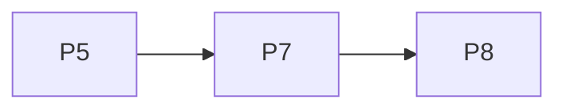

# v2.2.1 — TASKS.md sections

Cut from `TASKS.md` by `scripts/sdd/split.ts` (FR-SDD-3); ids resolve through `docs/sdd/ids.md`.

## v2.2.1 tasks

Draft, cut 2026-09-28 from `SPEC.md` v2.2.1 and `PLAN.md` v0.9.1, for review. Spec Phase 2j, "the Bariloche night": the recordings for the owner's posts and the release capture set move from D-179's Paris night, where no forecast was recorded, to Bariloche on the night of 5 to 6 September 2026, with Open-Meteo's historical-forecast record and the geocoder's answer as fixtures (FR-SHOW-9, FR-SHOW-10). No product change: nothing under `src/` or `public/`, no version, no tag (V22-19).

Delivery is PLAN §16 unchanged, cut by §16.19: two tasks over two waves, on `main` after the `v2.2.0` tag, in wave order. Both are `P` tasks (§16.12's numbering). P8 depends on P7 because it imports the seeds P7 adds.

**Sessions for this phase** (V22-19, V22-13, D-659): both tasks run on `fable`, are reviewed on `opus`, have 500 implementation turns and `Fallback: off`.

Decision blocks (§16.2), reserved in PLAN §16.19: **P7 D-687..D-690, P8 D-691..D-695**. D-682..D-686 are the plan's.

**Precondition:** P7's is `tests/fixtures/open-meteo/2026-09-06-bariloche-forecast.json` on `origin/main`: the owner's one commit before wave 1 adds it with `2026-09-06-bariloche-geocode.json` and both `.meta.json` files (V22-17, D-686), and the driver skips P7 until it exists. A task session has no network and cannot fetch them.

### Wave 1

- [x] **P7 — The recording run on the Bariloche night** — done; each flow names its instant (`at`), the first run needs no `[ continue ]` after a pick, and both live flows hold at 20:44 local, past `SHOWCASE_UNTIL` with no warning on screen (PLAN D-687..D-689). **At the owner's gate (D-690):** the clock starts at 05:00 so Tiangong's 05:48 pass is the first card; the phone holds that pass and the desk steps by minutes, so nothing after `SHOWCASE_UNTIL` is shown; the review's import-time lookup in `promoFlows.ts` is a literal the seeds' test checks.
  - **Lane:** ui
  - **Model:** fable
  - **Review:** opus
  - **Turns:** 500
  - **Fallback:** off
  - **Gate:** owner
  - **Depends on:** P5
  - **Precondition:** `tests/fixtures/open-meteo/2026-09-06-bariloche-forecast.json`
  - **Precondition note:** the owner's commit on `main` of the two Bariloche fixtures and their `.meta.json` files (D-686) is what puts that file there. `--wave` must not pick P7 before it exists.
  - **Reads:** SPEC §4.43 (FR-SHOW-6 as amended, FR-SHOW-7, FR-SHOW-9), FR-SAT-4, §9 Phase 2j, §12 V22-16..V22-19; PLAN §2.37 (D-682, D-683, D-685, D-686), D-652..D-654, D-671..D-673, §16.19; `tests/e2e/promo-record.spec.ts`, `tests/e2e/promoFlows.ts`, `tests/e2e/observers.ts` and `scripts/build-stored-run.ts` whole; `tests/e2e/liveHelpers.ts`'s `stubNetwork`; `tests/docs/promo.test.ts`.
  - **Goal:** `npm run promo:record` records every flow of `PROMO_FLOWS` over Bariloche on the showcase night, with the place typed and picked by name, local clocks, the recorded forecast in the badges and no staleness warning.
  - **Satisfies:** FR-SHOW-6 as amended, FR-SHOW-9 (for the recordings); US-36 AC5, AC8 (the recordings).
  - **Why not a slice:** it produces material, not evidence, and changes nothing a reader of the app sees.
  - **Scope (SPEC FR-SHOW-9, PLAN D-682, D-683, D-685):**
    - `tests/e2e/observers.ts`: `BARILOCHE_QUERY`, `BARILOCHE` as `observerFromPlace(parseGeocodeBody(fixture)[0])`, `SHOWCASE_NIGHT` (2026-09-06T07:00:00Z), `SHOWCASE_UNTIL` (2026-09-06T23:20:48Z), `STORED_RUN_BARILOCHE_FILE`; `STORED_RUN_PARIS_FILE` removed. `PARIS` and `PARIS_NIGHT` stay (the capture set still reads them until P8).
    - `tests/e2e/liveHelpers.ts`: `stubNetwork`'s third parameter `weather: 'refused' | 'showcase'`, default `'refused'`, every existing caller unchanged; `'showcase'` fulfils the forecast for the fixture's cell only and the geocoder for `name=bariloche` only, and refuses anything else (D-682).
    - `scripts/build-stored-run.ts`: writes `tests/fixtures/stored-run-bariloche.json` at `SHOWCASE_NIGHT`; `stored-run-paris.json` deleted; `stored-run-neuquen.json` byte for byte unchanged.
    - `tests/e2e/promo-record.spec.ts` and `tests/e2e/promoFlows.ts`: every flow on the showcase seeds; the first-run and desk cold-open flows type `bariloche` and pick the first result; the desk live flow three minutes into Tiangong's 07:20 pass, found in the stored run by object and start; the phone live flow at `SHOWCASE_NIGHT + 12 h`; no flow's clock past `SHOWCASE_UNTIL`. The flow names, devices, languages and stills unchanged.
    - `tests/docs/showcase.test.ts` (new) per D-685, the P7 half; `tests/docs/promo.test.ts`'s Paris check rewritten to the Bariloche run at `SHOWCASE_NIGHT`, and each flow's start plus its seconds under `SHOWCASE_UNTIL`.
  - **Touches outside the lane:** `tests/docs/showcase.test.ts`, `tests/docs/promo.test.ts`, `scripts/build-stored-run.ts`.
  - **Out of scope:** `captureSeeds.ts`, `v1-captures.spec.ts`, `captureSet.ts` and every capture (P8); `src/`; the golden fixtures; any other spec's network stub.
  - **Done when:**
    - `npx vitest run tests/docs/showcase.test.ts tests/docs/promo.test.ts` passes.
    - `npm run build:stored-run` leaves `stored-run-neuquen.json` unchanged (`git diff --quiet` on it) and writes the Bariloche run.
    - The session runs `npm run promo:record` once headless, reports the files and sizes, and names in its summary the countdown's first pass, the desk live flow's pass and the cloud badge values the stills show; `git status --short` shows nothing under `promo/`.
    - `npm test`, lint, typecheck and `npm run e2e` green; `git diff --stat origin/main -- src/ public/ docs/screenshots` empty.
    - The owner's gate: `npm run promo:record` on the Mac; every file opened; the place reads Bariloche, the clocks local time, the badges the forecast, no staleness warning (FR-SHOW-9 (a)–(c)).

### Wave 2

- [x] **P8 — The release set re-shot on the Bariloche night, the hero and the social preview regenerated** — done; the night has no glare pass and no ISS pass, so the chart screens are of the brightest pass and the `Next ISS` tag, the glare state and the legend's `soon`/`gone`/hidden rows are said absent in `captureSet.ts`; the chip's instant is three minutes before the pass; the home keeps its closed nights (five passes a night, route kept); every capture asserts US-36 AC8 before its shot (PLAN D-691). `git diff --stat origin/main -- docs/screenshots`: 230 files, all `v1-*` (the 24 unchanged are `location` and `shortcuts`); `-- docs/readme`: `hero.png` and `social-preview.png` only; `-- src/ public/`: empty. F-101 recorded and left.
  - **Lane:** ui
  - **Model:** fable
  - **Review:** opus
  - **Turns:** 500
  - **Fallback:** off
  - **Gate:** owner
  - **Depends on:** P7
  - **Reads:** SPEC §4.39 (FR-CAP-1..5), §4.43 (FR-SHOW-7 as amended, FR-SHOW-9, FR-SHOW-10), FR-ADDR-4, FR-PUB-2, §9 Phase 2j, §12 V22-16..V22-19; PLAN §2.37 (D-684, D-685), D-179, D-611, D-639, §16.19; `tests/e2e/captureSeeds.ts`, `tests/e2e/v1-captures.spec.ts` and `tests/e2e/captureSet.ts` whole; `scripts/readme-hero.ts`; `.github/workflows/captures.yml`.
  - **Goal:** the 254 `v1-*` captures show Bariloche on the showcase night with local clocks and the recorded forecast, deterministic across two runs, and the hero and the social preview are composed from them.
  - **Satisfies:** FR-SHOW-10, FR-SHOW-9 (for the set), FR-SHOW-7 as amended; US-36 AC8 (the captures).
  - **Why not a slice:** it re-shoots evidence of screens that do not change; only the data on them does.
  - **Scope (SPEC FR-SHOW-10, PLAN D-684, D-685):**
    - `tests/e2e/captureSeeds.ts`: `CLOCK = SHOWCASE_NIGHT`, `SHOWN` the showcase's, `seedPage`'s observer `BARILOCHE`, `GLARE_PASS` re-derived or the glare state recorded absent (D-684); no import of `PARIS` or `PARIS_NIGHT`.
    - `tests/e2e/v1-captures.spec.ts`: `stubNetwork(page, 'fixtures', 'showcase')`; routes unchanged. `tests/e2e/captureSet.ts`: the `what` lines that named Paris, the ISS pass or "weather unknown" rewritten, and every state the night lacks said absent and why; the list's names, widths and variants unchanged.
    - `tests/e2e/observers.ts`: `PARIS_NIGHT` removed if nothing imports it.
    - The set re-shot with `v1-captures.spec.ts`; `scripts/readme-hero.ts` run; `docs/readme/hero.png` and `docs/readme/social-preview.png` committed.
    - `tests/docs/showcase.test.ts`: the P8 half of D-685 (`captureSeeds.ts`'s instants on the night and under `SHOWCASE_UNTIL`; no Paris import).
  - **Touches outside the lane:** `docs/readme/hero.png`, `docs/readme/social-preview.png`, `tests/docs/showcase.test.ts`.
  - **Out of scope:** the per-task `r*-` captures; `src/`; any screen that renders wrongly with a forecast or a zone, which is a §4.20 finding and is left (D-656).
  - **Done when:**
    - `npx vitest run tests/docs/captures.test.ts tests/docs/showcase.test.ts` passes on the unchanged list.
    - `git diff --stat origin/main -- docs/screenshots` names only `v1-*` files, and `git diff --stat origin/main -- docs/readme` only the two pictures; the Done note carries both.
    - `captures.yml` run twice on the branch's head, both links in the PR, byte-identical files (FR-CAP-5), or a file out of the set with its row.
    - `npm test`, lint, typecheck and `npm run e2e` green; `git diff --stat origin/main -- src/ public/` empty.
    - The owner's gate: the home, live and sky-screen captures in both languages and both themes looked at; the social preview uploaded again in the GitHub UI (FR-PUB-11).

### Requirement coverage (v2.2.1)

| Requirement | Task |
|---|---|
| FR-SHOW-6 as amended | P7 |
| FR-SHOW-9 | P7 (the recordings), P8 (the set) |
| FR-SHOW-10, FR-SHOW-7 as amended | P8 |
| US-36 AC5, AC8 | P7 (AC5, AC8's recordings), P8 (AC8's captures) |

**Waves** (the driver recomputes them from `main`; this is the sanity check): **wave 1** P7 — **wave 2** P8. One task per wave, both `ui`, so no file is shared within a wave.

### Added 2026-09-28: the dome over London (V22-20, PLAN D-696)

- [x] **P9 — The dome flows over London, played at 60×** — done 2026-09-28 in the owner's session: two `dome-playback` flows (phone, desk) over London from 21:18 local on 2026-09-06, the live page scrubbed and played at 60× for about half an hour of sky; London's geocode and historical-forecast fixtures; a third stored run; `stubNetwork`'s showcase places as a table; the seeds' test extended. `npm run promo:record`: 10 flows passed; the `crowded` phone still at 21:22 shows five labelled passes, three up, `clear`.
  - **Lane:** ui
  - **Model:** interactive
  - **Review:** opus
  - **Gate:** owner
  - **Depends on:** P7
  - **Satisfies:** FR-SHOW-6 and FR-SHOW-9 as amended (V22-20).
