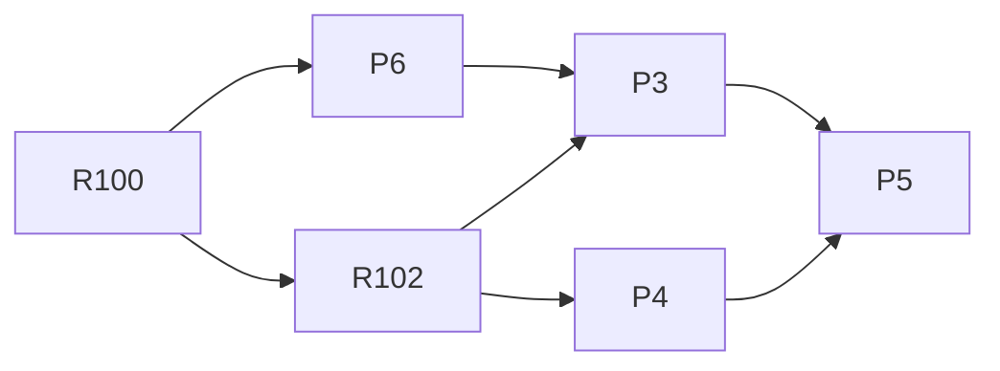

# v2.2 — TASKS.md sections

Cut from `TASKS.md` by `scripts/sdd/split.ts` (FR-SDD-3); ids resolve through `docs/sdd/ids.md`.

## v2.2 tasks

Draft, cut 2026-09-25 from `SPEC.md` v2.2 and `PLAN.md` v0.9, for review. Spec Phase 2i, "the showcase": the repository is going in front of recruiters and developers from a series of posts starting 2026-09-28, so §4.24's stance is restated for the tree as it is (§4.43 FR-SHOW-1..8), the app gets its address (§4.44 FR-ADDR-1..4), and one credit joins the footer (FR-X-2 as amended). No other product change: no screen changes, no capture is re-shot but the footer's, no test is changed to pass, and `passes.golden.test.ts` is untouched.

Delivery is PLAN §16 unchanged, cut by §16.18: five tasks over three waves, on `main` after the `v2.1.0` tag. Four are `P` tasks (§16.12's numbering: the repository's own readiness) and one is `R102`, the phase's one product change. The entries below are in **wave order**. The breakdown takes §16.18 as proposed. No two tasks of a wave name one file: the README's glyphcss paragraph (FR-SHOW-8) is P3's, not R102's, so wave 1 shares nothing, and `.gitignore`'s `/promo` line is P6's, so wave 2 shares nothing.

**Sessions for this phase** (V22-13, D-659): every task runs on `fable`, is reviewed on `opus`, has 500 implementation turns (twice the driver's default, the wall clock and the review's cap scaled with it) and is never retried on a lesser model — `Fallback: off`, so a session that ends on a limit fails the task for a rerun on the same model instead of finishing on a cheaper one. The owner chose no economy for the phase the world reads: the three fields are on every entry and the driver reads them (`Review:`, `Turns:`, `Fallback:`, §16.3).

Decision blocks (§16.2), reserved in PLAN §16.18: **P6 D-660..D-662, R102 D-663..D-666, P3 D-667..D-670, P4 D-671..D-674, P5 D-675..D-680**. D-647..D-659 are the plan's.

**Lane ownership for this phase** (§16.1 as amended, §16.18): the `docs` lane owns `docs/**`, the root documents (`README.md`, `CONTRIBUTING.md`, `CLAUDE.md`), `.claude/**`, `tests/docs/**`, `tests/deploy/**`, `wrangler.jsonc`, `scripts/readme-hero.ts`, `.gitignore` and PLAN §4 for this phase; the `ui` lane owns what it always has plus `playwright.config.ts`, `tests/e2e/promo-record.spec.ts`, `tests/docs/promo.test.ts` and `package.json`'s `scripts` block. P5 touches every lane and runs alone.

**Preconditions:** P6's is the `inyoursky.app` zone, active in the Cloudflare account since 2026-09-25 (V22-11); the driver checks files, not zones, so its `Precondition:` line names `wrangler.jsonc` and the owner's confirmation is the real check. P5's is `knip.json` on `origin/main` (D-647): the owner's one commit on `main` before wave 3 — `npm install --save-dev knip` and an empty `knip.json` — and the driver skips P5 until that file exists.

### Wave 1

- [x] **P6 — The address: `inyoursky.app` bound by the deploy, named everywhere, the hero regenerated** *(done 2026-09-25; the `workers.dev` scan is `git grep -F`, since `workers_dev` in `wrangler.jsonc` matches the unescaped dot — D-660; only the social preview prints the wordmark, D-661)*
  - **Lane:** docs
  - **Model:** fable
  - **Review:** opus
  - **Turns:** 500
  - **Fallback:** off
  - **Gate:** owner
  - **Depends on:** R100
  - **Precondition:** `wrangler.jsonc`
  - **Precondition note:** the driver checks a file; the real precondition is the `inyoursky.app` zone active in the Cloudflare account (V22-11, since 2026-09-25), which the owner confirms before the first `--wave`.
  - **Reads:** SPEC §4.44 (FR-ADDR-1..4), FR-PUB-1, FR-PUB-2, FR-PUB-11, §12 V22-11; PLAN §2.5 (D-12 as amended, the rename), §11's header block, D-370, D-658, §16.18; `docs/DEPLOY.md` whole.
  - **Goal:** the app's public address is `https://inyoursky.app`, bound to the Worker by the deploy from `main` with nothing set in the dashboard; every reader-facing document and test names it; the `workers.dev` address goes on serving unchanged and carries the branch previews.
  - **Satisfies:** FR-ADDR-1, FR-ADDR-2, FR-ADDR-4; FR-ADDR-3 by the sentence it writes. **Advances:** US-36 AC7.
  - **Why not a slice:** it delivers no requirement of the app; the reader it serves is the one who types the address. First in the phase so that P3 reads the new address as the truth.
  - **Scope (SPEC §4.44, PLAN D-658):**
    - `wrangler.jsonc`: `"routes": [{ "pattern": "inyoursky.app", "custom_domain": true }]`; `workers_dev`, `preview_urls`, `assets` and the absence of a `main` script unchanged, with a comment naming D-658.
    - The origin in the documents: `README.md`'s prologue live URL; `docs/DEPLOY.md`'s `SITE=` line; `docs/RELEASE.md`'s seven "Deploy `main` to …" items and its §10 metadata homepage; `tests/docs/public.test.ts`'s `LIVE`; `scripts/readme-hero.ts`'s wordmark line. After the change `git grep -l 'workers.dev'` over tracked text returns `docs/DEPLOY.md`, `SPEC.md`, `PLAN.md` and `TASKS.md` only.
    - `docs/RELEASE.md` gains `## 14. v2.2` — the headers on both origins, the hero, the footer captures, the `v2.2.0` tag (V22-12) — and `docs/DEPLOY.md` gains a `## Domain` section: the registrar (Cloudflare Registrar, auto-renew on, renewal 2026-09-25 yearly), the GitHub *Website* field to set to `https://inyoursky.app`, the branch-preview line (`https://<branch>-in-your-sky.ezequiel-baruf.workers.dev`, unchanged), one sentence that the old address still serves the same build with its own browser state (FR-ADDR-3), and the two checks: `curl -sI https://inyoursky.app` and the same for the old address, each printing §11's header block.
    - `npx tsx scripts/readme-hero.ts` re-run: `docs/readme/hero.png` (1200 px wide) and `docs/readme/social-preview.png` (1280 × 640) regenerated from the unchanged captures, the wordmark reading `inyoursky.app`.
    - `tests/deploy/wrangler.test.ts` (new, beside `headers.test.ts` and `manifest.test.ts`): the route with `custom_domain: true`, `workers_dev: true`, `preview_urls: true`, no `main`.
    - `.gitignore`: `/promo` beside `/redesign`, with a one-line comment naming FR-SHOW-3 (P3 asserts it, P4 writes into it; neither touches the file).
  - **Touches outside the lane:** nothing. **Nothing under `src/`.**
  - **Out of scope:** a `www` record; a redirect; any migration of browser state; the GitHub field itself and the renewal, which are the owner's.
  - **Done when:**
    - `npx vitest run tests/docs tests/deploy` passes, including `public.test.ts` with `LIVE = 'https://inyoursky.app'` and the new `wrangler.test.ts`.
    - `git grep -n 'workers.dev' -- ':!SPEC.md' ':!PLAN.md' ':!TASKS.md' ':!package-lock.json'` prints lines in `docs/DEPLOY.md` only, and both `docs/readme/*.png` differ from `origin/main` while `docs/screenshots/` does not (`git diff --stat origin/main -- docs/screenshots` empty).
    - `git check-ignore promo/x` prints the path.
    - `npm test`, lint and typecheck green; `git diff --stat origin/main -- src/` empty.
    - The owner's gate, after the merge deploys: `curl -sI https://inyoursky.app` and `curl -sI https://in-your-sky.ezequiel-baruf.workers.dev` both print the `Content-Security-Policy`, `Referrer-Policy` and `Permissions-Policy` lines of PLAN §11; the app opens at the new address; the GitHub *Website* field set.

- [x] **R102 — The footer credits glyphcss**
  - **Lane:** ui
  - **Model:** fable
  - **Review:** opus
  - **Turns:** 500
  - **Fallback:** off
  - **Gate:** owner
  - **Depends on:** R100
  - **Reads:** SPEC FR-X-2 as amended, FR-SHOW-8, FR-PUB-4, FR-COMP-4, FR-HOME-1, §12 V22-10; PLAN D-120, D-548, D-657, §16.18; `tests/e2e/captureSet.ts`.
  - **Goal:** the footer names the library the sky is drawn with — "Sky chart: glyphcss." / "Carta del cielo: glyphcss." — with `glyphcss` linked to <https://glyphcss.com>, in both languages and in every form the footer has. The library alone: its author is not named in the app or the repository (V22-15; the first two sessions of this task built the credit with his name, and this resume removes it).
  - **Satisfies:** FR-SHOW-8; FR-X-2 as amended; US-36 AC6.
  - **Scope (SPEC FR-SHOW-8, PLAN D-657):**
    - `ATTRIBUTION_URLS` gains `glyphcss` only; `footer.chart` in `en/ui.ts` and `es/ui.ts` is an ordinary one-link `LinkedText` ("Sky chart: glyphcss." / "Carta del cielo: glyphcss."); `footer.short.chart` (`Chart:` / `Carta:`) for the wide one-row footer (D-120); the line form (D-548) carries it after the credit. *(V22-15)* The `fortunatti` URL, the second anchor `Linked` learned (`middle`, `link2`, `href2`) and its `messages.ts` field are removed again — nothing else uses them — and `git grep -i fortunatti src tests` is empty on the branch.
    - `Footer.test.tsx`: the four credits' hrefs in both languages and all three forms. The full form's new sentence wraps on compact like GeoNames's does; the one-row forms may wrap once where the fourth item does not fit (FR-SHOW-8, D-657) — the task measures the narrowest wide width at which the Spanish row holds one line and writes it in the Done note. No literal pinned.
    - `tests/e2e/identity.spec.ts`: the home's control count ("3 footer links" in its comment) moves up by one, in the comment and the floor (`first-step-screen.spec.ts` the same, if the first resume changed it).
    - The captures: `CAPTURES=1 npx playwright test v1-captures -g home`, and the same for any other `captureSet.ts` entry whose screen renders `<Footer>` (the settings page has its own foot, FR-SET-1, and is not one); those files committed and listed in the Done note; no file added or removed, so `captures.test.ts` is unchanged.
    - No document: the README's glyphcss paragraph and `docs/RELEASE.md` §14's footer item are P3's (FR-SHOW-8, FR-PUB-4 as amended). *(V22-15)* The branch's earlier edits to `README.md`, `docs/RELEASE.md` and `tests/docs/public.test.ts` are reverted to `origin/main`'s versions on this resume.
    - *(extended 2026-09-25, V22-14, D-681 — the task resumes on its branch)* The two-line footer's row is the shell's: `FOOTER_ONE_LINE_MIN_PX = { en, es }` in `src/lib/layout.ts` — re-measured on the built app without the author's name (the first resume found 1330/1349 with it), pinned in `tests/styles/breakpoint.test.ts`; in `App.module.css` under each `:root[lang]` from `WIDE_MIN_PX` to the literal, the main's padding above and below the panes halves and the footer's `padding-top` halves, composing with D-608's under-720 rule. `home-desk.spec.ts` is not changed: FR-HOME-2 at 1024 × 768 and FR-HOME-3 at 1118 × 700 go green under it in both languages. The session records what it did with it in the one number left in its block (PLAN §16.18).
  - **Touches outside the lane:** `docs/screenshots/v1-*` (the footer's files only).
  - **Out of scope:** any other footer change; the notices file (FR-PUB-5 already carries glyphcss's MIT text); any document.
  - **Done when:**
    - `npx vitest run src/ui/components/common tests/styles/breakpoint.test.ts` passes with the new assertions, and `npx playwright test identity home-desk` passes — `home-desk.spec.ts` unchanged, at 1024 × 768 and 1118 × 700 in both languages (V22-14).
    - `git diff --stat origin/main -- docs/screenshots` lists exactly the files the Done note names, all of them screens whose footer is visible; `git diff --stat origin/main -- README.md docs/*.md` empty.
    - `npm test`, lint, typecheck and the PR's e2e path green inside FR-CI-1's ten minutes; `npm run bundle:budget`'s `main` row inside 170.
    - The owner's gate: the Spanish line read; the re-shot captures compared with their previous versions — the only difference the fourth credit.
  - **Done (2026-09-25, D-663..D-666; three sessions):** as the entry says after V22-15. The footer's fourth credit is "Sky chart: glyphcss." / "Carta del cielo: glyphcss.", one link to `https://glyphcss.com`, the last item of the full form, the wide row (`Chart: glyphcss` / `Carta: glyphcss`) and the steps' line form (D-663). The second anchor the first two sessions had built — `middle`, `link2`, `href2`, the `fortunatti` URL — is gone with the name, and `LinkedText` is the one-link shape it was (D-665); `git grep -i fortunatti src tests` finds only `tests/docs/public.test.ts`'s README pin, which is `main`'s and leaves with P3's README paragraph. `README.md`, `docs/RELEASE.md` and `public.test.ts` are `origin/main`'s. **Measured (D-664):** the one-row footer holds one line from **1118 px** (en) and **1137 px** (es) of viewport width on the built app — 1330/1349 with the author's name — so it wraps at the 1024 px capture width and holds one line at 1280 and 1920; these are `FOOTER_ONE_LINE_MIN_PX`, the stylesheet's two per-language folds and `breakpoint.test.ts`'s pin (D-666, D-681). `home-desk.spec.ts` unchanged: FR-HOME-2 at 1024 × 768 and FR-HOME-3 at 1118 × 700 green in both languages, the English fold happening to equal `HOME_THREE_PANE_MIN_PX`. **Captures:** `git diff --stat origin/main -- docs/screenshots` is 64 files, every one a screen with the footer in the picture, shot for `location`, `home`, `guide`, `polar` and `favourites` (the `shortcuts` overlay hides its footer, the settings page has its own foot): `v1-home-{360,390,768}-{dark,night}-{en,es}` (12), `v1-home-{1024,1280,1920}-{dark,night}-{en,es}` and their `-view` twins (24), `v1-location-{360,390,1280}-{dark,night}-{en,es}` (12), `v1-guide-{1024,1280}-{dark,night}-{en,es}` (8), `v1-polar-1280-{dark,night}-{en,es}` (4), `v1-favourites-1280-{dark,night}-{en,es}` (4). Against `main` the 1024 px files show the credit on a second row with half a row less air above and below the panes and above the footer's rule; every other file shows the credit on the one line and nothing else moved. No file added or removed; `captures.test.ts` unchanged. `identity.spec.ts` counts 4 footer links (floor 16), `first-step-screen.spec.ts` five. Seen and left (out of scope, "any other footer change"): where the row wraps, the maker's full stop opens the second line — `Ezequiel Baruf` / `. · Chart: glyphcss` — as it did before the fourth credit wherever the row wrapped.

### Wave 2

- [x] **P3 — The documents made true, the public half named, the reading order carried to v2.1** *(done 2026-09-25. Every row of FR-SHOW-1's audit table is corrected but two, each explained: `sdd-spec`'s SKILL.md carried nothing stale and is untouched; and §16 is described as it stands — eighteen subsections, §16.1–§16.18, one delivery section per phase from §16.9 on — rather than the seventeen the audit counted at `d7a5d27`, because §16.18 landed with the v2.2 plan after the audit. *By the numbers* is read at `2b6ff66`, the `main` this branch left, since a branch SHA does not survive a squash merge (D-667); its `npm test` row was measured with the base commit's `tests/docs` files swapped in — 2165 tests in 194 files, the branch's own run being 2213 in 195. `docs/RELEASE.md`'s §6–§13 carry a history marker and the accuracy test scans only its current sections for paths (D-668); a bare filename passes when a tracked file has that name (D-669). Corrected on the way, beyond the table: CONTRIBUTING's "one page"; the visual-review skill's three example capture names, which named files that never existed; the Heavens-Above README's R3 line at its top as well as at step 12; the mockups README's compact status also says R51 and R52 have merged. Checks: `npx vitest run tests/docs` 129 passed in 6 files; `npm test` 2208 passed, 5 skipped; lint and typecheck clean; `git diff --stat origin/main -- src/ docs/screenshots` empty; `git grep -n -E '← (NEW\|CHANGED)' .claude` empty; `git grep -c Tailwind SPEC.md` is 3 before and after; `git grep -i fortunatti` returns SPEC's four history lines, PLAN D-657's sentence and TASKS's P1 entry, R102's entry and this one. The `.claude/` files were written through `node`, because the session's Edit tool is refused under `.claude/` in a driver session.)*
  - **Lane:** docs
  - **Model:** fable
  - **Review:** opus
  - **Turns:** 500
  - **Fallback:** off
  - **Gate:** owner
  - **Depends on:** P6, R102
  - **Reads:** SPEC §4.43 (FR-SHOW-1..3), §4.24 (FR-PUB-1..13), §12 V22-1..V22-3, V22-6, V22-7; PLAN §2.36 (D-650, D-651), D-368, §4 whole, §16.2..§16.6 (the process the document describes), §16.18; `docs/HOW-THIS-WAS-BUILT.md` whole; the audit table in SPEC FR-SHOW-1.
  - **Goal:** every reader-facing document says what is true at the commit; the reading order is honest about which tasks the driver ran and carries the numbers a post will quote, each beside its command; the tree's public and local halves are named in one place; and a test reads all of it so it cannot drift again.
  - **Satisfies:** FR-SHOW-1, FR-SHOW-2, FR-SHOW-3; US-36 AC1..AC3. **Closes** the audit of 2026-09-25.
  - **Why not a slice:** the reader it serves is not the app's user (§4.24's first line).
  - **Scope (SPEC §4.43, PLAN D-650, D-651):**
    - The corrections FR-SHOW-1 lists, file by file: `README.md` (the "follows in R11" and "from R8 and R9" sentences, the hero script's line, the build paragraph per FR-SHOW-2 — R1–R15 and H by hand before the driver, `6b79db1`, R38 interactive); `CONTRIBUTING.md` (Done notes are the sessions'); `CLAUDE.md` (a headless session reads its brief; "in MVP" dropped); `docs/HOW-THIS-WAS-BUILT.md` (every count re-read and stated with `wc -l`/`git ls-files`/`grep` and the commit; §16 carried to seventeen sections; the R28 example checked; *What is deliberately public*; *By the numbers*); `docs/DEPLOY.md` ("three lines"); `docs/RELEASE.md` (§13 is current; the budget table with main 170, live 15, settings 10; a marker on the historical sections); `docs/mockups/README.md` (964; the approvals landed); `tests/fixtures/heavens-above/README.md` (`*.extras.json`, R3's provenance); the four `SKILL.md` files (`← NEW`/`← CHANGED` markers gone; worktrees, `R<n>` ids, the six lanes plus `docs`, the four models); SPEC §1 (one sentence: the live page, the sky screen, offline, two languages) and §5 (a dated *as built* note on the header and §5.1 naming the real stack and PLAN §11.1 — V22-7, nothing else in SPEC touched); PLAN §4's tree redrawn from `git ls-files` at directory level with the files FR-SHOW-1 names.
    - `README.md`'s glyphcss paragraph loses the author's name (FR-PUB-4 as amended, V22-15): "[glyphcss](https://glyphcss.com) — **MIT**, © 2025 Layoutit" and the line on why it was chosen; `tests/docs/public.test.ts`'s assertion on the name becomes one on the library, the URL and the copyright holder; `docs/RELEASE.md` §14's footer item names the library alone. After this, `git grep -i fortunatti` over the tracked tree returns only SPEC's Decision Log rows and history notes, PLAN D-657's history sentence and TASKS's checked P1 entry and this one.
    - `tests/docs/accuracy.test.ts` (D-650): paths, `npm run`/`npx tsx scripts/` names, the skill list, the version; `docs/HOW-THIS-WAS-BUILT.md`'s *By the numbers* table has a command column and names its commit; none of FR-SHOW-1's stale strings (`53 MB`, `326 PNGs`, `1053 lines`, `1846 lines`, `1459 lines`, `D-375`, `← NEW`, `Pixel 5`, `T<n>`) appears in the listed files; `git grep -l workers.dev` returns `docs/DEPLOY.md` and the three documents only (FR-ADDR-1); `docs/DEPLOY.md` has the *Domain* heading and the renewal date (FR-ADDR-4). `tests/docs/public.test.ts`: the "53 MB" assertion removed; the address and path scans named over `.claude/**`. `tests/docs/hygiene.test.ts`: `/promo` ignored (P6's line) and nothing tracked under `sdd-run/`, `logs/`, `.sdd-cache/`, `handoff/`, `redesign/`, `promo/`.
  - **Touches outside the lane:** `SPEC.md` §1 and §5 (the two notes), `PLAN.md` §4, `CLAUDE.md`. **Nothing under `src/`.** Not `.gitignore` (P6's).
  - **Out of scope:** any behaviour; the address (P6, merged before this starts); the footer (R102, merged before this starts).
  - **Done when:**
    - `npx vitest run tests/docs` passes with `accuracy.test.ts` added and the three amended tests.
    - Every row of FR-SHOW-1's audit table is either corrected or listed in the Done note with the reason it was left; `docs/HOW-THIS-WAS-BUILT.md` contains `by hand`, `R16`, a *What is deliberately public* heading and a *By the numbers* heading whose figures each sit beside a command and `d7a5d27` or later.
    - `git grep -n -E '← (NEW|CHANGED)' .claude` empty; `git grep -c 'Tailwind' SPEC.md` unchanged in count but the §5.1 line carries the *as built* note.
    - `npm test`, lint, typecheck green; `git diff --stat origin/main -- src/ docs/screenshots` empty.
    - The owner's gate: the README and the reading order read cold, once.

- [x] **P4 — The recording run: phone and desktop flows into `promo/`**
  - **Done (2026-09-25, D-671..D-673):** as written, with three things the tools decided. The `promo` project is in `playwright.config.ts` only when `--project=promo` is on the command line (a bare `playwright test` runs every project; the answer reaches the workers as `PLAYWRIGHT_PROMO=1`, D-671). Each flow opens its own context with its device's `recordVideo`, since Playwright refuses `test.use({ video })` inside a `describe` (D-672). The seeds module is `tests/e2e/captureSeeds.ts` and the list `tests/e2e/promoFlows.ts`, which the spec re-exports as `PROMO_FLOWS` (D-673). The frame produced: the phone's 1170 × 2532 as asked (VP8, 25 fps, no cap), the desk's 1440 × 900; the eight files are 17–29 s. "Light" in the flow list is read as the app's `night` theme. The phone's live flow is Paris by day (`CLOCK` + 12 h) so `[ see this pass ]` is on the headline. `ffmpeg` was on `PATH` for the headless run, so every `.webm` has its `.mp4`. **After review:** every flow runs over Paris on the capture set's night, not the lists at Neuquén nine days on as FR-SHOW-6's text says — nine days on put FR-SAT-4's amber `Elements 9 d 4 h old` line on six of the eight recordings, a warning a fresh install never shows (D-179's reason, D-673 amended); `scripts/build-stored-run.ts` now also writes `tests/fixtures/stored-run-paris.json`, the same search over Paris at `CLOCK`, and the Neuquén file is unchanged. And each `ffmpeg` conversion is caught on its own, so one failure keeps its `.webm` and loses nothing of the other flows.
  - **Lane:** ui
  - **Model:** fable
  - **Review:** opus
  - **Turns:** 500
  - **Fallback:** off
  - **Gate:** owner
  - **Depends on:** R102
  - **Reads:** SPEC §4.43 (FR-SHOW-6, FR-SHOW-7), §12 V22-3, V22-5; PLAN D-652..D-654, §16.18; `tests/e2e/v1-captures.spec.ts` and `tests/e2e/captureSet.ts` whole; `playwright.config.ts`; `tests/docs/hygiene.test.ts`.
  - **Goal:** `npm run promo:record` builds the app and records the flows FR-SHOW-6 lists on a phone and a desktop viewport, from the capture set's seeds under the paused clock, into `promo/media/` — videos, `.mp4` when `ffmpeg` is on `PATH`, and the stills each flow names — with nothing of it tracked or run by CI.
  - **Satisfies:** FR-SHOW-6, FR-SHOW-7; US-36 AC5.
  - **Why not a slice:** it produces material, not evidence, and nothing a reader of the app sees.
  - **Scope (SPEC FR-SHOW-6, PLAN D-652..D-654):**
    - `playwright.config.ts`: a `promo` project (`testMatch: /promo-record\.spec\.ts/`, `use: { video: { mode: 'on', size } }` — 1170 × 2532 asked for the phone flows, 1440 × 900 for the desktop ones, D-652; the frame size actually produced goes in the Done note); every other project gains `testIgnore` for that file. Still one config (`hygiene.test.ts`).
    - `tests/e2e/promo-record.spec.ts`: `PROMO_FLOWS` exported — name, device (`phone` 390 × 844 DPR 3 portrait; `desktop` 1440 × 900), language, seconds, stills — and one test per flow: phone first run (en, dark and light; es once), phone list and card to the guide, phone live watching → `[ see this pass ]` → `[ now ]`, phone settings and the language switch; desktop cold open → place → countdown → a pass open in two panes, desktop live watching and scrubbing with the rail. Seeds imported from the capture spec's exports (extract them to a shared module if they are not exported yet — that module is this task's, named in the Done note); `page.clock.install` at the fixture instant and `runFor` between actions. `afterAll` moves each video to `promo/media/<flow>-<device>.webm`, runs `ffmpeg -y -i … -c:v libx264 -pix_fmt yuv420p …mp4` when `ffmpeg` resolves on `PATH`, and prints one line per file saying what it wrote.
    - `package.json`: `"promo:record": "VITE_MOON_LORE=on vite build && playwright test --project=promo"`.
    - `tests/docs/promo.test.ts`: `PROMO_FLOWS` names a device, a language, a duration under 40 s and at least one still for every flow; the `promo` project exists and every other project ignores the file; when `promo/media/` exists, every flow has its `.webm` and its stills.
  - **Touches outside the lane:** `package.json` (`scripts` only), `tests/docs/promo.test.ts`, and the shared seeds module if extracted from `v1-captures.spec.ts` (`ui`'s file). Not `.gitignore` (P6's, already on `main`).
  - **Out of scope:** any assertion on what a frame looks like; CI; `docs/readme/hero.png` and the D-179 set.
  - **Done when:**
    - `npx vitest run tests/docs/promo.test.ts` passes.
    - `npm run e2e` runs no test from `promo-record.spec.ts` (the list reporter shows none); `npx playwright test --project=promo --list` lists every flow in `PROMO_FLOWS`.
    - The session runs `npm run promo:record` once headless and reports the files it wrote and their sizes; `git status --short` shows nothing under `promo/`.
    - `npm test`, lint, typecheck green; `git diff --stat origin/main -- src/ docs/screenshots` empty.
    - The owner's gate: `npm run promo:record` on the Mac; every file opened; the phone videos portrait, the desktop ones landscape, the countdown moving in all of them.

### Wave 3

- [x] **P5 — The dead code removed, knip in CI**
  - **Done 2026-09-25:** as specified, on the report knip 6.38 (the version the precondition installed) gives with D-647's config rather than the audit's knip 5 counts: 172 unused exports, 58 unused exported types, 4 duplicate exports, one unlisted binary (`ffmpeg`, the promo run's optional converter, D-652) and a hint that `docs/**` is an ignore pattern nothing matches. By D-648's rule: 186 `export` keywords removed (184 by the report and the two duplicates' aliases, `LIVE_FOLD_ACTIONS_UNDER_PX` and `INK_HEIGHT_UNITS`, whose importing tests now import the kept names `TAP_PX` and `DRAWING_HEIGHT_UNITS`); 13 declarations deleted — `catalogEntry`, `haFixtureDates`, `PlaceSearch`, `ARC_STATES`, `isChartOrientation` and the `CHART_ORIENTATIONS` only it read, `ForecastResponse`, `GeocodeResponse`, `SCREEN_CLOSE`, `MOON_LABEL_OFFSET_DEG`, `SAVED_CHART_VIEWS`, `LinkKind`, `ResponseFailureInfo`; 34 re-export specifiers removed from `src/state/index.ts` (18), `src/model/index.ts` (3), `src/state/moonLore.ts` (4), `src/data/moon/index.ts` (2), `src/ui/screens/Home.tsx` (2), `src/data/catalog/index.ts`, `src/data/weatherCache.ts`, `src/data/elementsCache.ts`, `src/ui/components/location/CoordsInput.tsx` and `src/ui/components/common/Countdown.tsx` (1 each). **No test deleted:** none existed only to import a removed symbol (every symbol the report names was imported by nothing, tests included). **No symbol named "pinned by a test" in SPEC or PLAN was on the report** — the ones the documents name by value (`MAG_LIMIT`, `RECOMPUTE_STALE_H`, `WEATHER_MAX_AGE_MIN`, `JOB_STALL_S`, `ENDED_LINGER_S`, `TONIGHT_STRIPE_HOURS`, `MARK_ORBIT_PERIOD_S`, `ATTRIBUTION_URLS`…) are read by their own files and keep their declarations without the keyword. `knip.json`: `ignoreBinaries: ["ffmpeg"]` (D-675), and `docs/**` left out of `ignore` because knip prints the hint on every run and the Done criterion is an empty report (D-675). Two doc comments that led deleted or de-exported statements (`openLink.ts`'s reading of a link, `Countdown.tsx`'s US-6 note) were kept on the declaration that follows. The bundle table before and after is identical to the tenth of a kilobyte (`main` 166.6 KB gzipped of 170); no capture, fixture or header changed.
  - **Lane:** ui
  - **Model:** fable
  - **Review:** opus
  - **Turns:** 500
  - **Fallback:** off
  - **Gate:** owner
  - **Depends on:** P3, P4
  - **Precondition:** `knip.json`
  - **Precondition note:** the owner's commit on `main` — `npm install --save-dev knip` plus an empty `knip.json` (`{}`) — is what puts that file there (D-647); the task fills the file. `--wave` must not pick P5 before it exists.
  - **Reads:** SPEC §4.43 (FR-SHOW-4, FR-SHOW-5), §12 V22-4; PLAN D-647..D-649, D-656, §11's budget table, §16.18; the knip report quoted in FR-SHOW-4; `tests/docs/captures.test.ts`.
  - **Goal:** `npx knip` reports nothing; the 83 unused exports, 39 unused exported types and 4 duplicate exports of the 2026-09-25 audit are gone by D-648's rule; the app is unchanged, measured; and CI keeps it so.
  - **Satisfies:** FR-SHOW-4, FR-SHOW-5; US-36 AC4.
  - **Why not a slice:** it removes what no reader can reach. It runs alone because it touches every lane's directories (D-655).
  - **Scope (SPEC FR-SHOW-4, PLAN D-647..D-649):**
    - Before any edit: `npm run build && npm run bundle:budget`, the table recorded in the summary.
    - `knip.json` at the root per D-647 (`entry`, `ignore: ["spike/**", "docs/**"]`, empty `ignoreDependencies`); `"check:dead": "knip"` in `package.json`; `.github/workflows/ci.yml` gains a `dead-code` job parallel to `trailers` running `npm ci` and `npm run check:dead`.
    - The rule, file by file over the audit's list: the `export` keyword removed where the file reads the symbol; the declaration deleted where nothing does, with any test that existed only to import it; a duplicate export keeps the name a requirement uses; `src/state/index.ts` and `src/model/index.ts` re-export what is imported outside their directories. No signature change, no rename, no moved file. A symbol a requirement names as "pinned by a test" with no such test gets the test or loses the export — the Done note says which for each.
    - After: the same build and table; `npx knip` empty.
  - **Touches outside the lane:** every directory the report names; `package.json`, `knip.json`, `.github/workflows/ci.yml`.
  - **Out of scope:** `spike/**`; any behaviour; any test changed to pass; any dependency removed or added beyond `knip`.
  - **Done when:**
    - `npx knip` prints nothing and exits 0; the `dead-code` job is green on the PR and spends none of the `ci` job's ten minutes.
    - The bundle table before and after, in the summary and the PR: no row larger; `main` inside 170.
    - `npm test` (the golden suite included), lint, typecheck, `npm run e2e` and `npx vitest run tests/docs/captures.test.ts` green; `git diff --stat origin/main -- docs/screenshots tests/fixtures public/_headers` empty.
    - The diff reads as three shapes only — removed `export` keywords, deleted declarations, deleted tests — and the Done note lists every deleted test by name.
    - The owner's gate: the table read; the clean-clone run of FR-PUB-8 on the merged commit; the version bump and the tag (§9 Phase 2i).

### Requirement coverage (v2.2)

| Requirement | Task |
|---|---|
| FR-ADDR-1, FR-ADDR-2, FR-ADDR-4 (FR-ADDR-3 by its sentence); FR-SHOW-3's `/promo` line | P6 |
| FR-SHOW-8; FR-X-2 as amended | R102 (the footer), P3 (the README's link) |
| FR-SHOW-1, FR-SHOW-2, FR-SHOW-3 | P3 |
| FR-SHOW-6, FR-SHOW-7 | P4 |
| FR-SHOW-4, FR-SHOW-5 | P5 |
| US-36 AC1..AC7 | P3 (AC1..AC3), P5 (AC4), P4 (AC5), R102 (AC6), P6 (AC7) |
| OQ-10 | P6 |

**Waves** (the driver recomputes them from `main`; this is the sanity check): **wave 1** P6, R102 — **wave 2** P3, P4 — **wave 3** P5. Lanes per wave: `docs` + `ui`, `docs` + `ui`, `ui` alone. No two tasks in one wave name the same file.
