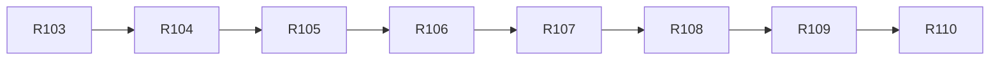

# v2.3 — TASKS.md sections

Cut from `TASKS.md` by `scripts/sdd/split.ts` (FR-SDD-3); ids resolve through `docs/sdd/ids.md`.

## v2.3 tasks

Draft, cut 2026-10-19 from `SPEC.md` v2.3 and `PLAN.md` v0.10, for review. Spec Phase 2k, "the design system": the look the app has had since R12 written down once — every value a token in `tokens.css` written from the grid, eight primitives under `ui/components/primitives/` as the only place a control, a card, a rule, a line or a field is styled, a literals test that fails CI on a hex, a length or a stacking level outside the sheet, and `docs/DESIGN.md` generated from the sheet and the primitives with a dev-only page beside it (FR-DS-1..9). One visible change, F-98's dome degree labels at AA (V23-5); everything else is a rename the re-shot capture set proves byte-identical (V23-2).

Delivery is PLAN §16 unchanged, cut by §16.20: eight tasks over eight waves of one. Every task but the last is `ui` with every lane's directories in scope and runs alone (D-709, D-655's rule), because each primitive deletes CSS in `ui`, `live`, `chart` and `window` modules and lowers the one allow-list. The chain is strict: R104..R107 each lower `literals.allow.json`; R104 and R105 both touch `PassCard.module.css`; R104 and R106 both touch the location modules; R108 reads the manifest the four primitive tasks fill; R109's diff is only meaningful once every module is settled.

**Sessions for this phase** (D-659): every task runs on `fable`, is reviewed on `opus`, has 500 implementation turns and `Fallback: off`.

Decision blocks (§16.2), reserved in PLAN §16.20: **R103 D-710..D-713, R104 D-714..D-717, R105 D-718..D-721, R106 D-722..D-724, R107 D-725..D-727, R108 D-728..D-731, R109 D-732..D-735, R110 D-736..D-738**. D-700..D-709 are the plan's.

**Precondition:** none. The phase needs nothing the owner must commit first; the stylesheets, the tests and the scripts are all in the tree.

**The rule every task keeps** (FR-DS-5, D-708): what is drawn does not change. A task's own proof is the committed `v1-*` captures its modules draw, re-shot locally and byte-identical; the phase's proof is `captures.yml` on R109's branch. A task that finds a pixel moving stops and records which file and why in its Done note rather than re-baselining.

### Wave 1

- [x] **R103 — The sheet and the literals test: `tokens.css` in sections, the scales named from the grid, the four chart tokens, the literals test seeded, every breakpoint named and in range syntax**
  - **Done (2026-10-19, D-710..D-713):** as written, with four things decided. The type table is D-710 (eight role pairs — `title`, `countdown`, `question`, `pane`, `heading`, `lead`, `body`, `stripe` — and the five `--chart-text-*`); the grid carries `--hairline: 1px` and the edges name it (D-711); the four star tokens are marks the tokens test measures and the dome palette test excludes (D-712); the header's four folds are `HEADER_FOLD_PX`, the script's three queries are range syntax too, `LANDSCAPE_PHONE_MAX_HEIGHT_PX` is `SIDEWAYS_MAX_HEIGHT_PX`, and `width <` stays `<` (D-713). The allow-list seeds 240 literals in 51 files (no colour, no inline style); the listing has 21 conditions in 9 files and did not change across the rewrite. `git diff --stat origin/main -- src/` names `tokens.css`, `layout.ts`, the eight query modules, and two test companions (`scrubPlacement.test.ts` for the rename, `dome/palette.test.tsx` for the reserved four); `contrast.ts` is under `scripts/`.
  - **Lane:** ui
  - **Model:** fable
  - **Review:** opus
  - **Turns:** 500
  - **Fallback:** off
  - **Gate:** auto
  - **Depends on:** none
  - **Reads:** SPEC §4.45 whole (FR-DS-1..9), FR-X-6 and FR-THEME-1 as amended, US-37, §9 Phase 2k, §12 V23-1..V23-10; PLAN §2.38 (D-700..D-709), §9.6, §16.20; `src/ui/styles/tokens.css` whole; `tests/styles/literals.allow.json`; `scripts/contrast.ts`, `tests/styles/tokens.test.ts` and `tests/styles/breakpoint.test.ts` whole; `src/lib/layout.ts`'s exports; PLAN D-50, D-100, D-259; SPEC F-10.
  - **Goal:** every value a module may use is a named token in one sheet the tests parse, nothing on screen moves, and from this commit on a new literal in a module fails `npm test`.
  - **Satisfies:** FR-DS-1, FR-DS-2, FR-DS-3, FR-DS-8; FR-THEME-1 as amended; US-37 AC3.
  - **Scope (SPEC FR-DS-1..3, FR-DS-8; PLAN D-700..D-702):**
    - `src/ui/styles/tokens.css` re-cut under the seven markers (`grid`, `space`, `type`, `edges`, `layers`, `colour`, the night block), every length a `calc()` from `--row` or `--cell`: `--space-1..5` and `--space-block` (1.2 rem, FR-FIRST-1/2); `--text-<role>` / `--text-<role>-row` for the six rem sizes and five line heights in use, named for the role of the element that uses them and tabled in the task's first decision; `--chart-text-9/11/12/14/15`; `--border`, `--border-control`, `--radius-0/1/2`, `--focus-ring`, `--focus-offset`, `--focus-offset-tight`, `--weight-bold`, `--window-fill-opacity`; `--z-raised`, `--z-raised-2`, `--z-sheet`, `--z-overlay`, `--z-screen` (30, kept), `--z-banner`; `--chart-star`, `--chart-star-dim`, `--chart-figure`, `--chart-planet` with a dark and a night value each at FR-DS-8's ratios. No existing token's value changes.
    - `scripts/contrast.ts`: `readSections(css)`; `CHART_MARK_TOKENS` gains the four. `tests/styles/tokens.test.ts`: the night set equals the colour section's; the length sections carry no bare length; the four chart tokens measured; the existing contrast table kept.
    - `tests/styles/literals.test.ts` and `tests/styles/literals.allow.json` per D-701: every stylesheet under `src/` but `tokens.css`, plus inline `style` objects in `src/ui/**/*.tsx`; the allow-list keyed by file, seeded at the day's counts with a one-line reason each, a count that no longer matches failing in either direction. The test is in `npm test`'s `node` project.
    - `src/lib/layout.ts`: `SIDEWAYS_MAX_HEIGHT_PX` (500), `SHORT_MAX_HEIGHT_PX` (700), `WIDE_SHORT_MAX_HEIGHT_PX` (720), `FRAME_LEGEND_MIN_CELLS` (62), each with a comment saying which rows it folds. `tests/styles/breakpoints.json`, the listing of every `@media` and `@container` condition as `(feature, comparator, value)`, committed **before** the rewrite; then every condition in `src/ui/**` rewritten to range syntax (`(width >= 964px)`, `(height <= 700px)`); `tests/styles/breakpoint.test.ts` holds each condition to a `layout.ts` export, to the syntax, and to the listing, which does not change.
    - Modules are touched for the query rewrite only; no other rule in any module changes in this task.
  - **Touches outside the lane:** every `*.module.css` under `src/ui/components/live/`, `guide/skychart/` and `guide/skychart/window/` (the query rewrite), `src/lib/layout.ts`.
  - **Out of scope:** any primitive; any module's bracket, border, padding or outline rule; `docs/DESIGN.md`; the dev page; F-98.
  - **Done when:**
    - `npx vitest run tests/styles` passes: `tokens.test.ts` with the night-set and the four chart rows, `literals.test.ts` against the seeded allow-list, `breakpoint.test.ts` with the listing identical to the committed one.
    - The Done note carries the type table (the task's first decision), the allow-list's seeded total, and `git diff --stat origin/main -- src/` naming `tokens.css`, `layout.ts`, `contrast.ts` and the modules whose queries were rewritten and nothing else.
    - `npm test`, lint, typecheck and `npm run e2e` green; `npx vitest run tests/styles` green with no new allow-list entry.
    - `git diff --stat origin/main -- docs/screenshots public/` empty, and a local `npx playwright test v1-captures` leaves every committed `v1-*` file it re-shoots byte-identical (F-99's sub-pixel files excepted, named in the Done note).

### Wave 2

- [x] **R104 — The controls: `TextButton`, `BracketLink` and `ToggleGroup`; `OptionToggle` moved; the 21 bracket modules and the three private toggles onto them**
  - **Done (2026-10-19):** allow-list 244 matches in 51 files → 180 in 39 (D-716). Converted: `RootBoundary`, `Settings`, `PassDetail`, `Live`, `Steps` (WhenStep, WhatStep), `Header`, `FailureLine`, `InstallAction`, `ShareButton`, `UpdateBanner`, `VisitNotice`, `ElementsLine`, `GuidePanel`, `Favourites`, `LocationInput`, `UseMyLocation`, `WherePlace`, `FaintToggle`, `NextEventBlock`, `SortToggle`, `PlaybackControls`; the chart view and orientation controls, the language and theme switches render `ToggleGroup`. `OptionToggle` re-cut as one option (D-714); `TextButton` carries the forms the modules drew as props (D-715). `controlRows.test.ts` changed in its paths and the chart control's primitive only (D-716). Captures (a local plain-build re-shoot, 254 files): byte-identical but for F-99's 17 live/legend files and the 20 `v1-favourites-*` / `v1-settings-360|390-*` files where the saved-places row's `[ × ]` no longer splits across two lines (the primitive's `nowrap`; named in D-715, for the owner's gate).
  - **Lane:** ui
  - **Model:** fable
  - **Review:** opus
  - **Turns:** 500
  - **Fallback:** off
  - **Gate:** owner
  - **Depends on:** R103
  - **Reads:** SPEC §4.45 whole (FR-DS-1..9), FR-X-6 and FR-THEME-1 as amended, US-37, §9 Phase 2k, §12 V23-1..V23-10; PLAN §2.38 (D-700..D-709), §9.6, §16.20; `src/ui/styles/tokens.css` whole; `tests/styles/literals.allow.json`; `src/ui/components/common/OptionToggle.tsx` + module + test, `src/ui/components/passes/SortToggle.tsx`, `src/ui/components/live/PlaybackControls.tsx`, `tests/styles/controlRows.test.ts`; PLAN D-441, D-549, D-703..D-705; SPEC FR-COMP-4, FR-X-5.
  - **Goal:** every `[ label ]` control and every `[x] option` row in the app is one of three primitives, the brackets are written in two files, and no row's text, role or pixels move.
  - **Satisfies:** FR-DS-4 (items 1–3); US-37 AC2.
  - **Scope (SPEC FR-DS-4; PLAN D-703, D-704, D-705):**
    - `src/ui/components/primitives/`: `TextButton` (`label`, `onClick`, `disabled`, `tone`, `pressed`), `BracketLink` (`href`, `label`, `current`), `OptionToggle` moved from `common/` with its test, `ToggleGroup` (`role`, a group label, arrow keys); one `.module.css` each, brackets as `::before`/`::after` in `TextButton` and `BracketLink` only, the reset once; `manifest.ts` with the four rows and `manifest.test.ts` (D-703); a component test per primitive in both themes.
    - `eslint.config.js`: the primitives zone (D-703) — no import of `src/state`, `src/lib`, `src/i18n`, `src/data` or another `src/ui/**` directory.
    - The 21 modules that draw brackets today lose the `::before`/`::after`, the reset and the accent; their components render `TextButton` or `BracketLink`. `SortToggle` and `PlaybackControls` keep their files and copy and render `ToggleGroup`; the chart view control is a group too. The allow-list's entries for those files fall.
  - **Touches outside the lane:** `src/ui/components/live/PlaybackControls.tsx` + module, `src/ui/components/guide/**` modules that draw a bracket, `eslint.config.js`, the allow-list.
  - **Out of scope:** `Card`, `Rule`, `Line`, `Field`, the layout helpers (R105–R107); any string in the catalogs; any new control.
  - **Done when:**
    - `npx vitest run src/ui/components/primitives tests/styles` passes; `controlRows.test.ts` unchanged and green; `rg -l 'content: *"\[ "' src --glob '*.css'` lists the two primitive modules and nothing else.
    - The Done note carries the allow-list total before and after and the list of modules converted.
    - `npm test`, lint, typecheck and `npm run e2e` green; `npx vitest run tests/styles` green with no new allow-list entry.
    - `git diff --stat origin/main -- docs/screenshots public/` empty, and a local `npx playwright test v1-captures` leaves every committed `v1-*` file it re-shoots byte-identical (F-99's sub-pixel files excepted, named in the Done note).
    - The owner's gate: the home, the live page and the settings page opened in both themes; every control looks as it did.

### Wave 3

- [x] **R105 — The surfaces: `Card`, `Rule` and `Line`; `SectionHeading` moved; `PassCard`, `NextEventBlock`, the five status lines and the bare rules onto them**
  - **Done (2026-10-20):** allow-list 180 matches in 39 files → 149 in 32 (D-721). `Card`, `Rule` and `Line` in `primitives/` with manifest rows and two-theme tests; `SectionHeading` moved from `common/` with a test of its own. Built on `Card`: `PassCard`, `NextEventBlock` (whose rule is a `Rule` the host leaves off with `ruled`, D-719, D-720). Rendered through `Line`: `FailureLine`, `ReadinessLine`, `VisitNotice` (and its `LinkNote`), `Banner`, `ElementsLine` (D-718; `Line`'s props are the five lines' forms, not the spec's three alone). Bare rules converted to `Rule`: `NextEventBlock`, `Footer`, `Header` (wide), `Steps` (the what step's foot), `LocationInput` (the boxed foot), `Live` (the folded rail); `StatusStrip`'s stays a border written from the sheet, since a `<dl>` holds only its groups (D-720); the table rules of `PassNumbers`, `ShortcutsOverlay` and `PlacePicker` are left as the out-of-scope line says. `Banner.module.css` gone; `PassCard`, `NextEventBlock`, `Banner`, `ElementsLine`, `Footer`, `Header` and `StatusStrip` out of the allow-list. Two tests changed where D-703 sanctions: `controlRows.test.ts` finds the visit notice's actions on the primitive, `Home.test.tsx` reads past the location foot's presentational rule. Captures (local plain-build re-shoots, 254 files; the first two found the header's and footer's `Rule` stopping at the content box, the Spanish elements line's wrap and the 1024 px footer row, all fixed before the third): byte-identical but for the 20 `v1-favourites-*` / `v1-settings-360|390-*` files that are R104's `[ × ]` move (V23-11, not yet in main's set) and F-99's 17 sub-pixel live/legend files (at most 2 levels): `v1-legend-360-dark-es`, `-360-night-en`, `-390-dark-en`; `v1-live-scrubbing-1024-night-en`, `-1200-dark-es`, `-1200-night-es`, `-1280-night-en`, `-1280-night-es`, `-1920-dark-en`, `-1920-dark-es`, `-3840-dark-en`, `-3840-night-en`; `v1-live-watching-1200-dark-en`, `-1200-dark-es`, `-360-dark-es`, `-360-night-en`, `-360-night-es`.
  - **Lane:** ui
  - **Model:** fable
  - **Review:** opus
  - **Turns:** 500
  - **Fallback:** off
  - **Gate:** auto
  - **Depends on:** R104
  - **Reads:** SPEC §4.45 whole (FR-DS-1..9), FR-X-6 and FR-THEME-1 as amended, US-37, §9 Phase 2k, §12 V23-1..V23-10; PLAN §2.38 (D-700..D-709), §9.6, §16.20; `src/ui/styles/tokens.css` whole; `tests/styles/literals.allow.json`; `src/ui/components/passes/PassCard.tsx` + module, `passes/NextEventBlock.tsx` + module, `common/FailureLine.tsx`, `common/ReadinessLine.tsx`, `common/VisitNotice.tsx`, `common/Banner.tsx`, `elements/ElementsLine.tsx` and their modules, `common/SectionHeading.tsx` + module; PLAN D-703, D-704; SPEC FR-FAIL-1, FR-A11Y-2, FR-X-5.
  - **Goal:** a card, a divider and a status line are each one component; the five lines and the two cards keep their names, their copy and their pixels.
  - **Satisfies:** FR-DS-4 (items 4–6).
  - **Scope (SPEC FR-DS-4; PLAN D-703, D-704):**
    - `primitives/`: `Card` (`as`, `selected`, children; `--border`, `--space-2` padding, the focus rule inherited), `Rule`, `SectionHeading` moved with its test, `Line` (`tone`, `children`, `actions`; the marker as the second channel); manifest rows, tests in both themes.
    - `PassCard` and `NextEventBlock` built on `Card`; `FailureLine`, `ReadinessLine`, `VisitNotice`, `Banner` and `ElementsLine` rendered through `Line`; every bare `border-top`/`border-bottom` divider a `Rule`. The allow-list falls for each.
  - **Touches outside the lane:** modules under `live/` or `guide/` that draw a bare rule, the allow-list.
  - **Out of scope:** `Field` and the inputs (R106); the ring and the clip rule (R107); the legend's own table rules unless they are bare dividers.
  - **Done when:**
    - `npx vitest run src/ui/components/primitives src/ui/components/passes src/ui/components/common tests/styles` passes.
    - The Done note carries the allow-list total before and after and the list of modules converted.
    - `npm test`, lint, typecheck and `npm run e2e` green; `npx vitest run tests/styles` green with no new allow-list entry.
    - `git diff --stat origin/main -- docs/screenshots public/` empty, and a local `npx playwright test v1-captures` leaves every committed `v1-*` file it re-shoots byte-identical (F-99's sub-pixel files excepted, named in the Done note).

### Wave 4

- [x] **R106 — `Field`; `CoordsInput`, `LocationInput` and `PlacePicker` composed from it**
  - **Done (2026-10-20):** allow-list 149 matches in 32 files → 131 in 29 (D-723): `CoordsInput.module.css` (10), `PlacePicker.module.css` (5) and `LocationInput.module.css` (3) out of it. `Field` in `primitives/` with its manifest row and a two-theme test: it renders the input itself (`id`, `label`, `labelHidden`, `size`, `cells`, `unit`, `box`, `trailing`, `children`; every input attribute and a `ref` pass through, D-722). `CoordsInput`'s two fields are `Field`s — the home group's pair one field with the altitude in its trailing slot, the panel's two side by side — and `PlacePicker`'s field is one, with its list, status, failure and confirmation as the rows under; the validation messages and the confirmation are `Line`s. The altitude's unit box is the sheet's bordered input with the unit drawn over it, so no module says `outline`; the boxed field's short-screen padding is the primitive's own media rule (`breakpoints.json` and `breakpoint.test.ts` gain `Field.module.css`, `layout.ts`'s comment names it). `LocationInput.module.css` reads `--space-block` and `--space-2`. Left: `Settings.module.css`'s 22-cell width override on the panel's coordinate field, a width by selector that still matches (a `cells` prop on `CoordsInput` is a follow-up). Tests: the three inputs' component tests unchanged and green, `controlRows.test.ts` unchanged, `npm test` (2318), lint, typecheck, `npm run e2e` (300 passed) green. Captures (a local plain-build re-shoot, 254 files): byte-identical but for the 20 `v1-favourites-*` / `v1-settings-360|390-*` files that are R104's `[ × ]` move (V23-11, not yet in main's set; at 390 px the difference is the control's own box, nothing above it) and F-99's 17 sub-pixel live/legend files (at most 15 px each, a channel step of 2): `v1-legend-1280-night-en`, `-360-dark-es`, `-360-night-en`, `-390-dark-en`; `v1-live-scrubbing-1200-dark-es`, `-1200-night-en`, `-1280-dark-en`, `-1280-dark-es`, `-1920-night-en`; `v1-live-watching-1024-night-en`, `-1024-night-es`, `-1200-dark-es`, `-1200-night-en`, `-1200-night-es`, `-360-dark-es`, `-360-night-en`, `-390-night-en`. Budget (FR-DS-7): main 168.1 KB gzipped of 170, the stylesheet 10.8 KB.
  - **Lane:** ui
  - **Model:** fable
  - **Review:** opus
  - **Turns:** 500
  - **Fallback:** off
  - **Gate:** auto
  - **Depends on:** R105
  - **Reads:** SPEC §4.45 whole (FR-DS-1..9), FR-X-6 and FR-THEME-1 as amended, US-37, §9 Phase 2k, §12 V23-1..V23-10; PLAN §2.38 (D-700..D-709), §9.6, §16.20; `src/ui/styles/tokens.css` whole; `tests/styles/literals.allow.json`; `src/ui/components/location/CoordsInput.tsx`, `LocationInput.tsx`, `PlacePicker.tsx` and their modules and tests; PLAN D-703; SPEC FR-LOC-1, FR-LOC-2, FR-FIRST-2, FR-COMP-4.
  - **Goal:** a label, an input, a trailing action and a hint row are one component with widths in cells, and the three inputs keep their behaviour, their validation copy and their pixels.
  - **Satisfies:** FR-DS-4 (item 7).
  - **Scope (SPEC FR-DS-4; PLAN D-703):** `primitives/Field` with its manifest row and test; the three inputs composed from it, their modules losing every rule `Field` now owns; the allow-list falls for each. Validation, focus order and the denial path unchanged, proved by the existing component tests.
  - **Touches outside the lane:** the allow-list.
  - **Out of scope:** `UseMyLocation`, `Favourites`, `ClearSavedLocation` beyond the controls R104 already converted; any catalog string.
  - **Done when:**
    - `npx vitest run src/ui/components/location src/ui/components/primitives tests/styles` passes; `tests/e2e/location*.spec.ts` green.
    - The Done note carries the allow-list total before and after.
    - `npm test`, lint, typecheck and `npm run e2e` green; `npx vitest run tests/styles` green with no new allow-list entry.
    - `git diff --stat origin/main -- docs/screenshots public/` empty, and a local `npx playwright test v1-captures` leaves every committed `v1-*` file it re-shoots byte-identical (F-99's sub-pixel files excepted, named in the Done note).

### Wave 5

- [x] **R107 — `Stack`, `Cluster` and `VisuallyHidden`; the focus ring in `global.css` alone, the clip rule in one file, the ten outline restatements removed**
  - **Lane:** ui
  - **Model:** fable
  - **Review:** opus
  - **Turns:** 500
  - **Fallback:** off
  - **Gate:** auto
  - **Depends on:** R106
  - **Reads:** SPEC §4.45 whole (FR-DS-1..9), FR-X-6 and FR-THEME-1 as amended, US-37, §9 Phase 2k, §12 V23-1..V23-10; PLAN §2.38 (D-700..D-709), §9.6, §16.20; `src/ui/styles/tokens.css` whole; `tests/styles/literals.allow.json`; `src/ui/styles/global.css`, `src/ui/App.module.css`, `src/ui/components/live/TimeStripe.module.css`, `live/StripeOverview.module.css`, every module `rg -l outline src --glob '*.css'` lists; PLAN D-703, D-704; SPEC FR-A11Y-1..3.
  - **Goal:** vertical rhythm, wrapping rows of controls and the hidden-text block are three components, the focus ring is one rule, and keyboard focus looks exactly as it did on every page.
  - **Satisfies:** FR-DS-4 (item 8), FR-DS-1 (edges).
  - **Scope (SPEC FR-DS-4; PLAN D-704):** `primitives/Stack` (`gap` from the space scale), `Cluster`, `VisuallyHidden` with manifest rows and tests; `global.css`'s one `:focus-visible` rule from `--focus-ring` and `--focus-offset`; the restated outlines removed from their modules, `TimeStripe` and `StripeOverview` keeping `outline-offset: var(--focus-offset-tight)` only; the clip rule out of `global.css` and `App.module.css` into `VisuallyHidden.module.css`; the modules whose column gaps are the space scale adopt `Stack`/`Cluster` where a component already wraps the row (no new wrappers where a grid area does the job). The allow-list falls for each.
  - **Touches outside the lane:** `live/TimeStripe.module.css`, `live/StripeOverview.module.css`, `screen/SkyScreen.module.css`, the allow-list.
  - **Out of scope:** any layout change; the dev page and the manifest's prose (R108).
  - **Done when:**
    - `npx vitest run src/ui/components/primitives tests/styles` passes; `rg -n 'outline' src --glob '*.css'` lists `global.css` and the two stripes' `outline-offset` lines only.
    - `npx playwright test axe` green; the Done note carries the allow-list total before and after.
    - `npm test`, lint, typecheck and `npm run e2e` green; `npx vitest run tests/styles` green with no new allow-list entry.
    - `git diff --stat origin/main -- docs/screenshots public/` empty, and a local `npx playwright test v1-captures` leaves every committed `v1-*` file it re-shoots byte-identical (F-99's sub-pixel files excepted, named in the Done note).
  - **Done (2026-10-21):** allow-list 131 matches in 29 files → 111 in 29 (D-726): `App.module.css` 23 → 20, `global.css` 14 → 10, `TimeStripe` 8 → 4, `StripeOverview` 7 → 3, `SkyScreen` 3 → 1, `OpenGuide` 2 → 1, `Live` 2 → 1, `Steps` 14 → 13; no entry added. `Stack`, `Cluster` and `VisuallyHidden` in `primitives/` with their manifest rows and two-theme tests (D-725). `rg -n 'outline' src --glob '*.css'` lists `global.css` and the two stripes' `outline-offset` lines only. Two controls wore the ring at another offset and keep it: the compact live Back (`0`, F-100) and the sky screen's `×` (inside its box) set `--focus-offset` on the control and the one rule reads it; `OpenGuide`'s stretched-button reset moved into `global.css` beside the card rule; `Steps`' `:focus:not(:focus-visible)` reset deleted. `ElementsLine.module.css` is gone (`controlRows.test.ts`'s list loses the line); `MoonLore`'s and `PassList`'s selector-hidden headings are `SectionHeading hidden`. Not moved: `LocationInput`'s two `--space-block` columns (a short-screen gap rule the primitive does not carry) and the cell-gap wrapping rows with ink or a height beside the row (`Favourites`, `Countdown`, `PlaybackControls`, the live rows) — R110's. Tests: `npx vitest run src/ui/components/primitives tests/styles` (237), `npm test` (2330), lint, typecheck, `npm run e2e` (300 passed) green. Captures (a local plain-build re-shoot, 254 files; `git diff --stat origin/main -- docs/screenshots public/` empty): byte-identical but for the 20 `v1-favourites-*` / `v1-settings-360|390-*` files that are R104's `[ × ]` move (V23-11, not yet in main's set; the same box as at R106) and F-99's 17 sub-pixel live/legend files (at most 18 px each, a channel step of 2): `v1-legend-360-dark-es`, `-360-night-en`, `-390-dark-en`; `v1-live-scrubbing-1200-dark-en`, `-1200-dark-es`, `-1200-night-es`, `-1280-dark-en`, `-1280-night-es`, `-1920-night-es`, `-3840-dark-es`, `-3840-night-es`; `v1-live-watching-1024-dark-en`, `-1024-dark-es`, `-1024-night-en`, `-1200-dark-es`, `-1200-night-es`, `-360-dark-es`. Budget (FR-DS-7): main 168.5 KB gzipped of 170 (R106 measured 168.1; the phase now stands 1.9 KB over `ed8748a`'s 166.6, past FR-DS-7's 1.5 KB allowance by 0.4 KB — D-727), the stylesheet 10.8 KB, no row raised.

### Wave 6

- [x] **R108 — The guide and the dev page: the manifest complete, `dev/primitives.html`, its capture config and `npm run design:captures`, `scripts/design-guide.ts`, `docs/DESIGN.md` held by a test, the reading order**
  - **Lane:** ui
  - **Model:** fable
  - **Review:** opus
  - **Turns:** 500
  - **Fallback:** off
  - **Gate:** owner
  - **Depends on:** R107
  - **Reads:** SPEC §4.45 whole (FR-DS-1..9), FR-X-6 and FR-THEME-1 as amended, US-37, §9 Phase 2k, §12 V23-1..V23-10; PLAN §2.38 (D-700..D-709), §9.6, §16.20; `src/ui/styles/tokens.css` whole; `tests/styles/literals.allow.json`; `src/ui/components/primitives/manifest.ts`; `tests/docs/accuracy.test.ts` (the regeneration pattern), `tests/e2e/captureSet.ts`, `playwright.config.ts`, `.github/workflows/captures.yml`, `docs/HOW-THIS-WAS-BUILT.md`; PLAN D-650, D-706, D-707; SPEC FR-DS-6, FR-DS-9, FR-PUB-2, FR-CAP-1.
  - **Goal:** a developer or a session opens `docs/DESIGN.md`, sees every token with both values and every primitive with its props, and can look at every primitive in both themes on a page `npm run dev` serves; a change to the sheet that the guide does not carry fails CI.
  - **Satisfies:** FR-DS-6, FR-DS-9; US-37 AC1, AC4.
  - **Scope (SPEC FR-DS-6, FR-DS-9; PLAN D-706, D-707):**
    - `dev/primitives.html` and `dev/primitives.tsx`: every primitive in every state and tone, both themes side by side, at 390 and wide; served by `vite`, not an input of `vite build`; excluded from every Vitest project.
    - `playwright.design.config.ts` (web server `npx vite --port`, `testMatch` `tests/e2e/design-captures.spec.ts`), `npm run design:captures` → `docs/screenshots/design/design-primitives-{390,1280}-{dark,night}.png`; `captureSet.ts`'s `design` group read by `tests/docs/captures.test.ts`; `captures.yml`'s step after the set.
    - `scripts/design-guide.ts` → `docs/DESIGN.md` from `readSections`, the manifest and the static rules block (FR-DS-2, FR-DS-3 with the floor, FR-DS-4, FR-DS-9); `npm run design:guide`; `tests/docs/design.test.ts` regenerates in memory and compares byte for byte. `docs/HOW-THIS-WAS-BUILT.md`'s reading order and `README.md` name the guide once; `.claude/skills/sdd-spec/SKILL.md` gains the one line "read `docs/DESIGN.md` before a screen".
  - **Touches outside the lane:** `dev/`, `scripts/design-guide.ts`, `docs/DESIGN.md`, `docs/screenshots/design/`, `docs/HOW-THIS-WAS-BUILT.md`, `README.md`, `.claude/skills/sdd-spec/SKILL.md`, `tests/docs/design.test.ts`, `tests/e2e/captureSet.ts`, `.github/workflows/captures.yml`, `package.json` scripts (the `docs` crossing, PLAN §16.20).
  - **Out of scope:** any token value; any primitive's CSS; F-98.
  - **Done when:**
    - `npm run design:guide` then `npx vitest run tests/docs/design.test.ts tests/docs/captures.test.ts tests/docs/accuracy.test.ts` passes; `npm run design:captures` writes the four files and a second run leaves them byte-identical.
    - `npm run build` emits nothing from `dev/` and `npm run bundle:budget` moves no row.
    - `npm test`, lint, typecheck and `npm run e2e` green; `npx vitest run tests/styles` green with no new allow-list entry.
    - `git diff --stat origin/main -- docs/screenshots public/` empty, and a local `npx playwright test v1-captures` leaves every committed `v1-*` file it re-shoots byte-identical (F-99's sub-pixel files excepted, named in the Done note).
    - The owner's gate: the dev page opened in both themes and `docs/DESIGN.md` read.
  - **Done (2026-10-21):** the manifest was already complete at R107 (twelve rows), so this task read it. The four design captures: `docs/screenshots/design/design-primitives-390-dark.png`, `design-primitives-390-night.png`, `design-primitives-1280-dark.png`, `design-primitives-1280-night.png` — each one theme's column of `dev/primitives.html` shot alone (D-728), stacked at 390 and side by side at 1280, two runs byte-identical. `dev/primitives.tsx` walks `PRIMITIVES` and draws a captioned specimen per prop value (TextButton 17 cases, Line 13, Field 7, …); `playwright.design.config.ts` (the dev server on 5173, `DESIGN_PORT` to move it) is the one second config the tree tracks, un-ignored by name in `.gitignore` and expected by `hygiene.test.ts`; the committed config ignores `design-captures.spec.ts` by name, since `vite preview` has no dev page. `scripts/design-guide.ts` → `docs/DESIGN.md` (351 lines: five length tables with the sheet's trailing notes, the colour table with the computed contrast in both themes, twelve primitive blocks, the rules, the four images), `tests/docs/design.test.ts` byte-for-byte (D-729); `tsconfig.node.json` gains `jsx`, the DOM libs and `vite/client` so the node project can type-check the manifest's `.tsx` imports. `captures.yml` shoots the four after the set and uploads them as `design-captures` (D-730); `accuracy.test.ts` reads the guide; `README.md`, the reading order (§7) and `sdd-spec` name it. Tests: `npm run design:guide` then `npx vitest run tests/docs` (164), `npm test` (2344), lint, typecheck, knip, `npm run e2e` (300 passed) green; `npx vitest run tests/styles` green, no allow-list entry touched. `npm run build` emits nothing from `dev/` (no `dist/dev`); budget unchanged from R107 — main 168.5 KB gzipped of 170, no row moved. Captures: `git diff --stat origin/main -- docs/screenshots public/` is the four new design files only; a local plain-build `v1-captures` re-shoot (254 passed) differs in 41 files, none of them this task's: the same 20 `v1-favourites-*` / `v1-settings-360|390-*` files that are R104's `[ × ]` move (V23-11, not yet in `main`'s set) and 21 of F-99's sub-pixel live/legend files — `v1-legend-1280-dark-es`, `-360-dark-en`, `-390-dark-es`, `-390-night-en`; `v1-live-scrubbing-1024-dark-en`, `-1200-dark-en`, `-1200-dark-es`, `-1200-night-en`, `-1280-dark-en`, `-1280-dark-es`; `v1-live-watching-1024-dark-en`, `-1024-dark-es`, `-1024-night-en`, `-1024-night-es`, `-1200-dark-es`, `-1200-night-en`, `-1200-night-es`, `-360-dark-en`, `-360-dark-es`, `-390-dark-es`, `-390-night-en`; every file restored from `HEAD`. Not done: a focused control on the dev page (the ring is `global.css`'s and `:focus-visible` cannot be forced from markup) — a follow-up for R110's gate.

### Wave 7

- [x] **R109 — F-98 and the re-shoot: the dome's degree labels on `--chart-compass` at full opacity, the axe exception removed, the set re-shot by `captures.yml` and diffed against `ed8748a`, the budget table**
  - **Lane:** ui
  - **Model:** fable
  - **Review:** opus
  - **Turns:** 500
  - **Fallback:** off
  - **Gate:** owner
  - **Depends on:** R108
  - **Reads:** SPEC §4.45 whole (FR-DS-1..9), FR-X-6 and FR-THEME-1 as amended, US-37, §9 Phase 2k, §12 V23-1..V23-10; PLAN §2.38 (D-700..D-709), §9.6, §16.20; `src/ui/styles/tokens.css` whole; `tests/styles/literals.allow.json`; SPEC §4.20 F-98 and F-99, FR-CAP-1..5, FR-DS-5, FR-DS-7; `src/ui/components/guide/skychart/dome/SkyDome.module.css`, `tests/e2e/axe.spec.ts`, `scripts/bundle-budget.ts`; PLAN D-617, D-622, D-708.
  - **Goal:** the dome's degree labels clear 4.5 : 1 in both themes with no axe exception, and the re-shot release set differs from `ed8748a`'s in those files alone.
  - **Satisfies:** FR-DS-5, FR-DS-7; US-37 AC5, AC6; F-98 closed.
  - **Scope (SPEC FR-DS-5, FR-DS-7; PLAN D-708):** `.degree` reads `color: var(--chart-compass)` and loses `opacity: 0.8`; `axe.spec.ts` loses the `color-contrast` exclusion for those nodes; `captures.yml` run twice on the branch's head, the files that differ from `ed8748a`'s set committed and listed by name in the Done note and the PR; `npm run bundle:budget`'s table in the PR, main and the stylesheet within 1.5 KB gzipped of `ed8748a`'s measure, no row raised; SPEC §4.20 moves F-98 to **closed**.
  - **Touches outside the lane:** `src/ui/components/guide/skychart/dome/SkyDome.module.css` (the one chart file), `docs/screenshots/v1-*.png` for the files that differ, `SPEC.md` §4.20 (one status cell).
  - **Out of scope:** any other token; any other capture; the tag (R110).
  - **Done when:**
    - `npx playwright test axe` green with the exclusion gone; `npx vitest run tests/docs/captures.test.ts` passes.
    - Two `captures.yml` runs on the head agree (FR-CAP-5); `git diff --stat origin/main -- docs/screenshots` names only files that show the dome's degree labels, listed in the Done note; `npm run bundle:budget` within FR-DS-7, the table in the Done note.
    - `npm test`, lint, typecheck and `npm run e2e` green; `npx vitest run tests/styles` green with no new allow-list entry.
    - The owner's gate: the diff list read against the dome captures in both themes.
  - **Done (2026-10-21):** `.degree` reads `color: var(--chart-compass)` with no opacity; `AXE_DISABLED_RULES` is empty and `npx playwright test axe` passes (24) with `color-contrast` on every node. One thing beyond the entry's file list: every dome label's colour is also an inline `style` from the palette (FR-DOME-2), which beats the class rule, so `domeLayers.ts` gives the tick and ring labels `palette.compass` instead of `palette.rings` (PLAN D-733; `domeLayers.test.ts` updated) — two `chart` files, not one. The set, shot twice on the head off a plain build (a scratch config in `sdd-run/`, since a session cannot prefix `CAPTURES=1`): 254 passed each, the two runs agree but for 17 files at 3–18 pixels and a channel step of at most 2 (F-99's clocks and legend edges, the same as R106/R107). Against `main`'s set, which is `ed8748a`'s for every `v1-*` file: **148 differ, committed from the second run**, 106 byte-identical. The 128 that show the dome's degree labels: `v1-guide-{360,390,768,1024,1280}-{dark,night}-{en,es}` (20); `v1-home-{1280,1920}-{dark,night}-{en,es}` and `v1-home-{1280,1920}-view-{dark,night}-{en,es}` (16); `v1-legend-{360,390,1280}-{dark,night}-{en,es}` (12); `v1-live-scrubbing-{360,390,768,844,1024,1200,1280,1920,2560,3840}-{dark,night}-{en,es}` (40); `v1-live-watching-` at the same ten widths, themes and languages (40) — about 900 pixels each inside the drawing. The 20 of V23-11's `[ × ]` move, in `main`'s set still at `ed8748a`: `v1-favourites-{360,390,1280}-{dark,night}-{en,es}` (12) and `v1-settings-{360,390}-{dark,night}-{en,es}` (8), which the entry's "only files that show the dome's degree labels" predates (FR-DS-5 as amended lists both). No polar, sky-screen, cold-open, location or other home/settings file moved; the four design captures re-shot after the set are byte-identical. `captures.yml` on the branch is the reading of record and the owner's to dispatch. Budget (`npm run bundle:budget`): main 168.5 KB gzipped of 170, chart 94.2 of 105, worker 36.1 of 40, astronomy 22.1 of 25, window 12.8 of 15, live 9.6 of 15, service worker 5.0 + 1.1 of 10, settings 1.0 of 10, no row raised; against a scratch build of `ed8748a`, main +1.9 KB (166.6 → 168.5, D-727's figure, 0.4 KB past FR-DS-7's allowance — nothing in this task's `src/` diff weighs), the main stylesheet +0.25 KB (10.49 → 10.74), every stylesheet together 15.15 → 15.23 (PLAN D-732). SPEC §4.20's register moves F-98 to closed. Tests: `npm test` (2344), lint, typecheck, `npx vitest run tests/styles` (no allow-list entry touched), `npx vitest run tests/docs/captures.test.ts` green; `npm run e2e` 300 passed on its second run — the first failed one test, `structure.spec.ts`'s announcer (five sentences heard of six), which failed again alone on that build and then passed on the branch's plain build, on the parent's plain and lore builds, and twice more on the branch's lore build (28 of 28), so it is a timing race in the test and not the labels. The 67 visual-review `r*-` captures `npm run e2e` re-shoots were restored from `HEAD` (out of scope, "any other capture"); the ones that show the dome still carry the old labels — R110's or the owner's call.
   - **Owner (2026-10-22):** the committed set is `captures.yml`'s, not the local re-shoot: run 39608218384's 254 `v1-*` files and four `design-*` files, so every file differs from `ed8748a` by the Linux renderer and the next run compares like with like. Run 39608235180 agreed on all but 14 legend and live-scrubbing files, the sub-pixel noise seen since R94. The degree labels stay on `--chart-compass` at full strength. The main chunk is 0.4 KB over FR-DS-7's allowance (+1.9 KB on `ed8748a`); R110 trims it or records why it stays.

### Wave 8

- [x] **R110 — Release preparation: `v2.3.0`, `docs/RELEASE.md` §14 with the diff list and the budget table, the allow-list down to the named remainder, the guide in the reading order**
  - **Lane:** docs
  - **Model:** fable
  - **Review:** opus
  - **Turns:** 500
  - **Fallback:** off
  - **Gate:** owner
  - **Depends on:** R109
  - **Reads:** SPEC §4.45 whole (FR-DS-1..9), FR-X-6 and FR-THEME-1 as amended, US-37, §9 Phase 2k, §12 V23-1..V23-10; PLAN §2.38 (D-700..D-709), §9.6, §16.20; `src/ui/styles/tokens.css` whole; `tests/styles/literals.allow.json`; `docs/RELEASE.md` §13, `README.md`, `tests/docs/**`; PLAN D-178, D-708, D-709; SPEC FR-PUB-2, FR-DS-7, §9 Phase 2k's definition of done.
  - **Goal:** the phase's definition of done is written down and checked, and the owner can tag `v2.3.0` and deploy.
  - **Satisfies:** §9 Phase 2k's release item; US-37 AC1–AC6 accepted.
  - **Scope (SPEC §9 Phase 2k; PLAN D-178, D-709):** `docs/RELEASE.md` §14 with the F-98 diff list, the two runs' links, the budget table and the allow-list's final entries with their reasons; `package.json` version `2.3.0`; `tests/styles/literals.allow.json` holding only the entries the section names; `README.md` and the reading order checked against `tests/docs/accuracy.test.ts`; the owner's checklist (the tag on the release SHA, the deploy, the dev page and the guide opened).
  - **Touches outside the lane:** `package.json` (the version), `tests/styles/literals.allow.json`.
  - **Out of scope:** any change under `src/`; the tag and the deploy, which are the owner's.
  - **Done when:**
    - `npx vitest run tests/docs tests/styles` passes; `npm test`, lint, typecheck and `npm run e2e` green.
    - `git diff --stat origin/main -- src/` names `tests/styles/literals.allow.json`'s companion changes and nothing under `src/`; the Done note carries the release SHA for the tag.
    - The owner's gate: `docs/RELEASE.md` §14 walked, `v2.3.0` tagged on the release SHA, deployed, the dev page and `docs/DESIGN.md` opened once more.
  - **Done (2026-10-22, D-736..D-738):** the section is **§15** — v2.2 is §14, so the entry's "§14" and "§13" were one phase behind — and §14 gains the history marker (`accuracy.test.ts`'s list: `14`). §15 carries the 148-file diff as two lists by name (F-98's 128 dome files, V23-11's 20 `[ × ]` files), the two `captures.yml` runs (39608218384, the committed set; 39608235180, agreeing on all but 14 sub-pixel legend and live-scrubbing files), the budget table beside `ed8748a`'s column (main 168.5 of 170, +1.9; every other row 0; the stylesheets 15.22 KB against 15.15) and the owner's steps under D-739 (tag, then `git push origin <sha>:release`). `package.json` and the lock's two top lines are `2.3.0`. **The allow-list is recorded, not lowered** (D-736): the entry puts every `src/` change out of scope and the brief's done-check wants `git diff --stat origin/main -- src/` empty, which it is, so the 111 matches in 29 files R107 left keep their counts and each reason now says what its literals are — 84 the sheet names (a one-line swap each, v2.4's first task or OQ-37's), 9 off the scale (OQ-37), 18 that stay by decision (D-737: `global.css`'s base, ring and resets, the skip link's offset, `'WIYS Braille'` ×4, the gutter's seven device pixels). FR-DS-7's 0.4 KB over the allowance is recorded in §15.2 and left to the gate's Decision Log row (D-732, D-738), not trimmed. The guide was already in the reading order (R108: `README.md` line 20, `docs/HOW-THIS-WAS-BUILT.md` §7) and `tests/docs` holds both; nothing to add. Tests: `npx vitest run tests/docs tests/styles` (321), `npm test` (2344), lint, typecheck and `npm run check:dead` (nothing) and `npm run e2e` (300 passed, first run) green; the 67 `r*-` visual-review captures the e2e run re-shoots were restored from `HEAD`, as at R109. **The release SHA** is the squash merge of this PR on `main` — unknowable on the branch — and §15.6 says to read it from here: the tag and the `release` push both take that commit, not `main`'s head.

### Requirement coverage (v2.3)

| Requirement | Task |
|---|---|
| FR-DS-1, FR-DS-8, FR-THEME-1 as amended | R103 |
| FR-DS-2, FR-X-6 as amended | R103 (the test), R104–R107 (the counts fall), R110 (the remainder) |
| FR-DS-3 | R103 |
| FR-DS-4 | R104 (items 1–3), R105 (4–6), R106 (7), R107 (8) |
| FR-DS-5, F-98 | R109 |
| FR-DS-6, FR-DS-9 | R108 |
| FR-DS-7 | R109 (the table), R110 (the section) |
| US-37 AC1–AC6 | AC1, AC4 R108; AC2 R104; AC3 R103; AC5, AC6 R109; all accepted at R110 |

**Waves** (the driver recomputes them from `main`; this is the sanity check): **wave 1** R103 — **wave 2** R104 — **wave 3** R105 — **wave 4** R106 — **wave 5** R107 — **wave 6** R108 — **wave 7** R109 — **wave 8** R110. One task per wave, so no file is shared within a wave; every `ui` task has every lane's directories in scope (PLAN D-709).
