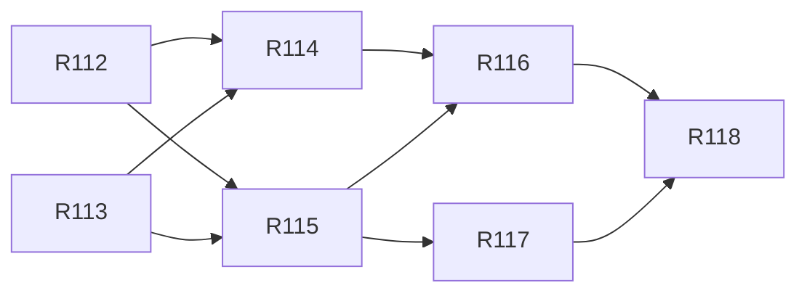

# v2.4 — TASKS.md sections

Cut from `TASKS.md` by `scripts/sdd/split.ts` (FR-SDD-3); ids resolve through `docs/sdd/ids.md`.

## v2.4 tasks

Draft, cut 2026-10-23 from `SPEC.md` v2.4 and `PLAN.md` v0.11, for review. Spec Phase 2l, "the stars": a `#stars` page that draws the bright stars, the 88 figures and the five planets in the window, with a hand camera on a desk and one tap to the sky screen on a phone (FR-STAR-1..12). This is the first cut, the spike alone, because its findings fix the catalogue's budget, the render path, the figure source and the glyph sizes before anything else is cut (V24-8, FR-STAR-12). The catalogue and positions, the scene and camera, the page, the screen's stars inventory and the release preparation are appended from R112 by the second cut (PLAN v0.12). No tag or deploy ends this phase (V24-11). *Second cut, 2026-10-23, from `SPEC.md` v2.4.1 and `PLAN.md` v0.12:* R112–R118 below — the catalogue and positions, the scene and camera, the star field in the look the owner chose beside Sky Guide (V24-13..V24-16), the page with its way in and its list, the names, the screen's stars inventory, and the capture set with the release preparation (`docs/RELEASE.md` §16, `2.4.0`, no tag). Every task is `Gate: auto` (V24-21, PLAN D-760); the owner's reading of the captures and the phone check are v2.5's release preparation. Deadline: all merged by 2026-10-24 22:00 −03.

Delivery is PLAN §16 unchanged, cut by §16.21: one task, `interactive`, which the driver lists and never runs. The second cut is §16.22: four waves, `Model:` `fable` for R113, R114 and R116 and `opus` for the rest, every task with `Review: opus`, `Turns: 500`, `Fallback: off` (PLAN D-761), sized to the account's five-hour limit with one stop and one CI rerun per task of margin.

Decision block (§16.2), reserved in PLAN §16.21: **R111 D-744..D-747**. D-740..D-743 are the plan's. Second cut, reserved in PLAN §16.22: **R112 D-763..D-765, R113 D-766..D-769, R114 D-770..D-773, R115 D-774..D-777, R116 D-778..D-781, R117 D-782..D-784, R118 D-785..D-787**. D-748..D-762 are the plan's.

- [x] **R111 — The stars spike: the catalogue's size, the rate with 900 glyphs, the render path, the precession path and the ladder, on a phone**
  - **Lane:** window
  - **Model:** interactive
  - **Gate:** owner
  - **Depends on:** none
  - **Precondition:** `data-src/stars/README.md`
  - **Precondition:** `tests/fixtures/stars/README.md`
  - **Reads:** SPEC §4.46 whole (FR-STAR-1..12), US-38, US-39, §9 Phase 2l, §12 V24-1..V24-12, OQ-39..OQ-42; PLAN §2.39 (D-740..D-743), §8.10, §8.17, §16.21, D-62; `docs/window/FINDINGS.md`; `spike/window/sensors.ts`, `params.ts` and `https.config.ts`; `src/ui/components/guide/skychart/window/projection.ts` and `SkyWindow.tsx`; `data-src/stars/README.md`; `tests/fixtures/stars/README.md`.
  - **Goal:** The owner reads, on a phone, whether 900 stars drawn as characters hold 30 updates/s, and which render path and glyph sizes the page is built on, with the catalogue's real size behind its budget.
  - **Satisfies:** FR-STAR-12; resolves OQ-39; sets `STARS_BUDGET_KB`, the render path FR-STAR-9 names, and the ladder's two sizes and collision distance for FR-STAR-6.
  - **Scope (PLAN §8.17, D-740, D-741):**
    - `spike/stars/` — `index.html`, `main.tsx` and `params.ts`: one window-shaped field with every knob a URL parameter (`render`, `mark`, `layers`, `mag`, `big`, `small`, `collide`, `source`, `facing`, `tilt`, `fov`, `at`, `site` or `lat`/`lon`), the projection imported from `src/`, the sensor and the rate meter from `spike/window/sensors.ts`, the positions from `astronomy-engine`'s `Rotation_EQJ_HOR`.
    - `catalog.ts` (counts, the worst snap distance, sizes raw and gzipped as objects and as columns, output under `.sdd-cache/spike-stars/`), `perf.ts` (D-62's method for the four `render` × `mark` combinations), `precession.ts` (the worst separation per fixture site), `capture.ts` (Crux over Neuquén and Orion over Paris at 390 × 844 and 1280 × 800, the default ladder and two alternatives on each side, into `docs/stars/captures/`).
    - `package.json`: `spike:stars` (the window spike's HTTPS server, the page at `/spike/stars/`) and `spike:stars:measure` (the four scripts).
    - `docs/stars/FINDINGS.md`: the five answers of PLAN D-741, each with a number or a capture behind it, and the owner's picks.
  - **Touches outside the lane:** `package.json` (two scripts).
  - **Out of scope:** any file under `src/`; any test in `npm test`; the catalogue build step and `catalog.json` (the second cut's first task).
  - **Done when:**
    - `docs/stars/FINDINGS.md` exists on `main` with OQ-39's source, `STARS_BUDGET_KB` and the encoding, the render path with the phone's and the proxy's rates for all four combinations, the precession path's worst error, and the two sizes and the collision distance the owner picked, each backed by a number or a capture.
    - The owner has held the phone up to the sky with the spike open and seen Crux or the Plough where another app puts it.
  - **How it runs:** the owner opens a session in this checkout and drives the spike with the phone on the local network (`npm run spike:stars`, then `https://<this machine's LAN address>:5173/spike/stars/`). The driver lists the task and never runs it.
  - **Done (2026-10-23, D-744..D-747):** `docs/stars/FINDINGS.md` answers all five. d3-celestial's figures snap within 0.0025°; 1035 stars, 21.1 KB gzipped as columns, under a 40 KB `STARS_BUDGET_KB` that stays; the ref path (React 19 at 4× falls to 19 draws/s, ref holds ~100; the owner's iPhone draws 61/s on both, the sensor's own rate), so V24-9 holds; precession worst 0.0064°; the owner picked 15/12, 0.5, `.` and the ink shift, which the spec did not foresee (`.` draws ~2 px low in the em box) and FR-STAR-6 is amended for. Crux and Canopus checked against Sky Guide at Neuquén. The phone's disc rows were not read (the sensor caps both glyph rows), the Android row and the declination are open lines. The owner also picked four looks from Sky Guide for v0.12 to cut: faint figure lines, spaced-capital figure names, the ground with N/E/S/W, and stronger brightness steps.

### Wave 1 (second cut)

- [x] **R112 — The catalogue and the positions: `build-stars.ts`, `catalog.json` in columns, the figure-name table, `skyStars.ts`, the two tests**
  - **Lane:** data
  - **Model:** opus
  - **Review:** opus
  - **Turns:** 500
  - **Fallback:** off
  - **Gate:** auto
  - **Depends on:** none
  - **Reads:** SPEC §4.46 (the rest of it in the file, as needed), §9 Phase 2l, V24-21; PLAN §8.18, §16.22; `docs/stars/FINDINGS.md`; `data-src/stars/README.md`; `tests/fixtures/stars/README.md` and one fixture with its `.meta.json`; `spike/stars/catalog.ts` and `precession.ts` (the spike's build and rotation, to port, not import); `src/lib/skyBodies.ts` and its test; `eslint.config.js`'s main-thread boundary; `scripts/third-party-notices.ts`; PLAN D-743, D-748, D-749. SPEC V24-20; PLAN D-745.
  - **Goal:** the app has the stars as data and knows where each one is at any instant, held to the published ephemeris; nothing on screen changes yet.
  - **Satisfies:** FR-STAR-1, FR-STAR-2, FR-STAR-10 (the names as data); US-38 AC3.
  - **Scope (PLAN D-748, D-749):**
    - `scripts/build-stars.ts` and `npm run build:stars`: from `data-src/stars/`, every star at V ≤ `STAR_MAG_LIMIT` and every fainter figure endpoint, the figures snapped to the nearest star, written as columns to `src/data/stars/catalog.json` sorted by magnitude; prints the counts and the gzipped size. The output is committed.
    - `src/data/stars/catalog.ts` (the `zod` reader, typed arrays) and `src/data/stars/constellations.ts` (the 88 Latin names by abbreviation, Serpens as Caput and Cauda).
    - `src/lib/skyStars.ts`: `starsAt(catalog, observer, t)` — one `Rotation_EQJ_HOR` per instant over every star, the five planets with `Illumination().mag`, one memo slot on `(t, lat, lon)`; the lint boundary's second exception.
    - `tests/data/starCatalog.test.ts` (the counts, ids, names, the table complete, ≤ 22 KB gzipped, the build re-run equal to the committed file) and `src/lib/skyStars.test.ts` (the three fixtures within `STAR_TOLERANCE_DEG`, the memo).
    - `scripts/third-party-notices.ts`'s fixed data block and `public/third-party-notices.txt` regenerated.
  - **Touches outside the lane:** `eslint.config.js` (one ignore), `package.json` (one script), `scripts/third-party-notices.ts`.
  - **Out of scope:** any file under `src/ui/`; the `stars` budget row (R115); importing `skyStars.ts` from anything but its test.
  - **Done when:**
    - `npx vitest run tests/data/starCatalog.test.ts src/lib/skyStars.test.ts` passes; the Done note carries the printed counts, the gzipped size and the worst separation per site.
    - `npm test`, lint, typecheck, `npx vitest run tests/docs` and `npm run e2e` green; `npm run bundle:budget` shows no row moved.

- [x] **R113 — The scene, the camera and the rotation channel: `SkyScene`, `SkyCamera` with the hand source, `useViewRotation` publishing to state and to subscribers**
  - **Lane:** window
  - **Model:** fable
  - **Review:** opus
  - **Turns:** 500
  - **Fallback:** off
  - **Gate:** auto
  - **Depends on:** none
  - **Reads:** SPEC §4.46 (the rest of it in the file, as needed), §9 Phase 2l, V24-21; PLAN §8.18, §16.22; `docs/stars/FINDINGS.md`; SPEC FR-WIN-1..5, FR-FOL-4, FR-FOL-5; `skychart/window/SkyWindow.tsx`, `projection.ts`, `useDeviceOrientation.ts` and their tests; `skychart/SkyChart.types.ts`; `skychart/dome/camera.ts`; PLAN D-750, D-751, D-278. SPEC V24-19; PLAN D-744.
  - **Goal:** the window can be driven by a hand as well as the sensor, through one rotation, and can feed a node set outside React, while every window the app shows today draws exactly as before.
  - **Satisfies:** FR-STAR-11, FR-STAR-4 (the camera and its constants; the page's wiring is R115), FR-STAR-9 (the channel).
  - **Scope (PLAN D-750, D-751):**
    - `skychart/window/scene.ts` (`SkyScene`, `StarField`'s data type) and `SkyChartProps`' `scene`, `namedStar`, `onNameStar` in `skychart/SkyChart.types.ts`.
    - `skychart/window/camera.ts`: `SkyCamera`, the hand reducers (`dragTo`, `stepYaw`, `stepPitch`, `face`, `up`) at `DRAG_PX_PER_DEG`, `YAW_STEP_DEG`, `PITCH_STEP_DEG` imported from `dome/camera.ts`, the tilt clamped to `STARS_TILT_MIN_DEG`..`STARS_TILT_MAX_DEG`, `STARS_DEFAULT_FACING` and `STARS_DEFAULT_TILT`; `camera.test.ts`.
    - `useViewRotation(camera)`: the `Mat3` for either source, published in one frame to React state and to subscribers; `SkyWindow` takes `camera?` and, with a hand camera, handles the pointer drag (captured, one update per frame) and the arrow keys while the box has focus.
    - `SkyWindow` renders an empty `StarField` group only when `scene.stars` is present; its subscriber test proves one write per published rotation and no re-render of the group.
  - **Touches outside the lane:** `skychart/SkyChart.types.ts`.
  - **Out of scope:** any star, figure or label drawn (R114, R116); the page; the sensor path's maths; the live page's and the pass detail's callers.
  - **Done when:**
    - `camera.test.ts` and the window's tests pass; a test drives the hand camera by drag and keys and reads the rotation `uprightRotation` gives.
    - A local `npx playwright test v1-captures` leaves every committed window file byte-identical (F-99's sub-pixel files excepted, named), and `tests/e2e/sky-window.spec.ts` is green.
    - `npm test`, lint, typecheck, `npx vitest run tests/docs` and `npm run e2e` green.
  - **Done (2026-10-24, D-766..D-769):** as written, with the hand camera a store (`createHandCamera`) rather than React state and `camera?` on `SkyWindowProps` rather than `SkyChartProps` (D-766); the channel publishes in the layout effect of the commit that draws the rotation, not in the frame that set it (D-767); `useDeviceOrientation` gains an `enabled` flag so the hand never arms the sensor (D-768). The committed set is not reproducible on the Mac (every one of the 254 files differs from CI's bytes by font rendering, as R94/R100 found), so the byte-identity was read against a same-machine baseline: the parent (`origin/main`) built and shot with the same spec and browser, then this branch — all 37 window files pixel-identical, by name: `v1-window-844-{dark,night}-{en,es}`, `v1-sky-screen-{sky,ground,buried,chip}-844-{dark,night}-{en,es}`, `v1-sky-screen-portrait-{360,390}-{dark,night}-{en,es}`, `v1-sky-screen-turned-{360,390}-dark-en`, `r66-window-390-denied-dark-en`, `r66-window-844-{dark,night}-{en,es}`, `r66-window-844-horizon-dark-en`, `r47-detail-1280-no-window-dark-en`; no F-99 file was among them. `projectDevice`, the parent's one dead export, is un-exported (D-769).

### Wave 2 (second cut)

- [x] **R114 — The star field: the ladder, the ink offsets, the collision and hit test, the hairlines with their gap and clip, the ground, written by ref** *(done 2026-10-24: the ink offsets probe is the browser project's `inkOffsets.integration.test.ts` rather than an e2e spec, D-771; `groundClipPath`, `HORIZON` and `ring` moved to `projection.ts`, D-773)*
  - **Lane:** window
  - **Model:** fable
  - **Review:** opus
  - **Turns:** 500
  - **Fallback:** off
  - **Gate:** auto
  - **Depends on:** R112, R113
  - **Reads:** SPEC §4.46 (the rest of it in the file, as needed), §9 Phase 2l, V24-21; PLAN §8.18, §16.22; `docs/stars/FINDINGS.md`; SPEC FR-DS-8 as amended, FR-THEME-2, FR-THEME-3, FR-FOL-5, FR-WIN-2; `src/ui/styles/tokens.css` whole; `scripts/contrast.ts`; `tests/styles/tokens.test.ts`; `scripts/design-guide.ts`; `spike/stars/Field.tsx` (`RefField`) and `spike/stars/stars.css`; `skychart/window/SkyWindow.tsx`; PLAN D-746, D-752, D-753, D-754. SPEC V24-13, V24-14, V24-15; PLAN D-744.
  - **Goal:** a window given a star scene draws the stars, the planets and the figures in the look the owner chose — three sizes, three tones, each glyph's ink on its point, hairlines that stop short of each star, the ground below the horizon — at the rate the ref path holds.
  - **Satisfies:** FR-STAR-6 as amended (all but the names), FR-DS-8 as amended, FR-STAR-9 (the stable DOM); US-38 AC5.
  - **Scope (PLAN D-752..D-754):**
    - `skychart/window/starGlyphs.ts` (`rungFor`, the planets on the ladder by magnitude, `collide`, `hitTest`) with `starGlyphs.test.ts`, the ladder as a table.
    - `skychart/window/inkOffsets.ts`: measured after `document.fonts.ready`, cached, 0 where the canvas has no metrics.
    - `skychart/window/StarField.tsx` + module: the nodes once, the writes per published rotation, the gap and the horizon clip, the ground path; `SkyWindow.stars.test.tsx`.
    - The four tokens in `tokens.css` with their night values, `scripts/contrast.ts`'s lists, the tokens test's two new rows and the "below `--chart-star-dim`" check, `docs/DESIGN.md` regenerated.
  - **Touches outside the lane:** `src/ui/styles/tokens.css`, `scripts/contrast.ts`, `tests/styles/tokens.test.ts`, `docs/DESIGN.md`.
  - **Out of scope:** the names and the tap label (R116); the page; any change to the window without a scene.
  - **Done when:**
    - `starGlyphs.test.ts`, `SkyWindow.stars.test.tsx` and `npx vitest run tests/styles tests/docs` pass; `literals.test.ts` green with no new allow-list entry.
    - The Done note carries the ink offsets measured in Chromium (an e2e probe of `inkOffsets.ts` on any page) and the window row's size; the field's captures are R115's and R116's, once the page exists.
    - `npm test`, lint, typecheck and `npm run e2e` green; the committed window captures unchanged.

- [x] **R115 — The `#stars` page: route, chunk and budget row, both layouts, the hand camera, the picker, the layers, `In this field`, the way in, every string**
  - **Lane:** ui
  - **Model:** opus
  - **Review:** opus
  - **Turns:** 500
  - **Fallback:** off
  - **Gate:** auto
  - **Depends on:** R112, R113
  - **Reads:** SPEC §4.46 (the rest of it in the file, as needed), §9 Phase 2l, V24-21; PLAN §8.18, §16.22; `docs/stars/FINDINGS.md`; SPEC FR-LIVE-1, FR-LIVE-7, FR-COMP-1, FR-COMP-4, FR-COMP-5, FR-DESK-1, FR-DESK-4, FR-A11Y-1..3, FR-LEG-4, FR-GUIDE-7, FR-OFF-1, FR-I18N-1; `screens/Settings.tsx`, `SettingsRoute.tsx`, `settingsChunk.ts` (the lazy pattern); `lib/shareLinks.ts`, `lib/routeTitle.ts`, `lib/shortcuts.ts`, `ui/navigation.ts`, `common/Header.tsx`; `tests/styles/controlRows.test.ts`; `scripts/bundle-budget.ts`; PLAN D-756, D-759. SPEC V24-16, V24-20.
  - **Goal:** a reader opens `#stars` from the header, the When pane or `s`, turns the sky by hand on a desk or a phone, toggles the layers and reads what is in the field from the list, in both languages, offline as online.
  - **Satisfies:** FR-STAR-3 as amended (`[x] names` on), FR-STAR-4 (the page's wiring), FR-STAR-7 (the list), FR-STAR-8, FR-STAR-9 (the chunk and its row), FR-STAR-10; US-39 AC1–AC4, US-38 AC7.
  - **Scope (PLAN D-756, D-759):**
    - `screens/Stars.tsx` + module, `StarsRoute.ts`, `starsChunk.ts`; `STARS_HASH` / `isStarsRoute`, the `RouteName`, the title row; the wide box and rail, the compact rows, the inert state; the scene built from `catalog.ts` and `starsAt` at the ticking instant; the hand camera from `STARS_DEFAULT_FACING` and `STARS_DEFAULT_TILT`; the facing picker and the layers.
    - `screens/stars/FieldList.tsx`: the `FIELD_LIST_MAX` brightest drawn objects, rows setting `namedStar`, FR-FOL-5's note when the field is all ground.
    - The way in: `[ stars ]` in the header's links on wide, the When pane's "Stars tonight · [ look up ]" on compact, `s` and the `?` line.
    - One `stars` section in both catalogs with every string the page, the list and the window's star label and readout line use (`mag`, the readout's form), so R116 adds none.
    - `scripts/bundle-budget.ts`'s `stars` row at 40 and, if Rollup splits `astronomy-engine` out, the `astronomy` row matching both files; `tests/e2e/stars.spec.ts` (route, link, `s`, picker, layers, list, both languages, the offline reload with a saved observer).
  - **Touches outside the lane:** `scripts/bundle-budget.ts`.
  - **Out of scope:** `src/ui/styles/tokens.css` (R114's in this wave: the page uses tokens already in the sheet); any file under `skychart/window/`; the screen and `[ hold up to the sky ]` (R117).
  - **Done when:**
    - `tests/e2e/stars.spec.ts` and `controlRows.test.ts` (the compact rows in 36 cells, both languages) pass.
    - `npm run bundle:budget`: `stars` present and under 40, main ≤ 1 KB over `6cfa699`, no other row's total moved; the Done note carries the numbers.
    - `npm test`, lint, typecheck, `npx vitest run tests/docs tests/styles` and `npm run e2e` green; captures of the page at 390 and 1280 in both themes and languages under `docs/screenshots/r115/`.
  - **Done (2026-10-24, D-774..D-777):** the budget, gzipped, against `6cfa699` built on the same machine: main 168.5 → 169.4 KB (+923 bytes); `stars` 24.4 of 40; `astronomy` 22.1 → 22.6 (Rollup split the library into `astronomy-*.js` 21.9 beside `skyBodies-*.js` 0.7; the row matches both and holds their total — the 0.5 is the functions `skyStars.ts` calls that `skyBodies.ts` does not); `window` 12.8 → 14.4 (13.9 on R113's merge; the 0.5 since is R113's hand camera, tree-shaken until a page created one, and the exports the `stars` chunk imports), under 15; `chart`, `live`, `settings`, `worker` and the service worker unmoved. Three differences from the text: the page's own words are a `starsPage` section the `stars` chunk carries (`i18n/{en,es}/starsPage.ts`, `useStarsPageT`), the `stars` section in the main catalogs keeping only what main draws — one section in both catalogs put main at +1.3 KB (D-777); the wide header's live link takes its short word under the title's fold, which `[ stars ]` moved to 1079 and 1233 px (D-774); and the layers are two rows of two on every width, since one row of four `[x]` toggles is 43 cells in English (D-776). `In this field`'s FR-FOL-5 note is wired, but the hand's −10° cannot bury a wide field (it takes −30°), so only the screen reaches it.

### Wave 3 (second cut)

- [x] **R116 — The names and the tap: the placement, spaced figure names, the tap and hover label, the readout's second line, the rate**
  - **Lane:** window
  - **Model:** fable
  - **Review:** opus
  - **Turns:** 500
  - **Fallback:** off
  - **Gate:** auto
  - **Depends on:** R114, R115
  - **Reads:** SPEC §4.46 (the rest of it in the file, as needed), §9 Phase 2l, V24-21; PLAN §8.18, §16.22; `docs/stars/FINDINGS.md`; SPEC FR-DOME-3, FR-WIN-2; `skychart/window/StarField.tsx`, `starGlyphs.ts`, `SkyWindow.tsx`; the `stars` catalog section; `tests/e2e/dome-perf.spec.ts`; `docs/stars/captures/` (the `Ori` and `Betelgeuse` case); PLAN D-62, D-755. SPEC V24-16; PLAN D-744, D-747.
  - **Goal:** the bright stars and every drawn figure are named without covering a mark, a line or each other, a figure never loses its name to a star's, a tap or a hover names a star or a planet, and the page holds 30 updates/s with every layer on.
  - **Satisfies:** FR-STAR-6 as amended (the names), FR-STAR-7 (the tap, the hover, the readout's second line, `STAR_LABEL_HOLD_S`), FR-STAR-9 (the rate); US-38 AC4, AC6; US-39 AC2.
  - **Scope (PLAN D-755):**
    - `skychart/window/starLabels.ts` with `starLabels.test.ts`: the order, the four places, the spaced capitals and the fit rule, the figure keeping its name; Orion over Paris and Crux over Neuquén as table cases.
    - `StarField`: the name nodes written by ref, placement rerun only past `converged()`; the named mark's label from the tap, the hover on a desk, or `namedStar`, cleared by a second tap, a tap elsewhere or `STAR_LABEL_HOLD_S`; the readout's second line.
    - `tests/e2e/stars-perf.spec.ts`: ≥ 30 updates/s at 4× under a drag with every layer on, `dome-perf.spec.ts`'s method.
  - **Touches outside the lane:** `tests/e2e/stars-perf.spec.ts`.
  - **Out of scope:** new strings (R115 added them); a tap on a figure's line (FR-STAR-14, v2.5); the screen.
  - **Done when:**
    - `starLabels.test.ts` and `stars-perf.spec.ts` pass; the Done note carries the rate.
    - Captures under `docs/screenshots/r116/`: Crux over Neuquén and Orion over Paris at 390 and 1280, both themes, with `O R I O N` and `Betelgeuse` both placed and no label on a mark or a line.
    - `npm test`, lint, typecheck, `npx vitest run tests/docs` and `npm run e2e` green.
  - **Done (2026-10-24, D-778..D-781; V24-22..V24-24):** `stars-perf.spec.ts` draws **52.2 updates/s** at 4× under a 5 s drag, every layer on, Neuquén facing south, 390 px (51.6 on a second run; gate 30). The owner's decisions after the blocked run: a figure's name searches a grid over its drawn extent before a star name yields (V24-22, FR-STAR-6 and D-755 amended); the Done line is read with `Betelgeuse` required placed at 1280 only — at 390 the rule drops it and a tap names it (V24-23); the `window` row (21.8 KB against 15) is re-set by R118 from the measured build (V24-24, D-759 amended). `starLabels.test.ts` pins Orion over Paris (`O R I O N` at 390 and 1280, `Betelgeuse` at 1280, not at 390) and Crux over Neuquén (`C R U` at both, the cross being narrower than the full name; `C R U X` in a 900 × 640 box), and no label on a mark, a line or another label. Captures: `docs/screenshots/r116/r116-{orion-paris,crux-neuquen}-{390,1280}-{dark,night}.png` (`tests/e2e/r116-captures.spec.ts`, `CAPTURES=1`). `main` 169.7 KB, `stars` 23.6 of 40.

- [x] **R117 — The screen's stars inventory: `[ hold up to the sky ]`, `inventory: 'stars'`, the true-north line**
  - **Lane:** ui
  - **Model:** opus
  - **Review:** opus
  - **Turns:** 500
  - **Fallback:** off
  - **Gate:** auto
  - **Depends on:** R115
  - **Reads:** SPEC §4.46 (the rest of it in the file, as needed), §9 Phase 2l, V24-21; PLAN §8.18, §16.22; `docs/stars/FINDINGS.md`; SPEC §4.23 (FR-FSC-1..10), FR-WIN-3, FR-WIN-4, FR-LIVE-8, FR-FOL-2; `components/screen/SkyScreen.tsx`, `useSkyScreen.ts` and their tests; `screens/Stars.tsx`; `tests/e2e/sky-screen.spec.ts` and its orientation stub; PLAN D-756, D-757. SPEC V24-20.
  - **Goal:** on a phone, one tap on the stars page asks for the sensor and opens the sky screen showing the stars, with the turn, the notes and the exit the screen already has.
  - **Satisfies:** FR-STAR-5; FR-FSC-1 as amended; US-38 AC1, AC2.
  - **Scope (PLAN D-756, D-757):**
    - `SkyScreen`'s `inventory: 'passes' | 'stars'`: the window with the page's scene and layers, the `×`, the readout, the gutter's band and bracket; no pass, no tick, no chip, no list.
    - `useSkyScreen.open()` taking the scene; the page's `[ hold up to the sky ]` row where FR-WIN-4's presence test passes, a denial or a relative-only reading leaving FR-LIVE-8's note beside it.
    - `tests/e2e/stars-screen.spec.ts` with a mocked orientation: open, turn, the ground notes, `×` and `Esc`, the readout's true-north line.
  - **Touches outside the lane:** none.
  - **Out of scope:** any file under `skychart/window/` (the window already draws no tick and no chip without a pass); the names.
  - **Done when:**
    - `stars-screen.spec.ts` and the screen's unit tests pass; the Done note names the specs.
    - `npm test`, lint, typecheck, `npx vitest run tests/docs` and `npm run e2e` green; the screen at 844 × 390 in both themes under `docs/screenshots/r117/`.
  - **Done 2026-10-24:** specs `tests/e2e/stars-screen.spec.ts` (six tests: the open with the true-north line and no pass; the turn round the horizon and past the zenith with the ground and buried notes; `×` and `Esc`; the denial note; the locked phone's layer turn; no control on a desk) and `src/ui/components/screen/SkyScreen.stars.test.tsx` (twelve). Differs from the text in two places (D-782, D-783): `open()` keeps its signature and the scene is `SkyScreen`'s prop, so the screen ticks with the page; and the window does draw its empty-sky chip, the next-event block upright and the legend's body lines on a screen with no pass, so `SkyChartProps` carries `inventory: 'stars'` and the chart and the window skip them. Captures under `docs/screenshots/r117/` (844 × 390 both themes and languages, the compact page's row at 390).

### Wave 4 (second cut)

- [x] **R118 — The capture set and the release preparation: the stars files, the diff against `6cfa699`, `2.4.0`, `docs/RELEASE.md` §16, no tag**
  - **Lane:** docs
  - **Model:** opus
  - **Review:** opus
  - **Turns:** 500
  - **Fallback:** off
  - **Gate:** auto
  - **Depends on:** R116, R117
  - **Reads:** SPEC §4.46 (the rest of it in the file, as needed), §9 Phase 2l, V24-21; PLAN §8.18, §16.22; `docs/stars/FINDINGS.md`; SPEC V24-11, FR-CAP-1, FR-CAP-5, FR-SHOW-9, FR-PUB-2; `docs/RELEASE.md` §15; `tests/e2e/captureSet.ts`, `tests/e2e/v1-captures.spec.ts`, `.github/workflows/captures.yml`; `scripts/bundle-budget.ts`; `tests/docs/accuracy.test.ts`; PLAN D-178, D-739, D-742, D-758, D-759. SPEC V24-17, V24-18.
  - **Goal:** the phase's definition of done is written down and checked: the release set holds the stars, nothing else moved, the budgets are re-set, and `main` reads 2.4.0 with no tag.
  - **Satisfies:** §9 Phase 2l's release item as amended; US-38 and US-39 accepted but the owner's phone check, which is v2.5's (V24-21).
  - **Scope (PLAN D-758, D-759):**
    - `captureSet.ts` and `v1-captures.spec.ts`: the page at 390, 1280 and 1920 and the screen at 844 × 390, both themes, on the set's clock; `captures.yml` run against `6cfa699`, only `v1-stars-*` files new and none changed.
    - `docs/RELEASE.md` §16: the diff list, the two runs, the budget table beside `6cfa699`'s, `stars` re-set by D-178's rule, the owner's v2.5 items (the stars captures read, the phone held up); no tag and no `release` push (V24-11).
    - `package.json` and the lock's top lines `2.4.0`; `README.md`'s screens and the reading order naming the stars, checked by `tests/docs`.
  - **Touches outside the lane:** `tests/e2e/captureSet.ts`, `tests/e2e/v1-captures.spec.ts`, `docs/screenshots/v1-stars-*`, `package.json`, `scripts/bundle-budget.ts`.
  - **Out of scope:** any change under `src/`; the tag and the deploy (v2.5's).
  - **Done when:**
    - `npx vitest run tests/docs` passes; `npm test`, lint, typecheck and `npm run e2e` green.
    - The Done note carries the `captures.yml` run ids, the diff list and the release SHA to tag at v2.5 (the squash merge, read from `main`).
  - **Done (2026-10-24, D-785..D-787):** the set is **274 files**: `v1-stars-{360,390,1280,1920}` (16; 360 is FR-CAP-2's column, D-786) and `v1-stars-screen-844` (4), both themes and both languages, two local runs byte-identical. **The diff against `6cfa699`**, both commits shot on one Mac by this branch's spec off plain builds (D-787): 155 of 254 byte-identical, 99 differ, all on four lists — the header's `[ stars ]` (48: `home-{1024,1280,1920}` and `-view`, `guide-{1024,1280}`, `favourites`/`location`/`polar`/`settings-1280`), the When pane's `Stars tonight · [ look up ]` (24: `home-{360,390,768}` and `-view`), the `?` overlay's `s` and the page's two keys (12: `shortcuts-*`), F-99's noise (15, ≤ 6 px at Δ ≤ 2); every `live-*`, `window` and `sky-screen-*` file identical. So "none changed" is read as "nothing but what FR-STAR-3 and FR-DESK-4 moved". The shortcuts route had failed since R115 (it counted 8 keys; 11 now). **`captures.yml` runs** (Linux, D-732, dispatched on the branch at `c1a7838`): **40106274669**, green, 274 files — its artefact is the committed set (the 20 `v1-stars-*` files replace the Mac's; against `6cfa699` it differs in the 84 phase files and 15 F-99 files); **40106522515**, same commit, agrees on 253 of 274 and all four design captures, the 21 others sub-pixel (≤ 18 px). **Budget** (gzip, beside `6cfa699` on the same machine): main 169.8 (+1,270 bytes, 0.24 KB past FR-STAR-9's 1 KB: the When pane's line, the `?` overlay's three rows and R117's stars inventory in `SkyScreen.tsx`, all drawn by main before the `stars` chunk loads, so no cheap lazy import trims it; recorded, §16.2 and §16.4), `stars` 23.6 → budget 30 (was 40), `window` 22.1 → budget 25 (was 15; the reason beside the row), astronomy 22.6 (+0.5), the rest unmoved. `package.json` and the lock read 2.4.0; the README's first screen and the reading order name the stars (`tests/docs/public.test.ts`). **The release SHA** is the squash merge of this PR on `main` — unknowable on the branch — so read it from the merge: v2.5 tags that commit as `v2.4.0`'s reference (D-742), and §16.5 says where to read it. No tag, no `release` push.

### Requirement coverage (v2.4, second cut)

| Requirement | Task |
|---|---|
| FR-STAR-1, FR-STAR-2 | R112 |
| FR-STAR-3, FR-STAR-8, FR-STAR-10 | R115 |
| FR-STAR-4 | R113 (the camera), R115 (the page) |
| FR-STAR-5 | R117 |
| FR-STAR-6 as amended, FR-DS-8 as amended | R114 (the field), R116 (the names) |
| FR-STAR-7 | R115 (the list), R116 (the tap, the label, the readout) |
| FR-STAR-9 | R113 (the channel), R114 (the stable DOM), R115 (the chunk), R116 (the rate) |
| FR-STAR-11 | R113 |
| FR-STAR-13, FR-STAR-14 | v2.5 (V24-17, V24-18) |
| US-38, US-39 | accepted at R118 but the phone check (v2.5) |

Waves (for the sanity check): **wave 1** R111 (done) — second cut: **wave 1** R112 (data) + R113 (window) — **wave 2** R114 (window) + R115 (ui) — **wave 3** R116 (window) + R117 (ui) — **wave 4** R118 (docs). No two tasks of a wave name the same file (PLAN §16.22).
