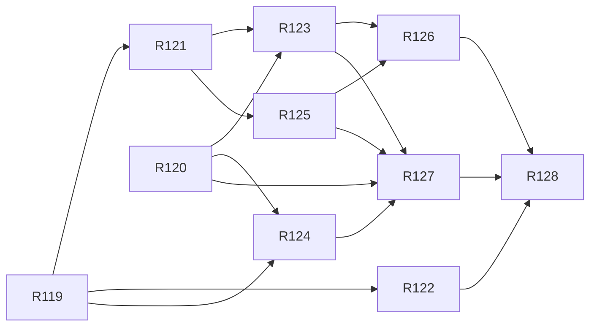

# v2.5 — TASKS.md sections

Cut from `TASKS.md` by `scripts/sdd/split.ts` (FR-SDD-3); ids resolve through `docs/sdd/ids.md`.

## v2.5 tasks

Draft, cut 2026-10-25 from `SPEC.md` v2.5 and `PLAN.md` v0.13, for review. Spec Phase 2m, "one sky": the way the stars are seen becomes the way the satellites are seen — one `SkyScene` for every view through a layer table, the window on every page and device, the stars under the arcs behind `[ stars ]`, the polar chart's stars and the dome's brightest dots, the passes on the stars page and one screen, the pass detail facing the peak, the landmark line and ring, the `Among` column, the facing key that follows a pass, zoom, and the star and constellation names in Spanish (FR-SKY-1..14, FR-STAR-13, FR-STAR-14, V25-1..V25-16). The phase ends in the one release: `2.5.0` on `main` and the tag the owner's (V24-11).

Delivery is PLAN §16 with §16.23: five waves, `Model:` `fable` for R119, R121, R124, R125 and R127 and `opus` for the rest, every task with `Review: opus`, `Turns: 500`, `Fallback: off` and `Gate: auto` (PLAN D-800, D-801). The binding limit is the weekly Fable allowance: the owner reads `/usage` before wave 1, and a task in flight when it runs out is finished with `--task <id> --model opus` (§16.23).

Decision block (§16.2), reserved in PLAN §16.23: **R119 D-802..D-804, R120 D-805..D-807, R121 D-808..D-810, R122 D-811..D-813, R123 D-814..D-816, R124 D-817..D-819, R125 D-820..D-822, R126 D-823..D-825, R127 D-826..D-828, R128 D-829..D-831**. D-788..D-801 and D-832 are the plan's.

### Wave 1

- [x] **R119 — The scene for every view: `useSkyScene`, the layer table, `scene` on the props, the contract test's star case; no visible change**
  - **Lane:** chart
  - **Model:** fable
  - **Review:** opus
  - **Turns:** 500
  - **Fallback:** off
  - **Gate:** auto
  - **Depends on:** none
  - **Reads:** SPEC §4.47 (the rest of it in the file, as needed), §9 Phase 2m, FR-LIVE-10, FR-STAR-11; PLAN §8.19, §9.7, §16.23, D-788, D-799; `skychart/SkyChart.tsx`, `SkyChart.types.ts`, `SkyChart.contract.test.tsx`; `skychart/window/scene.ts`; `src/lib/skyStars.ts`.
  - **Goal:** every drawing of the sky is fed by one scene per tick and a table that says what each view draws, and nothing on screen changes yet.
  - **Satisfies:** FR-SKY-1, FR-LIVE-10 as amended; US-41 AC3.
  - **Scope (PLAN D-788):**
    - `skychart/useSkyScene.ts`: one hook per page building `SkyScene` from the observer, the shown instant and the prefs, memoised per tick.
    - `skychart/layers.ts`: the pure table `Record<View, readonly Layer[]>` with `POLAR_STAR_MAG` and `DOME_STAR_MAG`; `layers.test.ts` (every view names every layer, the caps).
    - `SkyChartProps.scene` beside `passes`; the three views read their layers from the table and draw nothing new.
    - The contract test's star case: one star and one planet at a known alt/az at the same anchor in the dome, the polar chart and the window, within each view's tolerance.
  - **Touches outside the lane:** none.
  - **Out of scope:** any star drawn on the pass pages (R122–R124); the toggle and its pref (R123); the window offered everywhere (R121).
  - **Done when:**
    - `npx vitest run src/ui/components/guide/skychart` passes with the star case and `layers.test.ts`.
    - A local capture run leaves the live and pass detail files byte-identical to `ece8bfd` against a same-machine baseline; the Done note names them.
    - `npm test`, lint, typecheck, `npx vitest run tests/docs` and `npm run e2e` green; `npm run bundle:budget` shows no row moved.
  - **Done (2026-10-26):** as written, plus the anchors D-803 records (the polar chart and the dome place one empty anchor per scene star and planet so the star case holds the three views to one anchor; R122 and R124 draw into them). Captures: the live page's and the pass detail's 154 files — `v1-live-watching-*` and `v1-live-scrubbing-*` at the ten widths, `v1-guide-*`, `v1-polar-*`, `v1-window-844-*`, `v1-legend-*` and the `v1-sky-screen-*` set, in both themes and languages — re-shot on this machine against an `ece8bfd` build on the same machine: 146 byte-identical; 8 differ by 1–15 px at a channel delta ≤ 2 (F-99's anti-aliasing noise, FR-CAP-5): `v1-legend-360-{dark,night}-es`, `v1-live-scrubbing-1024-dark-en`, `v1-live-scrubbing-1200-night-es`, `v1-live-watching-1024-{dark-en,night-es}`, `v1-live-watching-1200-night-{en,es}`. No capture is committed. Budget: `main` 169.8 → 170.4 (the table and the polar anchors, +0.6 of FR-SKY-10's ≤ 1 KB; over its 170 line by 0.4, a warning), `chart` 94.2 → 94.5 (+0.3 of ≤ 2 KB), every other row unchanged.

- [x] **R120 — The landmark, the constellation at a point, the twilight steps and the Spanish names, as data and pure functions**
  - **Done 2026-10-26:** as specified, with the readers taking the catalogue first (`starName(catalog, i, lang)`; `src/lib` may not import `src/data`, D-805) and `drawnRungs` living in `skyStars.ts`, re-exported by `landmark.ts`, counting the ladder's five rungs (D-806). Worst fixture separation over the three sites: landmark 0.0056°, `Among` column 0.0062° (tolerance 0.25°). `stars` row 24.6 KB against `ece8bfd`'s 23.6 (24,168 → 25,175 bytes gzipped, the names; ceiling 30, FR-SKY-10's ≤ 1 KB for the names, D-807); `main` 169.8, unchanged.
  - **Lane:** data
  - **Model:** opus
  - **Review:** opus
  - **Turns:** 500
  - **Fallback:** off
  - **Gate:** auto
  - **Depends on:** none
  - **Reads:** SPEC §4.47 (the rest of it in the file, as needed), §9 Phase 2m, FR-STAR-1, FR-STAR-10, FR-STAR-13, FR-STAR-14; PLAN §8.19, §9.7, §16.23, D-795, D-832; `data-src/stars/README.md` and `names-es.tsv`; `scripts/build-stars.ts`; `src/data/stars/catalog.ts`, `constellations.ts`; `src/lib/skyStars.ts` and its test; `tests/data/starCatalog.test.ts`.
  - **Goal:** the app knows which star a pass passes, which figure a point is among, how many rungs the twilight leaves, and every name in both languages; nothing on screen changes yet.
  - **Satisfies:** FR-SKY-11 and FR-SKY-12 (the functions), FR-STAR-13 (the steps), FR-STAR-14 (the hit), FR-STAR-10 as amended (the names as data); US-40 AC8 (the data).
  - **Scope (PLAN D-795, D-832):**
    - `src/lib/landmark.ts`: `landmark`, `constellationAt`, `segmentDistanceDeg`, `drawnRungs` with `LANDMARK_MAG`, `LANDMARK_DEG`, `LANDMARK_LEVEL_DEG`, `AMONG_MAX_DEG`; `landmark.test.ts` against the three sites.
    - `scripts/build-stars.ts` reads `names-es.tsv`; `catalog.json` gains the Spanish star-name column and the constellation table; the build fails on an unknown key, a missing part or a duplicate. The output is committed.
    - `skyStars.ts`: `starName`, `figureName`, `constellationName`, each taking the language — the only readers of a name.
    - `starCatalog.test.ts`: the 88 abbreviations, the 89 parts and the fourteen stars equal to `names-es.tsv`; the build re-run equal to the committed file.
  - **Touches outside the lane:** none.
  - **Out of scope:** any file under `src/ui/`; drawing a name (R126, R127).
  - **Done when:**
    - `npx vitest run tests/data src/lib` passes; the Done note carries the worst fixture separation for the landmark and the column.
    - `npm test`, lint, typecheck, `npx vitest run tests/docs` and `npm run e2e` green; `npm run bundle:budget`'s `stars` row against `ece8bfd` in the Done note, within FR-SKY-10's ceiling.

### Wave 2

- [x] **R121 — The window everywhere: the view offered, the box on wide, the hand camera on the pass pages, the saved view on wide, the pass detail facing the peak**
  - **Done 2026-10-26:** as written, with D-808 (the load guard is the prefs slice's and never rewrites; `facePeak(peak, fovDeg)` takes no state; the guide's box takes the shape as the `--chart-box-aspect` ratio), D-809 (the facing picker in the window lane, its option list from its page, `facingOf` the pressed rule) and D-810's measurements; blocked once on the third option's fit (D-810) and finished on the owner's call, V25-17 / D-834: on the wide live page every view's status slot stands in the box's top-left corner (`ChartFrame`'s `.cornerStatus`, `data-corner-status`) and the row above the box is the control alone, one line at every wide width; on compact the control is `gap="none"` with `inline` options (new on `OptionToggle` and `ToggleGroup`, `TextButton`'s pattern) in a row held at `--tap`, so at 740 × 360 it wraps to two text rows inside 48 px (the box 279 × 236 px watching, over `LIVE_BOX_MIN_PX`). The window's box: live 798 × 498 px at 1280 × 800, 1438 × 809 at 1920 × 1080; pass detail 424 × 265 at 1280 × 800. Captures, re-shot on this machine against a same-machine `7d41477` build: 158 byte-identical, 116 moved, each in both themes and both languages — the view row's third option, a 93 × 16 px box (102 × 16 in Spanish), on compact with no gap between the options (`v1-guide-{360,390,768}-*`, `v1-polar-{360,390}-*`, `v1-legend-{360,390,1280}-*`, `v1-live-watching-{360,390,768,844}-*`, `v1-live-scrubbing-{360,390,768,844}-*`); the same option and the readout moved from the row into the box's corner on every wide live page (`v1-live-watching-{1024,1200,1280,1920,2560,3840}-*`, `v1-live-scrubbing-{1024,1200,1280,1920,2560,3840}-*`); the screen's placeholder on the peak at `facePeak`'s tilt (`v1-window-844-*`, 33° where 26° stood). No capture committed (the set is CI's); R128 re-shoots it. Review captures: `r121-live-{1280,1920}-window-*`, `r121-detail-{1280,390}-window-*`, `r121-live-390-window-*` (`sky-window.spec.ts`), `r121-live-{1280,1200}-dome-dark-en`, `r121-live-1280-polar-dark-en`, `r121-live-1024-dome-dark-es`, `r121-live-740-dome-dark-{en,es}` (`r121-captures.spec.ts`).
  - **Lane:** window
  - **Model:** fable
  - **Review:** opus
  - **Turns:** 500
  - **Fallback:** off
  - **Gate:** auto
  - **Depends on:** R119
  - **Reads:** SPEC §4.47 (the rest of it in the file, as needed), §9 Phase 2m, FR-WIN-4, FR-WIN-5, FR-FSC-6, FR-STAR-4; PLAN §8.19, §9.7, §16.23, D-789, D-790; `skychart/window/camera.ts`, `SkyWindow.tsx`; `skychart/ChartFrame.tsx`; `screens/Live.tsx`, `PassDetail.tsx`, `Stars.tsx`; `model/prefs.ts`, `data/localPrefs.ts`.
  - **Goal:** a desk reader chooses the window on the live page or a pass detail and turns it by hand; the pass detail's window opens already looking at the pass.
  - **Satisfies:** FR-SKY-2, FR-SKY-7, FR-WIN-4, FR-WIN-5 and FR-FSC-6 as amended; US-41 AC1, AC2.
  - **Scope (PLAN D-789, D-790):**
    - `WINDOW_VIEW.available()` true; the presence test answers only whether the screen can follow the phone.
    - `ChartFrame` lays the window out in the box on wide and on compact without a sensor; the hand camera, the keys and the facing picker in the rail as on the stars page.
    - `chartView: 'window'` saved on wide only, a load guard falling back to the dome on compact; `localPrefs.test.ts`.
    - `camera.ts`'s `facePeak`; the pass detail's picker offers `peak`; `camera.test.ts`.
  - **Touches outside the lane:** `skychart/ChartFrame.tsx`, `screens/Live.tsx`, `screens/PassDetail.tsx`, `model/prefs.ts`, `data/localPrefs.ts`.
  - **Out of scope:** stars on the pass pages (R123); zoom (R125); the facing key that follows (R127).
  - **Done when:**
    - `camera.test.ts`, `localPrefs.test.ts` and `sky-window.spec.ts` with the window in the box at 1280 px and at 390 px without a sensor pass.
    - The Done note carries the box's measured size at 1280 and 1920 px and every capture file that moved, by name.
    - `npm test`, lint, typecheck, `npx vitest run tests/docs` and `npm run e2e` green.

- [x] **R122 — The polar chart's stars: the star group, the planets as `@`, the snapshot re-baselined**
  - **Lane:** chart
  - **Model:** opus
  - **Review:** opus
  - **Turns:** 500
  - **Fallback:** off
  - **Gate:** auto
  - **Depends on:** R119
  - **Reads:** SPEC §4.47 (the rest of it in the file, as needed), §9 Phase 2m, FR-STAR-6; PLAN §8.19, §16.23, D-792; `skychart/polar/SkyPolar.tsx` and its tests; `skychart/window/starGlyphs.ts`.
  - **Goal:** the polar chart shows the stars to magnitude 3.5 and the planets under the arcs, from the one scene.
  - **Satisfies:** FR-SKY-4; US-40 AC3 (the polar chart).
  - **Scope (PLAN D-792):**
    - One `<g>` under the arcs in `SkyPolar.tsx` with the ladder scaled by the chart's unit, the planets as `@`, following the looking-up / map toggle.
    - `SkyPolar.live.svg` re-baselined once.
  - **Touches outside the lane:** none.
  - **Out of scope:** the toggle (R123); the landmark ring (R127).
  - **Done when:**
    - The polar tests pass with the new snapshot; the Done note gives its diff in glyph count.
    - `npm test`, lint, typecheck, `npx vitest run tests/docs` and `npm run e2e` green.
  - **Done (2026-10-26):** as written. R119's empty anchors became the glyph `<text>` nodes, each keeping its `data-star` / `data-planet` and `translate`. `SkyPolar.live.svg` re-baselined once with a scene written by hand under the arcs: **+7 glyphs** (2 `*`, 1 `+`, 1 `.`, 3 `@`), +9 lines including the group's open and close, nothing else changed. The glyphs take the window's ink offsets (D-811); the sizes are the chart text tokens in user units (D-812); the group is a lazy chunk on the window's sheet and draw order (D-813). `main` 170.6 → 170.0 KB (−0.6).

### Wave 3

- [x] **R123 — The stars under the arcs: `[ stars ]`, `starsLayer`, the chunk's load and prefetch, the twilight steps in the scene, and every string of the phase**
  - **Lane:** live
  - **Model:** opus
  - **Review:** opus
  - **Turns:** 500
  - **Fallback:** off
  - **Gate:** auto
  - **Depends on:** R120, R121
  - **Reads:** SPEC §4.47 (the rest of it in the file, as needed), §9 Phase 2m, FR-STAR-13, FR-COMP-4; PLAN §8.19, §9.7, §16.23, D-791; `screens/Live.tsx`, `PassDetail.tsx`; `components/live/**`; `skychart/useSkyScene.ts`; `model/prefs.ts`, `state/slices/prefs.ts`, `data/localPrefs.ts`; `src/i18n/`; `tests/styles/controlRows.test.ts`.
  - **Goal:** the live page, the pass detail and the screen show the stars, the figures and the planets under the arcs by default, at the page's instant, thinned by the twilight, behind one remembered toggle.
  - **Satisfies:** FR-SKY-3, FR-SKY-8, FR-SKY-10, FR-STAR-13, FR-STAR-8 as amended; US-40 AC1, AC2.
  - **Scope (PLAN D-791):**
    - `starsLayer` (default true) in the prefs, its schema test; `[ stars ]` / `[ estrellas ]` on the live page's actions row and the pass detail's view row, and on compact on the readout row, within 36 cells.
    - The `stars` chunk loaded with the toggle on and prefetched on idle after the page's chunk.
    - `drawnRungs` applied in `useSkyScene`, so no view changes for the twilight.
    - Every string the phase needs in both languages: the toggle, the landmark line's words, the column's heading, `Following`, `field`.
  - **Touches outside the lane:** `skychart/useSkyScene.ts`, `model/prefs.ts`, `state/slices/prefs.ts`, `data/localPrefs.ts`, `src/i18n/`.
  - **Out of scope:** the landmark drawn (R127); the dome's dots (R124).
  - **Done when:**
    - `localPrefs.test.ts`, `controlRows.test.ts` and `sky-screen.spec.ts` with stars pass; `live-perf.spec.ts` green with the stars on.
    - The Done note carries main, `live` and `stars` against `ece8bfd`.
    - `npm test`, lint, typecheck, `npx vitest run tests/docs` and `npm run e2e` green.
  - **Done (2026-10-26):** as written, except where `[ stars ]` stands on compact: D-791's readout row, built and measured, cost the box a text row and failed FR-COMP-5 (373 px against 374 at 390 × 844 scrubbing, 282 against 304 at 390 × 667) and the guide's equal dome and polar frames, so on compact portrait it is the view row's second text line, `inline` inside the row's one 48 px tap row, and on the landscape phone it ends the readout row (D-814); wide is as written. The twilight step cuts the scene's catalogue through the source, which carries `drawnRungs` and `drawnMagLimit` from the `stars` chunk, the Sun's altitude riding with the positions at the scene's instant (D-815); the stars page keeps its own scene (its file is R125's in this wave), so its twilight step is left to R126. The pass detail evaluates its bodies once and hands them to the chart and the screen; the loader shares `whenIdle` with the settings prefetch (D-816). `live-perf.spec.ts` with the stars on: 42.5 updates/s at 390 px, 37.5 at 1280 px (6× throttle, 3600×), and after the review (the Sun evaluated with the stars at every shown instant) 44.3 and 35.6; it now enters scrubbing for the speeds. Budget against `ece8bfd` (same machine): `main` 169.8 → 171.7 KB (the parent 170.5; +1.2 here; after merging R124 and R125 and the review, 171.8 against the parent's 170.6, the scene hook, the loader, the toggle, the slots and the strings the pass detail pulls into `main` — over FR-SKY-10's ≤ 1 KB for the phase, accepted for the D-178 re-set), `live` 9.6 → 9.8, `stars` 23.6 → 24.1 (the parent 24.0). `shapes.spec.ts`'s `[ see this pass ]` table re-measured (D-814). Review captures: `r123-live-{1280-polar,390-dome}-dark-{en,es}`, `r123-live-844-polar-dark-en`, `r123-detail-1280-polar-dark-{en,es}`, `r123-detail-390-polar-dark-es` (`r123-captures.spec.ts`).

- [x] **R124 — The dome's dots and the rate: the points mesh, the two palette entries, `dome-perf` against `ece8bfd`, the rasters re-baselined**
  - **Lane:** chart
  - **Model:** fable
  - **Review:** opus
  - **Turns:** 500
  - **Fallback:** off
  - **Gate:** auto
  - **Depends on:** R119, R120
  - **Reads:** SPEC §4.47 (the rest of it in the file, as needed), §9 Phase 2m, FR-DOME-7, FR-GUIDE-6; PLAN §8.19, §16.23, D-793, D-62; `skychart/dome/domeLayers.ts`, `palette.ts`; `tests/e2e/dome-perf.spec.ts`.
  - **Goal:** the dome shows the twenty brightest stars and the planets as single dots and drags as fast as it did.
  - **Satisfies:** FR-SKY-5, FR-DOME-2 and FR-DOME-7 as amended; US-40 AC3 (the dome), AC4.
  - **Scope (PLAN D-793):**
    - One points mesh of single braille dots in `domeLayers.ts`, `--chart-star` and `--chart-planet` through `palette.ts`; the Where pane's dome draws none.
    - `dome-perf.spec.ts` against `ece8bfd`'s measure: not below it by more than a tenth and never below 30 updates/s; the rasters re-baselined once.
  - **Touches outside the lane:** `tests/e2e/dome-perf.spec.ts`.
  - **Out of scope:** the landmark ring (R127).
  - **Done when:**
    - `dome-perf.spec.ts` passes; the Done note carries the measured rate beside `ece8bfd`'s at 6× throttling.
    - `npm test`, lint, typecheck, `npx vitest run tests/docs` and `npm run e2e` green.
  - **Done (2026-10-26):** as written. The `stars` mesh sits between the grid and the passes: one two-vertex polygon per body `starsFor` places, at the anchor's place (D-818), dropped with the other empty meshes without a field, so the Where pane's dome is `ece8bfd`'s mesh for mesh. `SkyDome.golden.txt` and `SkyDome.live.txt` re-baselined once with a scene written by hand: **+5 dots** each (2 stars at the cap, 3 planets), 4 of 30 lines changed in both. The rate at 6× throttle, best of three drags (D-817), middle of three runs: `ece8bfd` **59.4/s** at 390 px and 53.1/s at 1280 px; with 20 stars and 5 planets on, **57.2/s** at 390 px (−3.7 %, floor 53.5) and **43.9/s** at 1280 px (−17 %, reported, not gated: D-91). The stars came from a scratch build that hands the dome a field when the page hands none, because R123 wires the page's in the same wave (D-819); on the branch's own page the spec reads 59.4 and 53.7. The desktop's cost is not the hotspots (none), not the colour (about 3/s) and not the degenerate polygon (a real tiny triangle costs the same): a per-polygon cost in glyphcss's frame, left as a follow-up.

- [x] **R125 — Zoom: `fovDeg` on the camera, the pinch, ctrl + wheel, the box's `+`/`-`/`0`, the readout's field, the bracket and the ground from the current field**
  - **Lane:** window
  - **Model:** fable
  - **Review:** opus
  - **Turns:** 500
  - **Fallback:** off
  - **Gate:** auto
  - **Depends on:** R121
  - **Reads:** SPEC §4.47 (the rest of it in the file, as needed), §9 Phase 2m, FR-WIN-1, FR-GUT-3, FR-STAR-4; PLAN §8.19, §9.7, §16.23, D-798; `skychart/window/projection.ts`, `camera.ts`, `SkyWindow.tsx`, `gutter.ts`; `screens/Stars.tsx`; `components/screen/SkyScreen.tsx`.
  - **Goal:** the reader zooms the window wherever it is drawn, by pinch, ctrl + wheel or keys, and the bracket, the ground and the readout follow.
  - **Satisfies:** FR-SKY-14, FR-WIN-1, FR-GUT-3 and FR-STAR-4 as amended; US-41 AC6.
  - **Scope (PLAN D-798):**
    - `HandState.fovDeg` within `WINDOW_FOV_MIN_DEG`..`WINDOW_FOV_MAX_DEG`, `zoomBy` and the reset; every caller of `WINDOW_FOV` passes the camera's.
    - The two-pointer pinch, ctrl + wheel at `ZOOM_WHEEL_RATE`, `+`/`=`/`-` at `ZOOM_KEY_FACTOR` and `0` while the box has focus; a plain wheel scrolls the page; on the screen the pinch under the sensor.
    - `window-zoom.spec.ts`; `camera.test.ts` for `zoomBy`.
  - **Touches outside the lane:** `screens/Stars.tsx`, `components/screen/SkyScreen.tsx`, `tests/e2e/window-zoom.spec.ts`.
  - **Out of scope:** any string (the readout's suffix is R123's); `StarField.tsx`.
  - **Done when:**
    - `window-zoom.spec.ts` and `camera.test.ts` pass; `live-perf.spec.ts` green zoomed to the minimum; the Done note gives the bracket's half-width at 20°, 60° and 90°.
    - `npm test`, lint, typecheck, `npx vitest run tests/docs` and `npm run e2e` green.
  - **Done (2026-10-26, D-820..D-822):** as written, with one reading. **The bracket's half-width** on the 844 × 390 screen (`bracketFor`, `gutter.test.ts`): **21.4° at 20°, 60.2° at 60°, 83.7° at 90°** — 167.5° across at the widest, FR-SKY-14's figure; upright or square it is half the field exactly (10°, 30°, 45°), and the ground is buried that far below the horizon. The field is the hand camera's `fovDeg` and, under the sensor, the window's own state (D-820); `SkyScreen.tsx` needed nothing. The second finger ends the drag and makes the pinch (D-821, superseding R113's "a second pointer is ignored"); the finger left after a pinch does not drag. **The readout's suffix** is drawn from R123's `window.field` through a cast that compiles either side of it (D-822): on this branch the readout is the one line and `data-fov` on the window's root carries the field, which is what `window-zoom.spec.ts` reads; the ` · field 30°` assertion is held optional until R123 lands and is the next window task's to tighten. `live-perf.spec.ts` measures the dome and is skipped without `DOME_PERF`, so it was not touched; the window's drag at `WINDOW_FOV_MIN_DEG` is checked functionally in `window-zoom.spec.ts` (120 px turns 30°, the dome's rate). No string, no pref, nothing in the hash.

### Wave 4

- [x] **R126 — The passes on the stars page and one screen: `[ passes ]`, the pass rows in `In this field`, the gutter from the scene, the list's names in both languages**
  - **Lane:** ui
  - **Model:** opus
  - **Review:** opus
  - **Turns:** 500
  - **Fallback:** off
  - **Gate:** auto
  - **Depends on:** R123, R125
  - **Reads:** SPEC §4.47 (the rest of it in the file, as needed), §9 Phase 2m, FR-FSC-1, FR-GUT-4; PLAN §8.19, §16.23, D-794, D-832; `screens/stars/**`; `components/screen/SkyScreen.tsx`, `useSkyScreen.ts`; `skychart/window/gutter.ts`; `tests/e2e/stars-screen.spec.ts`; `tests/styles/controlRows.test.ts`.
  - **Goal:** the stars page brings tonight's passes onto the sky and the list, and the screen it opens is the live page's screen with the stars on.
  - **Satisfies:** FR-SKY-6, FR-FSC-1 as amended, FR-STAR-10 as amended (the list); US-40 AC5, AC8 (the list).
  - **Scope (PLAN D-794, D-832):**
    - `[ passes ]` / `[ pases ]` on the layer row, off and not saved; the pass rows first in `In this field` (key, name, state).
    - One `SkyScreen`; the gutter's ticks and chip read the scene's passes; `inventory` names only the way back.
    - The list's star names through `starName`; the two longest Spanish rows in `controlRows.test.ts` at 360 px.
  - **Touches outside the lane:** `skychart/window/gutter.ts`, `tests/e2e/stars-screen.spec.ts`.
  - **Out of scope:** the drawn names (R127).
  - **Done when:**
    - `stars-screen.spec.ts` and `controlRows.test.ts` pass; the Done note names the e2e specs.
    - `npm test`, lint, typecheck, `npx vitest run tests/docs` and `npm run e2e` green.
  - **Done (2026-10-26):** as written, except that `gutter.ts` needed no change: the window already draws a tick per pass it is handed, so the one screen is `SkyScreen` handing the chart the stars page's passes and telling it `inventory: 'stars'` only where the scene carries none (D-823). `[ passes ]` is a third layers row of its own, so the two rows of two stay (D-824); the pass rows are the list's four columns, not buttons, the whole sentence as what is read, and they count in the list's twelve (D-825). The set and its window are the live page's, moved to `src/lib/livePasses.ts`, and `[ passes ]` brings nothing to the screen until the run for this place is in (D-824). The constellation names are in no list row yet, so the 360 px check renders the two longest Spanish names as a star's and a pass's row. E2E: `tests/e2e/stars-screen.spec.ts` (`[ passes ] on the stars page`, with the six earlier cases) and `tests/e2e/stars.spec.ts` (the fifth toggle, off, and the third layers row at 390 px); review captures `r126-stars-passes-{390,1280}-dark-{en,es}`, `r126-stars-screen-passes-844-dark-{en,es}` (`r126-captures.spec.ts`). Bundle (after merging main's #203): `stars` 24.9 KB gzipped; `main` 171.5, the parent's warning, the same as `origin/main` built on the same machine.

- [x] **R127 — The landmark on the drawing and the page, the `Among` column, the facing key that follows, the figure tap, every drawn name in both languages**
  - **Lane:** window
  - **Model:** fable
  - **Review:** opus
  - **Turns:** 500
  - **Fallback:** off
  - **Gate:** auto
  - **Depends on:** R120, R123, R124, R125
  - **Reads:** SPEC §4.47 (the rest of it in the file, as needed), §9 Phase 2m, FR-LEG-1, FR-DESK-4, FR-STAR-14; PLAN §8.19, §9.7, §16.23, D-796, D-797, D-832; `skychart/window/scene.ts`, `StarField.tsx`, `camera.ts`; `skychart/layers.ts`, `useSkyScene.ts`; `screens/Live.tsx`, `PassDetail.tsx`; `src/lib/landmark.ts`, `shortcuts.ts`; `tests/e2e/sky-window.spec.ts`.
  - **Goal:** the reader finds a pass by the star beside it: one line under the pass's name, one ring in every view, the constellation at each point, and a facing that keeps the pass in view.
  - **Satisfies:** FR-SKY-11, FR-SKY-12, FR-SKY-13, FR-STAR-14, FR-LEG-1 and FR-DESK-4 as amended; US-40 AC6, AC7, AC8 (the drawing); US-41 AC5.
  - **Scope (PLAN D-796, D-797, D-832):**
    - `SkyScene.landmark`; the ring in the three views and the screen, the name in the window and the screen; the line on the live page, the pass detail and the screen's readout.
    - The pass detail's `Among` / `Entre` column.
    - The picker's pass key and `f`; `followPass` each tick until a drag, an arrow or another facing; the readout's `Following A`.
    - The figure tap; every drawn name, the tap label, the line and the column through D-832's accessors, the spaced capitals by `toLocaleUpperCase`.
  - **Touches outside the lane:** `skychart/layers.ts`, `skychart/useSkyScene.ts`, the ring in `skychart/{polar,dome}/**`, `screens/Live.tsx`, `screens/PassDetail.tsx`, `lib/landmarkLine.ts`, `lib/shortcuts.ts`.
  - **Out of scope:** any string (R123's); the stars page's list (R126).
  - **Done when:**
    - `camera.test.ts` (`followPass`) and `sky-window.spec.ts` (the key and `f`) pass; Spanish captures show `Orión` on the line and in `Entre`; the Done note names the capture files and the follow tests.
    - `npm test`, lint, typecheck, `npx vitest run tests/docs` and `npm run e2e` green.
  - **Done (2026-10-27, D-826..D-828, D-838..D-840):** as written, with three readings. **The landmark is picked at the peak's own instant** (D-826), so a scrub does not move it while the pass stands; the twilight step is the shown instant's. **The follow tests:** `camera.test.ts` › `followPass (FR-SKY-13, D-797)` — `passPosition` before, during and after the pass; the tilt and `follow` on the state; the moves that end it and the zoom that keeps it; `facingOf`'s pressed option; the store's notices — and `sky-window.spec.ts` › `the landmark and the facing key (R127)` › `the live page at 1280, en|es`, which chooses the key after `up`, reads `Following A`, runs the clock through the pass and sees the look move, ends it with a drag, presses `f`, ends it with an arrow. **The captures** (`docs/screenshots/`): `r127-live-1280-window-dark-en.png`, `r127-live-1280-window-dark-es.png` (the window following Tiangong at its peak over Bariloche, the ring on Bellatrix, the line under the headline, `· A` after `arriba`), `r127-detail-390-dark-en.png`, `r127-detail-390-dark-es.png` (the line under the name: `pasa 8° bajo Bellatrix, en Orión` — Bellatrix once the landmark is the peak's instant's, D-826; it was Aldebarán five minutes before), `r127-detail-390-among-dark-en.png`, `r127-detail-390-among-dark-es.png` (the table with `Among` / `Entre`, the peak among `Orión`), `r127-detail-390-polar-dark-en.png`, `r127-detail-390-polar-dark-es.png` (the ring on the polar chart). The figure tap is a negative key and the window names on its own where the page holds no `namedStar` (D-828); the pass detail asks for the stars source whatever the toggle says, for the column (D-826); the one string added is the overlay's description of `f` (`shortcuts.does.follow`), which R123 had not written (D-827). **The budget** (`npm run bundle:budget` on the flag-on build, before the rebase onto D-837 and R126; on the plain build after it `main` is 172.9 KB and `window` 25.4 KB, both `::warning::`): `main` 171.7 → 173.5 KB (the line's formatter, the column, the follow row and the strings, in `main` as the pass detail is; the `::warning::` R123 left stands, for the D-178 re-set at R128), `window` 25.0 KB at its 25 KB row, `stars` 24.8 KB of 30, `live` 9.9 KB of 15, `chart` 94.7 KB of 105; the catalogue and its names stay in `stars`. **The compact box at 390 × 667** (D-838): the line is the headline's fourth text line, so the watching box measures 306 px against D-480's 329 — `live-compact.spec.ts`'s `WATCHING_667` is re-measured to 306 — and 282 with a two-line path (`shapes.spec.ts`'s SL-16 R/B row), under FR-COMP-5's 304: the session stopped on it (`sdd-run/R127.blocked.md`) and the owner restated the floor to 280 (V25-18, D-839; `COMPACT_BOX_MIN_SHORT_PX`). 844 × 501's box pays the same 23 px, 116 px against 140, and `FLOOR_ALLOWANCE` holds it at four and a half rows (D-838). **The short wide rail** (V25-19, D-840): the line took the watching inventory's last row at 1200 × 450 and the Spanish jump row's at 964 × 420, so the headline carries no landmark line where the scrub placement is `overlay`; `sky-window.spec.ts` › `the short wide window: …` holds it, and the line comes back at 1280 × 800.

### Wave 5

- [x] **R128 — The capture set and the release preparation: FR-SKY-9's files, the diff against `ece8bfd`, `2.5.0`, `docs/RELEASE.md` §17, the README's screens, no tag**
  - **Lane:** docs
  - **Model:** opus
  - **Review:** opus
  - **Turns:** 500
  - **Fallback:** off
  - **Gate:** auto
  - **Depends on:** R122, R126, R127
  - **Reads:** SPEC §4.47 (the rest of it in the file, as needed), §9 Phase 2m, V24-11, FR-CAP-1, FR-CAP-5; PLAN §8.19, §16.23, D-178, D-799; `docs/RELEASE.md` §16; `tests/e2e/captureSet.ts`, `v1-captures.spec.ts`, `.github/workflows/captures.yml`; `scripts/bundle-budget.ts`; `tests/docs/accuracy.test.ts`.
  - **Goal:** the phase's definition of done is written down and checked: the set holds one sky, nothing else moved, the budgets are re-set, and `main` reads 2.5.0 ready for the owner's tag.
  - **Satisfies:** FR-SKY-9; §9 Phase 2m's release item; US-40 and US-41 accepted but the owner's phone and desk check.
  - **Scope (PLAN D-799):**
    - `captureSet.ts` and `v1-captures.spec.ts`: the window on the live page and the pass detail at 1280 and 1920 px, the box at 390 px, the screen at 844 × 390 with stars and passes from both pages, the stars page with `[ passes ]`, both themes and languages; `captures.yml` against `ece8bfd`, only FR-SKY-9's files changed.
    - `docs/RELEASE.md` §17: the diff list, the two runs, the budget table re-set by D-178, the owner's items (the captures read, one pass watched through the phone with the stars on, one scrubbed at a desk in the window, the tag on this PR's squash SHA pushed to `release`).
    - `package.json` and the lock `2.5.0`; `README.md`'s screens.
  - **Touches outside the lane:** `tests/e2e/captureSet.ts`, `tests/e2e/v1-captures.spec.ts`, `docs/screenshots/v1-*`, `package.json`, `scripts/bundle-budget.ts`.
  - **Out of scope:** any change under `src/`; the tag and the deploy (the owner's).
  - **Done when:**
    - `npx vitest run tests/docs` passes; `npm test`, lint, typecheck and `npm run e2e` green.
    - The Done note carries the `captures.yml` run ids, the diff list (FR-SKY-9's files only), the budget table and the release SHA to tag (read from `main` after the merge).
  - **Done (2026-10-27, D-829..D-831, D-841):** as written, with three readings. **The set** is 330 files: `live-window` and `guide-window` (360, 390, 1280, 1920), `live-window-follow` and `stars-zoom` (1280), `stars-passes` (360, 390, 1280) and `stars-passes-screen` (844); the live page's screen with stars and a pass is `sky-screen-sky`, re-shot (D-829). **The diff against `ece8bfd`**, each set shot by its own commit's spec off its own plain build on one Mac: of 274 shared files 90 are byte-identical and 184 differ, every one on `docs/RELEASE.md` §17.1's four lists — the stars under the arcs and the landmark on every chart file (154), the overlay's `f` row (`v1-shortcuts-*`, 12), the stars page's `[ passes ]` row (`v1-stars-*`, 16) and the Spanish names (`v1-stars-screen-844-*-es`, 2). Two runs of the branch first disagreed beyond noise because the lazy `stars` chunk raced the shot: the spec waits for a placed star, and the dome's half of it was the app's — a box shortened by height alone kept the taller box's drawing — fixed at the review as F-103 (the scene key carries the rows, D-830), which also moves the compact `legend` and `live-scrubbing` files; the spec keeps the reader's prefetch for the order the dome's meshes mount in, and two runs agree on 306 of 330, the rest F-99's size and polar anti-aliasing. **The `captures.yml` run ids are not in this note**: a task session cannot dispatch a workflow, so the 56 new files are committed as a Mac run shot them and the 184 moved files keep `ece8bfd`'s bytes until §17.1's two runs (with the new `base` input, `ece8bfd`) are dispatched and run 1's artefact committed — §17.1's and §17.5's unchecked items. **The budget** (§17.2, D-831, D-841): `main` 173.0 (+3.29 KB) → budget and §11 ceiling **175** at the owner's call (V25-20), `chart` 94.7, `worker` 36.1, `stars` 25.8 (+2.29 KB), `astronomy` 22.6, `window` 25.7 → budget **30**, `live` 9.7, service worker 5.0 + 1.2, settings 1.0; `main`, `stars` and `window` were past FR-SKY-10's allowances; the owner accepted the measured sizes (V25-20). `package.json` 2.5.0; the README's laptop tile is the pass detail's window. **The release SHA** is R128's squash merge, or the commit that lands the Linux set after it — read from `main` after the merge (§17.5); no tag.

### Requirement coverage (v2.5)

| Requirement | Task |
|---|---|
| FR-SKY-1, FR-LIVE-10 as amended | R119 |
| FR-SKY-2, FR-SKY-7, FR-WIN-4, FR-WIN-5, FR-FSC-6 as amended | R121 |
| FR-SKY-3, FR-SKY-8, FR-SKY-10, FR-STAR-13 | R123 (R120 the steps) |
| FR-SKY-4 | R122 |
| FR-SKY-5, FR-DOME-7 as amended | R124 |
| FR-SKY-6, FR-FSC-1 as amended | R126 |
| FR-SKY-9 | R128 |
| FR-SKY-11, FR-SKY-12 | R120 (the functions), R127 (the drawing and the page) |
| FR-SKY-13, FR-STAR-14 | R127 (R120 the hit) |
| FR-SKY-14 | R125 |
| FR-STAR-10 as amended (Spanish names) | R120 (the data), R126 (the list), R127 (the drawing) |
| US-40, US-41 | accepted at R128 but the owner's phone and desk check |

Waves (for the sanity check): **wave 1** R119 (chart) + R120 (data) — **wave 2** R121 (window) + R122 (chart) — **wave 3** R123 (live) + R124 (chart) + R125 (window) — **wave 4** R126 (ui) + R127 (window) — **wave 5** R128 (docs). No two tasks of a wave name the same file (PLAN §16.23).
