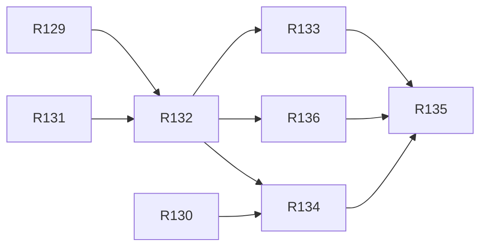

# v2.6 — TASKS.md sections

Cut from `TASKS.md` by `scripts/sdd/split.ts` (FR-SDD-3); ids resolve through `docs/sdd/ids.md`.

## v2.6 tasks

Draft, cut 2026-10-27 from `SPEC.md` v2.6 and `PLAN.md` v0.14, for review. Spec Phase 2n, "the phone and desk flow": the 390 px and 1280 px audits (F1–F14, D1–D10) fixed by placement, not by new features — the home's three doors (Satellites, Stars, Both), Where in two lines, one header told its page, one order and one readout for every sky view, the hint under the drawing, the pass detail led by its countdown, the dome's box cut from the bowl, three gaps and 44 px targets, the legend's named times, the window first on a phone and the turned phone (FR-FLOW-1..15, V26-1..V26-12). The phase ends in the release preparation: `2.6.0` on `main`, the tag and the deploy the owner's.

Delivery is PLAN §16 with §16.24 (D-854): eight tasks in four waves of three, one, three and one. `Model:` is `fable` for R132 and R133 and `opus` for the rest; every task has `Review: opus`, `Turns: 500`, `Fallback: off` and `Gate: auto`. No owner gate; the owner merges the plan, starts `--wave` after each wave merges, and reads the release at R135.

Lanes: §16.24 names a `home` lane for R130 and a `sky` lane for R132 and R136, which the driver does not have (its lanes are §16.1's). On the owner's call (2026-10-27) R130 runs as `data` (it owns `lib/skyStars.ts`, and wave 1 stays three at once) and R132 and R136 as `live` (`screens/Live.tsx` is theirs); each lists the rest under **Touches outside the lane**. Two re-cuts keep a wave out of one file: in wave 1, R129 owns `tests/styles/controlRows.test.ts` (the header rows) and R130 fits the door lines in a new `tests/styles/doorRows.test.ts` on the same `cells.ts`; R132 sets `data-rhythm` on `SkyViewLayout`'s slots, since `components/sky/**` is R136's in wave 3, and R134 marks the home and settings and measures. `lib/layout.ts` gets one constant from R133 and one from R136 on separate lines in wave 3 (§16.24's one stated exception); whichever merges second rebases.

Decision block (§16.2), reserved in PLAN §16.24: **R129 D-855..D-857, R130 D-858..D-860, R131 D-861..D-863, R132 D-864..D-866, R133 D-867..D-869, R134 D-870..D-872, R135 D-873..D-875, R136 D-878..D-880**. D-842..D-854, D-876 and D-877 are the plan's.

What every session reads (§16.24, D-284's rule), written once here and named in each task as "the phase set": SPEC §4.48 whole (FR-FLOW-1..15, F1–F14, D1–D10), §9 Phase 2n, §12 V26-1..V26-12; PLAN §2.41, §9.8, §16.24; and the design canvas https://claude.ai/artifact/T9sDydFaRQNAMy5zVcSi7q, pages Phone and Desktop, the boards for the task's screens, matched to 1–2 px (copy, sizes, gaps).

### Wave 1

- [x] **R129 — One header: `Header.tsx`'s `page` and `context`, the compact top row on the four sub-pages, the wide nav with `aria-current`, `[ settings ]`, and the language and theme switches removed from the header and the pass detail**
  - **Lane:** ui
  - **Model:** opus
  - **Review:** opus
  - **Turns:** 500
  - **Fallback:** off
  - **Gate:** auto
  - **Depends on:** none
  - **Reads:** the phase set (above), boards “Proposed · Live, window”, “Proposed · Stars”, “Proposed · Pass detail” (Phone) and the four “Proposed · …, wide” boards (Desktop) — their header rows; `components/common/{Header.tsx,Header.module.css,Header.test.tsx,LanguageToggle.tsx,ThemeToggle.tsx}`; `ui/App.tsx`, `ui/Shell.tsx`, `screens/SettingsRoute.tsx`; `screens/Live.tsx`'s top row and `screens/PassDetail.tsx`'s toggles block (about lines 280–295 of each); `screens/Stars.tsx`; `src/i18n/{en,es}/ui.ts`; `tests/styles/controlRows.test.ts`, `tests/styles/cells.ts`; `ui/App.structure.test.tsx`.
  - **Goal:** every page has one header that says where the reader is: the home's row, and on every other page `[ ← ]`, the page's name and the place; on wide one row with the page links and the current one marked.
  - **Satisfies:** FR-FLOW-3; F7, D3, D4.
  - **Scope (PLAN D-845):**
    - `Header.tsx` takes `page: 'home' | 'live' | 'stars' | 'pass' | 'settings'` and an optional `context`. Compact: the home keeps today's row; a sub-page gets `[ ← ]` (FR-COMP-7's control and accessible name), the page's name in the accent and the context in `--fg-dim`, cut by `text-overflow: ellipsis` to 36 cells. Wide: one row on every page — `[ ← ]` on a sub-page, the mark and title, a `<nav aria-label>` of `home`, `live`, `stars` with `aria-current="page"` on the current one (`--fg`, a 2 px accent rule under it), the context on a sub-page, `[ settings ]` last. The tagline renders on the home only, under the row.
    - `LanguageToggle` and `ThemeToggle` leave `Header.tsx`, `PassDetail.tsx` (that one block) and `Live.tsx`'s own top row, which the header replaces; they stay only on `Settings.tsx`.
    - The call sites tell the header its page and context: `App.tsx`, `Shell.tsx`, `SettingsRoute.tsx`.
    - The stars page's visible `h1`, "Stars tonight" / "Estrellas esta noche", with the dark window and the cloud word under it at `--small` (one block in `Stars.tsx`; R132 moves it into the `answer` slot).
    - `src/i18n/{en,es}/ui.ts`: the page names (`live`, `stars`, `pass`, `settings`, `home` and their Spanish), the nav's label, the `h1`.
    - `Header.test.tsx` for the five pages in both languages at both widths; `controlRows.test.ts` gains the four sub-page rows at 360 and 390 px in both languages; `App.structure.test.tsx` gains the stars page's `h1`.
  - **Touches outside the lane:** `screens/Live.tsx` (the top row only, `live` lane).
  - **Out of scope:** the sky views' order and `SkyViewLayout` (R132); the header links' 44 px targets (R134); the home's body (R130).
  - **Done when:**
    - `npx vitest run src/ui/components/common src/ui/App.structure.test.tsx tests/styles` passes.
    - The Done note gives the header's cells at 360 px in Spanish on each of the four sub-pages.
    - `npm test`, lint, typecheck, `npx vitest run tests/docs` and `npm run e2e` green.
  - **Done:** at 360 px (33 cells on the widest font) in Spanish the compact header is: live `[ ← ]` + the mark + `en vivo` = 17 cells, with `−38.93, −67.99` 32; stars `[ ← ] estrellas` 15, with the pair 30; pass `[ ← ] pase` 10, with the date 21; settings `[ ← ] ajustes` 13, with the pair 28 (`controlRows.test.ts` pins each). On the live page the state indicator stands in the name's place (D-855); the settings page's own back row went to the header (D-856); the wide title no longer folds (D-857).

- [x] **R130 — The home's doors and the folded Where: `HomeDoors`, `doorLines`, `brightestDrawn`, the Satellites door's target, `WherePlace`'s `folded`, `StarsLine` and `WhereDome` removed, the doors at both widths**
  - **Lane:** data
  - **Model:** opus
  - **Review:** opus
  - **Turns:** 500
  - **Fallback:** off
  - **Gate:** auto
  - **Depends on:** none
  - **Reads:** the phase set (above), boards “Proposed · Home” (Phone), “Proposed · Home, wide” (Desktop); `screens/Home.tsx`, `screens/home/**` (`StarsLine.tsx` and the next-event block), `screens/starsChunk.ts`, `screens/whenIdle.ts`; `components/location/{WherePlace,WhereDome,ReadinessLine,FailureLine}*`; `lib/skyStars.ts` (`drawnRungs`, `planetsDrawn`), `lib/landmarkLine.ts`; `src/i18n/{en,es}.ts`; `tests/styles/cells.ts`; `tests/e2e/{home,home-desk}.spec.ts`.
  - **Goal:** a reader on the home picks satellites, stars or both from three boxes near the top, each already answering what it opens to; the Where reading is two lines until asked.
  - **Satisfies:** FR-FLOW-1, FR-FLOW-2; F1, F2, D1, D2.
  - **Scope (PLAN D-843, D-844):**
    - `screens/home/doorLines.ts` (pure) builds each door's lines from the next event, the dark window and cloud word, the passes up now and the highlighted pass's landmark; `HomeDoors.tsx` draws the three doors in their fixed order, each one link over the whole ruled box, full width on compact, one row of three equal boxes on wide with one more line each (FR-FLOW-1's).
    - The Satellites door's `href` is `#pass/<id>` of the next event's pass, or opens the What reading in place with no pass in 72 h; the Stars door opens `#stars`; the Both door `#live` with the saved `starsLayer`.
    - `lib/skyStars.ts`: `brightestDrawn(scene)` (lowest magnitude of the stars and planets drawn above 0° at now, with its 16-point direction), called once `starsChunk.ts`'s idle prefetch resolves; the line holds `min-height: 1lh` until then.
    - `StarsLine.tsx` and the next-event block leave the home at both widths; `WhereDome.tsx` and its lazy load are deleted.
    - `WherePlace.tsx`'s `folded` (compact): the place with `[ change ]`, one status line ending in a `<button aria-expanded>` `[ details ]` that opens the rest in FR-FIRST-11's order; the first fault of the not-ready state, the elements warning or the failure takes the line and never folds.
    - `src/i18n/{en,es}/home.ts` (new) and its registration in `src/i18n/{en,es}.ts`.
    - Tests: `doorLines.test.ts` (an up-now pass, a later pass, no pass, daylight, the stars line pending), `HomeDoors.test.tsx`, `WherePlace.test.tsx` (folded, opened, each fault), `tests/styles/doorRows.test.ts` (every door line in 34 cells at 360 and 390 px, both languages); `home.spec.ts` (390 × 844: the doors' bottom edge ≤ 600 px, each door's target) and `home-desk.spec.ts` (1280 × 800: the doors in one row above the panes, no dome in the Where pane).
  - **Touches outside the lane:** `screens/Home.tsx`, `screens/home/**`, `components/location/{WherePlace,WhereDome}*`, `src/i18n/{en,es}/home.ts`, `src/i18n/{en,es}.ts`, `tests/styles/doorRows.test.ts`, `tests/e2e/home*.spec.ts` (all `ui`).
  - **Out of scope:** the header (R129); `controlRows.test.ts` (R129's in this wave); the doors' `.target` and the home's `data-rhythm` (R134).
  - **Done when:**
    - `npx vitest run src/ui/screens src/ui/components/location src/lib tests/styles` passes; `home.spec.ts` and `home-desk.spec.ts` pass.
    - The Done note gives the doors' bottom edge at 390 × 844 in both languages, and the `main` and `stars` rows of `npm run bundle:budget` against 2.5.0 (`main` within D-853's 174.5, `stars` ≤ 0.5 KB more).
    - `npm test`, lint, typecheck, `npx vitest run tests/docs` and `npm run e2e` green.
  - **Done note:** the doors' bottom edge at 390 × 844 is 450 px in English and 470 px in Spanish (the stored-run fixture, whose not-ready line takes two rows); `npm run bundle:budget` against 2.5.0: `main` 173.0 → 174.5 KB (at D-853's 174.5, the whole of `FLOW_MAIN_KB`), `stars` 25.8 → 25.9 KB. The Satellites door opens `#pass=<id>`, the cards' hash, where the entry says `#pass/<id>`; the folded Where puts a failure first (D-858).

- [x] **R131 — The words: "Facing" in the three readouts, the legend's rise · peak · set** — done: `chart.legend.times` replaced by `rise/peak/end` (D-861; "end", not "set", V26-13); the sky screen's strip keeps bare figures; `starsPage.readout` takes the azimuth (D-862); the named times fit their rows, the zone once and no inventory header (D-863).
  - **Lane:** chart
  - **Model:** opus
  - **Review:** opus
  - **Turns:** 500
  - **Fallback:** off
  - **Gate:** auto
  - **Depends on:** none
  - **Reads:** the phase set (above), boards “Proposed · Live, window”, “Proposed · Stars” (Phone), “Proposed · Live, wide” (Desktop) — the readout and the legend; `skychart/Legend.tsx` and `Legend.test.tsx`; `src/i18n/{en,es}/{chart,window,starsPage}.ts`; `src/i18n/messages.test.ts` and its snapshot; the readout tests of the window, the stars page and the dome (`rg -l "Looking\|readout" src --glob '*.test.tsx'`).
  - **Goal:** every view says where it faces with the same word, and a legend row names its three times.
  - **Satisfies:** FR-FLOW-5, FR-FLOW-13; F12, D9, D10.
  - **Scope (PLAN D-847, D-852):**
    - `chart.readout` keeps "Facing … · tilt …" and reads "Hacia el …" in Spanish; `window.readout` and `starsPage.readout` become "Facing <point> (<az>) · up <alt>" / "Hacia el <point> (<az>) · <alt> de altura" (the stars page keeps "· <n>° across").
    - `chart.legend.rise/peak/end` ("rise", "peak", "end" / "sale", "máximo", "termina"; V26-13); `Legend.tsx`'s pass row writes "rise 07:23:47 · peak 07:23:55 · end 07:27:03" on its second line under the name and state, at both widths.
    - `messages.test.ts`'s snapshot re-baselined once; the readout tests and `Legend.test.tsx` in both languages.
  - **Touches outside the lane:** `src/i18n/{en,es}/{chart,window,starsPage}.ts`, `src/i18n/messages.test.ts` (`ui`); the window's readout test (`window`).
  - **Out of scope:** where the readout sits (R132); any layout.
  - **Done when:**
    - `npx vitest run src/i18n src/ui/components/guide/skychart` passes.
    - The Done note lists the re-baselined strings by key, English and Spanish.
    - `npm test`, lint, typecheck, `npx vitest run tests/docs` and `npm run e2e` green.

### Wave 2

- [x] **R132 — One order for every sky view: `SkyViewLayout`, the three pages filled by slot, the one-line view row, `SkyHint` and `skyHintSeen`, the stars page's action first, the pass detail's head and `TimesRow`, at both widths** — done: the chart's parts reach the layout's slots by portal and `ChartFrame.tsx` is unchanged (D-864); the bounding-box order `sky-layout.spec.ts` measures at 390 × 844 is answer · viewRow · readout · drawing · picker · hint · action · list on the live page (every view; no hint and no hint slot on the polar chart, which has no drag, D-864), answer · readout · drawing · picker · hint · [action] · layers · list on the stars page and answer · viewRow · readout · drawing · [picker] · hint · list · foot on the pass detail, and at 1280 × 800 the box with the readout on its corner and the hint under it beside a rail of answer · View · Facing · [Layers] · list · foot (the pass detail: the head band, the one control line, the drawing at the panel's width, the prose and the table); the canvas boards are a claude.ai artifact a headless session cannot open, so nothing was matched to them (the summary says so); the Spanish layer row and the 360 px view row are cut to FR-COMP-4 and the stars box is four to three until R133 (D-865); FR-FLOW-7's share is of the panel's body (D-866); on the landscape phone the live page's rail scrolls inside the layout and the box keeps the layout's height, and the panel's drawing keeps seven rows on a short window (D-881). Outside the brief's chart Touches, the portals and the hint's gesture also edit `skychart/dome/SkyDome.tsx`, `skychart/polar/SkyPolar.tsx` (the readout and picker slots), `skychart/SkyChart.tsx` and `SkyChart.types.ts` (the control and legend slots, the figure's name, `HandSlot.gesture`), `skychart/window/SkyWindow.module.css` (R121's corner hint removed), `common/Countdown.tsx` (`steps`) and `guide/GuideText.tsx`, so R133 starts from those files as changed here.
  - **Lane:** live
  - **Model:** fable
  - **Review:** opus
  - **Turns:** 500
  - **Fallback:** off
  - **Gate:** auto
  - **Depends on:** R129, R131
  - **Reads:** the phase set (above), boards “Proposed · Live, window”, “Proposed · Stars”, “Proposed · Pass detail” (Phone), “Proposed · Live, wide”, “Proposed · Stars, wide”, “Proposed · Pass detail, wide” (Desktop); `screens/{Live.tsx,Stars.tsx,PassDetail.tsx}` and their `.module.css`, `screens/stars/**`; `components/guide/GuidePanel.tsx`; `components/primitives/ToggleGroup.tsx`, `components/live/StarsToggle.tsx`; `skychart/window/SkyWindow.tsx` (`handHint`), `skychart/useChartHand.ts`, `skychart/ChartFrame.tsx` (read only); `model/prefs.ts`, `state/slices/prefs.ts`, `data/localPrefs.ts`; `lib/layout.ts`; `src/i18n/{en,es}/{window,ui}.ts`; `tests/styles/controlRows.test.ts`; `tests/e2e/sky-window.spec.ts`.
  - **Goal:** the live page, the stars page and the pass detail lay out the same parts in the same order at both widths — answer, view row, readout, drawing, picker, hint, action, layers, list — and the pass detail opens on its countdown with the chart on the first screen.
  - **Satisfies:** FR-FLOW-4, FR-FLOW-6, FR-FLOW-7, FR-FLOW-8; F3, F5, F6, F8, F9, F10, F11, F14, D6, D7, D8.
  - **Scope (PLAN D-842, D-846, D-848, D-849):**
    - `components/sky/SkyViewLayout.tsx` (+ `.module.css`, `.test.tsx`): the slots `answer`, `viewRow`, `readout`, `drawing`, `picker`, `hint`, `action`, `layers`, `list`, `foot`, in FR-FLOW-4's order — one column on compact; the box (readout and zoom on its corners, hint under it) and the rail on wide, `foot` pinned to the rail's bottom. An empty slot renders nothing. The layout owns the gaps (`--space-1` / `--space-3` / `--space-5`) and sets `data-rhythm="row" | "group" | "section"` on its slots (D-851, so R134 need not open `components/sky/**`). `usePageShape` stays the one source of compact or wide.
    - `Live.tsx`, `Stars.tsx` and `PassDetail.tsx` pass slots and stop laying out their sky parts; the stars page's `h1` from R129 goes into `answer`.
    - The view row: the view control through `ToggleGroup`'s bracket form (`Polar Dome [Window]`) with `StarsToggle` at the row's right end, one line; the rail labels `View` and `Facing` (`Vista`, `Hacia`) on wide; `controlRows.test.ts` gains the row at 360 and 390 px (≤ 35 cells in Spanish).
    - `components/sky/SkyHint.tsx`: `SkyWindow.tsx`'s `handHint` leaves the SVG overlay for the `hint` slot, worded by `matchMedia('(pointer: coarse)')`, the live page's `followKey` clause, drag-only on the dome and the polar chart; `skyHintSeen` in `model/prefs.ts`, `state/slices/prefs.ts`, `data/localPrefs.ts` (default false, schema test); `useChartHand.ts`'s `onFirstGesture` sets it.
    - The stars page: `[ hold up to the sky ]` full width, ≥ 48 px, right after the hint; the layer toggles one group of two rows `--space-1` apart; then `In this field`.
    - The pass detail: `answer` is the name (`h1`), the `Countdown` at the headline size, the landmark line and `components/guide/TimesRow.tsx` (three cells, the peak with altitude and direction); the prose and the table of points in `list`. On wide the guide panel's head is one band (name, countdown, landmark left; times right; close last), then the one control line, then the drawing at the panel's full width. `lib/layout.ts` gains `DETAIL_DRAWING_TOP_PX = 480` and `DETAIL_DRAWING_MIN_SHARE = 0.6` with their rationale.
    - `tests/e2e/sky-layout.spec.ts` (new): FR-FLOW-4's order by bounding boxes at 390 × 844 and 1280 × 800 on the live page (each view), the stars page and the pass detail in both languages; the view row one line; no hint text inside the drawing's box; FR-FLOW-7's drawing top ≤ 480 px at 390 × 844 and share ≥ 0.6 at 1280 × 800; FR-FLOW-8's `In this field` heading and first row inside 390 × 844 with `[ passes ]` off and on.
  - **Touches outside the lane:** `components/sky/**`, `screens/{Stars.tsx,PassDetail.tsx}` and their CSS, `screens/stars/**`, `components/guide/{TimesRow.tsx,GuidePanel.*}`, `components/primitives/ToggleGroup.tsx`, `skychart/window/SkyWindow.tsx`'s hint, `skychart/useChartHand.ts`, `model/prefs.ts`, `state/slices/prefs.ts`, `data/localPrefs.ts`, `lib/layout.ts`, `src/i18n/{en,es}/{window,ui}.ts`, `tests/styles/controlRows.test.ts`, `tests/e2e/sky-layout.spec.ts`.
  - **Out of scope:** the box's size (R133); the default view and the landscape arrangement (R136); `.target` and `rhythm.spec.ts` (R134).
  - **Done when:**
    - `SkyViewLayout.test.tsx`, `SkyHint.test.tsx`, the prefs schema test, `controlRows.test.ts` and `sky-layout.spec.ts` pass.
    - The Done note gives the bounding-box order on the three pages at both widths and names the canvas boards matched to 1–2 px.
    - `npm test`, lint, typecheck, `npx vitest run tests/docs` and `npm run e2e` green.

### Wave 3

- [x] **R133 — The boxes: the compact dome cut from the bowl, the wide box to the hint line, the pass panel's share** — done: at 390 × 844 at the opening tilt the dome's box is 390 × 337 on the live page and the pass detail (the bowl's drawn height 288.9 px at that width plus `DOME_COMPACT_SLACK_PX` above and below, D-867), with 18.0 px of blank over the bowl's highest drawn cell and 14.5 px under its lowest, read from the raster inside the box (the readout stands a row gap over the box and the hint two under it); the live page is one screen at 844. At 1280 × 800 the box is the room (`fitBox` without an aspect, D-868): 644 × 728 for the dome, 644 × 734 for the polar chart (no hint row) and 644 × 704 for the window on the live page, 644 × 653 on the stars page, with 10, 0, 10 and 6 px under the drawing against `--space-3`'s 24; the pass panel's drawing is 787 × 174 of a 797 × 254 body, 0.677 of the body (R132's reading, D-866) and 0.379 of the whole 818 × 442 panel. `windowBox` is gone. Three touches on `components/sky/**` against the out-of-scope line, each one rule the task could not be done without (D-867, D-868, D-869): the column's bowl slot follows the chart (`height: auto; min-height: auto`), the wide `fill` layout is a size container whose slot is the layout's height less the hint, and the wide rail measures its hint (two lines in Spanish at 1280). The dome's scene key is unchanged. `sky-box.spec.ts` is the check; `r133-captures.spec.ts` the review captures.
  - **Lane:** chart
  - **Model:** fable
  - **Review:** opus
  - **Turns:** 500
  - **Fallback:** off
  - **Gate:** auto
  - **Depends on:** R132
  - **Reads:** the phase set (above), boards “Proposed · Live, window” (Phone), “Proposed · Live, wide”, “Proposed · Stars, wide”, “Proposed · Pass detail, wide” (Desktop); `skychart/ChartFrame.tsx` and its tests, `lib/fitBox.ts` and its test, `lib/layout.ts`; `components/sky/SkyViewLayout.tsx` (read only); `tests/e2e/sky-dome.spec.ts`, `sky-layout.spec.ts` (read only).
  - **Goal:** the drawing fills its box: on a phone the dome's box hugs the bowl, on a desk the box runs down to the hint line, and the pass panel's drawing takes most of the panel.
  - **Satisfies:** FR-FLOW-9; FR-FLOW-7's wide share; F4, D5.
  - **Scope (PLAN D-850):**
    - Compact: `ChartFrame.tsx` cuts the dome's box from the bowl's drawn silhouette with `fitBox.ts`'s rule (F-61's divisor 2.0), the bowl's height plus `DOME_COMPACT_SLACK_PX` (24) above and below, never under FR-LIVE-7's floors (280 px while watching).
    - Wide: the box's height is the viewport less the header and the hint line, for every view, on the live page and the stars page; the pass panel's drawing at least `DETAIL_DRAWING_MIN_SHARE` of the panel at 1280 × 800.
    - `lib/layout.ts` gains `DOME_COMPACT_SLACK_PX = 24` on its own line, with its rationale. The dome's scene key is unchanged (a size change remounts only through the existing measured key).
    - `tests/e2e/sky-box.spec.ts` (new): at 390 × 844 at the opening tilt, the blank between the view row and the bowl's highest drawn cell and between its lowest drawn cell and the readout each ≤ 24 px, read from the scene's measured box; at 1280 × 800 no band under the drawing taller than `--space-3` on the live page and the stars page.
  - **Touches outside the lane:** `lib/{fitBox,layout}.ts`, `tests/e2e/sky-box.spec.ts`.
  - **Out of scope:** `components/sky/**` and `sky-layout.spec.ts` (R136's in this wave); any stylesheet but `ChartFrame.module.css`.
  - **Done when:**
    - `npx vitest run src/ui/components/guide/skychart src/lib` and `sky-box.spec.ts` pass.
    - The Done note gives the blank above and below the bowl at 390 × 844 and the pass panel's share at 1280 × 800.
    - `npm test`, lint, typecheck, `npx vitest run tests/docs` and `npm run e2e` green.

- [x] **R136 — The phone's window first and the turned phone: `defaultChartView`, `openingFacing`, `chartView` saved on compact, `SkyViewLayout`'s landscape arrangement for the three sky pages, the turn test** — done: `defaultChartView` gives, with no pref, the window on compact and the dome on wide, and a saved `polar`, `dome` or `window` in either mode (`chartViewDefault.test.ts`); `openingFacing` follows the highlighted pass, else faces the next rise at `clamp(alt − 15°, 20°, 75°)`, else today's default (`camera.test.ts`), and `createHandCamera` keeps the opening `follow`; the landscape layout leaves the page's column, is one viewport high on the three pages and stands the drawing slot at 464 of 844 px (0.55) at 844 × 390 and 367 of 667 px (0.55) at 667 × 375, with no page scroll (D-878); the turned rail keeps the wide order and lets the view row wrap (D-879); the turn test is `sky-layout.spec.ts` › "FR-FLOW-15: the turn" › "turning 390 × 844 → 844 × 390 → 390 × 844 keeps the camera and the shown instant and opens no screen" (D-880), beside "FR-FLOW-15 on the turned phone, {844 × 390, 667 × 375}, {en, es}" (the live page, the stars page, the pass detail) and "FR-FLOW-14: the view a fresh profile opens on". Outside the Touches, the default and the saved window also edit `model/prefs.ts` (`compactChartView` removed), `state/slices/prefs.ts`, `App.tsx` (the `v` key), `SkyChart.tsx`, `SkyChart.types.ts`, `useChartHand.ts` and `SkyWindow.tsx`; the stars page's and the sheet's top row stay in their column (a follow-up for the pages' stylesheets).
  - **Lane:** live
  - **Model:** opus
  - **Review:** opus
  - **Turns:** 500
  - **Fallback:** off
  - **Gate:** auto
  - **Depends on:** R132
  - **Reads:** the phase set (above), boards “Proposed · Live, phone turned” and “Proposed · Live, window” (Phone); `components/sky/**`; `screens/{Live.tsx,PassDetail.tsx}` (where the view default is read); `skychart/window/camera.ts` and `camera.test.ts` (`followPass`, `facePeak`); `data/localPrefs.ts` and its test; `lib/layout.ts`; `usePageShape`; `tests/e2e/sky-layout.spec.ts`, `sky-screen.spec.ts`.
  - **Goal:** a phone opens the live page and the pass detail on the window, facing the pass, until the reader picks another view; turned sideways, the three sky pages lay out as a small desk with nothing lost.
  - **Satisfies:** FR-FLOW-14, FR-FLOW-15.
  - **Scope (PLAN D-876, D-877):**
    - `data/localPrefs.ts`'s `chartView` reader returns `undefined` when nothing is saved; the D-789 wide-only guard is removed, so `chartView: 'window'` is saved on compact as on wide.
    - `screens/chartViewDefault.ts`: the pure `defaultChartView(mode, saved)` — the saved view, else `'window'` on compact, `'dome'` on wide; `Live.tsx` and `PassDetail.tsx` read the view through it.
    - `camera.ts`'s `openingFacing(scene, highlighted, nextPass)`: the follow state (D-797's `followPass`), else the next rise at `clamp(alt − 15°, 20°, 75°)`, else today's default; the pass detail still faces the peak.
    - `SkyViewLayout`'s landscape arrangement, keyed by `usePageShape`: the box left at full height and ≥ `LANDSCAPE_DRAWING_MIN_SHARE` of the width, the rail right with `overflow-y: auto`, compact type size; no orientation listener opens the screen. `lib/layout.ts` gains `LANDSCAPE_DRAWING_MIN_SHARE = 0.55` on its own line.
    - Tests: `chartViewDefault.test.ts` (no pref, each saved view, both modes), `camera.test.ts` (the three facing cases), `localPrefs.test.ts`; `sky-layout.spec.ts` gains the window at 390 × 844 for a fresh profile and the dome at 1280 × 800, the drawing's share, the rail's order and no page scroll at 844 × 390 and 667 × 375 on the three pages, and the turn 390 × 844 → 844 × 390 → 390 × 844 with the camera state and `t` unchanged and no screen opened.
  - **Touches outside the lane:** `components/sky/**`, `screens/{chartViewDefault.ts,PassDetail.tsx}`, `skychart/window/camera.ts`, `data/localPrefs.ts`, `lib/layout.ts`, `tests/e2e/sky-layout.spec.ts`.
  - **Out of scope:** `ChartFrame` and `fitBox` (R133's in this wave); stylesheets outside `components/sky/**` (R134's).
  - **Done when:**
    - `chartViewDefault.test.ts`, `camera.test.ts`, `localPrefs.test.ts` and `sky-layout.spec.ts` pass.
    - The Done note gives the default for each pref case, the drawing's share at 844 × 390 and 667 × 375, and the turn test's names.
    - `npm test`, lint, typecheck, `npx vitest run tests/docs` and `npm run e2e` green.

- [x] **R134 — The rhythm and the targets: `data-rhythm`, `.target`, `.target-row`, the two specs, and every gap or target they find on the five pages**
  - **Note:** done; the settings blocks are groups (D-870), the facing picker is `ToggleGroup`'s `dense` (`FacingPicker` passes it, D-871), targets are measured at rest (D-872), and the dome view's empty picker slot (12 px drawing → hint) is a named exception in `rhythm.spec.ts` for the layout to close.
  - **Lane:** ui
  - **Model:** opus
  - **Review:** opus
  - **Turns:** 500
  - **Fallback:** off
  - **Gate:** auto
  - **Depends on:** R130, R132
  - **Reads:** the phase set (above), boards “Spacing rule” and the four “Proposed · …” boards (Phone); `ui/styles/primitives.css`, the tokens sheet (§4.45's `--space-*`); `components/primitives/**` (`ToggleGroup`, `OptionToggle`); `components/common/Header.tsx`, `screens/home/HomeDoors.tsx`, `screens/Home.tsx`, `screens/Settings.tsx`; the pages' `.module.css`; `components/sky/SkyViewLayout.tsx` (read only, its `data-rhythm`).
  - **Goal:** every page keeps three gaps and every control is big enough for a thumb, checked by two specs rather than by eye.
  - **Satisfies:** FR-FLOW-10, FR-FLOW-11; F9, F13.
  - **Scope (PLAN D-851):**
    - `data-rhythm` on the home's readings and doors and the settings page's blocks (the sky views' come from `SkyViewLayout`, R132).
    - `.target` in `ui/styles/primitives.css` (44 × 44 min, padding to fill) applied by `ToggleGroup`, `OptionToggle`, the header's links and the doors; `.target-row` for the facing picker (44 px tall, `flex: 1`, hit areas meeting). No row's cell count changes.
    - `tests/e2e/rhythm.spec.ts`: at 390 × 844 in both languages, the gaps between marked siblings on the home, the live page, the stars page, the pass detail and the settings page equal `--space-1`, `--space-3` or `--space-5` (± 1 px), and row ≤ group ≤ section.
    - `tests/e2e/targets.spec.ts`: `a, button, [role=radio], input` on the five pages and the sky screen at 390 × 844 meet 44 × 44 or the row rule, skipping links inside `p`.
    - Every gap or target the specs find, fixed in the pages' stylesheets and the primitives.
  - **Touches outside the lane:** none (`Header.tsx` and `HomeDoors.tsx` take the class only).
  - **Out of scope:** `ChartFrame.module.css` (R133's) and `components/sky/**` including `SkyViewLayout.module.css` (R136's); a gap inside a sky view that needs the layout changed is reported in the Done note for R135 rather than fixed here.
  - **Done when:**
    - `rhythm.spec.ts` and `targets.spec.ts` pass; `tests/styles/controlRows.test.ts` and `doorRows.test.ts` still pass.
    - The Done note lists every gap or target the specs found and its fix.
    - `npm test`, lint, typecheck, `npx vitest run tests/docs` and `npm run e2e` green.

### Wave 4

- [x] **R135 — The capture set and the release preparation: FR-FLOW-12's files, the diff against 2.5.0, `2.6.0`, `docs/RELEASE.md` §18, the README's screens, no tag**
  - **Note:** done: 386 files; of 2.5.0's 330, 8 retired (`live-window` at 360 and 390, the same picture as `live-watching` since FR-FLOW-14), 20 byte-identical and 302 moved on FR-FLOW-12's lists (RELEASE §18.1) and the settings page by its header (D-856) and R134's gaps (D-870), as FR-FLOW-12 now says (V26-14); two runs agree on 372 of 386 (13 F-99's, and `v1-polar-360-dark-en`'s stars once, a finding in RELEASE §18.4); the `captures.yml` run ids are the owner's to record (dispatch with `base` `89a8e5b`, RELEASE §18.1). Budget per §18.2 and the owner's call of 2026-10-28 (V26-14, D-875): the branch measured `main` 181.0, over the 175 ceiling, and R135 stopped; the owner had the import fixed and `main`'s ceiling and budget raised to 180. On plain builds against `89a8e5b`: `main` 177.5 (+4,667 bytes) under 180, `chart` 97.1 (+2,445) under 110, `stars` 26.7 (+834), `astronomy` 24.1 (+1,510) under 30, `window` 26.6 (+913), `settings` 1.1 (+112), `worker`, `live` and `service worker` unmoved; `chart` and `astronomy` re-set by D-178's rule. One change under `src/`, outside the task's scope and approved by the owner with the budget call: `skychart/dome/bowl.ts` takes `bowlHeightPx`, `compactBowlBoxPx` and their constants out of `dome/camera.ts`, which `ChartFrame` (in `main`) had pulled into `main` since R133; `ChartFrame` and `Live.tsx` import from it; `camera.ts` and `domeGeometry.ts` re-export them, no behaviour or capture changes (D-882). The release SHA to tag is read from `main` after the merge (RELEASE §18.5).
  - **Lane:** docs
  - **Model:** opus
  - **Review:** opus
  - **Turns:** 500
  - **Fallback:** off
  - **Gate:** auto
  - **Depends on:** R133, R134, R136
  - **Reads:** the phase set (above), every board on both pages; `docs/RELEASE.md` §17; `tests/e2e/captureSet.ts`, `v1-captures.spec.ts`, `.github/workflows/captures.yml`; `scripts/bundle-budget.ts`; `tests/docs/accuracy.test.ts`; PLAN D-178, D-853.
  - **Goal:** the phase's definition of done is written down and checked: the set shows the new flow, only the named moves moved, the budgets are re-set, and `main` reads 2.6.0 ready for the owner's tag.
  - **Satisfies:** FR-FLOW-12; §9 Phase 2n's release item.
  - **Scope (PLAN D-853):**
    - `captureSet.ts` and `v1-captures.spec.ts`: the home's doors at 360, 390, 1280 and 1920 px (a later pass, up now, no pass, daylight), the folded and opened Where, and the live page, the stars page and the pass detail at 844 × 390, both themes and languages; the phone's live captures show the window.
    - `captures.yml` against the `2.5.0` build (`89a8e5b`): every changed file is one of FR-FLOW-12's named moves (the home, every header, the sky views' order, view row, hint and box at every width, the pass detail's head and panel, the stars page's order, the legend's times, the readout's word); the settings page, the sky screen and the first-visit steps byte-identical.
    - `npm run bundle:budget`: `main` within `FLOW_MAIN_KB` over 2.5.0 and ≤ 175, `stars` ≤ 0.5 KB more, no other row moved; every row re-set by D-178.
    - `docs/RELEASE.md` §18: the diff list, the runs, the budget table, the owner's items (the captures read in both themes; on a phone, the Satellites door to a watched pass and the Stars door to the sky screen; at a desk, the three doors; the tag on this PR's squash SHA pushed to `release`).
    - `package.json` and the lock `2.6.0`; `README.md`'s screens.
  - **Touches outside the lane:** `tests/e2e/captureSet.ts`, `tests/e2e/v1-captures.spec.ts`, `docs/screenshots/v1-*`, `package.json`, `scripts/bundle-budget.ts`.
  - **Out of scope:** any change under `src/`; the tag and the deploy (the owner's).
  - **Done when:**
    - `npx vitest run tests/docs` passes; `npm test`, lint, typecheck and `npm run e2e` green.
    - The Done note lists the changed capture files against FR-FLOW-12's named moves, with the `captures.yml` run ids, the budget table and the release SHA to tag (read from `main` after the merge).

### Requirement coverage (v2.6)

| Requirement | Task |
|---|---|
| FR-FLOW-1, FR-FLOW-2 | R130 |
| FR-FLOW-3 | R129 |
| FR-FLOW-4, FR-FLOW-6, FR-FLOW-8 | R132 |
| FR-FLOW-5, FR-FLOW-13 | R131 |
| FR-FLOW-7 | R132 (the head, the compact top edge), R133 (the wide panel's share) |
| FR-FLOW-9 | R133 |
| FR-FLOW-10, FR-FLOW-11 | R134 (R132 marks the sky views' slots) |
| FR-FLOW-12 | R135 (each task's budget rows in its Done note) |
| FR-FLOW-14, FR-FLOW-15 | R136 |

Waves (for the sanity check): **wave 1** R129 (ui) + R130 (data) + R131 (chart) — **wave 2** R132 (live) — **wave 3** R133 (chart) + R136 (live) + R134 (ui) — **wave 4** R135 (docs). No two tasks of a wave name the same file, but for `lib/layout.ts` in wave 3 (one constant each, §16.24). The critical path is R129 → R132 → R133 → R135.
